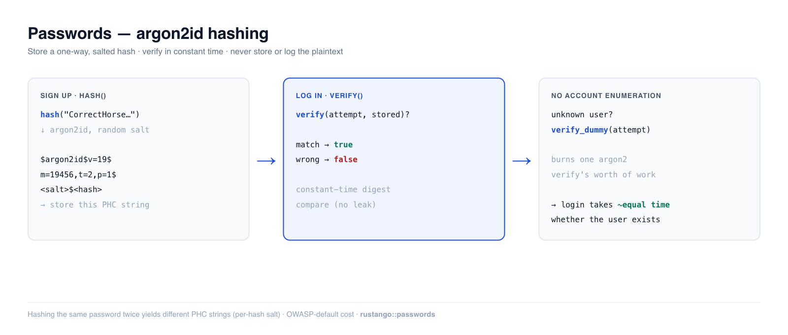

# Passwords

Storing a password means storing something an attacker can't reverse even with
your whole database in hand. **Rustango** gives you that in two calls — `hash`
on the way in, `verify` on the way out — backed by **argon2id**, the
memory-hard winner of the Password Hashing Competition and the current OWASP
first choice. You never store, log, or compare the plaintext.

[](img/auth-passwords.png)

> **Source:** `rustango::passwords` (`hash`, `verify`, `verify_dummy`, their
> `_async` forms, `Argon2Params`, `needs_rehash`, `strength_score`,
> `StrengthIssue`) — behind the `passwords` feature (on by
> default). For the tenancy-integrated user-password helpers see
> `rustango::tenancy::password`.
>
> **Runnable version:** every snippet below is copied from the tested
> [`auth_demo`](https://github.com/ujeenet/rustango/blob/main/crates/rustango/examples/auth_demo/tests/auth_passwords.rs)
> example — `cargo test -p auth_demo --test auth_passwords`.

> **New to a term here?** *hash*, *salt*, *argon2id*, *PHC string* — see the
> [glossary](glossary.md).

> This is the deep dive for the [Security guide](security.md)'s "Hashing and
> checking passwords" section.

---

## Table of contents
- [Quick start](#quick-start) · [Why argon2id](#why-argon2id)
- [Hashing on signup](#hashing-on-signup) · [Verifying on login](#verifying-on-login)
- [Timing-safe logins](#timing-safe-logins-account-enumeration) · [Strength checks](#strength-checks)
- [Where the hash lives](#where-the-hash-lives) · [Async code](#async-code) · [Cost and rehashing](#cost-and-rehashing)
- [Notes & limits](#notes-and-limits)

---

## Quick start

```rust
use rustango::passwords::{hash, verify};

// Signup — store the returned PHC string, never the plaintext.
let stored: String = hash("CorrectHorseBatteryStaple!42")?;

// Login — check an attempt against the stored hash.
if verify("CorrectHorseBatteryStaple!42", &stored)? {
    // credentials good
}
```

`hash` returns a [PHC string](https://github.com/P-H-C/phc-string-format) — a
self-describing line that carries the algorithm, its cost parameters, the random
salt, and the digest:

```text
$argon2id$v=19$m=19456,t=2,p=1$<base64 salt>$<base64 hash>
```

Because the salt and parameters travel *inside* the string, `verify` needs only
the stored value and the attempt — there's no separate salt column to manage.

---

## Why argon2id

`hash` uses **argon2id** with OWASP-recommended defaults (m=19 MiB, t=2, p=1).
argon2id is *memory-hard*: each guess costs real RAM, which is what blunts the
GPU/ASIC farms that make fast hashes (MD5, SHA-256, even bcrypt at low cost)
brute-forceable. Two properties matter for correctness:

- **Salting is automatic and per-hash.** Hashing the same password twice yields
  two different PHC strings, so identical passwords don't collide in your table
  and precomputed-rainbow-table attacks don't apply.

  ```rust
  let a = hash("same-password-12345")?;
  let b = hash("same-password-12345")?;
  assert_ne!(a, b);                 // different random salt each time
  assert!(verify("same-password-12345", &a)?);
  assert!(verify("same-password-12345", &b)?);
  ```

- **Verification is constant-time** in the digest comparison (argon2's own
  `PasswordVerifier`), so a byte-by-byte timing leak can't reveal how much of a
  guess was right.

---

## Hashing on signup

```rust
use rustango::passwords::{hash, strength_score};

fn create_user(username: &str, plaintext: &str) -> Result<String, String> {
    // Optional: nudge users away from weak choices (see below).
    let issues = strength_score(plaintext);
    if !issues.is_empty() {
        return Err(format!("password too weak: {issues:?}"));
    }
    // Store the PHC string on the user row (e.g. auth_users.password_hash).
    hash(plaintext).map_err(|e| e.to_string())
}
```

---

## Verifying on login

```rust
use rustango::passwords::verify;

// `stored` is the PHC string you saved at signup.
let ok = verify(attempt, &stored)?;
```

`verify` returns:
- `Ok(true)` — the attempt matches.
- `Ok(false)` — it doesn't.
- `Err(PasswordError::Verify)` — `stored` wasn't a valid PHC string (a corrupt
  or truncated column), so treat it as a failed login, not a 500.

---

## Timing-safe logins (account enumeration)

If your login does the expensive `verify` **only** when the username exists, an
unknown username returns noticeably faster than a real one — and that timing
gap lets an attacker enumerate valid accounts. `verify_dummy` closes it: call it
on the user-not-found (and inactive-account) branch so every login spends one
argon2 verify's worth of work regardless.

```rust
use rustango::passwords::{verify, verify_dummy};

let row = users::find_by_username(username).await?;
let authenticated = match row {
    Some(u) if u.is_active => verify(attempt, &u.password_hash)?,
    _ => {
        verify_dummy(attempt); // burn the same work, then fail
        false
    }
};
```

---

## Strength checks

`strength_score` returns a `Vec<StrengthIssue>` — empty means "good enough". It's
an intentionally light heuristic to *encourage* users, not a hard policy gate;
pair it with a breach-list check (HIBP / pwned-passwords) for serious deployments.

```rust
use rustango::passwords::{strength_score, StrengthIssue};

assert!(strength_score("Tr0ub4dor&3-CorrectBattery").is_empty());
assert!(strength_score("password123").contains(&StrengthIssue::KnownWeak));
assert!(strength_score("short").contains(&StrengthIssue::TooShort));
```

| `StrengthIssue` | Triggered when |
|---|---|
| `TooShort` | fewer than 12 characters |
| `NoDigitsOrSymbols` | letters only — no digit or symbol |
| `NoVariety` | only lowercase letters |
| `KnownWeak` | matches the small built-in weak-password list (case-insensitive) |

---

## Where the hash lives

The PHC string is just a `String` column on whatever account model you own. In
the [`auth_demo`](https://github.com/ujeenet/rustango/blob/main/crates/rustango/examples/auth_demo/src/models.rs) example:

```rust
#[derive(Model, Clone, Debug)]
#[rustango(table = "auth_users", display = "username")]
pub struct User {
    #[rustango(primary_key)]
    pub id: Auto<i64>,
    #[rustango(max_length = 150, unique)]
    pub username: String,
    #[rustango(max_length = 254)]
    pub email: String,
    #[rustango(max_length = 255)]      // PHC strings are ~95 chars at these params
    pub password_hash: String,
    pub is_active: bool,
    pub is_superuser: bool,
}
```

Once the user is authenticated, hand off to a [session](auth-sessions.md) (for
browser apps) or issue a [JWT](auth-jwt.md) (for APIs).

---

## Async code

`hash`, `verify` and `verify_dummy` are blocking: one argon2 call holds a
runtime worker for the whole hash. In a handler, call `hash_async`,
`verify_async` and `verify_dummy_async` instead. They run on the blocking
pool, at most one job per CPU at once.

A job waits up to `hash_wait()` for a free slot (default 5 s,
`DEFAULT_HASH_WAIT`), then fails with `PasswordError::Busy`. Answer that with a
503, the same for a known and an unknown user. Set the wait with
`[auth] hash_wait_ms` or `configure_hash_wait(duration)` at boot.

---

## Cost and rehashing

New hashes use `argon2_params()`, by default `Argon2Params::DEFAULT`
(m=19456 KiB, t=2, p=1). Raise it with `[auth] argon2_memory_kib`,
`argon2_iterations` and `argon2_parallelism`, or call
`configure_argon2(Argon2Params::new(m, t, p)?)` at boot; a value set in code
wins over the settings. `Argon2Params::new` refuses a combination argon2 rejects.

Old hashes still verify, because their cost lives in the PHC string.
`needs_rehash(&stored)` is `true` when a hash is weaker than today's cost (or
not argon2id v19). After a successful login:

- `rehash_async(attempt, &stored)` returns a fresh hash when one is due, else `None`.
- `upgrade_stored_hash(&pool, Model::SCHEMA, id, attempt, &stored)` also stores
  it in the row's `password_hash` column, but only if that column still holds
  `stored`, and returns the hash now in force.

---

## Notes and limits

- **Never** store, log, or `==`-compare the plaintext. `hash` → store;
  `verify` → check. That's the whole contract.
- **Cost parameters default to the OWASP floor.** Raising them later is safe —
  old hashes still verify (their params live in the PHC string), and
  [`upgrade_stored_hash`](#cost-and-rehashing) re-hashes on the next successful
  login.
- `strength_score` is a heuristic, not a policy engine — it won't catch
  `Summer2024!`. Layer a breach-list lookup for real strength enforcement.
- For multi-tenant apps with the framework's user store, prefer
  `rustango::tenancy::password` (same argon2id, integrated with the tenant user
  model). This module is the standalone version for apps that own their User table.


---

## See also

- [Sessions](auth-sessions.md)
- [Account flows](auth-flows.md)
- [Auth backends](auth-backends.md)
- [Security guide](security.md)
