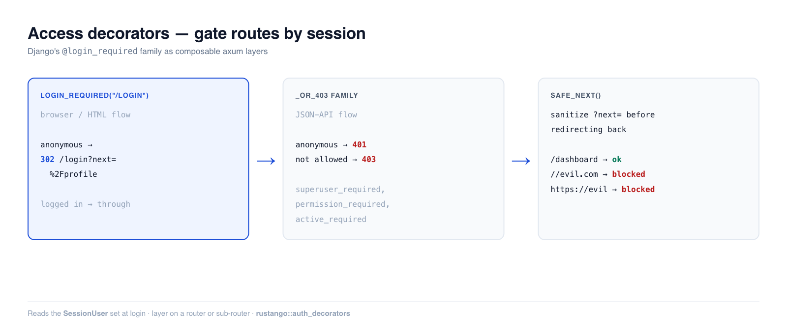

# Zugriffs-Dekoratoren

Sobald ein Benutzer authentifiziert ist, sichern Sie Routen ab. **Rustango**
liefert dafür eine Familie komponierbarer axum-**Layer**:
hängen Sie einen an einen Router, und anonyme Anfragen werden abgewiesen — per
302 auf Ihre Anmeldeseite umgeleitet (Browser-Ablauf) oder mit 401/403
beantwortet (API-Ablauf) —, bevor sie je den Handler erreichen.

[](../img/auth-decorators.png)

> **Quelle:** `rustango::auth_decorators` (`login_required`, `login_required_or_401`,
> `user_passes_test`, `superuser_required`, `active_required`,
> `permission_required` + die `_or_403`-Varianten; `safe_next`, `extract_next`) —
> die Gatter liegen hinter dem Feature `tenancy` und funktionieren nur unter dem
> Tenancy-Server (sie lesen den `SessionUser`-Extraktor). `safe_next`, `extract_next`, `extract_next_named` und
> `redirect_to_login` brauchen nur axum.
>
> **Ausführbare Version:** das Absicherungsverhalten wird vom getesteten
> [`auth_demo`](https://github.com/ujeenet/rustango/blob/main/crates/rustango/examples/auth_demo/tests/auth_decorators.rs)
> abgedeckt — `cargo test -p auth_demo --test auth_decorators`.

> **Ein Begriff hier neu?** *Middleware/Layer*, *Extraktor*, *401/403* — siehe das
> [Glossar](glossary.md).

> Vertiefungsbegleiter zum [Sicherheitsleitfaden](security.md).

> **Nur für Tenancy-Apps.** Die Gatter lesen genau eines: das signierte Cookie
> `rustango_tenant_session`, über den `SessionUser`-Extraktor. Der
> Tenancy-Server setzt dieses Cookie, wenn sich ein Benutzer beim
> Mandanten-Login (standardmäßig `/login`) oder per SSO anmeldet oder wenn ein
> Operator einen Benutzer impersoniert. Der Extraktor braucht außerdem den
> Mandantenkontext, den der Tenancy-Server einhängt. Die Gatter lesen **keine**
> [`SessionStore`](auth-sessions.md)-Sessions. In einer App mit nur einer
> Datenbank oder auf einem Router ohne Tenancy-Server gilt jede Anfrage als
> anonym: `login_required` leitet jedes Mal auf die Anmeldeseite um. Was Sie
> dort stattdessen nutzen, steht unter
> [Apps mit einer Datenbank](#apps-mit-einer-datenbank).

---

## Inhaltsverzeichnis
- [Schnellstart](#schnellstart) · [Browser- vs. API-Gatter](#browser--vs-api-gatter)
- [Die Gatter-Familie](#die-gatter-familie) · [Prädikat- und Rollen-Gatter](#prädikat--und-rollen-gatter)
- [Berechtigungs-Gatter](#berechtigungs-gatter) · [Der `?next=`-Umlauf](#der-next-umlauf)
- [Apps mit einer Datenbank](#apps-mit-einer-datenbank) · [Hinweise und Grenzen](#hinweise-und-grenzen)

---

## Schnellstart

```rust
use rustango::auth_decorators::login_required;

// Scope the gate to a sub-router (the idiomatic shape):
let private = Router::new()
    .route("/profile", get(profile))
    .route("/settings", get(settings))
    .layer(login_required("/login"));      // anonymous → 302 /login?next=...

let app = Router::new()
    .route("/", get(home))                 // public
    .merge(private);
```

Anonyme Anfragen an `/profile` werden auf `/login?next=%2Fprofile` umgeleitet;
eine authentifizierte Anfrage geht bis zum Handler durch.

---

## Browser- vs. API-Gatter

Dasselbe Gatter kommt in zwei Antwortformen. Wählen Sie danach, was der Aufrufer
mit der Antwort anfangen kann:

- **Browser / HTML** → die Basis-Gatter **leiten per 302** auf Ihre Anmeldeseite
  um (ein Mensch kann ihr folgen und sich anmelden).
- **JSON-API** → die `_or_403`-Familie gibt **Statuscodes** zurück:
  `401 Unauthorized` für anonym, `403 Forbidden` für authentifiziert-aber-nicht-erlaubt
  (ein Client kann keine HTML-Anmeldeseite rendern, und die 401/403-Aufteilung
  lässt ihn „anmelden" von „das darfst du nicht" unterscheiden).

```rust
// Browser: redirect to /login
let app = Router::new().route("/dashboard", get(dash)).layer(login_required("/login"));

// API: 401 for anonymous, never a redirect
let api = Router::new().route("/api/me", get(me)).layer(login_required_or_401());
```

---

## Die Gatter-Familie

| Gatter (Browser, 302) | API-Variante (401/403) | Lässt durch |
|---|---|---|
| `login_required(url)` | `login_required_or_401()` | jeden angemeldeten Benutzer |
| `active_required(url)` | `active_required_or_403()` | angemeldet **und** `active` |
| `superuser_required(url)` | `superuser_required_or_403()` | `is_superuser && active` |
| `user_passes_test(url, pred)` | `user_passes_test_or_403(pred)` | Prädikat über die `User`-Zeile |
| `permission_required(url, codename)` † | `permission_required_or_403(codename)` | hält den Berechtigungs-Codename |
† `permission_required` ist das einzige Gate dieser Spalte, das nicht immer weiterleitet. Ein **anonymer** Besucher bekommt den 302 auf `login_url`; wer angemeldet ist, aber den Codename nicht hat, bekommt ein nacktes **403** ohne Redirect und ohne Body. Die anderen vier leiten in jedem Fehlerfall weiter.

Alle sind tower-Layer — `.layer(...)` sie auf einen Router oder Sub-Router.

---

## Prädikat- und Rollen-Gatter

`user_passes_test` führt Ihre Closure gegen die aufgelöste `User`-Zeile aus,
sodass Sie über jedes Feld absichern können:

```rust
use rustango::auth_decorators::{user_passes_test, superuser_required_or_403};

// Staff-only sub-router (browser):
let staff = Router::new()
    .route("/admin/dashboard", get(dashboard))
    .layer(user_passes_test("/login", |u| u.is_superuser));

// Superuser-only JSON API → 401 anonymous / 403 non-superuser:
let api = Router::new()
    .route("/api/admin/stats", get(stats))
    .layer(superuser_required_or_403());
```

`superuser_required` / `active_required` sind fest verdrahtete Abkürzungen für
die gängigen Prädikate `is_superuser && active` / `active`, damit Aufrufstellen
nicht stillschweigend darüber auseinanderdriften, ob deaktivierte Konten noch
zählen.

---

## Berechtigungs-Gatter

`permission_required` prüft einen Berechtigungs-Codename gegen die
Berechtigungs-Engine des Mandanten (Superuser umgehen sie automatisch). Es löst
zusätzlich den `Tenant`-Extraktor auf, sodass Routen, die es verwenden, unter dem
Mandantenkontext eingehängt werden müssen:

```rust
use rustango::auth_decorators::permission_required;
use rustango::tenancy::permissions::ACCESS_ADMIN_CODENAME;

let admin = Router::new()
    .route("/admin", get(dashboard))
    .layer(permission_required("/login", ACCESS_ADMIN_CODENAME));
```

---

## Der `?next=`-Umlauf

`login_required` bewahrt die ursprünglich angeforderte URL in `?next=` auf,
sodass Ihr Anmelde-Handler den Benutzer nach der Authentifizierung zurückschicken
kann. **Sie müssen diesen Wert bereinigen** — ihn ungeprüft in eine Umleitung zu
spiegeln, ist ein lehrbuchmäßiges Open-Redirect-Loch (Phishing). `safe_next` ist
der Schutz:

```rust
use rustango::auth_decorators::{extract_next, safe_next};

async fn login_post(Query(q): Query<HashMap<String, String>>, /* … */) -> Response {
    // … verify credentials, set the session …
    let dest = extract_next(&q)
        .and_then(|n| safe_next(&n))          // rejects open redirects
        .unwrap_or_else(|| "/".to_owned());
    Redirect::to(&dest).into_response()
}
```

`safe_next` akzeptiert nur gleichherkünftige, wurzelrelative Pfade — es weist
absolute URLs, schema-relative `//host`, Backslash-Varianten, deren
prozentkodierte Formen, Steuerzeichen und leere Werte zurück:

```rust
assert_eq!(safe_next("/dashboard"),            Some("/dashboard".to_owned()));
assert_eq!(safe_next("https://evil.example/x"), None);
assert_eq!(safe_next("//evil.example/x"),       None);   // scheme-relative
assert_eq!(safe_next("%2F%2Fevil.example/x"),   None);   // decodes to //evil
```

---

## Apps mit einer Datenbank

Für eine App ohne Tenancy gibt es heute kein fertiges Gatter. Nutzen Sie eines
davon:

- **Staff-Seiten im Admin.** Der einfache Admin hat ein eigenes Login. Rufen Sie
  `with_session_auth(secret)` auf `rustango::admin::Builder` auf, dann verlangt
  jede Admin-Route einen angemeldeten Admin-Benutzer. Der Admin legt die Session
  als `Extension<AdminSession>` in die Anfrage. Dieses Gatter deckt nur den
  Admin-Router ab, nicht Ihre eigenen Routen.
- **Ihre eigenen Routen.** Schreiben Sie eine kleine Middleware mit
  `axum::middleware::from_fn`: Session-Cookie lesen, die Session mit
  [`SessionStore::load`](auth-sessions.md) laden und, wenn kein Benutzer darin
  ist, `redirect_to_login(login_url, "next", original_path)` zurückgeben. Im
  Login-Handler lesen Sie `?next=` mit `extract_next` und geben es durch
  `safe_next`, wie oben gezeigt. Diese Helfer brauchen das Feature `tenancy`
  nicht.

---

## Hinweise und Grenzen

- **„Angemeldet" heißt: eine Mandanten-Session.** Der `SessionUser`-Extraktor
  hat einen aktiven Benutzer aus dem Cookie `rustango_tenant_session` für diesen
  Mandanten aufgelöst. Ein Cookie eines anderen Mandanten, ein abgelaufenes oder
  eines, das vor der letzten Passwortänderung oder Abmeldung ausgestellt wurde,
  gilt als anonym. API-Token-Auth ([JWT](auth-jwt-api.md), [API-Schlüssel](auth-api-keys.md))
  sichert stattdessen auf der Ebene der [Backend-Kette](auth-backends.md) ab und
  liest den `Authorization`-Header.
- **Die Layer-Reihenfolge ist wichtig.** `.layer(gate)` schützt jede Route, die
  dem Router *vor* ihm hinzugefügt wurde; danach hinzugefügte Routen sind
  öffentlich. Das Gatter auf einen dedizierten Sub-Router zu beschränken (die
  Schnellstart-Form) vermeidet diesen Fallstrick.
- **`permission_required` benötigt Mandantenkontext** (es fragt die
  Mandanten-Berechtigungs-Engine ab) — hängen Sie es unter den Mandanten ein;
  eine Route ohne Mandant quittiert mit 500.
- Das `?next=` der Umleitung ist stets prozentkodiert, sodass
  CRLF / Response-Splitting nicht in den `Location`-Header durchsickern kann.
- Eigenes Gatter? `redirect_to_login(login_url, "next", original)` baut denselben
  302, und `extract_next_named(&q, field)` liest ein anderes Feld als `next`.


---

## Siehe auch

- [Auth-Backends](auth-backends.md)
- [Sessions](auth-sessions.md)
- [Sicherheitsleitfaden](security.md)
