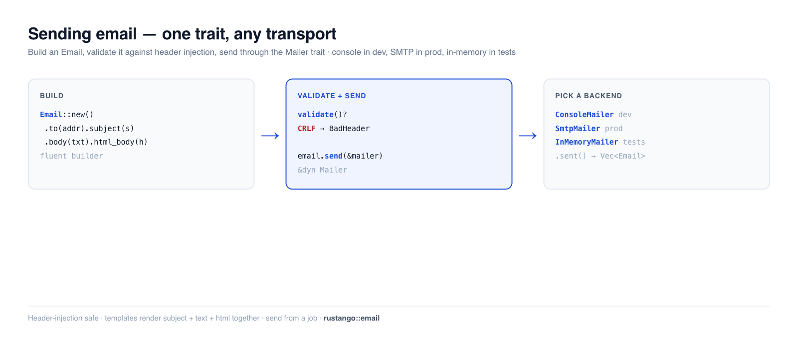

# E-Mails versenden

Willkommensnachrichten, Passwort-Resets, Belege, Alerts — die meisten Apps versenden
transaktionale E-Mails. **Rustango** gibt dir ein `Mailer`-Trait mit austauschbaren
Backends (Konsole für die Entwicklung, SMTP für die Produktion, ein In-Memory-Recorder für Tests),
einen flüssigen `Email`-Builder mit Schutz vor Header-Injection und
Template-Rendering. Schreibe `mailer.send(&email)` einmal; wechsle vom Drucken
in dein Terminal zu echtem SMTP mit einer einzeiligen Änderung — der Aufrufcode bleibt unberührt.

[](../img/email.png)

> **Neu bei einem Begriff hier?** *transaktionale E-Mail*, *SMTP*, *Mailer-Backend* — siehe
> das [Glossar](glossary.md).

> **Quelle:** `rustango::email` (`Mailer`, `Email`, `ConsoleMailer`,
> `InMemoryMailer`, `NullMailer`, `SmtpMailer`, `BoxedMailer`, `send_mail`,
> `MailError`) — hinter dem `email`-Feature (standardmäßig aktiviert). SMTP benötigt das
> `email-smtp`-Feature. Templates: `rustango::email_templates::EmailRenderer`.
> Eingereihter Versand: `rustango::email_jobs`.
>
> **Lauffähige Version:** Die Snippets zu Bauen, Senden, Validierung und Tests sind kopiert aus
> [`email_doc.rs`](https://github.com/ujeenet/rustango/blob/main/crates/rustango/tests/email_doc.rs)
> (`cargo test -p rustango --test email_doc`); die Send-Helfer und Anhänge
> werden von `email_send_helpers.rs` und `email_attachments.rs` selbst erprobt.

## Inhaltsverzeichnis

- [Schritt 1 — Eine E-Mail bauen](#schritt-1--eine-e-mail-bauen)
- [Schritt 2 — Einen Mailer wählen](#schritt-2--einen-mailer-wählen)
- [Schritt 3 — Sie versenden](#schritt-3--sie-versenden)
- [Aus einem Handler senden](#aus-einem-handler-senden) — das vollständige Beispiel
- [Validierung und Schutz vor Header-Injection](#validierung-und-schutz-vor-header-injection)
- [E-Mails testen](#e-mails-testen)
- [Templates](#templates)
- [Sie außerhalb des Requests versenden](#sie-außerhalb-des-requests-versenden)
- [Referenz](#referenz)
- [Siehe auch](#siehe-auch)

---

## Schritt 1 — Eine E-Mail bauen

`Email` ist ein flüssiger Builder. Setze Empfänger, Betreff und einen Text- und/oder HTML-Body:

```rust
use rustango::email::Email;

let email = Email::new()
    .to("ada@example.com")
    .from("noreply@example.com")
    .subject("Welcome")
    .body("Thanks for signing up.")              // plain-text part
    .html_body("<p>Thanks for signing up.</p>"); // optional HTML part
```

`.cc(...)`, `.bcc(...)`, `.reply_to(...)`, `.header(name, value)`, `.attach(...)` / `.attach_text(filename, text)` und Anhänge sind ebenfalls verfügbar.

---

## Schritt 2 — Einen Mailer wählen

Jedes Backend implementiert `Mailer`, sodass dein Code den konkreten Typ nie benennt —
halte ein **`BoxedMailer`** (`Arc<dyn Mailer>`):

| Backend | Feature | Verwenden für |
|---|---|---|
| `ConsoleMailer` | `email` | dev — druckt die Nachricht auf stdout |
| `SmtpMailer` | `email-smtp` | Produktion — echte Zustellung über SMTP |
| `InMemoryMailer` | `email` | Tests — zeichnet Nachrichten auf, sendet nichts |
| `FileMailer` | `email` | dev/CI — schreibt jede Nachricht in eine Datei |
| `NullMailer` | `email` | E-Mail vollständig deaktivieren |

Baue ihn aus der Konfiguration, damit er sich je Umgebung unterscheidet (`ConsoleMailer`
lokal, `SmtpMailer` in prod) über `email::from_settings(&settings.mail)?`. Mit
`backend = "smtp"` schlägt es fehl, wenn der Mailer nicht gebaut werden kann (kein `smtp_host`,
ungültige `from_address`, `smtp_tls` außer `none` / `starttls` / `implicit`, oder ein Build
ohne `email-smtp`). `backend` akzeptiert `console` (Standard außerhalb von prod; ungesetzt auf prod
ist ein `MailError::Config`), `memory`,
`null` / `none`, `file` (braucht `file_email_dir`) und `smtp`; jeder andere Wert ist ein
`MailError::Config`.

### Die `[mail]`-Einstellungen

`from_settings` liest den `[mail]`-Abschnitt deiner `config/*.toml`-Dateien. Hier
ist jeder Schlüssel. In der Entwicklung brauchst du keinen davon, denn die Konsole
ist der Standard. Für SMTP brauchst du mindestens `backend` und `smtp_host`:

```toml
# config/prod_settings.toml (or config/default.toml for every tier)
[mail]
backend           = "smtp"               # console | memory | file | null | smtp
smtp_host         = "smtp.example.com"
smtp_port         = 587                  # default: 25 / 587 / 465, from smtp_tls
smtp_tls          = "starttls"           # none | starttls | implicit
smtp_username     = "apikey"
# smtp_password: NOT here. Set RUSTANGO__MAIL__SMTP_PASSWORD (see below).
smtp_timeout_secs = 10                   # unset = no timeout
from_address      = "My App <noreply@example.com>"  # From: when the email sets none

# Optional
server_email         = "ops@example.com"  # From: for mail_admins / mail_managers
email_subject_prefix = "[My App] "        # before mail_admins / mail_managers subjects
admins               = ["ops@example.com"]
managers             = ["team@example.com"]
# file_email_dir     = "var/mail"         # needed with backend = "file"
```

`smtp_username` und `smtp_password` wirken nur zusammen. Ohne beide verbindet sich
der Mailer ohne Anmeldung.

Das SMTP-Backend braucht das `email-smtp`-Feature, das das generierte Projekt
nicht einschaltet. Füge es der `rustango`-Zeile in deiner `Cargo.toml` hinzu:

```toml
rustango = { version = "…", default-features = false, features = ["batteries", "email-smtp"] }
```

Oder übergib `--features email-smtp` an `cargo rustango new`.

### Das SMTP-Passwort aus Git heraushalten

`config/*.toml`-Dateien werden committet, also **schreibe das Passwort niemals
hinein.** Jede Einstellung lässt sich über eine Umgebungsvariable namens
`RUSTANGO__SECTION__KEY` setzen (zwei Unterstriche zwischen den Teilen). Für
`[mail] smtp_password` ist das:

```bash
RUSTANGO__MAIL__SMTP_PASSWORD=your-smtp-password
```

Auf deinem Rechner kommt diese Zeile in `.env`. Die generierte `main.rs` lädt
`.env`, bevor sie die Einstellungen liest, und die generierte `.gitignore` hält
`.env` schon aus Git heraus. In Produktion setzt du die Variable in den
Secret-Einstellungen deines Hosters. Dasselbe Muster gilt für jeden anderen
Schlüssel, etwa `RUSTANGO__MAIL__SMTP_USERNAME`. Siehe auch
[Secrets verwalten](security.md#secrets-verwalten).

---

## Schritt 3 — Sie versenden

`Email::send` nimmt jedes `&dyn Mailer`:

```rust
email.send(&mailer).await?;
```

`from_settings` gibt dir einen `BoxedMailer`, also einen `Arc`. Übergib den Mailer
darin mit `&*mailer`: `email.send(&*mailer).await?`.

Für einen schnellen Einzelfall überspringt `send_mail` den Builder:

```rust
use rustango::email::send_mail;

send_mail(
    &mailer,
    "Your report is ready",                  // subject
    "Download it from your dashboard.",      // body
    Some("noreply@example.com"),             // from (or None for the default)
    &["ops@example.com", "qa@example.com"],  // recipients
).await?;
```

`send_many` versendet einen Batch in einem Aufruf.

---

## Aus einem Handler senden

Das Framework hält keinen Mailer für dich bereit. Du baust ihn beim Boot mit
`from_settings` und gibst ihn deinen Routen als axum-`Extension`. Ein Handler
nimmt ihn dann als Argument.

Dieses Beispiel ergänzt die App aus [Erste Schritte](getting-started.md) um ein
Kontaktformular. Zuerst die Route, in einer neuen Datei. Füge `pub mod contact;`
zu `src/lib.rs` hinzu:

```rust
// src/contact.rs
use axum::{http::StatusCode, routing::post, Extension, Json, Router};
use rustango::email::{BoxedMailer, Email};
use serde::Deserialize;

#[derive(Deserialize)]
pub struct ContactForm {
    pub email: String,
    pub message: String,
}

async fn contact(
    Extension(mailer): Extension<BoxedMailer>,
    Json(form): Json<ContactForm>,
) -> StatusCode {
    let sent = Email::new()
        .to("support@example.com")
        .reply_to(form.email)
        .subject("Contact form")
        .body(form.message)
        .send(&*mailer)
        .await;
    match sent {
        Ok(()) => StatusCode::NO_CONTENT,
        // The mail server is down or timed out: the user can try again.
        Err(e) if e.is_retryable() => StatusCode::SERVICE_UNAVAILABLE,
        // A bad address or a newline in a header.
        Err(_) => StatusCode::BAD_REQUEST,
    }
}

pub fn router(mailer: BoxedMailer) -> Router {
    Router::new()
        .route("/contact", post(contact))
        .layer(Extension(mailer))
}
```

Dann baue den Mailer in `src/main.rs` und hänge die Route ein. Der Scaffolder legt
diesen Code in `run()`; lass alles andere, wie es ist. Zwei Zeilen sind neu:

```rust
// src/main.rs, inside run()
let _ = dotenvy::dotenv();
let loaded = rustango::config::Settings::load_from_env();
let settings = loaded.as_ref().cloned().unwrap_or_default();
let admin_settings = settings.clone();
let mailer = rustango::email::from_settings(&settings.mail)?; // NEW: reads [mail]

rustango::manage::Cli::new()
    .api(urls::api().merge(myblog::contact::router(mailer))) // NEW: mounts /contact
    .try_nest_with(urls::admin_prefix(&settings), move |pool| {
        urls::admin_router(pool, &admin_settings)
    })
    .with_health()
    .with_loaded_settings(loaded)
    .run()
    .await
```

Probiere es mit `cargo run` aus, und in einem zweiten Terminal:

```bash
curl -X POST http://localhost:8080/contact \
     -H "content-type: application/json" \
     -d '{"email":"ada@example.com","message":"Hello"}'
```

Mit dem Standard-Backend (Konsole) erscheint die E-Mail im Terminal des Servers.

Der Nutzer wartet, während die E-Mail gesendet wird. Um sofort zu antworten,
sende sie aus einem Job: siehe
[Sie außerhalb des Requests versenden](#sie-außerhalb-des-requests-versenden).

---

## Validierung und Schutz vor Header-Injection

`Email::validate()` läuft vor dem Versand (und du kannst es selbst aufrufen). Es
lehnt unvollständige Nachrichten ab **und** verteidigt gegen Header-Injection — ein in einen
Header eingeschmuggelter Zeilenumbruch ist die Art, wie Angreifer ein verstecktes `Bcc` hinzufügen:

```rust
// Missing recipients or an empty subject → MailError::InvalidMessage
Email::new().subject("hi").validate()?;          // Err: no recipients

// A CRLF in any header field → MailError::BadHeader
Email::new()
    .to("a@example.com")
    .subject("Hello\r\nBcc: victim@example.com")  // injection attempt
    .body("x")
    .validate()?;                                  // Err: BadHeader
```

Beide werden im zugrunde liegenden Test verifiziert.

---

## E-Mails testen

Verwende `InMemoryMailer` — es zeichnet jede Nachricht auf, statt zu senden, sodass Tests
darauf prüfen, was *hinausgegangen wäre*, ohne Netzwerk:

```rust
use rustango::email::InMemoryMailer;

let mailer = InMemoryMailer::new();
welcome_flow(&mailer).await?;          // your code under test

let sent = mailer.sent();              // Vec<Email>
assert_eq!(sent.len(), 1);
assert_eq!(sent[0].to, vec!["ada@example.com".to_string()]);
assert_eq!(sent[0].subject, "Welcome");
```

---

## Templates

Für alles jenseits einer Textzeile rendere den Body aus einem [Tera](html-views.md)-Template,
statt HTML inline zu setzen. `email_templates::EmailRenderer` (Features `email` + `admin`, beide im Standardsatz)
folgt einer `name.subject.txt` / `name.txt` / `name.html`-Konvention — ein Template-Satz
produziert den Betreff, den Klartextteil und den HTML-Teil zusammen, sodass die
drei nie auseinanderdriften. Das `Mailable`-Trait verpackt „ein Ding, das weiß, wie es sich
selbst in eine `Email` verwandelt" für wiederverwendbare Nachrichten.

Lege die drei Dateien in einen Ordner `email_templates/` im Projektwurzelverzeichnis:

```text
email_templates/welcome.subject.txt   Welcome, {{ name }}
email_templates/welcome.txt           Hi {{ name }}, thanks for signing up.
email_templates/welcome.html          <p>Hi {{ name }}, thanks for signing up.</p>
```

Der Betreff und die `.txt`-Datei sind Pflicht; die `.html`-Datei ist optional. Lade
den Ordner dann einmal und rendere nach Namen. Die Werte kommen aus einem
Tera-`Context`, also füge `tera = "1"` zu `[dependencies]` in deiner `Cargo.toml`
hinzu:

```rust
use rustango::email_templates::EmailRenderer;
use tera::Context;

// Once, at boot. Share it with handlers as Arc<EmailRenderer>, like the mailer.
let renderer = EmailRenderer::from_dir("email_templates")?;

// In the handler:
let mut ctx = Context::new();
ctx.insert("name", "Ada");
let email = renderer.render("welcome", &ctx)?.to("ada@example.com");
email.send(&*mailer).await?;
```

`render` setzt nur den Betreff und die Bodies. Ergänze `.to(...)`, und `.from(...)`,
falls `from_address` nicht gesetzt ist.

---

## Sie außerhalb des Requests versenden

E-Mail inline zu versenden lässt den Nutzer auf deinen SMTP-Server warten und koppelt die
Antwort an dessen Verfügbarkeit. Versende sie stattdessen aus einem [Hintergrundjob](jobs.md) —
der Handler kehrt sofort zurück und ein Worker stellt sie zu (mit Retries, falls SMTP
ausgefallen ist).

`email_jobs` (Features `email` + `jobs`, beide im Standardsatz) erledigt das für
dich. `register_email_job` gibt einer Job-Queue einen Handler, der deinen Mailer
hält. `dispatch_email` stellt eine `Email` in die Queue. Es validiert die E-Mail
vorher, und nur ein `Transport`-Fehler wird wiederholt. Anhänge werden als base64
eingereiht.

Hier ist das Kontaktformular aus [Aus einem Handler senden](#aus-einem-handler-senden),
umgebaut, sodass es die E-Mail einreiht. Die Route hält jetzt die Queue statt des
Mailers:

```rust
// src/contact.rs
use std::sync::Arc;

use axum::{http::StatusCode, routing::post, Extension, Json, Router};
use rustango::email::Email;
use rustango::email_jobs::dispatch_email;
use rustango::jobs::{InMemoryJobQueue, JobError};
use serde::Deserialize;

#[derive(Deserialize)]
pub struct ContactForm {
    pub email: String,
    pub message: String,
}

async fn contact(
    Extension(queue): Extension<Arc<InMemoryJobQueue>>,
    Json(form): Json<ContactForm>,
) -> StatusCode {
    let email = Email::new()
        .to("support@example.com")
        .reply_to(form.email)
        .subject("Contact form")
        .body(form.message);
    // Returns at once; a worker sends the email.
    match dispatch_email(&*queue, &email).await {
        Ok(()) => StatusCode::ACCEPTED,
        Err(JobError::Fatal(_)) => StatusCode::BAD_REQUEST, // the email is not valid
        Err(_) => StatusCode::SERVICE_UNAVAILABLE,          // the queue failed
    }
}

pub fn router(queue: Arc<InMemoryJobQueue>) -> Router {
    Router::new()
        .route("/contact", post(contact))
        .layer(Extension(queue))
}
```

Baue in `src/main.rs` die Queue, registriere den E-Mail-Job mit dem Mailer und
starte die Worker, bevor `Cli` läuft. Stoppe sie in `on_shutdown`:

```rust
// src/main.rs, inside run(). Add at the top of the file:
//   use std::sync::Arc;
//   use rustango::email_jobs::{register_email_job, EmailJobConfig};
//   use rustango::jobs::{InMemoryJobQueue, JobQueue};
let _ = dotenvy::dotenv();
let loaded = rustango::config::Settings::load_from_env();
let settings = loaded.as_ref().cloned().unwrap_or_default();
let admin_settings = settings.clone();

let mailer = rustango::email::from_settings(&settings.mail)?;
let queue = Arc::new(InMemoryJobQueue::with_workers(4));
register_email_job(&*queue, EmailJobConfig::new(mailer)).await;
queue.start().await;
let draining = Arc::clone(&queue);

rustango::manage::Cli::new()
    .api(urls::api().merge(myblog::contact::router(queue)))
    .try_nest_with(urls::admin_prefix(&settings), move |pool| {
        urls::admin_router(pool, &admin_settings)
    })
    .with_health()
    .with_loaded_settings(loaded)
    .on_shutdown(move || async move { draining.shutdown().await })
    .run()
    .await
```

`&*queue` übergibt die Queue im `Arc`. Um deinen eigenen Job-Typ mit dem Mailer
einzureihen, siehe
[Schritt 4 der Jobs-Anleitung](jobs.md#schritt-4--in-deine-app-verdrahten).

---

## Referenz

**`Email`-Builder:** `to` · `cc` · `bcc` · `from` · `reply_to` · `subject` · `body` ·
`html_body` · `header` · `attach` · `attach_text` · `validate()` · `send(&mailer)`.

**Helfer:** `send_mail(mailer, subject, body, from, &recipients)` ·
`send_many(mailer, &emails)` · `from_settings(&MailSettings)` ·
`mail_admins(mailer, &settings.mail, subject, body)` /
`mail_managers(...)` (send to `[mail].admins` / `managers`).

**`MailError`:** `InvalidMessage` (unvollständig) · `BadHeader` (CRLF-Injection) ·
`Transport` (Backend-/Zustellungsfehler, als einziger von `EmailJob` wiederholt) ·
`Rejected` (der SMTP-Server lehnt die Nachricht endgültig ab) · `Config` (fehlerhafter `[mail]`-Abschnitt).

---

## Siehe auch

- [Hintergrundjobs](jobs.md) — E-Mail außerhalb des Requests mit Retries zustellen.
- [Konto-Abläufe](auth-flows.md) — Passwort-Reset- / Verifizierungs- / Magic-Link-E-Mails,
  die darauf aufbauen.
- [HTML-Views](html-views.md) — die Tera-Engine, die auch E-Mail-Templates verwenden.
- [Caching](caching.md) — dasselbe Muster „Backend-austauschen" per Trait.
