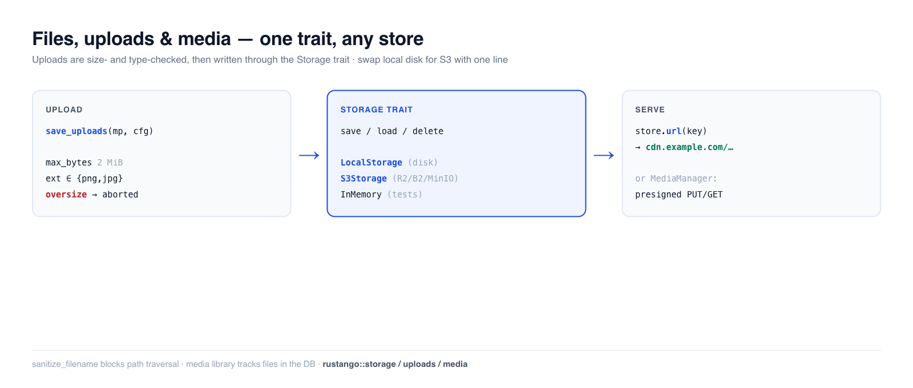

# Dateien, Uploads & Medien

Fast jede App speichert Nutzerdateien — Avatare, Anhänge, exportierte Berichte,
Bilder. **Rustango** gibt dir ein `Storage`-Trait mit austauschbaren Backends (lokale
Festplatte, S3-kompatibler Objektspeicher, In-Memory für Tests), einen sicheren Multipart-**Upload**-Helfer
mit Größen-/Typ-Schutzvorkehrungen und — wenn du eine nachverfolgte Mediathek brauchst — einen
datenbankgestützten `MediaManager` mit vorsignierten URLs. Schreibe deinen Code
einmal gegen das Trait; wechsle von lokaler Festplatte zu S3 mit einer einzeiligen Änderung.

[](../img/files.png)

> **Neu bei einem Begriff hier?** *Storage-Backend*, *Multipart*, *Objektspeicher*,
> *vorsignierte URL* — siehe das [Glossar](glossary.md).

> **Quelle:** `rustango::storage` (`Storage`, `LocalStorage`, `InMemoryStorage`,
> `s3::S3Storage`, `azure::AzureBlobStorage`, `StorageRegistry`, `BoxedStorage`), `rustango::uploads` (`save_uploads`,
> `UploadConfig`, `sanitize_filename`) und `rustango::media`
> (`Media`, `MediaManager`) — hinter den Features `storage` / `uploads` / `storage-s3` /
> `storage-azure` / `media` (alle standardmäßig aktiviert).
>
> **Lauffähige Version:** Die Storage- + Upload-Schutzvorkehrungs-Snippets sind kopiert aus
> [`files_doc.rs`](https://github.com/ujeenet/rustango/blob/main/crates/rustango/tests/files_doc.rs)
> (`cargo test -p rustango --test files_doc`); der End-to-End-Multipart-`save_uploads`-Ablauf
> wird von den In-File-Tests in
> `crates/rustango/src/uploads.rs` selbst erprobt, und die Mediathek von
> [`media_sqlite_live.rs`](https://github.com/ujeenet/rustango/blob/main/crates/rustango/tests/media_sqlite_live.rs).

## Inhaltsverzeichnis

- [Schritt 1 — Ein Storage-Backend wählen](#schritt-1--ein-storage-backend-wählen)
- [Schritt 2 — Dateien speichern, laden und ausliefern](#schritt-2--dateien-speichern-laden-und-ausliefern)
- [Schritt 3 — Einen Upload annehmen](#schritt-3--einen-upload-annehmen)
- [Ein Avatar-Upload von Anfang bis Ende](#ein-avatar-upload-von-anfang-bis-ende)
- [Sichere Dateinamen](#sichere-dateinamen)
- [Produktion: S3-kompatibler Speicher](#produktion-s3-kompatibler-speicher)
- [Produktion: Azure Blob Storage](#produktion-azure-blob-storage)
- [Große Dateien: streamen](#große-dateien-streamen)
- [Mehrere Disks aus der Konfiguration](#mehrere-disks-aus-der-konfiguration)
- [Die Mediathek](#die-mediathek)
- [Referenz](#referenz)
- [Siehe auch](#siehe-auch)

---

## Schritt 1 — Ein Storage-Backend wählen

Jedes Backend implementiert dasselbe `Storage`-Trait, sodass dein Code den konkreten Typ nie
benennt — er hält ein **`BoxedStorage`** (`Arc<dyn Storage>`):

```rust
use rustango::storage::{BoxedStorage, LocalStorage};
use std::path::PathBuf;
use std::sync::Arc;

let storage: BoxedStorage = Arc::new(LocalStorage::new(PathBuf::from("./uploads")));
```

| Backend | Feature | Verwenden für |
|---|---|---|
| `LocalStorage` | `storage` | Ein-Server-Deployments — Dateien auf lokaler Festplatte |
| `S3Storage` | `storage-s3` | Produktion — S3 / R2 / B2 / MinIO Objektspeicher |
| `AzureBlobStorage` | `storage-azure` | Produktion — Azure Blob Storage (Azurite in der Entwicklung) |
| `InMemoryStorage` | `storage` | Tests — eine `HashMap`, berührt nie die Festplatte |

---

## Schritt 2 — Dateien speichern, laden und ausliefern

Das Trait besteht aus vier async-Methoden, indiziert durch einen String-Pfad. `save` schreibt
Bytes, `load` liest sie zurück, dazu `exists` / `delete`:

```rust
use rustango::storage::{Storage, InMemoryStorage};

let store = InMemoryStorage::new();
store.save("avatars/7.png", &png_bytes).await?;
assert!(store.exists("avatars/7.png").await?);
let bytes = store.load("avatars/7.png").await?;
store.delete("avatars/7.png").await?;
```

**Die Datei ausliefern.** Hänge eine Basis-URL an (dein CDN oder statischer Host) und `url(key)`
baut die öffentliche Adresse, die du am Modell speicherst und dem Browser übergibst:

```rust
let store = LocalStorage::new("./uploads".into())
    .with_base_url("https://cdn.example.com/uploads");

store.url("docs/report.pdf");   // Some("https://cdn.example.com/uploads/docs/report.pdf")
```

Ohne Basis-URL gibt `url()` `None` zurück. Dann liefere den Ordner mit
`Cli::with_uploads` aus ([Avatar-Beispiel](#ein-avatar-upload-von-anfang-bis-ende)) oder
streame die Bytes durch einen eigenen Handler ([Große Dateien](#große-dateien-streamen)).
`LocalStorage` schützt außerdem vor Path-Traversal in Keys.

---

## Schritt 3 — Einen Upload annehmen

`save_uploads` konsumiert einen axum-`Multipart`-Body, validiert jede Datei gegen eine
`UploadConfig` und schreibt die Überlebenden in dein `Storage` — als Stream, sodass eine
überdimensionierte Datei mitten in der Übertragung abgelehnt wird, statt zuerst in den Speicher
gepuffert zu werden.

```rust
use axum::extract::{Multipart, State};
use axum::http::StatusCode;
use axum::Json;
use rustango::storage::BoxedStorage;
use rustango::uploads::{save_uploads, UploadConfig};

async fn upload(
    State(storage): State<BoxedStorage>,             // router state, see below
    mp: Multipart,                                   // must be the last argument
) -> Result<Json<Vec<String>>, (StatusCode, String)> {
    let cfg = UploadConfig::new("avatars/")          // key prefix
        .max_bytes(2 * 1024 * 1024)                  // reject files over 2 MiB
        .allowed_extensions(&["png", "jpg", "jpeg", "webp"])
        .randomize_filename(true);                   // avoid collisions

    // UploadError is not a response: map it yourself.
    let saved = save_uploads(mp, &cfg, &storage)     // Vec<SavedUpload>
        .await
        .map_err(|e| (StatusCode::BAD_REQUEST, e.to_string()))?;
    Ok(Json(saved.into_iter().map(|s| s.key).collect()))
}
```

Das Storage erreicht den Handler als Router-State:
`Router::new().route("/upload", post(upload)).with_state(storage)`. Das
[Avatar-Beispiel](#ein-avatar-upload-von-anfang-bis-ende) unten zeigt die ganze Verdrahtung.

Die Schutzvorkehrungen werden erzwungen (und verifiziert): `allowed_extensions` ist
**case-insensitiv** (`"PNG"` und `"png"` sind dasselbe), und `max_bytes` bricht den Stream ab,
sobald die Größe überschritten wird. Die In-File-`uploads`-Tests treiben echte Multipart-Bodies an
und behaupten, dass Dateien im Speicher landen, überdimensionierte Dateien abgelehnt und
nicht erlaubte Erweiterungen verweigert werden.

Standardwerte: `max_bytes` 10 MiB, `max_files` 20, `randomize_filename` an (ein
UUID-Präfix im Key). Ohne `allowed_extensions` wird jede Erweiterung akzeptiert,
außer denen, die ein Browser als Skript ausführt (`html`, `svg`, `xml`, `js`, … —
`uploads::ACTIVE_EXTENSIONS`). Der erste Fehler stoppt die Schleife und löscht die
schon gespeicherten Dateien; eine abgelehnte Anfrage hinterlässt also nichts. Jedes
`SavedUpload` trägt `key`, `original_filename`, `content_type` (wie vom Client
behauptet — nicht vertrauen) und `size_bytes`.

```rust
let cfg = UploadConfig::new("avatars/").allowed_extensions(&["PNG", "Jpg"]);
assert!(cfg.allowed_extensions.contains("png"));   // normalized to lowercase
assert!(cfg.allowed_extensions.contains("jpg"));
```

---

## Ein Avatar-Upload von Anfang bis Ende

Hier kommen die Teile in der App aus [Erste Schritte](getting-started.md)
zusammen: ein Profil mit Avatar, eine Route, die das Bild annimmt, und eine URL,
die der Browser laden kann. Die Dateien landen in `./var/uploads` auf der lokalen
Platte.

### 1. Den Key im Model speichern

Speichere den Storage-Key, nicht die Datei und nicht die URL. Lege in
`src/blog/models.rs` unter `Post` ein Model an. Die Zeile
`use rustango::{Auto, Model};` aus Schritt 8 deckt es schon ab:

```rust
#[derive(Model, Clone, Debug)]
#[rustango(table = "profiles")]
pub struct Profile {
    #[rustango(primary_key)]
    pub id: Auto<i64>,

    pub user_id: i64,

    // Storage key, e.g. "avatars/3f2c…-me.png". None until the first upload.
    pub avatar_key: Option<String>,
}
```

Dann lege die Tabelle an, wie in Schritt 9:

```bash
cargo run -- makemigrations
cargo run -- migrate
```

Die URL wird bei Bedarf aus dem Key gebaut. Ziehen die Dateien später nach S3
um, ändert sich keine Zeile in der Datenbank.

`avatar_key` hat kein `max_length` und ist deshalb eine `TEXT`-Spalte. Der Key
behält den Dateinamen des Clients, und `save_uploads` kürzt ihn nicht. Eine feste
`VARCHAR`-Länge könnte also zu kurz sein.

### 2. Den Upload annehmen und den Key speichern

Der Handler braucht zwei Dinge: den Datenbank-Pool und das Storage. Pack beide in
eine State-Struct. Füge das in `src/blog/views.rs` ein. Lass jede `use`-Zeile weg,
die die Datei schon hat: dasselbe `use` zweimal kompiliert nicht.

```rust
use axum::extract::{Multipart, Path, State};
use axum::http::StatusCode;
use axum::Json;
use rustango::sql::Pool;
use rustango::storage::BoxedStorage;
use rustango::uploads::{save_uploads, UploadConfig};

use crate::blog::models::Profile;

/// What the avatar routes need: the database and the file storage.
#[derive(Clone)]
pub struct AvatarState {
    pub pool: Pool,
    pub storage: BoxedStorage,
}

type HttpError = (StatusCode, String);

fn server_error(e: impl std::fmt::Display) -> HttpError {
    (StatusCode::INTERNAL_SERVER_ERROR, e.to_string())
}

/// POST /profiles/{id}/avatar with a multipart form that holds one image.
pub async fn upload_avatar(
    State(state): State<AvatarState>,
    Path(id): Path<i64>,
    mp: Multipart,
) -> Result<Json<serde_json::Value>, HttpError> {
    let mut profile = Profile::objects()
        .find(id, &state.pool)
        .await
        .map_err(server_error)?
        .ok_or((StatusCode::NOT_FOUND, "no such profile".to_owned()))?;

    let cfg = UploadConfig::new("avatars/")
        .max_bytes(2 * 1024 * 1024) // 2 MiB
        .max_files(1)
        .allowed_extensions(&["png", "jpg", "jpeg", "webp"]);
    let saved = save_uploads(mp, &cfg, &state.storage)
        .await
        .map_err(|e| (StatusCode::BAD_REQUEST, e.to_string()))?;
    let Some(file) = saved.into_iter().next() else {
        return Err((StatusCode::BAD_REQUEST, "send one file".to_owned()));
    };

    // Save the key on the row. If that fails, remove the new file.
    let old_key = profile.avatar_key.replace(file.key.clone());
    if let Err(e) = profile.save(&state.pool).await {
        let _ = state.storage.delete(&file.key).await;
        return Err(server_error(e));
    }
    // Nothing points at the old file any more.
    if let Some(old) = old_key {
        let _ = state.storage.delete(&old).await;
    }

    Ok(Json(serde_json::json!({
        "key": file.key,
        "url": state.storage.url(&file.key), // "/uploads/avatars/…-me.png"
    })))
}
```

`find` gibt `Ok(None)` zurück, wenn keine Zeile diese ID hat; der Handler
antwortet dann mit `404`. `save` schreibt die Zeile auf PostgreSQL, MySQL und
SQLite gleich zurück.

`Multipart` kommt aus dem axum-Feature `multipart`. Das Rustango-Feature
`uploads` schaltet es ein, also baut der Code so. Trag `"multipart"` trotzdem in
die `axum`-Features deiner `Cargo.toml` ein, damit dein Code nennt, was er nutzt.

### 3. Storage anlegen und Route mounten

Baue das Storage einmal, neben dem Router, der es nutzt. Füge das in
`src/blog/urls.rs` ein, das schon `use axum::Router;` hat:

```rust
use std::path::PathBuf;
use std::sync::Arc;

use axum::routing::post;
use rustango::sql::Pool;
use rustango::storage::{BoxedStorage, LocalStorage};

use crate::blog::views::{upload_avatar, AvatarState};

/// The folder that holds uploads, and the URL prefix that serves it.
pub const UPLOAD_DIR: &str = "./var/uploads";
pub const UPLOAD_URL: &str = "/uploads";

pub fn avatar_routes(pool: Pool) -> Router {
    let storage: BoxedStorage = Arc::new(
        LocalStorage::new(PathBuf::from(UPLOAD_DIR)).with_base_url(UPLOAD_URL),
    );
    Router::new()
        .route("/{id}/avatar", post(upload_avatar))
        .with_state(AvatarState { pool, storage })
}
```

Dann füge zwei Zeilen zur `Cli`-Kette in `src/main.rs` hinzu:

```rust
rustango::manage::Cli::new()
    .api(urls::api())
    // … the lines you already have …
    .nest_with("/profiles", myblog::blog::urls::avatar_routes)
    .with_uploads(myblog::blog::urls::UPLOAD_URL, myblog::blog::urls::UPLOAD_DIR)
    .with_loaded_settings(loaded)
    .run()
    .await
```

`nest_with` baut den Router aus dem Pool, den der Server öffnet, wie in
Schritt 12b. Er braucht ein eigenes Präfix: ein zweites `nest_with("/api", …)`
würde mit dem ViewSet kollidieren. `with_uploads` liefert die Dateien aus
`./var/uploads` unter `/uploads/…` aus. HTML, SVG und XML gehen als Download
raus, damit eine hochgeladene Seite kein Skript auf deiner Site ausführt.
`LocalStorage` legt die Ordner beim ersten Speichern an. Die
generierte `.gitignore` hält `var/` schon aus git heraus.

### 4. Ausprobieren

Lege zuerst eine Profilzeile an, im Admin (Schritt 11) oder mit `save` wie in
Schritt 10. Dann:

```bash
curl -F "avatar=@me.png" http://localhost:8080/profiles/1/avatar
# {"key":"avatars/3f2c…-me.png","url":"/uploads/avatars/3f2c…-me.png"}

curl -O http://localhost:8080/uploads/avatars/3f2c…-me.png
```

Setze die `url` in ein ``. Ein `.gif` bekommt `400` mit der Meldung
``file extension `gif` not allowed``.

> **Diese Route prüft keinen Login.** Jeder kann jeden Avatar ersetzen. Bevor du
> sie auslieferst, stell sie hinter deine Authentifizierung und prüfe, dass der
> angemeldete Benutzer das Profil besitzt. Siehe [Zugriffs-Dekoratoren](auth-decorators.md).

**Private Dateien.** `with_uploads` liefert jede Datei an jeden aus, der die URL
kennt. Für Dateien, die nur manche Benutzer sehen dürfen, lass `with_uploads` und
die Basis-URL weg und streame die Datei durch einen Handler, der vorher den
Zugriff prüft: der `download`-Handler in [Große Dateien](#große-dateien-streamen)
ist dieser Handler.

**Mehr als ein Server.** Die lokale Platte reicht für einen Server. Bei mehreren
nimm `S3Storage` oder `AzureBlobStorage` mit einer öffentlichen URL; `url()` zeigt
dann auf den Bucket, und `with_uploads` fällt weg. Der Handler bleibt gleich.

### Das Limit für den Request-Body

axum begrenzt einen Request-Body standardmäßig auf 2 MiB, und `Multipart` liest
unter dieser Grenze. Sie zählt das ganze Formular, nicht eine Datei. Ohne
Änderung ist der `max_bytes`-Standard von 10 MiB also nie erreichbar, und eine
Datei knapp unter 2 MiB scheitert als Multipart-Parse-Fehler.

Hebe die Grenze mit `max_body_bytes` in `config/default.toml` an:

```toml
[server]
max_body_bytes = 5242880   # 5 MiB: room for a 2 MiB file and the form
```

oder mit der Umgebungsvariable `RUSTANGO__SERVER__MAX_BODY_BYTES=5242880`. Der
`Cli` macht daraus einen `BodyLimitLayer` (`rustango::body_limit`) auf der API
und auf jedem mit `nest_with` hinzugefügten Router, und er ersetzt die 2-MiB-Grenze
von axum. Ein Request mit größerem `Content-Length` bekommt
`413 Payload Too Large`, bevor dein Handler läuft. Setze den Wert etwas über dein
größtes `max_bytes`.

Der `Cli` liest diese Einstellung nur, wenn er deine Settings hat. Die
gescaffoldete `main.rs` übergibt sie mit `.with_loaded_settings(loaded)`. Ohne
diesen Aufruf (oder `.with_settings_from_env()`) wird der Wert ignoriert, und der
Server loggt eine Warnung, die ihn nennt.

---

## Sichere Dateinamen

Vertraue nie einem vom Client gelieferten Dateinamen. `sanitize_filename` reduziert ihn auf einen
sicheren Basenamen — es entfernt Verzeichniskomponenten (Path-Traversal) und ersetzt unsichere
Zeichen:

```rust
use rustango::uploads::sanitize_filename;

sanitize_filename("../../etc/passwd");   // "passwd"   — no traversal
sanitize_filename("my photo!.png");      // "my_photo_.png"
sanitize_filename("");                    // "upload"   — never empty
```

`save_uploads` wendet dies für dich an; rufe es nur direkt auf, wenn du Keys von Hand baust.

---

## Produktion: S3-kompatibler Speicher

Für Multi-Server-Deployments tausche `LocalStorage` gegen `S3Storage` (hinter dem
`storage-s3`-Feature). Es spricht die S3-API mit einem selbstgebauten SigV4-Signierer, sodass es
mit **AWS S3, Cloudflare R2, Backblaze B2 und MinIO** funktioniert. Das Trait ist
identisch — nur der Konstruktor ändert sich:

```rust
use rustango::storage::s3::S3Storage;   // needs the `storage-s3` feature

use rustango::storage::s3::{S3Config, S3Credentials};

let cfg = S3Config::new("my-bucket", "us-east-1")
    .with_endpoint("https://<account>.r2.cloudflarestorage.com"); // R2 / B2 / MinIO; omit for AWS
let creds = S3Credentials::new(access_key_id, secret_access_key);
let storage: BoxedStorage = Arc::new(S3Storage::new(cfg, creds));
// save / load / delete / url — exactly the same calls as LocalStorage
```

Deine Handler und Modelle ändern sich nicht; nur die Verdrahtung beim Start.

---

## Produktion: Azure Blob Storage

`AzureBlobStorage` (hinter `storage-azure`) signiert Serveraufrufe mit dem
Shared Key des Kontos und gibt Service-SAS-URLs für vorsigniertes GET und PUT
aus:

```rust
use rustango::storage::azure::{AzureBlobStorage, AzureConfig};

let key = std::env::var("AZURE_STORAGE_KEY")?; // base64, from the portal
let cfg = AzureConfig::new("myaccount", key, "uploads");
// Azurite: cfg.endpoint("http://127.0.0.1:10000/devstoreaccount1")
let storage: BoxedStorage = Arc::new(AzureBlobStorage::new(cfg)?);
```

Unterschiede zu S3, die ein Direkt-Upload beachten muss:

- Der Browser muss jeden Header aus `storage.presigned_put_headers(&put)`
  senden, der `x-ms-blob-type: BlockBlob` ergänzt. Die CORS-Regel des Kontos
  muss ihn zusammen mit `Content-Type` und `If-None-Match` erlauben.
- Eine SAS kann keine Header signieren, Größe und Typ werden also nicht von der
  URL erzwungen. Bestätige den Upload mit `metadata`.
  `MediaManager::begin_upload` lehnt eine Azure-Disk ab; lade über den Server
  mit `save_bytes` hoch. Ein Create-only-PUT bekommt `c` ohne `w`, die URL kann
  also weiterhin keinen Blob ersetzen.
- Ein einzelnes PUT fasst bis zu 5000 MiB; darüber stellt `save_stream` Blöcke
  bereit.

---

## Große Dateien: streamen

`save` und `load` nehmen und liefern ganze Puffer. Für ein großes Objekt, oder
um den Bucket privat zu halten und Uploads durch deinen Server zu leiten, nimm
`save_stream` und `load_stream`: Chunks gehen durch, sobald sie ankommen, der
Speicher bleibt also flach. Ein `ByteStream` entsteht aus einem axum-`Body`,
einer `reqwest::Response`, `Bytes` oder einem `Vec<u8>`.

```rust
use axum::{body::Body, extract::{Path, State}, http::{header, HeaderMap, StatusCode}};
use rustango::storage::{BoxedStorage, ByteStream, PutConditions, StorageError};

// PUT /files: proxy the request body into storage.
async fn upload(State(storage): State<BoxedStorage>, headers: HeaderMap, body: Body)
    -> Result<String, StatusCode>
{
    let len = headers
        .get(header::CONTENT_LENGTH)
        .and_then(|v| v.to_str().ok()?.parse::<u64>().ok())
        .ok_or(StatusCode::LENGTH_REQUIRED)?;
    let key = format!("uploads/{}", uuid::Uuid::new_v4());
    let put = PutConditions::new().create_only();
    storage
        .save_stream(&key, len, ByteStream::from(body), &put)
        .await
        .map_err(|_| StatusCode::BAD_REQUEST)?;
    Ok(key)
}

// GET /files/{*key}: stream it back.
async fn download(State(storage): State<BoxedStorage>, Path(key): Path<String>)
    -> Result<Body, StatusCode>
{
    let stream = storage.load_stream(&key).await.map_err(|e| match e {
        StorageError::NotFound(_) => StatusCode::NOT_FOUND,
        _ => StatusCode::BAD_GATEWAY,
    })?;
    Ok(Body::from_stream(stream))
}
```

`save_stream` schreibt genau `len` Bytes. Ein Body anderer Größe oder ein
`put.content_length` ungleich `len` wird abgelehnt, und `create_only` lehnt
einen vorhandenen Key ab. Ein Body, der fehlschlägt oder abgebrochen wird,
hinterlässt nichts. Ein Body-Limit-Layer auf der Route muss die Größe
erlauben, die du annimmst.

| Backend | Wie es streamt |
|---------|----------------|
| `LocalStorage` | Temp-Datei im Zielverzeichnis, fsync, dann rename; `create_only` verlinkt, ersetzt also nie eine Datei |
| `S3Storage` | ein PUT bis 5 GiB; darüber ein Multipart-Upload mit bis zu 10.000 Teilen (5 TiB), ein Teil gleichzeitig unterwegs. Über https wird der Body als `UNSIGNED-PAYLOAD` gesendet; über reines http (lokales MinIO, SeaweedFS) wird jeder 64-KiB-Chunk signiert. `create_only` sendet `If-None-Match: *` (bei Multipart beim Complete), was AWS, MinIO und SeaweedFS beachten |
| `AzureBlobStorage` | ein Put Blob bis 5000 MiB; darüber Put Block für jeden Teil, dann ein Put Block List. `create_only` sendet `If-None-Match: *` (auf der Liste) |
| `InMemoryStorage` | sammelt den Body im Speicher; `create_only` wird unter seiner Sperre geprüft |
| andere | der Trait-Default: sammelt den Body im Speicher, dann `save`; lehnt `create_only` ab |

Ein fehlgeschlagener oder abgebrochener Multipart-Upload wird abgebrochen, und
Azure zeigt nie nicht festgeschriebene Blöcke, ein Teilobjekt ist also nie
sichtbar. Ein Server, der nach einem Absturz Teile behält, sollte trotzdem eine
Lifecycle-Regel haben, die unvollständige Multipart-Uploads entfernt.
`LocalStorage` `create_only` braucht Hardlinks; auf FAT, SMB oder manchen
FUSE-Mounts scheitert es mit einem Fehler, der das sagt.

---

## Mehrere Disks aus der Konfiguration

Eine App kann Backends mischen — zwei S3-Buckets, einen Azure-Container, einen
lokalen Cache — als benannte Disks. Deklariere sie in `[storage]` und baue eine
`StorageRegistry`:

```toml
[storage]
default = "uploads"

[storage.disks.uploads]
driver          = "azure"
account         = "myaccount"
container       = "uploads"
public_endpoint = "https://files.example.com"   # optional: links browsers follow

[storage.disks.archive]
driver = "s3"
bucket = "archive"
region = "eu-west-1"
cdn    = "https://cdn.example.com/archive"

[storage.disks.cache]
driver = "local"
root   = "./var/cache"
```

```rust
let registry = StorageRegistry::from_settings(&settings.storage)?;
let uploads = registry.default_disk().expect("default disk");
```

Schlüssel bleiben aus der Datei: `RUSTANGO__STORAGE__DISKS__UPLOADS__ACCOUNT_KEY`,
`RUSTANGO__STORAGE__DISKS__ARCHIVE__SECRET_ACCESS_KEY`. Disk-Namen sind
kleingeschrieben `[a-z0-9_]`, damit diese Overrides sie erreichen. Ein Treiber,
dessen Feature nicht einkompiliert ist, ist ein Fehler, der die Disk nennt,
keine still fehlende Disk. `public_endpoint` lässt vorsignierte URLs und
`url()` auf die Adresse zeigen, die Browser erreichen, während Lesen und
Schreiben weiter `endpoint` nutzen.

---

## Die Mediathek

Wenn Dateien erstklassige Datensätze sind — in der Datenbank nachverfolgt, im Admin durchstöberbar,
mit CDN-/vorsignierter Auslieferung — greife zu `rustango::media` statt zu rohem
`Storage`. `MediaManager` persistiert eine `Media`-Zeile pro Datei und
unterstützt zwei Upload-Abläufe:

- **Serverseitig:** `manager.save_bytes(...)` speichert die Bytes und die Zeile in einem
  Aufruf.
- **Direkt-in-den-Speicher:** `manager.begin_upload(...)` gibt eine **vorsignierte PUT**-URL
  zurück, zu der der Browser direkt hochlädt (dein Server proxyt die Bytes nie),
  dann bestätigst du die Zeile. Das PUT muss jeden Header aus
  `ticket.headers` senden (`Content-Type`, `If-None-Match: *` und auf Azure
  `x-ms-blob-type`), die CORS-Regel des Buckets muss sie also erlauben. Die URL
  kann das Objekt einmal anlegen und nie ersetzen. Vergib auch
  `s3:ListBucket`: Ohne das beantwortet S3 ein fehlendes Objekt mit 403, und
  finalize liefert 502, statt die Zeile als `Failed` zu markieren.

```rust
use rustango::media::{Media, MediaManager};

let manager = MediaManager::new(pool.clone(), registry);
// Hand the browser a short-lived download link:
// Liefert Option<String> — None bei Backends, die nicht signieren können (z. B. lokale Platte).
let Some(url) = manager.presigned_get(&media, Duration::from_secs(3600)).await else {
    return Err(/* keine signierte URL für dieses Backend */);
};
```

Er kümmert sich außerdem um Soft-Delete und das Bereinigen von Waisen. Der vollständige Ablauf wird
in `media_sqlite_live.rs` erprobt; die vorsignierten und Direct-Upload-Methoden des Managers
laufen auf allen drei Backends.

### Medien auf einer öffentlichen Seite ausliefern

Eine öffentliche Seite geht **nicht** über `media::router`. Dieser Router ist
die interne Verwaltungs-API — Uploads, Löschungen, Tags, Blättern — und er
antwortet allen, die nicht angemeldet sind, auf jeder Route absichtlich mit
`401`.

Ermittle die URL stattdessen im eigenen Handler:

```rust
// deine eigene öffentliche Route
let url = manager.public_url(media_id).await?;   // Option<String>, ohne Signatur
```

`public_url` ist ein Datenbank-Lookup plus ein String; es signiert nichts und
wartet auf keinen Signierer — deshalb passt es in eine Seite. Zwei
Auslieferungsmodelle, und die Wahl dazwischen ist die eigentliche Entscheidung:

| | öffentlicher Bucket / CDN | privater Bucket + Presigned |
|---|---|---|
| Adresse | `manager.public_url(id)` — stabil | `manager.presigned_get(&m, ttl)` — läuft ab |
| cachebar | ja, von Browsern und CDNs | nein; der Router sendet `no-store` |
| wer darf laden | jede:r mit der URL | jede:r mit der URL, bis sie abläuft |
| wofür | öffentliche Seiten, `` | der Verwaltungs-Router, interne Tools |

`public_url` sagt dir, **wo** das Objekt ausgeliefert *würde*; es macht das
Objekt nicht lesbar. Zeigt es auf einen privaten Bucket, bekommst du eine
korrekte URL und einen 403 — dieser Fall will eine Presigned-URL, die bewusst
weder cachebar noch teilbar ist.

Für Dateien auf der lokalen Platte statt in einem Bucket erledigt das der
Static-Handler bereits, ganz ohne Media-Zeile:

```rust
Cli::new().with_uploads("/uploads", "./var/uploads")
```

**Wenn du gerade einen `AllowAll`-Authorizer schreiben wolltest, damit eine
öffentliche Seite funktioniert: nicht tun.** Das öffnet alle 16 Routen — auch
`DELETE` und das Presigned `PUT` — für alle, und genau dieses Loch hat 0.57.7
geschlossen.

### Der Verwaltungs-Router braucht eine Autorisierungs-Policy

`media::router` hängt 16 JSON-Routen über den Manager, allesamt
Verwaltungs-Aktionen auf der Mediathek. **Jede einzelne davon ist abgesichert,
und es gibt keinen freizügigen Standard.** Baue ihn mit `media_router_with`
und übergib eine Policy:

```rust
use rustango::media::router::{media_router_with, MediaPerms};

let app = axum::Router::new()
    .nest("/media", media_router_with(manager, MediaPerms::new(pool)));
```

`media_router(manager)` — der alte Konstruktor — ist deprecated (entfällt in 0.65.0) und antwortet
auf jeder Route mit `403`. Das ist eine bewusste Verhaltensänderung in
0.57.7: davor nahmen diese Routen überhaupt keinen Authentifizierungs-,
Autorisierungs- oder Tenant-Extractor entgegen, also lieferte
`GET /media/{id}` die Zeile **und eine vorsignierte S3-Download-URL** an
jeden, der eine Ganzzahl raten konnte, und `POST /uploads/begin` erzeugte ein
vorsigniertes `PUT` für ein vom Aufrufer gewähltes Key-Präfix.

`MediaPerms` (braucht das `tenancy`-Feature) prüft die
`{tabelle}.{aktion}`-Permission-Codenamen, die der Admin ohnehin verwendet —
`rustango_media.view` zum Lesen, `rustango_media_collections.add` zum Anlegen
eines Ordners und so weiter. Hänge es **innerhalb** von `require_auth` ein,
das die Identität injiziert, die es liest; ohne das ist jede Anfrage ein
`401`. Superuser überspringen die Codename-Prüfung — aber **nicht**
`allow_disks`, das auch sie bindet: `is_superuser` erhebt innerhalb eines
Tenants, und der Objektspeicher ist über alle hinweg geteilt. Nur ein Superuser
darf das `uploaded_by_id` eines anderen Benutzers setzen, und das Ablegen in
eine Collection (Upload, Verschieben oder eine verschachtelte Collection)
braucht zusätzlich `rustango_media_collections.view`.

Drei Dinge, die es nicht leistet:

- **Entscheidungen auf Zeilenebene.** Ein `rustango_media.view` liest *jede*
  Media-Zeile per id. `MediaManager` hält einen Pool, ein mandantenfähiges
  Deployment grenzt Zeilen also selbst ein — dafür implementierst du
  `MediaAuthorizer`. `MediaTarget` benennt die Zeile (`Media(id)`,
  `Collection(id)`, `CollectionSubtree(id)`, …) genau dafür, damit sich eine
  Policy pro Zeile schreiben lässt. `?recursive` auf dem Inhalt einer Collection
  kommt als `CollectionContents { id, recursive: true }` an — dasselbe Ziel,
  markiert —, sodass eine Policy beim breiten Lesen strenger sein kann, ohne
  die genannte Collection zu verlieren.
- **Den Objektspeicher eingrenzen.** `disk` kommt bei `POST /uploads/begin` vom
  Aufrufer, und die `StorageRegistry` ist prozessweit — Pool-pro-Mandant trennt
  die Datenbank, nicht den Bucket: ein bloßes `rustango_media.add` schreibt in
  jede Disk, die der Prozess kennt. Grenze sie mit
  `MediaPerms::new(pool).allow_disks(["user-uploads"])` ein. Präfixe innerhalb
  einer Disk brauchen weiterhin `MediaAuthorizer`, dem `key_prefix` übergeben wird.
- **Raten, was eine neue Route bedeutet.** `MediaAction` und `MediaTarget`
  sind `#[non_exhaustive]`; beende eine selbst geschriebene Policy mit
  `_ => false`, dann kommt eine später ergänzte Route abgelehnt statt
  erlaubt an.

Wichtig für eine eigene Policy: `DELETE /collections/{id}` löscht den ganzen
**Teilbaum** und hängt die Medien auf jeder Ebene um, kommt also als
`Delete(CollectionSubtree(id))` an, nicht als `Delete(Collection(id))` — und
unter `MediaPerms` braucht es zusätzlich `rustango_media.change` neben
`rustango_media_collections.delete`, weil es in die Medientabelle schreibt.
[UPGRADING.md](https://github.com/ujeenet/rustango/blob/main/UPGRADING.md)
enthält die Migrationshinweise.

### Wie die Medientabellen angelegt werden

Die Medientabellen (`rustango_media`, `rustango_media_collections`,
`rustango_media_tags`, `rustango_media_tag_links`) sind verwaltete Modelle. Ihr
Schema wird als **System-Migration** ausgeliefert und angelegt — pro Tenant, wenn das
`media`-Feature aktiviert ist — auf dieselbe Weise wie die übrigen frameworkeigenen
Tabellen, immer wenn du `migrate` ausführst / einen Tenant provisionierst. Es gibt keinen faulen
Schritt „beim ersten Gebrauch anlegen"; ist das Feature aus, werden die Tabellen nie angelegt.

> **Upgrade von vor 0.51.** Frühere Versionen legten die Medientabellen faul über einen
> `ensure_table`-DDL-Aufruf statt über eine Migration an. Beim ersten
> `migrate` (oder Tenant-Provisionierung) nach dem Upgrade **rekonziliert** das Framework
> **automatisch**:
> Weil die Tabellen bereits existieren, wird die generierte Medien-Migration im
> System-Migrations-Ledger verzeichnet, *ohne* ihr `CREATE TABLE` erneut auszuführen, und deine
> bestehenden Zeilen bleiben unberührt. **Kein manueller Schritt ist erforderlich** — das Upgrade,
> das andernfalls mit `relation already exists` / `table already exists` fehlschlagen würde,
> funktioniert jetzt einfach.
>
> **Upgrade auf 0.51.2 oder neuer, nicht 0.51.1.** 0.51.0 verlegte die
> Medientabellen auf System-Migrationen, und 0.51.1 versprach diese
> Reconciliation — versionsübergreifende Tests gegen echte 0.46–0.50-Datenbanken
> zeigten, dass keine von beiden funktionierte, und **beide sind gezogen
> (yanked)**. Die Absicherung verlangte, dass eine Migration rein aus
> `CreateTable` besteht, während eine generierte Initial-Migration Tabellen
> *und* Indizes enthält, also brach sie bei jeder echten ab. 0.51.2 ist das
> Release, in dem sie tatsächlich greift.

---

## Referenz

**`Storage`-Trait:** `save(key, &bytes)` · `load(key)` · `delete(key)` ·
`exists(key)` · `url(key) -> Option<String>`, dazu mit Default `save_with_content_type`,
`presigned_get_url(key, ttl)`, `presigned_put_url(key, ttl, &put)`, `presigned_put_headers(&put)`, `metadata(key)`,
`save_stream(key, len, body, &put)` und `load_stream(key)`
(ein signierendes Backend überschreibt das Presign-Paar; die Defaults liefern `None`).

**`UploadConfig`:** `new(prefix)` · `.max_bytes(n)` · `.max_files(n)` · `.allowed_extensions(&[..])`
(case-insensitiv) · `.randomize_filename(bool)`. Verwendet von
`save_uploads(multipart, &cfg, &storage)`.

**Backends:** `LocalStorage` (Festplatte) · `S3Storage` (Objektspeicher, `storage-s3`) · `AzureBlobStorage` (`storage-azure`)
· `InMemoryStorage` (Tests). Alle geben ein `BoxedStorage` zurück.

---

## Siehe auch

- [Der Admin](admin.md) — Medien- und FK-Widgets bringen hochgeladene Dateien in der UI zur Anzeige.
- [Hintergrundjobs](jobs.md) — skaliere/transcodiere einen Upload außerhalb des Requests.
- [Caching](caching.md) — dasselbe Muster „Backend-austauschen" per Trait.
- [Sicherheitsleitfaden](security.md) — Validieren nicht vertrauenswürdiger Upload-Eingaben.
- [Häufige Aufgaben](common-tasks.md) — kurze Antworten mit Links zu vollständigen Beispielen.
