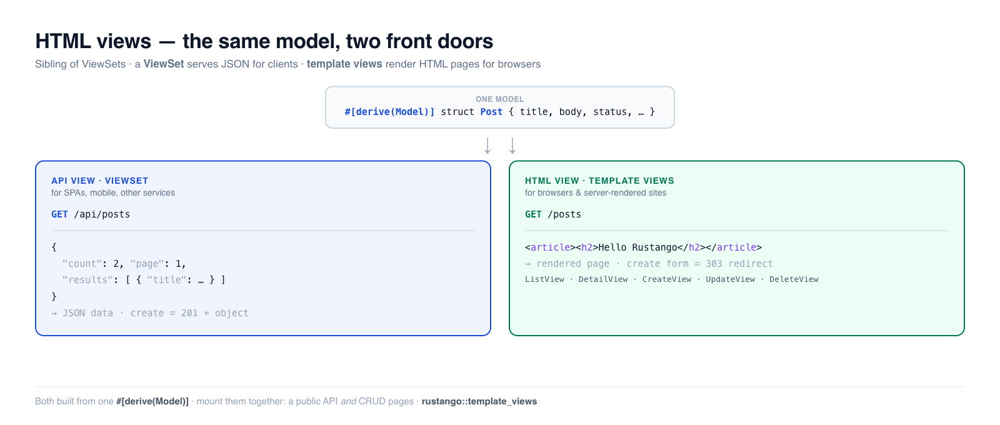

# HTML-Views — serverseitig gerenderte Seiten

Ein HTML-View verwandelt ein Modell in **serverseitig gerenderte Webseiten** — eine
Listenseite, eine Detailseite sowie Erstellungs-/Bearbeitungs-/Löschformulare — aus einer
einzigen Deklaration. Es ist das **Gegenstück zu [ViewSets](viewsets.md)**: Während ein ViewSet
JSON für API-Clients ausgibt, gibt ein HTML-View eine gerenderte Seite für einen Browser aus. Beide
werden aus demselben `#[derive(Model)]` gebaut, und du kannst ein Modell *beides* zugleich
ausliefern.

Die einzelnen View-Typen (`ListView`, `DetailView`, `CreateView`, `UpdateView`,
`DeleteView`) decken je einen Standardfall ab und rendern über
[Tera](https://keats.github.io/tera/)-Templates.

[](../img/html-views.png)

> **Neu bei einem Begriff hier?** Falls *Modell*, *Template*, *Router* oder *serverseitig gerendert*
> unbekannt sind, erklärt das [Glossar](glossary.md) jeden in einfacher Sprache.

> **Quelle:** `rustango::template_views` (`ListView`, `DetailView`, `CreateView`,
> `UpdateView`, `DeleteView`, `TemplateView`, `RedirectView`) — hinter dem
> `template_views`-Feature (standardmäßig aktiviert).
>
> **Lauffähige Version:** Das API-vs-HTML-Beispiel unten ist durch den
> Framework-Test
> [`html_and_api_contrast_sqlite_live.rs`](https://github.com/ujeenet/rustango/blob/main/crates/rustango/tests/html_and_api_contrast_sqlite_live.rs)
> festgeschrieben (`cargo test -p rustango --features sqlite --test html_and_api_contrast_sqlite_live`).
> Die einzelnen Views werden von `template_view.rs` und
> `template_views_context_object_name_sqlite_live.rs` abgedeckt.

## Inhaltsverzeichnis

- [API-Views vs HTML-Views — welche willst du?](#api-views-vs-html-views--welche-willst-du)
- [Die fünf Modell-Views](#die-fünf-modell-views)
- [ListView](#listview) · [DetailView](#detailview)
- [CreateView, UpdateView, DeleteView](#createview-updateview-deleteview)
- [Der Tera-Kontext](#der-tera-kontext)
- [TemplateView und RedirectView](#templateview-und-redirectview)
- [Single-Tenant vs Multi-Tenant](#single-tenant-vs-multi-tenant)
- [Ein Modell auf beide Arten ausliefern](#ein-modell-auf-beide-arten-ausliefern)
- [Fehlerseiten](#fehlerseiten)
- [Siehe auch](#siehe-auch)

---

## API-Views vs HTML-Views — welche willst du?

Das ist die erste Entscheidung. Beide verwandeln ein Modell in Endpunkte; sie unterscheiden sich
darin, *was herauskommt* und *wer aufruft*.

| | **API-View** — [ViewSet](viewsets.md) | **HTML-View** — dieser Leitfaden |
|---|---|---|
| Modul | `rustango::viewset` | `rustango::template_views` |
| Gibt zurück | **JSON-Daten** | eine **serverseitig gerenderte HTML-Seite** |
| Gebaut für | SPAs, Mobile-Apps, andere Services | Browser, serverseitig gerenderte Sites, CRUD im Admin-Stil |
| Ein „Erstellen" | `POST` JSON → `201` + das neue Objekt | `POST` eines Formulars → `303`-Redirect zu einer Erfolgsseite |
| Bei fehlerhafter Eingabe | `422` + eine feldbasierte JSON-Fehlerkarte | rendert das Formular mit den angezeigten Fehlern neu |
| Liest eine Liste als | eine paginierte JSON-Hülle | eine `<table>`/Schleife in deinem Template |
| Üblicherweise authentifiziert per | Tokens / JWT / API-Keys | Session-Cookies |

Du musst nicht global wählen — wähle pro Ressource, und du kannst **beide auf demselben Modell**
einhängen (siehe [unten](#ein-modell-auf-beide-arten-ausliefern)). Faustregeln:

- Du baust ein **JSON-Backend** für ein Frontend-Framework oder eine Mobile-App → ViewSet.
- Du baust eine **serverseitig gerenderte Site** (der Server gibt HTML-Seiten zurück) → HTML-Views.
- Du brauchst beides (eine öffentliche API *und* interne CRUD-Seiten) → hänge beide ein.

> Suchst du die JSON-Seite? Sie hat ihre eigene Vertiefung: [ViewSets — CRUD-REST-APIs](viewsets.md).

---

## Die fünf Modell-Views

Jeder View ist `for_model(SCHEMA)` plus ein `.router(prefix, tera, pool)`. Sie am selben
`prefix` (sagen wir `/posts`) einzuhängen, ergibt den klassischen CRUD-URL-Satz:

| View | Rendert | Eingehängte Routen | Standard-Template |
|---|---|---|---|
| [`ListView`](#listview) | eine paginierte Liste | `GET <prefix>` | `<table>_list.html` |
| [`DetailView`](#detailview) | eine Zeile | `GET <prefix>/{pk}` | `<table>_detail.html` |
| [`CreateView`](#createview-updateview-deleteview) | ein Formular für einen neuen Datensatz | `GET`/`POST <prefix>/new` | `<table>_form.html` |
| [`UpdateView`](#createview-updateview-deleteview) | ein vorausgefülltes Bearbeitungsformular | `GET`/`POST <prefix>/{pk}/edit` | `<table>_form.html` |
| [`DeleteView`](#createview-updateview-deleteview) | eine Bestätigungsseite | `GET`/`POST <prefix>/{pk}/delete` | `<table>_confirm_delete.html` |

`<table>` ist der Tabellenname des Modells, ein `Post` (Tabelle `posts`) sucht also nach
`posts_list.html`, `posts_detail.html` und so weiter. Überschreibe jedes davon mit
`.template("my_name.html")`.

---

## ListView

Eine paginierte Listenseite. Du stellst ein Template bereit, das über `object_list` iteriert;
der View übernimmt Paginierung, Sortierung, Filterung und Suche aus den Query-Parametern.

```rust
use rustango::template_views::ListView;
use std::sync::Arc;
use tera::Tera;

let app = ListView::for_model(Post::SCHEMA)
    .page_size(20)                       // rows per page (?page=N to navigate)
    .order_by("published_at", true)      // default sort, true = DESC
    .filter_fields(&["status", "author_id"])  // ?status=published
    .search_fields(&["title", "body"])        // ?search=rust
    .router("/posts", Arc::new(tera), pool);
```

Ein passendes `posts_list.html` — beachte `object_list` und die Paginierungsvariablen,
die der View für dich einstempelt:

```html
<h1>Posts ({{ total }})</h1>

  <article>
    <h2><a href="/posts/{{ post.id }}">{{ post.title }}</a></h2>
    <p>{{ post.body }}</p>
  </article>


<a href="?page={{ page - 1 }}">← prev</a>
page {{ page }} / {{ total_pages }}
<a href="?page={{ page + 1 }}">next →</a>
```

`?page=`, `?status=` und `?search=` funktionieren genauso wie bei einer
ViewSet-Liste — der Unterschied liegt allein darin, dass das Ergebnis eine gerenderte Seite statt
einer JSON-Hülle ist. Verwende `.context_object_name("posts")`, falls du lieber über `posts` als
über `object_list` im Template iterierst.

Die Seitengröße ist standardmäßig 20. Ein Client kann `?page_size=N` anfragen,
begrenzt durch `.max_page_size(n)` (Standard 100). `.bulk_actions(true)` lässt die
Liste einen POST mit einem `action`-Feld und den gewählten PKs annehmen:
`delete_selected` ist eingebaut, `.action(...)` fügt eigene hinzu, und
`.with_delete_confirmation(true)` zeigt vorher eine Bestätigungsseite.
`.with_fk_display(true)` fügt jedem Fremdschlüssel einen Wert `<column>_display`
hinzu, mit einer zusätzlichen Abfrage pro FK-Spalte und Seite.

**`?ordering=` ist die Ausnahme.** Die Allowlist eines `ListView` startet *leer*, also
wird der Parameter ignoriert, bis du die sortierbaren Spalten selbst nennst:

```rust
fn post_list() -> ListView {
    ListView::for_model(Post::SCHEMA).ordering_fields(&["title", "published_at"])
}
```

Ohne diesen Aufruf fällt die Liste auf das eigene `.order_by(...)` des Builders zurück,
oder auf PK-ASC, damit die Paginierung deterministisch bleibt. Nur eine Spalte wird
akzeptiert, mit führendem `-` für absteigend.

---

## DetailView

Eine Zeile, anhand der URL nachgeschlagen. Standardmäßig passt sie zum Primärschlüssel
(`/posts/42`); richte sie mit `.lookup_field("slug")` auf eine andere Spalte aus, um schöne URLs zu
erhalten (`/posts/my-first-post`). Eine fehlende Zeile ist ein `404`.

```rust
use rustango::template_views::DetailView;

let app = DetailView::for_model(Post::SCHEMA)
    .lookup_field("slug")          // GET /posts/{slug} instead of /posts/{id}
    .router("/posts", Arc::new(tera), pool);
```

Das Template erhält die Zeile als `object`:

```html
<h1>{{ object.title }}</h1>
<p>{{ object.body }}</p>
<small>by author #{{ object.author_id }}</small>
```

---

## CreateView, UpdateView, DeleteView

Die Schreibseite. Jeder verarbeitet ein `GET` (ein Formular / eine Bestätigungsseite rendern) und
ein `POST` (die Arbeit erledigen, dann **weiterleiten**). Die Weiterleitung-nach-POST ist das
Standardmuster **Post/Redirect/Get** — es verhindert, dass ein Browser-Refresh erneut absendet.

**CreateView** — `GET /posts/new` rendert ein leeres Formular; `POST /posts/new`
fügt die Zeile ein und `303`t zu `success_url`:

```rust
use rustango::template_views::CreateView;

let app = CreateView::for_model(Post::SCHEMA, &["title", "body"])
    .success_url("/posts")         // where to send the browser after a save
    .router("/posts", Arc::new(tera), pool);
```

Die Feldliste ist Pflicht. Sie ist die Schreib-Allowlist: Das Formular zeigt nur
diese Felder, jeder andere gesendete Schlüssel (etwa `author_id=1`) wird ignoriert.
Bei UpdateView behält ein gelistetes, aber nicht gesendetes Feld seinen Wert; nur
ein `bool` wird `false`, weil eine nicht angehakte Checkbox nichts sendet. Bei
CreateView bekommt ein gelistetes, nicht gesendetes Feld mit Spalten-Default diesen Default.

Das Formular-Template (`posts_form.html`) wird mit UpdateView geteilt. `is_update`
unterscheidet die beiden, und **`form`** trägt sowohl die Felder als auch etwaige
Validierungsmeldungen:

```html
<form method="post">
  {{ csrf_input | safe }}
  
    <label for="{{ field.name }}">{{ field.name }}</label>
    <input id="{{ field.name }}" name="{{ field.name }}" value="{{ field.value }}"
           required
           maxlength="{{ field.max_length }}">
    
      <p class="error">{{ form.errors[field.name] }}</p>
    
  
  <button>SaveCreate</button>
</form>
```

Zwei Dinge sind hier leicht falsch zu machen. `form.errors` bildet einen Feldnamen auf
**einen String** ab, nicht auf eine Liste — `join` darauf ist ein Fehler. Und es gibt keine
`errors`-Variable auf oberster Ebene; über eine solche zu iterieren ist ein Tera-Render-Fehler,
sodass die Seite 500 zurückgibt, statt die Meldung anzuzeigen.

`{{ csrf_input | safe }}` braucht den Filter: Tera escapt `.html` automatisch, ohne ihn wird
das Token als Text gerendert und jedes POST abgelehnt.

**Validierung.** Schema-Regeln (Typ, `max_length`, NOT NULL…) werden automatisch
erzwungen. Füge mit einem Closure-Validator eigene hinzu — bei `Err` wird das Formular
mit den Meldungen und einem `422`-Status neu gerendert statt gespeichert:

```rust
use rustango::forms::FormErrors;

CreateView::for_model(Post::SCHEMA, &["title", "body"])
    .validator(|data| {
        let mut errs = FormErrors::default();
        if data.get("title").map_or(true, |t| t.len() < 5) {
            errs.add("title", "must be at least 5 characters");
        }
        if errs.is_empty() { Ok(()) } else { Err(errs) }
    })
    .success_url("/posts")
    .router("/posts", Arc::new(tera), pool);
```

Du kannst auch die Validatoren einer `#[derive(Form)]`-Struktur mit `.form::<F>()` wiederverwenden
(vorerst nur Validierung — siehe die API-Dokumentation).

**UpdateView** — `GET /posts/{pk}/edit` rendert dasselbe Formular, vorausgefüllt aus der
Zeile (`object` ist befüllt, `is_update` ist `true`); `POST` aktualisiert und `303`t.

```rust
use rustango::template_views::UpdateView;

UpdateView::for_model(Post::SCHEMA, &["title", "body"])
    .success_url("/posts")
    .router("/posts", Arc::new(tera), pool);
```

**DeleteView** — `GET /posts/{pk}/delete` rendert eine Bestätigungsseite
(`posts_confirm_delete.html`, mit `object`); `POST` löscht und `303`t.

```rust
use rustango::template_views::DeleteView;

DeleteView::for_model(Post::SCHEMA)
    .success_url("/posts")
    .router("/posts", Arc::new(tera), pool);
```

Hänge alle fünf am selben Präfix ein und du hast vollständiges HTML-CRUD:

```rust
let app = axum::Router::new()
    .merge(ListView::for_model(Post::SCHEMA).router("/posts", tera.clone(), pool.clone()))
    .merge(DetailView::for_model(Post::SCHEMA).router("/posts", tera.clone(), pool.clone()))
    .merge(CreateView::for_model(Post::SCHEMA, &["title", "body"]).success_url("/posts").router("/posts", tera.clone(), pool.clone()))
    .merge(UpdateView::for_model(Post::SCHEMA, &["title", "body"]).success_url("/posts").router("/posts", tera.clone(), pool.clone()))
    .merge(DeleteView::for_model(Post::SCHEMA).success_url("/posts").router("/posts", tera, pool));
```

---

## Der Tera-Kontext

Jeder View stempelt einen konsistenten Kontext ein, damit Templates sauber zwischen ihnen portieren:

| View | Im Template verfügbare Variablen |
|---|---|
| `ListView` | `object_list` (die Zeilen der Seite), `page`, `page_size`, `total`, `total_pages`, `has_next`, `has_prev`, `page_marks`, `prev_page_url` / `next_page_url`, `ordering`, `filters`, `search` (and `bulk_actions` when on) |
| `DetailView` | `object` (die Zeile) |
| `CreateView` | `form` (`.fields`, `.errors`), `is_create` (true), `is_update` (false) — **kein `object`** |
| `UpdateView` | `form` (`.fields`, `.errors`), `object` (die Zeile), `pk`, `is_create` (false), `is_update` (true) |
| `DeleteView` | `object` (die zu bestätigende Zeile) |

Zeilen werden als schlichte, nach Spaltennamen indizierte Maps bereitgestellt (`{{ post.title }}`),
wobei SQL-`NULL` als `null` gerendert wird. Verwende `.context_object_name("posts" / "post")`, um
neben `object_list` / `object` einen freundlicheren Alias hinzuzufügen.

Jeder Eintrag in `form.fields` trägt `name`, `column`, `ty`, `required`, `max_length` und
`value`. Eine Checkbox und ein `blank`-String sind nie `required`. `form.errors` ist nach Feldnamen indiziert und enthält eine Meldung pro Feld, keine
Liste. Jeder View stempelt zusätzlich `csrf_token` und `csrf_input` ein, und jeder
View-Router weist einen POST ohne passendes Token ab.

`CreateView` stempelt kein `object` ein, daher ist `{{ object.title }}` in einem
Erstellformular undefiniert statt leer — verwende `{{ field.value }}` aus `form.fields`, das
in beiden Fällen befüllt ist.

---

## TemplateView und RedirectView

Zwei modellfreie Helfer für die Seiten, die jede Site hat:

**TemplateView** — rendert ein statisches Template mit einem festen Kontext (eine „Über uns"-Seite,
eine Landingpage). Kein Modell, keine Datenbank:

```rust
use rustango::template_views::TemplateView;

let app = TemplateView::new("about.html")
    .context_value("title", "About us")
    .router("/about", Arc::new(tera));
```

**RedirectView** — eine permanente oder temporäre Weiterleitung an einer URL (für verschobene Seiten):

```rust
use rustango::template_views::RedirectView;

let app = RedirectView::to("/posts").router("/old-posts");
```

Sie antwortet mit `302 Found`; `.permanent()` macht daraus `301`.

**FormView** — ein Formular ohne Modell. `FormView::<ContactForm>::for_form(handler)`
rendert bei GET ein `#[derive(Form)]`-Formular (Template standardmäßig `form.html`).
Bei POST validiert es und ruft Ihren async Handler auf; `Ok(())` leitet mit `303`
weiter, `Err(msg)` rendert das Formular neu. Ungültige Eingaben rendern es mit
`422` neu. Sein Kontext ist `errors` (eine Liste pro Feld; formularweite Fehler
unter `__all__`) und `values`. Wie bei jeder View hier ist `.success_url` standardmäßig `/`.

---

## Single-Tenant vs Multi-Tenant

Jeder Modell-View bringt zwei Router-Konstruktoren mit — derselbe Builder, wähle den, der dazu
passt, wie deine App Datenbankverbindungen verwaltet:

- **`.router(prefix, tera, pool)`** — Single-Tenant; erfasst zur Einhängezeit einen Pool.
  Das nutzen die Beispiele oben.
- **`.tenant_router(prefix, tera)`** — Multi-Tenant; löst eine Verbindung pro Request aus dem
  [`Tenant`](https://docs.rs)-Extractor auf. Verfügbar mit den Features
  `template_views` + `tenancy`. Templates portieren unverändert zwischen beiden.

Das spiegelt die ViewSet-Aufteilung (`router` / `router_pool` vs `tenant_router`).

---

## Ein Modell auf beide Arten ausliefern

Du bist nicht auf eine Eingangstür beschränkt. Hänge eine JSON-API *und* HTML-Seiten über dasselbe
Modell und denselben Pool ein — eine öffentliche API für Clients, serverseitig gerenderte Seiten
für Menschen:

```rust
use rustango::viewset::ViewSet;
use rustango::template_views::{ListView, DetailView};

let app = axum::Router::new()
    // JSON for API clients:
    .merge(ViewSet::for_model(Post::SCHEMA, &["id", "title", "body"]).router_pool("/api/posts", pool.clone()))
    // HTML pages for browsers:
    .merge(ListView::for_model(Post::SCHEMA).router("/posts", tera.clone(), pool.clone()))
    .merge(DetailView::for_model(Post::SCHEMA).router("/posts", tera, pool));
```

Jetzt gibt `GET /api/posts` die paginierte JSON-Hülle zurück und `GET /posts`
gibt eine gerenderte HTML-Liste zurück — dieselben Zeilen, derselbe Pool, zwei Formen. Genau dieses
Setup ist es, was der [zugrunde liegende Test](https://github.com/ujeenet/rustango/blob/main/crates/rustango/tests/html_and_api_contrast_sqlite_live.rs)
behauptet.

---

## Fehlerseiten

Ein Layer macht aus jedem 4xx/5xx deiner App eine Seite für Menschen und lässt
API-Clients in Ruhe. Er ist **standardmäßig aus**; nichts ändert sich, bis du
ihn einschaltest. Braucht das Feature `template_views`.

### Einschalten

Auf dem Multi-Tenant-Server umschließt der Layer alles: deine API, den
Tenant-Login, den Tenant-Admin, die Operator-Konsole und die eigenen Layer des
Frameworks.

```rust
use std::sync::Arc;
use rustango::errors::ErrorPagesLayer;

let tera = Arc::new(rustango::template_extensions::html_tera_from_glob("templates/**/*.html")?);
let app = rustango::server::Builder::from_env().await?
    .api(my_app::urls::api())
    .error_pages(ErrorPagesLayer::new().templates(tera));
```

`AppBuilder::error_pages` macht dasselbe für eine Single-Pool-App. Auf einem
eigenen Router hängst du ihn mit `ErrorPagesRouterExt` an und ergänzt den
404-Fallback:

```rust
use rustango::errors::{ErrorPagesLayer, ErrorPagesRouterExt as _};

let app = Router::new()
    .route("/projects", get(projects))
    .fallback(rustango::errors::not_found)
    .error_pages(ErrorPagesLayer::new().templates(tera.clone()));
```

Mit `Cli` und einer Config-Datei nimmst du stattdessen den Abschnitt `[errors]`:

```toml
[errors]
enabled = true            # default false
templates = "templates"   # template root holding errors/404.html etc.; default "templates"
htmx_target = "#flash"    # HX-Retarget for htmx errors; default "#flash", "" sends none
```

Ein fehlendes `templates`-Verzeichnis wird still übersprungen; eines, das nicht
parst, wird mit einer Warnung geloggt. In beiden Fällen gelten die eingebauten Seiten.

`cargo rustango new` schreibt `[errors] enabled = true` in
`config/default.toml`, also hat ein neues Projekt die Seiten eingeschaltet.
Ältere Projekte bleiben aus, bis sie den Abschnitt ergänzen.

### Was jeder Client bekommt

| Anfrage | Antwort |
|---|---|
| Browser-Navigation (`Accept: text/html`, kein `HX-Request`) | Vollständige HTML-Seite |
| htmx (`HX-Request`) | HTML-Fragment, plus `HX-Retarget: <htmx_target>` und `HX-Reswap: innerHTML show:window:top` |
| Jeder andere Client (`fetch`, curl) | Body unverändert; ein leerer Body bekommt die Meldung als Klartext |
| JSON / problem+json | Unverändert, außer es trägt eine `Message` und ein Browser oder htmx fragt |
| `HEAD` | Unverändert |
| Eine mit `rustango::errors::KeepBody` markierte Antwort | Unverändert |

**Auch ein `text/html`-Fehler-Body wird ersetzt**, außer die Antwort ist mit
`KeepBody` markiert: markiere jede HTML-Fehlerseite, die du selbst baust.

Ersetzt werden nur Text-Bodies (`text/plain`, `text/html`, keiner) und JSON mit
Meldung; Bilder und andere Typen gehen durch. Eine ersetzte Antwort behält
Status und Header (auch `Retry-After`) und bekommt `Vary: Accept, HX-Request`.

### Templates

Das erste Template, das in deinem Tera existiert, gewinnt:

1. `errors/<code>.html`, z. B. `errors/404.html`
2. `errors/4xx.html` oder `errors/5xx.html`
3. `errors/default.html`
4. die eingebaute Seite

htmx-Fragmente nutzen `errors/partial.html`, dann das eingebaute Fragment. Ein
Template, das beim Rendern scheitert, wird geloggt und die eingebaute Seite
verwendet; eine Fehlerseite kommt nie leer zurück.

`templates/errors/404.html`:

```html


<section class="error">
  <h1>{{ code }} · {{ title }}</h1>
  <p>{{ message }}</p>
  <p>Nothing at <code>{{ path }}</code>.</p>
  <p>Signed in as {{ user.username }}.</p>
  <a href="/">Back to the start</a>
</section>

```

`templates/errors/5xx.html`:

```html


<section class="error">
  <h1>{{ title }}</h1>
  <p>{{ message }}</p>
  <form method="post" action="/feedback">{{ csrf_input | safe }}
    <button>Tell us what you were doing</button>
  </form>
</section>

```

Kontext:

| Schlüssel | Wert |
|---|---|
| `code` | Der Status, z. B. `404` |
| `title` | Ein kurzer Titel pro Status („Not found") |
| `message` | Was schiefging, für den Nutzer (siehe unten) |
| `path` | Der Request-Pfad |
| `user` | `{ username, is_superuser }` des angemeldeten Tenant-Nutzers, oder null |
| `username`, `is_superuser` | Dasselbe, flach |
| `csrf_token`, `csrf_input` | Ein CSRF-Token und sein Hidden-Input, unter dem Cookie-Namen deines CSRF-Layers. Das Cookie wird nur gesetzt, wenn das Template sie nutzt |
| `csp_nonce` | Der CSP-Nonce dieser Anfrage, oder `""` |
| `brand_name`, `brand_logo_url`, `brand_css`, `theme_mode` | Aus `[brand]` |

`user` braucht das Feature `tenancy` und einen Tenant-Host; sonst ist es null.
Templates gelten pro App: jeder Tenant bekommt dieselben.

### Die eingebaute Seite

Eigenständiges HTML: kein CDN, kein Script, Inline-CSS mit dem CSP-Nonce der
Anfrage, die Theme-Tokens des Admins (hell und dunkel). Mit `[errors]` in den
Settings zeigt sie `[brand] name` und `logo_url`; `primary_color` und
`theme_mode` setzen die Farben (sie brauchen das Feature `tenancy`, dessen
Brand-Code wiederverwendet wird). `ErrorPagesLayer::brand(&settings.brand)`
macht dasselbe im Code.

### Die Meldung

Ein Handler gibt der Seite Worte mit `rustango::errors::Message`, einer
Response-Extension, oder mit `PageError`, das eine trägt:

```rust
use rustango::errors::{Message, PageError};

async fn project(Path(slug): Path<String>) -> Result<Html<String>, PageError> {
    let project = find_project(&slug)
        .await
        .map_err(PageError::server)?            // logged; the page says something generic
        .ok_or_else(|| PageError::not_found("No project with that name."))?;
    Ok(Html(render_project(&project)))
}

async fn archived() -> impl IntoResponse {
    (StatusCode::GONE, Message::new("This project was archived."))
}
```

Ohne `Message` ist ein 4xx-`text/plain`-Body bis 2 KiB die Meldung (axums
Rejections, der CSRF-Check), sonst der Standardtext des Status. Der erste
Buchstabe wird großgeschrieben.

Ein 5xx zeigt nie seine Ursache: Die Seite nutzt den generischen Text, und
`PageError::server(e)` loggt `e` und sendet denselben undurchsichtigen Body wie
jedes andere 5xx. Nur wenn `RUSTANGO_DISCLOSE_ERRORS` gesetzt ist, zeigt eine
5xx-Seite ihre Meldung oder ihren Body — dieselbe Regel wie für jeden 5xx-Body
im Framework.

`PageError::forbidden(msg)` und `PageError::new(status, msg)` decken andere
Status ab. `ErrorPagesLayer::htmx_swap(..)` ändert den `HX-Reswap`-Wert.

### Was abgedeckt ist

Über `Builder::error_pages` (oder `[errors]`) eingehängt, sitzt der Layer
innerhalb der Security-Header und außerhalb von allem anderen, er ersetzt also:

- unbekannte Pfade und unbekannte Hosts (404) sowie 405;
- das 500 des Panic-Guards;
- das 403 des CSRF-Layers, mit seinem Grund;
- die Gates `login_required_or_401` / `*_or_403` (401, 403);
- Body-Limit (413), Request-Timeout (504), Rate-Limit und Login-Throttle (429);
- axums Rejections (400, 415, 422);
- die Ablehnungen und 404 des Tenant-Admins sowie unbekannte Pfade der Operator-Konsole.

Seiten mit eigenen Bedienelementen behalten ihr Aussehen: jede HTML-Fehlerseite
des Admins, des Tenant-Admins, der Operator-Konsole und der generischen Views,
etwa ein mit seinem Fehler erneut gezeigtes Formular, die Seite „admin access
required" (sie hat ein Abmelde-Formular) und die Seite „table not migrated". Markiere eigene Antworten mit `KeepBody`, um dasselbe zu tun.

### Umstieg von einer selbst geschriebenen Fehler-Middleware

Eine App mit eigener `error_pages`-Middleware kann löschen:

- die Middleware (`from_fn(error_pages)`) und ihr `.fallback(not_found)`;
- ihre Titel/Meldungs-Tabelle: `rustango::errors::error_words` ist dieselbe Tabelle;
- ihre private Meldungs-Extension: gib `PageError` oder `Message` zurück;
- das Klonen von Headern/Extensions, um CSRF zu stempeln und den Nutzer zu finden.

Behalte `templates/error.html` als `templates/errors/default.html` und den
htmx-Alert als `templates/errors/partial.html`; die Kontext-Schlüssel sind dieselben.

---

## Siehe auch

- [ViewSets — CRUD-REST-APIs](viewsets.md) — das JSON/API-Gegenstück, ausführlich.
- [Admin](admin.md) — der automatisch generierte Admin baut auf denselben Views auf.
- [URLs & Routing](urls.md) — wie du diese Router zu deiner App zusammensetzt.
- [Serializer](serializers.md) — forme das JSON, wenn du den API-Weg gehst.
