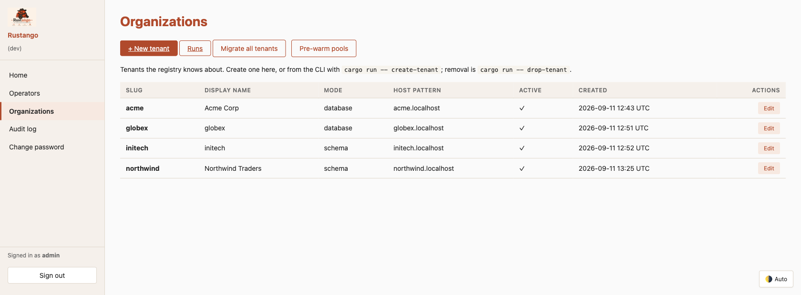
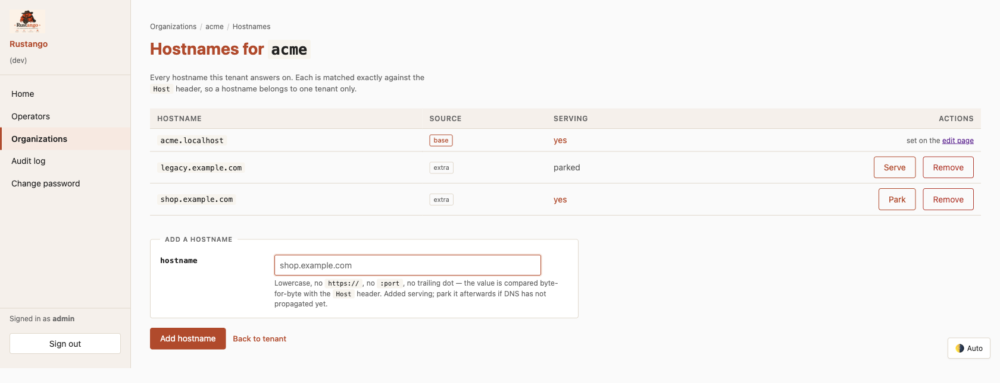
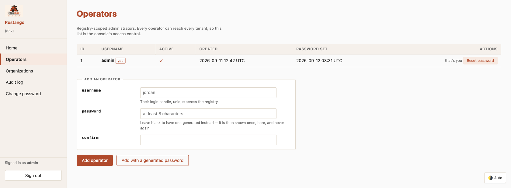
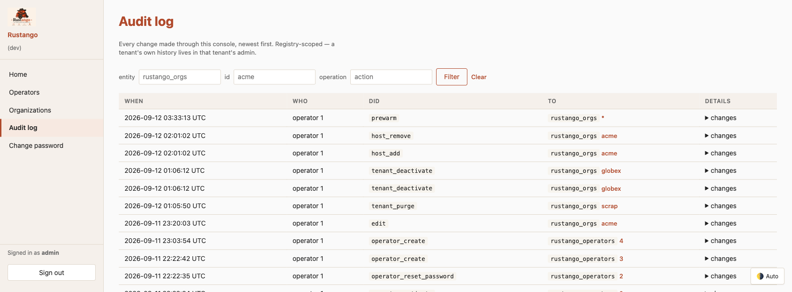
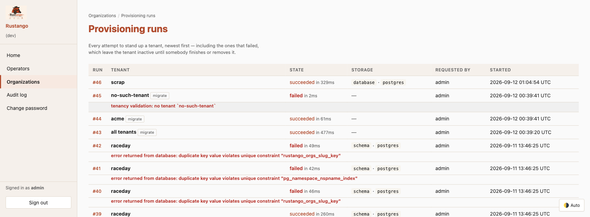

# Die Operator-Konsole

Ein Multi-Tenant-Projekt hat zwei Arten von Administratoren, und die vermischen sich nie:

- **Operatoren** betreiben das *Deployment*. Sie leben in der Registry, melden sich auf der Apex-Domain an und erreichen jeden Tenant.
- **Tenant-Benutzer** betreiben *einen* Tenant. Sie leben in der Datenbank dieses Tenants und sehen die Konsole nie.

Die Operator-Konsole ist die Weboberfläche für die erste Art — Tenants provisionieren, Hostnamen binden, Operatoren verwalten, den Audit-Trail lesen und einen Tenant außer Betrieb nehmen. Alles davon ist auch ein [`manage`-Verb](manage.md#tenancy-befehle), denn eine Aktion, die es nur auf einer Oberfläche gibt, lässt sich nicht automatisieren — und eine, die es nur in der Shell gibt, nicht delegieren.

Die Lücke, die man kennen sollte: Die Konsole kann **einen** Tenant migrieren
(`POST /orgs/{slug}/migrate`), während `migrate-tenants` in der CLI keinen Slug
nimmt und die ganze Registry abarbeitet. Eine Migration pro Tenant gibt es auf
der Kommandozeile nicht.

[](../img/operator-console.png)

## Inhaltsverzeichnis

- [Einbinden](#einbinden)
- [Was jede Seite tut](#was-jede-seite-tut)
- [Hostnamen](#hostnamen)
- [Unbekannte Hosts](#unbekannte-hosts)
- [Operatoren](#operatoren)
- [Zwei-Faktor-Anmeldung](#zwei-faktor-anmeldung)
- [Das Audit-Log](#das-audit-log)
- [Provisioning-Läufe](#provisioning-läufe)
- [Datenbankserver](#datenbankserver)
- [Branding](#branding)
- [Die drei Fähigkeitsstufen](#die-drei-fähigkeitsstufen)

---

## Einbinden

Die Konsole ist ein Router, den du einhängst; wie viel sie kann, hängt davon ab, was du ihr gibst.

```rust
use rustango::tenancy::operator_console::{router, router_with_pools, router_with_provisioning, SessionSecret};
use rustango::tenancy::provision::Provisioner;

// `pools` ist hier ein `Arc<TenantPools<_>>`.

// Nur lesend: Tenants, Operatoren und das Audit-Log durchsehen.
let app = router(registry.clone(), SessionSecret::from_env_or_random());

// …plus Tenants bearbeiten, Operatoren verwalten, Hostnamen binden, Pools vorwärmen.
let app = router_with_pools(registry.clone(), pools.clone().into_invalidator(), secret);

// …plus neue Tenants provisionieren und Migrationen ausführen.
let provisioner = Provisioner::new(pools.clone(), registry_url.clone(), "migrations").erased();
let app = router_with_provisioning(
    registry.clone(),
    pools.clone().into_invalidator(),
    provisioner,
    secret,
);
```

Zwei Konvertierungen leisten dort Arbeit, und keine davon ist optional.
`pools` geht als `Arc<dyn TenantPoolInvalidator>` hinein, braucht also
`.into_invalidator()` — die Konsole invalidiert Pools nur, und der enge
Trait ist es, was sie von allem anderen fernhält. `Provisioner::new`
schließt über die Pools, die Registry-URL und das Migrationsverzeichnis,
und `.erased()` steckt das Ganze hinter `Arc<dyn TenantProvisioner>`.

In einem generierten `tenant`-Projekt ist das bereits verdrahtet — `Cli::new().tenancy().with_tenant_provisioning("migrations")` hängt die volle Variante ein. Siehe [Scaffolding](scaffolding.md).

Die Konsole antwortet auf der **Apex**-Domain (`RUSTANGO_APEX_DOMAIN`), nicht auf einer Tenant-Subdomain: `http://localhost:8080/login` bei Apex `localhost`. Eine Anfrage an `127.0.0.1` ist nicht der Apex und trifft nicht zu.

---

## Was jede Seite tut

| Seite | Wofür sie da ist |
|---|---|
| **Organizations** | Jeder Tenant, mit Speichermodus, Host-Muster und Aktiv-Status |
| **Organizations → Edit** | Anzeigename, Host-Muster, Pfad-Präfix, Port, Datenbank-URL, Branding |
| **Hostnames** | Die zusätzlichen Domains, unter denen ein Tenant antwortet |
| **Operators** | Wer sich an dieser Konsole anmelden darf |
| **Audit log** | Jede Änderung, die über diese Konsole lief |
| **Runs** | Provisioning- und Migrationsläufe, live gestreamt |
| **Database servers** | Server, auf denen Tenant-Datenbanken angelegt werden, mit ihrem Admin-Login |
| **Two-factor sign-in** | Die eigene Authenticator-App (Feature `totp`) |
| **Shared SSO** | Anmelde-Provider, die jedem Tenant angeboten werden, mit der zu registrierenden Callback-URL (Feature `admin-sso`; siehe [SSO](sso.md)) |

---

## Hostnamen

Ein Tenant ist unter seiner Subdomain erreichbar und optional unter weiteren Hostnamen, die du an ihn bindest. Ein Hostname führt zu genau einem Tenant.

[](../img/operator-console-hosts.png)

Zwei Dinge, die man wissen sollte:

**Der Basis-Host hat keinen Löschen-Button.** Er stammt aus der Spalte `host_pattern` des Tenants, nicht aus der Hostnamen-Tabelle, es gibt also keine Zeile zum Entfernen — ändere ihn stattdessen auf der Bearbeitungsseite des Tenants. Das ist strukturell, keine UI-Regel: die Engine lehnt es ebenfalls ab, sodass jemand, der den `POST` errät, dieselbe Antwort bekommt wie jemand, der die Seite liest.

**Stilllegen behält die Zeile.** *Park* nimmt einen Host aus dem Betrieb, ohne den Eintrag zu verlieren — nützlich, während DNS propagiert, oder beim Ausmustern einer Domain, die du vielleicht zurückhaben willst. *Serve* nimmt ihn wieder in Betrieb.

Hostnamen werden beim Eingang normalisiert: kleingeschrieben, ohne Schema, ohne Port, ohne Pfad. Der gespeicherte Wert wird Byte für Byte gegen den `Host`-Header verglichen, ein Wert, der nie passen könnte, wird also abgelehnt statt gespeichert.

Über die CLI: [`list-hosts` / `add-host` / `remove-host` / `set-host-enabled`](manage.md#hostnamen).

---

## Unbekannte Hosts

Standardmäßig geht eine Anfrage, deren Host keinen Tenant auflöst, an die
Routen deiner App, wo der `Tenant`-Extractor und die Tenant-Admin mit 404
antworten. Um dort stattdessen etwas auszuliefern — eine Einrichtungsseite beim ersten
Start, eine Seite „diese Site ist noch nicht eingerichtet" — übergib einen
Router an `unresolved_tenant`, etwa eine Route `/`, die „Erstelle deine erste Site" antwortet, solange `TenantRegistry::has_tenants()` false ist. `Builder::unresolved_tenant` hat ein kompiliertes Beispiel.

Er läuft für einen unbekannten Host und für einen Apex-Pfad, den die Konsole
nicht bedient. Er läuft nie für einen Host, der zu einem Tenant auflöst, und
die Konsole behält ihre eigenen Routen. Ein inaktiver Tenant löst nicht auf,
sein Host erreicht also ebenfalls diesen Router. Der Router bekommt die
Registry als `Extension<TenantRegistry>`, nie einen Tenant-Pool;
`has_tenants()` zählt auch inaktive Tenants. `/health` und `/ready` bleiben
daneben erreichbar.

**Sicherheit:** Jeder, der den Server erreicht, erreicht auch diesen Router.
Prüfe den Zustand selbst (biete die Einrichtung z. B. nur an, solange
`has_tenants()` false ist) und schütze alles, was schreibt.

Denselben Setter gibt es auf `rustango::server::Builder`.

---

## Operatoren

[](../img/operator-console-operators.png)

Operatoren werden deaktiviert, nie gelöscht: die Zeile bleibt, sodass sich ein späteres „wer war das?" noch auflösen lässt. Die Konsole liest sie bei **jeder** Anfrage neu, sodass eine Deaktivierung beim nächsten Klick greift und nicht erst, wenn das Cookie abläuft.

Zwei Dinge lässt die Seite aus demselben Grund nicht zu:

- **Dich selbst deaktivieren.** Deine nächste Anfrage würde abgewiesen.
- **Den letzten aktiven Operator deaktivieren.** Das sperrt alle aus, und nur eine Shell auf der Registry könnte es rückgängig machen.

Ein generiertes Passwort wird **einmal** angezeigt, im Antwortkörper — nie über einen Redirect, der es in die Adressleiste, die Historie, den Referrer und jedes Access-Log dazwischen tragen würde.

Über die CLI: [`list-operators` / `set-operator-active`](manage.md#list-operators).

---

## Zwei-Faktor-Anmeldung

Mit dem Feature `totp` kann ein Operator unter **Two-factor sign-in** (`/account/totp`) eine Authenticator-App hinzufügen. Die Seite zeigt einen Einrichtungsschlüssel und einen `otpauth://`-Link, bis ein Code ihn bestätigt. Zum Abschalten ist ein aktueller Code nötig.

Danach öffnet das Passwort allein nur den Code-Schritt (`/login/totp`); keine Konsolenseite antwortet, bis der Code stimmt. Jeder Code gilt einmal, und falsche Codes zählen gegen dieselben Limits und dieselbe Sperre wie falsche Passwörter. Einrichten, Abschalten und jeder falsche Code landen im [Audit-Log](#das-audit-log) als `totp_enroll`, `totp_disable` und `totp_failed`, nie mit dem Code.

Pro Operator ist es freiwillig. Mit `RUSTANGO_OPERATOR_REQUIRE_TOTP=1` wird es Pflicht: Ein Operator ohne Gerät richtet dann beim Code-Schritt eines ein, bevor die erste Sitzung beginnt. Wird beim Start gelesen.

Die Geheimnisse liegen in `rustango_operator_totp` in der Registry, versiegelt unter `RUSTANGO_SECRET_KEY`, der zum Einrichten gesetzt sein muss. `migrate` legt die Tabelle an, sonst die Konsole bei der ersten Anmeldung. Fehlt die Tabelle (eine Registry-Rolle ohne CREATE, vor `migrate`), reicht das Passwort, sofern TOTP nicht Pflicht ist; existiert sie, ist aber nicht lesbar, wird die Anmeldung abgelehnt. Wiederherstellungscodes gibt es noch nicht: Wer das Gerät verliert, braucht eine Shell auf der Registry, um seine Zeile zu löschen.

---

## Das Audit-Log

[](../img/operator-console-audit.png)

Jede Änderung über die Konsole wird festgehalten: Tenant-Bearbeitungen, Hostnamen-Änderungen, Operator-Verwaltung, Impersonation, Purges, Vorwärmen. Die Spalte `source` trägt `operator:<id>:<verb>`, sodass sich Operator-Aktivität im Nachhinein von Tenant-Benutzer-Aktivität trennen lässt.

Das ist das Log der **Registry**. Die eigene Historie eines Tenants liegt im Admin dieses Tenants — beides zu mischen hieße, für eine Seite eine Abfrage über jeden Tenant-Pool zu fächern.

Es wächst mit der Nutzung der Konsole, also kürze es regelmäßig mit [`audit-cleanup`](manage.md#audit-cleanup), das das Log der Registry und das jedes aktiven Tenants aufräumt.

Über die CLI: [`audit-log`](manage.md#nachsehen-was-passiert-ist).

---

## Provisioning-Läufe

[](../img/operator-console-runs.png)

Einen Tenant zu provisionieren sind mehrere Schritte gegen eine Datenbank, die langsam oder nicht erreichbar sein kann — deshalb wird es als **Lauf** aufgezeichnet und nicht als Anfrage, die entweder zurückkommt oder nicht. Jeder Lauf streamt seine Schritte live und übersteht einen Reload, eine neue Verbindung oder das Zuschauen von einem zweiten Pod aus.

Über die CLI angelegte Tenants werden ebenfalls aufgezeichnet, markiert mit `requested_by = cli`, sodass die Historie beide Oberflächen abdeckt.

### Einen Tenant anlegen

**Organizations → New tenant**. Jede Option sagt im Formular, wo die Daten
liegen, welcher Login genutzt wird und welche Rechte er braucht:

- **Schema** (nur PostgreSQL-Registry): ein Schema in der Registry-Datenbank.
  Es nutzt den Login der Registry (`DATABASE_URL`); Tenants teilen ihn und
  bekommen keinen eigenen Login. Braucht `CREATE` auf der Registry-Datenbank.

Im Datenbankmodus wählst du eine davon:

- **Create a new database on a saved server**: Wähle den Server. Er nutzt den
  Admin-Login des Servers einmal; der Tenant bekommt seinen eigenen Login. Die
  Datenbank heißt exakt wie der Slug und bekommt einen eigenen Login mit
  Zufallspasswort, der nur auf diese Datenbank Rechte hat. Der Lauf zeigt
  `create_database`, `create_login`, `grant` und `check_login` (der neue Login
  meldet sich an). Eine vorhandene Datenbank dieses Namens wird abgelehnt.
  Scheitert ein späterer Schritt, löscht der Schritt `rollback` des Laufs die
  neue Datenbank, den Login und die Tenant-Zeile, und das Formular kommt mit
  dem Grund zurück. Das ist der Standard, sobald ein Server gespeichert ist.
- **Use an existing database URL**: Nichts wird angelegt; die Datenbank muss
  existieren. Maskiert und nie an die Seite zurückgeschickt. Keine
  Admin-Rechte nötig.
- **A database on the registry's server**: ein Datenbankname; er nutzt den
  Login der Registry (`DATABASE_URL`), Tenants sind also nicht voneinander
  isoliert. Nichts wird angelegt.

**Test connection** prüft, was die gewählte Option braucht, und legt nichts
an. Auf einem gespeicherten Server führt es jede Prüfung aus, die ein Absenden
vor dem Anlegen ausführt (Slug frei, Routing, Admin-Rechte, keine Datenbank
und kein Login dieses Namens), und listet jedes Recht als yes, no oder
unknown. Im Schemamodus prüft es das `CREATE` des Registry-Logins auf der
Registry-Datenbank. Ein fehlendes Recht kommt mit den Anweisungen, die es
beheben, und das Anlegen wird mit demselben Text abgelehnt, bevor etwas
entsteht. Siehe [Rechte](tenant-databases.md#rechte). Sonst erreicht es die
Datenbank. Das Backend ist immer das der Registry.

### Erster Admin

Gib eine Admin-E-Mail an (und optional einen Benutzernamen; Standard ist die
E-Mail), und der Lauf ergänzt nach den Migrationen einen Schritt
`create_admin`, bevor der Tenant live geht. Er legt einen Superuser ohne
nutzbares Passwort an. Scheitert der Schritt, rollt der Lauf zurück wie bei
jedem anderen Schritt.

Der Admin setzt sein Passwort selbst über einen Set-Password-Link. Der Link
funktioniert einmal, läuft nach 72 Stunden ab und öffnet nur die
Passwort-ändern-Seite dieses Tenants. Mit
`Builder::first_admin_mailer(mailer, from)` wird er dem Admin gemailt. Ohne
Mailer zeigt die Lauf-Seite ihn dir **einmal**, direkt nach dem Absenden;
kopiere ihn und gib ihn dem Admin. Er wird nie gespeichert, auditiert oder
geloggt; das Audit-Log hält nur das Anlegen des Benutzers fest.

Die Felder erscheinen, wenn der Provisioner eine Übergabe hat
(`Provisioner::with_first_admin_handover`; der Standard-`Builder` setzt eine).
Ein verlorener oder abgelaufener Link: Führe
`manage set-password-link <slug> <username>` aus.

Über die CLI: [`list-runs` / `show-run`](manage.md#nachsehen-was-passiert-ist).

---

## Datenbankserver

**Organizations → Database servers** speichert einen Server einmal: Host, Port,
Admin-Benutzer, Admin-Passwort, TLS-Modus und bei Postgres optional eine
Wartungsdatenbank statt `postgres`. Bei einer SQLite-Registry ist ein „Server“
ein Verzeichnis für Tenant-Dateien. Das Backend ist immer das der Registry.

Das Passwort wird versiegelt gespeichert (`enc:v1:`), daher muss
`RUSTANGO_SECRET_KEY` gesetzt sein; sonst wird das Speichern abgelehnt, und die
Seite zeigt eine Warnung. Es wird nie wieder angezeigt: Das Bearbeiten-Formular
lässt das Feld leer, ein leeres Feld behält das gespeicherte. Audit-Zeilen
nennen die geänderten Felder, nie ihre Werte.

**Test** meldet sich an und zeigt die Serverversion und, je eine Zeile, ob der
Admin-Login Datenbanken anlegen, Logins anlegen und Rechte vergeben darf. Kann
er keine Tenants provisionieren, sagt es warum (ein fehlendes Recht oder
PostgreSQL vor 15) und zeigt die `GRANT`- / `ALTER ROLE`-Anweisungen, die es
beheben. Rechte aus aktiven MySQL-Rollen zählen.

TLS ist für einen neuen Server standardmäßig `require`. Eine Bearbeitung von
einer Seite aus, die zwischenzeitlich jemand anderes geändert hat, wird
abgelehnt; lade neu und bearbeite erneut.

Im generierten `docker compose`-Dev-Stack hat Postgres kein TLS, speichere es
also mit TLS `disable`; MySQL 8 liefert TLS, `require` funktioniert also. Der
MySQL-Benutzer `rustango` aus der Compose-Datei kann keine Benutzer anlegen und
keine Rechte vergeben; speichere diesen Server als `root`.

Löschen wird abgelehnt, solange die URL eines Datenbank-Tenants auf Host und
Port des Servers zeigt (SQLite: eine Datei in seinem Verzeichnis) oder sich
nicht auflösen lässt, solange eine Datenbank, die rustango dort angelegt hat,
noch festgehalten ist, und bei einer Konsole ohne Tenant-Pools.

Ein Tenant, dessen Datenbank auf einem gespeicherten Server angelegt wurde,
bekommt auf seiner Seite **Rotate database password**. Das und **Purge** laufen
als festgehaltene Läufe, live verfolgt wie ein Anlegen. Der ganze Ablauf steht
in [Tenant-Datenbanken auf einem gespeicherten Server](tenant-databases.md).

Über die CLI: [`add-db-server` und Verwandte](manage.md#datenbankserver).

---

## Branding

Name, Tagline, Logo, Akzentfarbe und Theme der Konsole kommen aus `[brand]` in
`config/default.toml` oder `config/<env>_settings.toml`:

```toml
[brand]
name          = "Acme Operator"
tagline       = "Production"
logo_url      = "https://cdn.example.com/acme-logo.png"
primary_color = "#2c6fb0"
theme_mode    = "auto"
```

| Schlüssel | Standard | Was er tut |
|---|---|---|
| `name` | `Rustango` | Name in der Kopfzeile und auf der Anmeldeseite |
| `tagline` | keiner; die Anmeldeseite zeigt „Operator console" | Zeile unter dem Namen |
| `logo_url` | `/__static__/rustango.png` | Logo-Bild; Standard ist das mitgelieferte Logo, von der Konsole ausgeliefert |
| `logo_path` | keiner | Lokale Logo-Datei, die die Konsole selbst ausliefert; siehe [Eigenes Logo](#eigenes-logo) |
| `primary_color` | die Farbe des Themes | Färbt primäre Buttons und Links. Hex: `#rrggbb` oder `#rgb` |
| `theme_mode` | `auto` | Start-Theme: `auto`, `light` oder `dark` |

Ein leerer Wert gilt als nicht gesetzt. Eine `primary_color` oder ein
`theme_mode`, die sich nicht parsen lassen, werden ignoriert, und der Standard
bleibt.

Umgebungsvariablen überschreiben die Datei, so kannst du ein Deployment ohne
Konfigurationsänderung umbranden:

| Variable | Überschreibt |
|---|---|
| `RUSTANGO_OPERATOR_BRAND_NAME` | `name` |
| `RUSTANGO_OPERATOR_TAGLINE` | `tagline` |
| `RUSTANGO_OPERATOR_LOGO_URL` | `logo_url` |
| `RUSTANGO_OPERATOR_LOGO_PATH` | `logo_path` |
| `RUSTANGO_OPERATOR_PRIMARY_COLOR` | `primary_color` |
| `RUSTANGO_OPERATOR_THEME_MODE` | `theme_mode` |

Die Reihenfolge: Umgebungsvariable, dann `[brand]` (die Stufen-Datei über
`default.toml`), dann der Standard. Eine leere Variable wird ignoriert. Die
Konsole liest all das einmal beim Start, starte sie also nach einer Änderung
neu.

### Eigenes Logo

Die Apex-Domain liefert nur die Konsole aus: Ein `Cli::with_static`-Mount wird
auf Tenant-Hosts ausgeliefert, nicht auf dem Apex. Ein Logo ist also entweder
eine Datei, die die Konsole ausliefert, oder eine vollständige URL.

`logo_path = "assets/acme-logo.png"` nennt eine lokale Datei, relativ zum
Arbeitsverzeichnis. Die Konsole liest sie einmal beim Start, mit denselben
Prüfungen wie ein Tenant-Logo-Upload: PNG, JPEG, WebP oder ICO (kein SVG),
höchstens `RUSTANGO_BRAND_MAX_BYTES` (1 MiB). Sie liefert die Datei unter
`/__static__/brand-logo.<ext>?v=<hash>` mit einem Jahr Cache aus; der Hash
ändert sich mit der Datei. Eine fehlende oder abgelehnte Datei loggt eine
Warnung, und das mitgelieferte Logo bleibt.

`logo_url` geht direkt in ``, der Browser muss es also laden können:
ein CDN, ein Object-Storage-Bucket oder deine Website. Wenn du
`[security] csp` setzt, erlaube diesen Host in `img-src`.

Sind beide gesetzt, gewinnen die Umgebungsvariablen über die Datei, und
innerhalb einer Quelle gewinnt `logo_url` über `logo_path`.

In einem Projekt ohne Tenancy teilt sich der Admin einen Host mit deinen
Routen, dort funktioniert ein Static-Mount also; siehe
[den Branding-Abschnitt des Admins](admin.md#konfiguration-admin-und-brand).

Die Konsole setzt kein Favicon, und es gibt keinen Schlüssel dafür.

### Die Taglines `dev` und `staging`

`cargo rustango new` schreibt `tagline = "dev"` unter `[brand]` in
`config/dev_settings.toml` und `tagline = "staging"` in
`staging_settings.toml`, damit du die Stufen auf einen Blick unterscheidest;
die Tagline erscheint als Badge. `prod_settings.toml` setzt keine. Die
Stufen-Datei gewinnt über `default.toml`, das ersetzt also eine Tagline, die
du dort gesetzt hast.

Um sie zu ändern, bearbeite die Zeile, etwa `tagline = "Acme dev"`. Um sie zu
entfernen, lösche die Zeile oder setze `tagline = ""`. In einem Projekt mit
Admin ist dieselbe Tagline der Untertitel des Admins.

### Branding pro Tenant

Jeder Tenant hat seine eigene Marke in seiner `Org`-Zeile, gesetzt unter
**Organizations → Edit**: `brand_name`, `brand_tagline`, `primary_color` und
`theme_mode`. Das Formular **Branding assets** auf derselben Seite lädt ein
Logo (PNG, JPEG oder WebP) und ein Favicon (PNG oder ICO) hoch, je bis 1 MB
(`RUSTANGO_BRAND_MAX_BYTES`). Die Dateien liegen unter
`RUSTANGO_BRAND_STORAGE_DIR`, Standard `./var/brand`.

Der Tenant-Admin und seine Anmeldeseite nutzen diese Werte; `[brand]` erreicht
sie nicht. Ohne `brand_name` wird der Anzeigename des Tenants gezeigt, ohne
hochgeladenes Logo das Framework-Logo. Das Favicon erscheint auf der Anmelde-
und der Passwort-ändern-Seite des Tenants. Siehe
[den Branding-Abschnitt des Admins](admin.md#der-tenant-admin).

---

## Die drei Fähigkeitsstufen

Welche Routen existieren, hängt davon ab, welchen Konstruktor du eingehängt hast:

| | `router` | `router_with_pools` | `router_with_provisioning` |
|---|---|---|---|
| Tenants, Operatoren, Audit-Log durchsehen | ✓ | ✓ | ✓ |
| Tenant bearbeiten, Hostnamen verwalten | | ✓ | ✓ |
| Operatoren anlegen / deaktivieren | | ✓ | ✓ |
| Pools vorwärmen | | ✓ | ✓ |
| Tenant außer Betrieb nehmen | | ✓ | ✓ |
| Neuen Tenant provisionieren, Migrationen ausführen | | | ✓ |
| Provisioning-Läufe ansehen | | | ✓ |
| Datenbankserver speichern und testen | | | ✓ |

Nicht eingehängte Routen liefern 404 statt 403 — eine Nur-Lese-Konsole bewirbt nicht, was sie nicht kann.

### Drei weitere Konstruktoren, für Verdrahtung statt für Fähigkeiten

Die drei oben sind die Fähigkeitsstufen. Die übrigen nehmen dieselben
Stufen und ergänzen Verdrahtung, sind also keine vierte und fünfte
Sprosse:

| Konstruktor | Stufe | Was er zusätzlich nimmt |
|---|---|---|
| `router_with_brand_storage` | nur lesend, oder bearbeitend mit `Some(pools)` | ein `BoxedStorage` für Branding-Uploads, wenn das voreingestellte `LocalStorage` nicht der gewünschte Ort ist |
| `router_with_impersonation` | bearbeitend | Brand-Storage, das Tenant-Session-Secret und eine Handoff-URL, damit ein Operator einen Tenant betreten kann |
| `router_full` | was immer du übergibst | all das als `Option` — `None` hängt die jeweiligen Routen schlicht nicht ein |

`Server::Builder::serve` hängt Impersonation für dich ein; ein eigener
Mount-Punkt entscheidet sich dafür, indem er `router_with_impersonation`
statt `router_with_pools` verwendet. Greif zu `router_full`, wenn du eine
Kombination brauchst, die die Kurzformen nicht benennen — es existiert,
damit eine neue Paarung keinen neuen positionalen Konstruktor braucht.

**Jeder Operator kann alles.** Es gibt keine Rechte-Gates pro Operator: ein Operator erreicht jeden Tenant und jede Aktion, die die Konsole anbietet. Die Zugriffsgrenze ist die Operatorenliste selbst — genau deshalb greift eine Deaktivierung bei der nächsten Anfrage.
