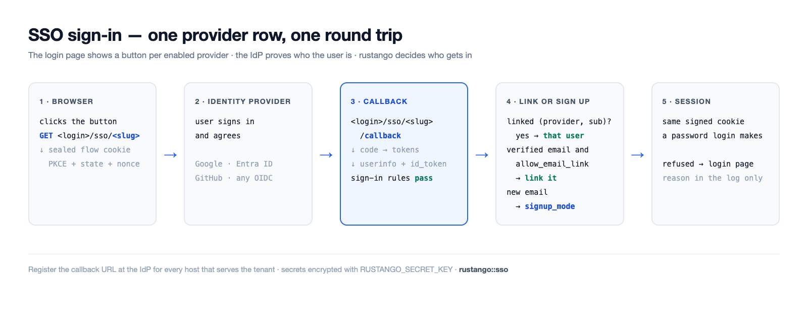
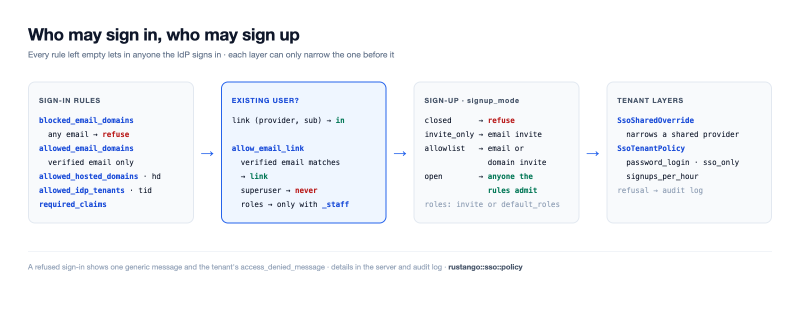

# SSO (OpenID Connect / Social Login)

Melden Sie sich mit einem externen Identity Provider (IdP) statt mit einem
lokalen Passwort an: Google, Microsoft Entra ID, GitHub, GitLab, Discord
oder **jedem OpenID-Connect-Anbieter** (Okta, Auth0, Keycloak, …). Jeder
Anbieter ist eine Zeile, die Sie im Admin anlegen: keine
Konfigurationsdatei, kein Neubau.

[](../img/sso-flow.png)

## SSO in vier Schritten einrichten

1. **Eine App beim IdP anlegen.** Registrieren Sie eine Webanwendung
   („OAuth-Client“ oder „App-Registrierung“). Kopieren Sie **Client-ID**
   und **Client-Secret**. Die [Anbieter-Anleitungen](#anbieter-anleitungen)
   unten sagen, wo.
2. **Die Callback-URL beim IdP eintragen**, für jeden Host, der die
   Anmeldeseite ausliefert. Sie lautet `<login>/sso/<slug>/callback` auf
   diesem Host; siehe [Callback-URLs](#callback-urls). Wählen Sie den
   `slug` jetzt, z. B. `google`.
3. **Die Anbieterzeile anlegen.** Legen Sie im Tenant-Admin eine Zeile im
   Modell `rustango_sso_providers` an: `slug`, `label`, `kind`,
   `client_id`, `client_secret` und `issuer_url`, wenn `kind` `oidc` ist.
   Nur ein Superuser darf Anbieterzeilen anlegen oder ändern. Jedes Feld
   hat einen Hilfetext unter seiner Eingabe; die
   [Feldreferenz](#feldreferenz) listet dieselben Texte.
   `RUSTANGO_SECRET_KEY` muss gesetzt sein, sonst lässt sich das Secret
   nicht speichern.
4. **Die Anmeldung testen.** Öffnen Sie die Anmeldeseite in einem privaten
   Fenster und nutzen Sie den neuen Button. Eine abgelehnte Anmeldung zeigt
   eine allgemeine Meldung; der Grund steht im Server-Log (`sso refused`)
   und im Audit-Log. `manage check --deploy` findet einen Anbieter, der
   jeden bestehenden Benutzer ablehnen würde.

SSO meldet den Benutzer an, der mit der IdP-Identität **verknüpft** ist: eine
`rustango_sso_links`-Zeile pro `(provider, sub)`. Die E-Mail, die der IdP sendet,
reicht allein nie aus. Ein Erstbenutzer wird nur dann über seine verifizierte
E-Mail verknüpft, wenn beim Anbieter **`allow_email_link`** eingeschaltet ist
(Standard: aus), und nie, wenn das Konto ein Superuser oder, ohne
`allow_email_link_staff`, Staff ist (Tenant: besitzt irgendeine Rolle oder direkte Berechtigung;
Bare-Admin: jedes Konto). Solche Konten
verknüpft ein Admin, der die `SsoLink`-Zeile im Admin anlegt; die Log-Zeile der
Abweisung nennt das Subject. (Der Member-Ablauf, weiter unten, kann für eine
unbekannte E-Mail auch ein Konto anlegen; das ist standardmäßig aus.)

> **Quelle:** der admin-unabhängige Kern `rustango::sso` (`SsoProvider`,
> `build_provider`, `verified_email`, `ResolvedSso`, `SsoError`), die
> Link-Tabelle `rustango::sso::link` (`SsoLink`, `ProviderKey`, `sign_in`), die
> Bare-Admin-Verdrahtung `rustango::admin::sso`, das SSO pro Tenant/Konsole
> (gemeinsame Provider: die Registry-Tabelle `rustango_shared_sso_providers`,
> in der Operator-Konsole bearbeitet) und das Member-SSO
> `rustango::tenancy::member_auth`.

## Callback-URLs

Der Callback wird pro Anfrage aus Host und `slug` gebaut:
`https://<host><login>/sso/<slug>/callback`. Auf den Admin-Oberflächen
ist das Schema `https`, außer ein vertrauenswürdiger Proxy sendet
`X-Forwarded-Proto`; der Member-Ablauf nutzt auf einem Loopback-Host auch
`http` (siehe [Member-SSO](#member-endbenutzer-sso)). Tragen Sie eine URL
pro Host ein, auf dem der Anbieter genutzt wird.

| Anmelde-Oberfläche | Tenant auf eigenem Host | Tenant unter einem Pfad-Präfix |
|---|---|---|
| Tenant-Admin (`<login>` ist `/login`) | `https://acme.example.com/login/sso/<slug>/callback` | `https://app.example.com/acme/login/sso/<slug>/callback` |
| Member-Anmeldung (`member_sso_router`, `login_base` Standard `/auth`) | `https://acme.example.com/auth/sso/<slug>/callback` | `https://app.example.com/acme/auth/sso/<slug>/callback` |
| Bare-Admin (ohne Tenancy), unter `/admin` | `https://admin.example.com/admin/login/sso/<slug>/callback` | — |

Mit `RouteConfig::legacy()` ist `<login>` des Tenant-Admins `/__login`.
Ein Tenant, der auf eigenem Host und unter einem Präfix erreichbar ist,
braucht beide URLs. Für einen geteilten Anbieter zeigt die
Operator-Konsole die einzutragende Callback-URL neben jeder Zeile.

## Anbieter-Anleitungen

### Google

1. In der Google Cloud Console unter *APIs & Services → Credentials* eine
   *OAuth client ID* vom Typ *Web application* anlegen.
2. Die Callback-URL unter *Authorized redirect URIs* eintragen.
3. Anbieterzeile: `kind = google`, Client-ID und Secret. `issuer_url` leer
   lassen. Standard-Scopes: `openid email profile`.
4. Um nur Ihren Google Workspace zuzulassen, `allowed_hosted_domains` (der
   Claim `hd`) setzen, z. B. `client.org`.

### Microsoft Entra ID

1. Im Entra Admin Center *App registrations → New registration* öffnen.
   Die Callback-URL als *Web*-Redirect-URI eintragen.
2. Die *Application (client) ID* kopieren. Unter *Certificates & secrets*
   ein Client-Secret anlegen und seinen Wert kopieren.
3. Anbieterzeile: `kind = microsoft`. Es nutzt den Endpunkt `common`;
   ist `allowed_idp_tenants` leer, kann sich jedes Entra-Verzeichnis
   anmelden. Setzen Sie es auf Ihre *Directory (tenant) ID*, um nur Ihr
   Verzeichnis zuzulassen; dann gelten seine E-Mails als verifiziert, und
   `role_map` und `required_claims` greifen. `check --deploy` warnt, wenn
   `role_map` oder `required_claims` gesetzt und `allowed_idp_tenants` leer
   ist.
4. Nutzen Sie nicht `kind = oidc` mit einem Entra-Issuer für ein einzelnes
   Verzeichnis (`…/<tenant-id>/v2.0`): diese Zeile gilt nicht als Microsoft,
   Entra sendet kein `email_verified`, also lehnen E-Mail-Verknüpfen,
   Registrierung und `allowed_email_domains` jeden ab.

### GitHub

1. In GitHub *Settings → Developer settings → OAuth Apps → New OAuth App*
   öffnen. Die *Authorization callback URL* auf die Callback-URL setzen.
2. Die Client-ID kopieren und ein Client-Secret erzeugen.
3. Anbieterzeile: `kind = github`. Standard-Scopes: `read:user user:email`.
   Die verifizierte E-Mail kommt aus `/user/emails`. GitHub sendet kein
   id_token, daher lehnt eine Regel ab, die eines braucht, etwa
   `allowed_idp_tenants`.

### Generisches OpenID Connect

1. Beim IdP einen Web-Client (confidential) anlegen und die Callback-URL
   eintragen.
2. Anbieterzeile: `kind = oidc`, Client-ID und Secret sowie `issuer_url`,
   etwa `https://<org>.okta.com`, `https://<host>/realms/<realm>`
   (Keycloak) oder `https://<tenant>.auth0.com/`.
3. rustango liest `<issuer>/.well-known/openid-configuration`, um die
   Endpunkte zu finden, einmal pro Issuer und Stunde. Standard-Scopes:
   `openid email profile`.

`check --deploy` warnt vor E-Mail-Verknüpfen bei einem `oidc`-Anbieter und
vor einem `http://`-Issuer, der nicht Loopback ist.

## Feldreferenz

Das sind die Hilfetexte, die der Admin unter jeder Eingabe zeigt (dort auf
Englisch).

### `SsoProvider` und `SharedSsoProvider`

Die eigenen Anbieter eines Tenants sind `SsoProvider`-Zeilen. Die geteilten
Anbieter der Operator-Konsole (`SharedSsoProvider`) haben dieselben Felder
und zeigen dieselben Texte.

| Feld | Was eintragen |
|---|---|
| `slug` | Kurze Id in den URLs des Anbieters, z. B. `google`: der IdP schickt Benutzer zu `<login>/sso/<slug>/callback` zurück. Eindeutig; ein neuer Slug bedeutet eine neue Callback-URL beim IdP. |
| `label` | Text auf dem Anmelde-Button, z. B. `Sign in with Google`. |
| `kind` | `google`, `microsoft`, `github`, `gitlab` oder `discord` für einen eingebauten Anbieter, oder `oidc` für jeden anderen OpenID-Connect-Anbieter (dann die Issuer-URL ausfüllen). |
| `issuer_url` | Nur für `oidc`: die Issuer-URL, z. B. `https://<org>.okta.com` oder `https://<host>/realms/<realm>`. Die Endpunkte werden aus `<issuer>/.well-known/openid-configuration` gelesen; für Microsoft Entra ID die Art `microsoft` nutzen. |
| `client_id` | Client-ID (Anwendungs-ID) aus der App-Registrierung bei Ihrem Identity Provider. |
| `client_secret` | Client-Secret aus derselben App-Registrierung. Verschlüsselt gespeichert mit `RUSTANGO_SECRET_KEY`. |
| `enabled` | Den Button dieses Anbieters auf der Anmeldeseite zeigen. |
| `sort_order` | Reihenfolge der Buttons auf der Anmeldeseite; kleinere Zahlen zuerst. |
| `scopes` | OAuth-Scopes, durch Leerzeichen getrennt, z. B. `openid email profile`. Leer: die Standard-Scopes der Art. |
| `allow_email_link` | Sicherheit: eine erste Anmeldung mit dem bestehenden Konto mit derselben verifizierten E-Mail verknüpfen; das Passwort dieses Kontos funktioniert dann nicht mehr, seine Sitzungen enden, seine API-Schlüssel werden gelöscht und seine Agent-Schlüssel abgeschaltet. Nie einen Superuser, einen Benutzer mit irgendeiner Rolle oder Berechtigung nur mit E-Mail-Verknüpfen für Staff; der Bare-Admin ignoriert es. |
| `allowed_email_domains` | Sicherheit: nur Benutzer, deren verifizierte E-Mail in diesen Domains liegt, dürfen sich anmelden. Liste mit Komma oder Zeilenumbruch: `client.org` nur diese Domain, `*.client.org` nur ihre Subdomains. Leer: jede Domain. |
| `blocked_email_domains` | Benutzer mit einer E-Mail in diesen Domains melden sich nie an, auch wenn die erlaubte Liste sie enthält. Gleiches Format wie die erlaubte Liste. |
| `allowed_idp_tenants` | Microsoft-Entra-Verzeichnis-(Tenant-)IDs, die sich anmelden dürfen, durch Komma getrennt, aus einem verifizierten id_token gelesen. Leer: jedes Entra-Verzeichnis kann sich über einen `microsoft`-Anbieter anmelden. |
| `allowed_hosted_domains` | Google-Workspace-Domains (der Claim `hd`), die sich anmelden dürfen, durch Komma getrennt, z. B. `client.org`. |
| `required_claims` | JSON-Objekt mit Claims, die eine Anmeldung tragen muss, jeder mit einem seiner Werte: `{"roles": ["App.User"]}`. `{}`: kein Claim nötig. |
| `signup_mode` | Sicherheit: wer bei der ersten Anmeldung ein neues Konto bekommt: `closed` (niemand), `invite_only` (eine Einladung für die E-Mail), `allowlist` (eine Einladung für die E-Mail oder ihre Domain) oder `open` (jeder, den die Anmelderegeln zulassen). Leer: die Vorgabe der Anmeldeseite. |
| `default_roles` | Tenant-Rollen eines neuen Benutzers, durch Komma getrennt, z. B. `Viewer`. Eine Einladung mit Rollen ersetzt sie. |
| `role_map` | JSON-Objekt von einer IdP-Gruppe oder App-Rolle auf Tenant-Rollen: `{"Admins": "Editor"}` oder `{"Admins": ["Editor", "Viewer"]}`. |
| `role_claims` | Claims, die die Rollenzuordnung liest, durch Komma getrennt. Leer: `groups,roles`. |
| `sync_roles_on_login` | Die Rollenzuordnung bei jeder Anmeldung anwenden, nicht nur bei der ersten. Nur Rollen aus der Zuordnung werden hinzugefügt oder entfernt. |
| `username_from` | Woher der Benutzername eines neuen Benutzers kommt: der lokale Teil der E-Mail, die ganze E-Mail oder `preferred_username` des IdP (sonst der lokale Teil). |
| `username_clash` | Was passiert, wenn der Benutzername vergeben ist: ein kurzes Suffix anhängen oder die Registrierung ablehnen. |
| `sync_profile` | Name und E-Mail bei jeder Anmeldung vom IdP aktualisieren. Nie für einen Superuser. |
| `allow_email_link_staff` | Sicherheit: bei aktivem E-Mail-Verknüpfen auch Benutzer mit irgendeiner Rolle oder Berechtigung verknüpfen. Ein Superuser wird nie per E-Mail verknüpft. |
| `sso_only` | Über diesen Anbieter verknüpfte Benutzer dürfen sich nicht mit Passwort anmelden, auch wenn der Anbieter aus ist. |
| `auto_deactivate_after_days` | Nach so vielen Tagen ohne Nutzung schaltet `sso-deactivate-idle` die von diesem Anbieter registrierten Benutzer ab, die kein Passwort nutzen können: hier nur SSO, oder Passwort-Login für den Tenant aus. Leer: nie. |
| `session_ttl_secs` | Längste Sitzung in Sekunden nach einer Anmeldung über diesen Anbieter. Leer: die normale Sitzungsdauer. |
| `superuser_session_ttl_secs` | Längste Sitzung in Sekunden für einen Superuser, der sich über diesen Anbieter anmeldet. Leer: die normale Sitzungsdauer. |

### `SsoTenantPolicy`

Die tenantweiten Einstellungen, eine Zeile.

| Feld | Was eintragen |
|---|---|
| `name` | Immer `default`: der Tenant nutzt diese eine Zeile. |
| `access_denied_message` | Text auf der Anmeldeseite nach einer abgelehnten SSO-Anmeldung, z. B. wen man fragt. Als reiner Text gezeigt. |
| `password_login` | Das Passwortformular: `on`, `off` (auch für Superuser) oder `superusers_only` (nur bei `?local=1`, für Superuser). |
| `sso_only` | Niemand außer einem Superuser darf sich mit Passwort anmelden. |
| `default_provider` | Slug des Anbieters, den die Anmeldeseite sofort öffnet, außer bei `?local=1` oder nach einem Fehler. |
| `signups_per_hour` | Höchstens so viele SSO-Registrierungen pro Stunde. Leer: 100; `0`: keine Grenze. |

### `SsoLandingRule`

Wohin eine Anmeldung ohne `?next=` führt. Die Regeln laufen nach `position`, die
erste passende gewinnt. Das Login-Gate behält `next` für jede Seite, die es
umleitet; die Regeln greifen also, wenn die Anmeldung kein `next` hat, etwa wenn
sie auf der Anmeldeseite selbst beginnt. Sie gelten für SSO- und Passwort-Anmeldungen im
Tenant-Admin und im Bare-Admin; die Mitglieder-Anmeldung ignoriert sie. Eine
Regel, deren Pfad die `next`-Prüfung nicht besteht (etwa die Anmeldeseite), wird
übersprungen. Fehlt die Tabelle, gibt es keine Regeln.

| Feld | Was eintragen |
|---|---|
| `position` | Die Regeln werden von der kleinsten Zahl an geprüft, die erste passende gewinnt. Bei gleicher Zahl entscheidet die ID. |
| `match_kind` | `role`: der Benutzer hat die Rolle aus `match_value` (nie im Bare-Admin, der keine Rollen hat). `claim`: die SSO-Anmeldung trägt den Claim `match_name` mit `match_value`, gelesen wie ein Claim der Rollenzuordnung. `any`: jede Anmeldung; als Standard ans Ende stellen. |
| `match_name` | Der Claim-Name, nur für `claim`-Regeln. Sonst leer. |
| `match_value` | Der Rollenname (`role`) oder der Claim-Wert (`claim`), exakt verglichen. Für `any` leer. |
| `landing_url` | Ein Pfad auf dieser Seite, der mit `/` beginnt, wie auf dem eigenen Host des Tenants, z. B. `/admin/reports`. Ein Pfadpräfix wird ergänzt. Keine Zugriffskontrolle: die Seite muss die Rechte selbst prüfen. |

### `SsoSharedOverride`

Die Einschränkung eines geteilten Anbieters durch einen Tenant. Leere
Felder behalten den geteilten Wert.

| Feld | Was eintragen |
|---|---|
| `shared_slug` | Slug des geteilten Anbieters, den diese Zeile für diesen Tenant einschränkt. |
| `shared_provider_id` | Die geteilte Anbieterzeile, an die diese Überschreibung gebunden ist, bei der ersten Nutzung gesetzt. |
| `shared_issuer` | Der Issuer dieser Zeile beim Binden. Wechselt die geteilte Zeile den Issuer, wird die Anmeldung abgelehnt, bis die Überschreibung neu angelegt ist. |
| `allowed_email_domains` | Sicherheit: nur diese E-Mail-Domains dürfen sich hier anmelden, zusätzlich zu den geteilten Regeln. Gleiches Format mit Komma oder Zeilenumbruch wie beim Anbieter. |
| `blocked_email_domains` | Weitere E-Mail-Domains, die sich hier nie anmelden. |
| `allowed_idp_tenants` | Hier erlaubte Microsoft-Verzeichnis-IDs, durch Komma getrennt. Schränkt die geteilte Liste ein. |
| `allowed_hosted_domains` | Hier erlaubte Google-Workspace-Domains, durch Komma getrennt. Schränkt die geteilte Liste ein. |
| `required_claims` | Weitere Claims, die eine Anmeldung hier tragen muss, als JSON: `{"roles": ["App.User"]}`. |
| `signup_mode` | Sicherheit: Registrierung hier. Nur strenger als beim geteilten Anbieter. Leer: der geteilte Wert. |
| `allow_email_link` | Aus: hier kein E-Mail-Verknüpfen. Leer oder an: die geteilte Einstellung. |
| `allow_email_link_staff` | Aus: E-Mail-Verknüpfen verknüpft hier nie einen Benutzer mit irgendeiner Rolle oder Berechtigung. Leer oder an: die geteilte Einstellung. |
| `sso_only` | An: Benutzer dieses Anbieters dürfen sich hier nicht mit Passwort anmelden. |
| `session_ttl_secs` | Eine kürzere längste Sitzung hier, in Sekunden. Leer: der geteilte Wert. |
| `superuser_session_ttl_secs` | Eine kürzere längste Superuser-Sitzung hier, in Sekunden. Leer: der geteilte Wert. |
| `allowed_roles` | Rollen, die der geteilte Anbieter hier vergeben darf, durch Komma getrennt. Leer: keine. |

### `SsoInvite`

Eine Einladung zur Registrierung über SSO.

| Feld | Was eintragen |
|---|---|
| `provider_slug` | Slug des Anbieters, für den die Einladung gilt. Leer: jeder Anbieter. |
| `target` | Wer sich registrieren darf: eine E-Mail (`ann@client.org`) oder eine Domain (`@client.org`, oder `*.client.org` für ihre Subdomains). Eine Domain-Einladung braucht eine Höchstzahl oder ein Ablaufdatum. |
| `roles` | Rollen des neuen Benutzers, durch Komma getrennt. Sie ersetzen die Standardrollen des Anbieters. |
| `expires_at` | Danach gilt die Einladung nicht mehr. Leer: kein Ablauf. |
| `max_uses` | Wie viele Registrierungen die Einladung nutzen dürfen. Leer: keine Grenze. |
| `link_user_id` | Nur Neuverknüpfen: der bestehende Benutzer, den die nächste Anmeldung verknüpft, statt eines neuen Kontos. Von der Aktion Re-link gesetzt. |
| `link_key` | Nur Neuverknüpfen: der Anbieter, über den die nächste Anmeldung kommen muss. Von der Aktion Re-link gesetzt; leer lassen. |

## Features & wer sie nutzt

Seit **0.49** ist der SSO-Kern ein eigenes Feature, unabhängig vom
Auto-Admin, sodass eine Endbenutzer-Anmeldung (Member) gebaut werden kann, ohne
`crate::admin` hereinzuziehen:

| Feature | Zieht herein | Gibt Ihnen |
|---|---|---|
| `sso` | `oauth2`, `casts` | Den admin-unabhängigen Kern: `rustango::sso` — den OIDC- / Social-OAuth-Handshake, das DB-gestützte `SsoProvider`-Modell (Secret im Ruhezustand über `casts` verschlüsselt) und den Member-Ablauf (`tenancy::member_auth`, mit `tenancy`). |
| `admin-sso` | `admin`, `sso` | Das Obige **plus** die Bare-Admin-Login-Verdrahtung (`rustango::admin::sso`) — SSO-Buttons auf der Admin-Anmeldeseite, die die Admin-Session prägen. |

```toml
[dependencies]
# Admin login with SSO:
rustango = { version = "0.64", features = ["admin-sso"] }
# Member (end-user) SSO without the auto-admin:
rustango = { version = "0.64", features = ["tenancy", "sso"] }
```

`admin::sso_provider` und die historischen `admin::sso::*`-Kernpfade sind
nun **Re-Export-Shims** über `sso::provider` / `sso::*`, sodass bestehende
Imports von `crate::admin::sso::{build_provider, ResolvedSso, …}` und
`crate::admin::sso_provider::SsoProvider` unverändert weiter aufgelöst
werden. Seit 0.58 hat `rustango_sso_providers` eine Spalte `allow_email_link`,
und es gibt eine Tabelle `rustango_sso_links`; `makemigrations` erzeugt beides.

Die E-Mail, die das optionale Verknüpfen per E-Mail abgleicht, ist die `email`-Spalte. Beim
Tenant-`User`-Modell hängt sie am Feature **`sso`** (in 0.49 von `admin-sso`
weggezogen, sodass reine Member-SSO-Builds die Spalte trotzdem erhalten); das
nackte `AdminUser.email` bleibt hinter `admin-sso`. Das Aktivieren oder
Deaktivieren des Features gibt eine `AddColumn` / `DropColumn`-Migration für
diese Spalte aus.

## Wie es funktioniert

1. Die Anmeldeseite zeigt einen **„Mit &lt;Anbieter&gt; anmelden“**-Button pro
   aktiviertem Anbieter.
2. Ein Klick darauf (`GET <login>/sso/<slug>`) leitet zum IdP weiter, mit einem
   signierten, kurzlebigen Flow-Cookie (PKCE + CSRF-`state`).
3. Der IdP schickt den Benutzer zurück an `<login>/sso/<slug>/callback`.
4. rustango verifiziert den Flow, tauscht den Code ein und liest `/userinfo`.
5. Es sucht die Verknüpfung für diesen Anbieter und das IdP-`sub`. Gibt es keine
   und ist `allow_email_link` eingeschaltet, legt eine **verifizierte** E-Mail,
   die zu einem nicht privilegierten Benutzer passt, die Verknüpfung an.
6. Ist der verknüpfte Benutzer aktiv, prägt es **dieselbe signierte
   Cookie-Session**, die eine Passwort-Anmeldung erzeugt — sodass jedes
   bestehende Gate (Superuser / Berechtigungen, Live-Passwortänderungs-
   Invalidierung) weiterhin gilt.
7. Andernfalls wird der Benutzer mit einem generischen Fehler zur Anmeldeseite
   zurückgeschickt (Details gehen ins Server-Log, nie in den Browser).

Im Tenant-Admin landet `GET <login>/sso/<slug>?next=/pfad` nach der Anmeldung
auf `/pfad`. Der Pfad steckt im signierten Flow-Cookie und durchläuft dieselbe
Prüfung wie bei der Passwort-Anmeldung: nur gleicher Origin und innerhalb des
Pfadpräfixes des Tenants. Ohne brauchbares `next` entscheiden die
[Landing-Regeln](#ssolandingrule) des Tenants, und ohne Treffer landet die
Anmeldung auf `admin_url`. Die Anmeldeseite gibt ihr eigenes `?next` an die
SSO-Buttons weiter und erfindet nie eines. Der Bare-Admin macht es ebenso, ohne die Präfix-Regel,
behält den Pfad über den TOTP-Schritt und fällt auf sein Präfix zurück.

Die Link-Tabelle ist ein normales migriertes Modell: im Speicher des Tenants für
Tenant-Anmeldungen und in der Admin-Datenbank für den Bare-Admin. Eine
Verknüpfung wird exakt abgeglichen (Issuer und Subject über einen SHA-256
verschlüsselt; bei der E-Mail wird nur die ASCII-Groß-/Kleinschreibung
ignoriert), unabhängig von der Kollation der Datenbank.

Das Client-**Secret ist im Ruhezustand verschlüsselt** — die `client_secret`-Spalte
ist ein [`EncryptedString`](#secret-speicherung)-Cast, erst zur Anmeldezeit im Speicher
entschlüsselt.

## Anbieter sind Zeilen, verwaltet im Admin

Jeder Anbieter ist eine `SsoProvider`-Zeile, ein normales Admin-Modell:
anlegen, bearbeiten und aktivieren über die Admin-UI, ohne Neudeployment.
Die Felder stehen in der [Feldreferenz](#feldreferenz). Nur ein Superuser
darf `SsoProvider`- und `SsoLink`-Zeilen anlegen, ändern oder löschen;
anderes Staff sieht sie mit den üblichen Rechten. Die Endpunkte werden bei
der Anmeldung ermittelt, ohne Verdrahtung pro Anbieter.

## Wo jede Oberfläche Anbieter verwaltet

- **Single-Tenant / Standalone-Admin** (`crate::admin`): `SsoProvider`-Zeilen
  sind eine schlichte globale Tabelle, verwaltet vom nackten Admin. Erfordert
  `Builder::with_session_auth` (SSO prägt dieselbe Session).
- **Tenant-Admin** (Multi-Tenancy): jeder Tenant verwaltet seine **eigenen**
  `SsoProvider`-Zeilen aus seinem Admin — granular, self-service, pro Tenant
  isoliert.
- **Operator-Konsole** (Multi-Tenancy): ein Operator definiert einmal einen
  **`SharedSsoProvider`**, und er wird **jedem** Tenant angeboten
  (etwa ein unternehmensweites Google). Verwaltet über das *Shared SSO*-Panel
  der Konsole (`/sso-shared`, Feature `admin-sso`; jeder Operator kann die
  Liste sehen, Änderungen brauchen eine editierbare Konsole), wo *Allow email linking* `allow_email_link` an Ort und Stelle
  umschaltet (die ID und ihre Verknüpfungen bleiben). Das Flag gilt für
  **jeden** Tenant. *Edit* (`/sso-shared/{id}/edit`) ändert einen Provider an
  Ort und Stelle (gleiche ID und Slug; ein leeres Secret behält das
  gespeicherte), und jede Zeile zeigt die Callback-URL, die beim IdP zu
  registrieren ist. Das Feld für die Issuer-URL erscheint nur bei `oidc`. Ein
  abgelehntes Hinzufügen oder Bearbeiten zeigt das Formular erneut (Status 400)
  mit den eingegebenen Werten und dem Fehler, nie mit dem Secret.

Auf der Anmeldeseite eines Tenants verschmelzen die beiden Mengen, und bei einer
Slug-Kollision **gewinnt der eigene Anbieter des Tenants** gegenüber dem geteilten
— ein Tenant kann also einen geteilten Anbieter für sich selbst überschreiben.

Tragen Sie die [Callback-URL](#callback-urls) beim IdP ein. Ein Benutzer wird verknüpft durch das optionale Verknüpfen per E-Mail
(nicht privilegierte Tenant-Benutzer) oder dadurch, dass ein Superuser eine
`SsoLink`-Zeile anlegt: `provider_source` (`tenant`, `shared`, `admin` oder `app` für eine native Anmeldung),
`provider_id` (die ID der Anbieter-Zeile), `issuer` (`kind` oder
`kind|issuer_url` ohne abschließenden Schrägstrich), `subject` und `user_id`.
Der Admin berechnet `key_sha256`. Die Log-Zeile der
Abweisung (`sso refused`) enthält `provider_id`, `issuer` und `subject`. Eine
Zeile anzulegen erfordert die Session-Authentifizierung des Admins
(`Builder::with_session_auth` oder `with_session` des Tenant-Admins); ohne sie
kann niemand Verknüpfungen anlegen.

Eine Verknüpfung, die mehr als eine Stunde vor dem Konto angelegt wurde, auf das
sie zeigt (etwa eine nach einem Restore wiederverwendete ID), wird gelöscht, und
die Anmeldung läuft weiter wie ohne Verknüpfung. Eine Verknüpfung, deren
Benutzer nicht mehr existiert, wird bei der nächsten Anmeldung gelöscht, und wer
einen Benutzer im Admin löscht, löscht auch seine Verknüpfungen.
Werden `created_at`-Werte von Konten nach ihren Verknüpfungen importiert oder
nachträglich befüllt, loggt
`rustango::sso::link::set_stale_links(StaleLinks::Warn)` nur eine Warnung und
meldet trotzdem an.

Mit dem Feature `totp` muss ein Bare-Admin-Benutzer mit bestätigtem
TOTP-Gerät nach SSO noch einen Code eingeben. Der Admin zeigt das Code-Formular
und hält die offene Anmeldung 5 Minuten in einem signierten Cookie; das
Formular sendet an `<login>/sso-totp`. Der Tenant-Admin hat keinen TOTP-Schritt.

`manage check --deploy` warnt vor einem aktivierten Anbieter, der jeden
bestehenden Benutzer abweisen würde: keine `SsoLink`-Zeilen, und E-Mail-Verknüpfung
aus oder nur privilegierte Benutzer. Im Bare-Admin ist das jeder Anbieter ohne
Verknüpfungen. Er warnt auch vor E-Mail-Verknüpfung bei einem Anbieter mit
`kind = "oidc"`, einem `http://`-Issuer außer Loopback und einem geteilten
Anbieter, der Benutzer registriert.

## Member (Endbenutzer) SSO

Die obigen Oberflächen melden Personen bei einem **Admin** an.
`tenancy::member_auth` ist das member-seitige Gegenstück: es meldet einen
Endbenutzer in den eigenen Benutzerpool eines Tenants an (`rustango_users`) und
prägt eine **Member-Session**, sodass ein Fitnessstudio-Mitglied / SaaS-Kunde
„Mit Google anmelden“ kann, ohne den Admin zu berühren. Es verwendet exakt
denselben `rustango::sso`-Kern und die eigenen `SsoProvider`-Zeilen des Tenants —
nur die Session, die es prägt, unterscheidet sich, weshalb es hinter dem
`sso`-Feature (nicht `admin-sso`) lebt und keinen Auto-Admin braucht.

Hängen Sie `member_sso_router` in einen `rustango::server::Builder`-Stack ein (es
liest den aufgelösten `Arc<TenantContext>`, den der Builder injiziert):

```rust
use rustango::tenancy::member_auth::{member_sso_router, MemberAuthConfig};

let members = member_sso_router(MemberAuthConfig {
    login_base:     "/auth".into(),   // buttons link to /auth/sso/<slug>
    landing_url:    "/".into(),       // post-login destination (a same-origin ?next on the begin URL wins)
    auto_provision: true,             // create a user from a verified email on first sign-in
    session_ttl:    7 * 24 * 60 * 60, // 7 days
    ..Default::default()
});
```

Mit mehreren einkompilierten Backends ist `member_sso_router` für den
Standard-Tenant-Typ (Postgres); nutzen Sie `member_sso_router_for::<sqlx::Sqlite>`
(oder `MySql`).

Es hängt zwei Routen pro Slug an `login_base` an:

- `GET {login_base}/sso/{slug}` — den Handshake beginnen, zum IdP weiterleiten.
- `GET {login_base}/sso/{slug}/callback` — ihn abschließen, den Member
  finden-oder-provisionieren, das Session-Cookie prägen.

Ein Tenant mit Pfad-Präfix bekommt dieselben zwei Routen unter seinem Präfix.

Unterschiede zum Admin-Ablauf:

- **Callback-Schema.** Die Member-`redirect_uri` nimmt ihr Schema aus dem
  `X-Forwarded-Proto` eines vertrauenswürdigen Proxys (und ihren Host aus
  `X-Forwarded-Host`), sonst `http` auf einem
  Loopback-Host (`localhost`, `*.localhost`, eine Loopback-IP) und überall sonst
  `https`, sodass `localhost.example.com` `https` bekommt.
- **Auto-Provisionierung.** Der `signup_mode` eines Anbieters ([Wer sich registrieren darf](#wer-sich-registrieren-darf)) hat Vorrang; ist keiner gesetzt, wirkt `auto_provision = true` wie `open`. Mit `auto_provision = true` (optional; Standard ist `false`) **erstellt**
  eine verifizierte IdP-E-Mail ohne passende `rustango_users`-Zeile eine solche
  — Benutzername aus dem lokalen Teil der E-Mail (bei Kollision entdupliziert),
  ein echter, aber unbrauchbarer zufälliger Passwort-Hash (SSO-Benutzer können
  sich nicht per Passwort anmelden) — und verknüpft sie. Eine E-Mail, die zu
  einem bestehenden Konto passt, folgt der obigen `allow_email_link`-Regel.
  Setzen Sie es auf `false`, um unbekannte E-Mails abzuweisen. Eine native
  Anmeldung (eine App, die ihr ID-Token selbst geprüft hat) ruft
  `sso::policy::admit` mit `AdmitRequest::new(pool, Surface::Member,
  &ProviderKey::app(issuer), &policy, &Identity::from_profile(profile))` und
  `tenancy::member_auth::TenantAccounts(pool)` auf; die übergebene
  `EffectivePolicy` ist die Anmelde-Policy, gehören ihre Regeln also dorthin.
  Das veraltete `find_or_provision_member` wendet die Regeln eines
  Tenant-Providers noch an, aber ein App-Schlüssel hat keine: Mit
  `auto_provision` registriert es jede verifizierte E-Mail.
- **Ein eigenes Session-Cookie.** Das Member-Cookie
  (`rustango_member_session`) ist von den Tenant- / Admin-Session-Cookies
  **domänengetrennt**: die signierte Nachricht trägt einen Tag pro Domäne und
  einen Audience-Claim, sodass ein Member-Cookie niemals als Tenant-/Admin-Cookie
  validieren kann (oder umgekehrt), obwohl beide mit
  `RUSTANGO_SESSION_SECRET` signiert sind. Es ist slug-gebunden (ein für `acme`
  geprägtes Cookie authentifiziert niemals auf `globex`) und wird durch eine
  Passwort-Rotation invalidiert (analog zur Admin-Session).
- **Logout.** `member_auth::logout(&pool, &user)` beendet die Sessions des
  Members auf allen Geräten und gibt den `Set-Cookie`-Wert zurück, der das
  Cookie löscht. Bei einem Tenant mit Pfad-Präfix nutzen Sie `logout_at`, das
  das Cookie auf dem Präfix-Pfad löscht.

Lesen Sie den aktuellen Member in einem Handler mit dem **`CurrentMember`**-
Extraktor — dem Member-Gegenstück zu `SessionUser`. Er ist unfehlbar
(`None` für anonyme / abgelaufene / rotierte / tenant-fremde Sessions),
sodass er sich mit öffentlichen Routen komponieren lässt:

```rust
use rustango::tenancy::member_auth::CurrentMember;

async fn dashboard(CurrentMember(member): CurrentMember) -> impl axum::response::IntoResponse {
    match member {
        Some(user) => format!("Hi, {}", user.username),
        None => "Please sign in".to_owned(),
    }
}
```

> **v1-Umfang.** Member-SSO löst Anbieter nur aus den eigenen
> `SsoProvider`-Zeilen des Tenants auf — der registry-weite
> `SharedSsoProvider`-Merge und ein eigener `provision`-Hook sind Folgeaufgaben.

## Wer sich anmelden darf

Jeder Anbieter (und jeder geteilte Anbieter in der Operator-Konsole) hat
Anmelderegeln. Leere Regeln lassen jeden zu, den der IdP anmeldet.

[](../img/sso-policy.png)

Die Regelfelder sind `allowed_email_domains`, `blocked_email_domains`,
`allowed_idp_tenants`, `allowed_hosted_domains` und `required_claims`;
ihr Format steht in der [Feldreferenz](#feldreferenz). Die gesperrte Liste
gilt für jede E-Mail des IdP, verifiziert oder nicht, die erlaubte nur für
eine verifizierte. Ein Claim in `required_claims` darf ein String oder
eine Liste sein; ein fehlender Claim lehnt ab.

Admin und Operator-Konsole speichern Listen in einer festen Form und
lehnen Werte ab, die sich nicht parsen lassen. Ein trotzdem ungültiger Wert
lehnt jede Anmeldung über den Anbieter ab.

Eine abgelehnte Anmeldung landet im Server-Log und im Audit-Log
(`source = sso:<surface>`, `changes.rule`, z. B. `domain_not_allowed`).
Der Browser sieht eine allgemeine Meldung; die Tenant-Login-Seite zeigt
zusätzlich die `access_denied_message` des Tenants (aus `SsoTenantPolicy`), escaped.

Die Member-Route (`member_sso_router`) löst nur die eigenen Anbieter des
Tenants auf; geteilte Anbieter und ihre Verschärfung durch den Tenant
gelten dort noch nicht.

### id_token-Vertrauen

Profildaten kommen von `/userinfo` über TLS. Claims, die nur ein id_token
trägt (`tid`, `iss`, `xms_edov`), werden erst genutzt, wenn das id_token
besteht: Signatur gegen das JWKS des Issuers (RS256 oder ES256; gecacht
gemäß `max-age`, bei unbekanntem Schlüssel höchstens einmal pro Minute neu
geladen), `aud` enthält die Client-ID, `exp`/`nbf` mit einer Minute
Toleranz, der Issuer (Microsoft: `https://login.microsoftonline.com/{tid}/v2.0`)
und dasselbe `sub` wie userinfo. Sonst fehlen diese Claims, und eine Regel,
die sie braucht, lehnt ab. Eine Microsoft-E-Mail gilt als verifiziert, wenn
`xms_edov` wahr ist oder der Anbieter `allowed_idp_tenants` festlegt und die
`tid` des Tokens darin steht.

## Wer sich registrieren darf

Ein Anbieter kann das Konto auch bei der ersten Anmeldung anlegen. Das
passiert nur, wenn weder ein Link noch ein Konto zur verifizierten E-Mail
passt, und erst nachdem die Anmelderegeln oben bestanden sind.

Die Registrierungsfelder sind `signup_mode`, `default_roles`, `role_map`,
`role_claims`, `sync_roles_on_login`, `username_from`, `username_clash`,
`sync_profile` und `allow_email_link_staff` (siehe
[Feldreferenz](#feldreferenz)). Ist `signup_mode` leer, ist der
Tenant-Login geschlossen und der Member-Ablauf folgt
`MemberAuthConfig::auto_provision`; der Bare-Admin registriert nie
jemanden. Ein neuer Benutzer bekommt die Rollen der Einladung oder `default_roles`,
dazu die Rollen aus `role_map`. Ein Anbieter mit JWKS (OIDC-Discovery, Microsoft, Google) nimmt
Rollen-Claims nur aus einem verifizierten id_token, ein Anbieter nur mit
Userinfo aus Userinfo. `sync_roles_on_login` fügt nur in `role_map`
genannte Rollen hinzu oder entfernt sie; von Hand vergebene Rollen
bleiben, und eine Anmeldung ohne Rollen-Claims ändert nichts.

Ein neuer Benutzer ist nie Superuser. Rollen laufen über die
Berechtigungs-Engine (`UserRole`); ein Rollenname ohne `Role`-Zeile wird
übersprungen und im Audit-Log vermerkt (`sso_role_unknown`). Benutzer,
Link (`provisioned = true`), Rollen und die Nutzung der Einladung werden in
einer Transaktion geschrieben.

**Einladungen** (`SsoInvite`, im Tenant-Admin nur für Superuser) gelten für
eine E-Mail (`ann@client.org`) oder eine Domain (`@client.org`, oder
`*.client.org` für Subdomains). Sie können einen Anbieter nennen, Rollen
tragen, ablaufen (`expires_at`) und Nutzungen begrenzen (`max_uses`). Eine
Nutzung wird atomar gezählt: Zwei gleichzeitige Registrierungen um die
letzte Nutzung ergeben ein Konto. `.../rustango_sso_invites/bulk` legt viele
auf einmal an, aus einer eingefügten Liste oder einer CSV-Spalte.

**Trennen und neu verknüpfen.** Auf `SsoLink`-Zeilen gibt es die
Admin-Aktionen *Unlink* und *Re-link on next sign-in* (nur Superuser).
Re-link löscht den Link und hinterlässt eine einmalige Einladung, 7 Tage
gültig, die denselben Benutzer bei der nächsten Anmeldung mit seiner
verifizierten E-Mail über denselben Anbieter wieder verknüpft, auch mit
neuem Subject. Ein Superuser wird nie neu verknüpft, ein Rolleninhaber nur
mit `allow_email_link_staff`.

Benutzername- und E-Mail-Kollisionen ignorieren die Groß-/Kleinschreibung so
wie das Backend: PostgreSQL faltet Unicode, SQLite nur ASCII-Buchstaben, MySQL
folgt der Spalten-Collation (standardmäßig auch Akzente, `ané` und `ane`
kollidieren). Mit ASCII-Benutzernamen ist die Antwort überall gleich.

`check --deploy` meldet einen Anbieter mit offener Registrierung nicht als
blockierend und warnt bei `signup_mode = open` ohne
`allowed_email_domains`, `allowed_hosted_domains` oder `allowed_idp_tenants`.

## Passwörter, Sitzungen und Lebenszyklus

Die Anbieterfelder `sso_only`, `session_ttl_secs`,
`superuser_session_ttl_secs` und `auto_deactivate_after_days` sowie die
Zeile `SsoTenantPolicy` stehen in der [Feldreferenz](#feldreferenz).
`sso_only` gilt für Passwort-Login, JSON-Login, HTTP Basic und
Reset-Links. Eine Sitzung dauert das Kürzeste aus der Grenze des Anbieters
und der Lebensdauer der Route. `sso-deactivate-idle` schaltet nie einen
Superuser ab oder einen Benutzer mit einer Verknüpfung, die ein Admin
angelegt hat.

Ein Superuser folgt nur `password_login`; `sso_only` sperrt ihn nie aus.
Ein abgelehntes Passwort sieht aus wie ein falsches. Eine unlesbare Regel lehnt ab; unlesbare Mandanteneinstellungen lassen nur Superuser herein. Ein deaktivierter Anbieter bindet seine Benutzer weiter, eine Verknüpfung zu einem gelöschten zählt als `sso_only`, bis ein Admin sie entfernt. `sso_only` gilt für Passwort-Logins (Mandant und Bare-Admin) und Resets, nicht für API-Schlüssel und MCP-Agenten-Secrets. `sso-deactivate-idle` deaktiviert nur Benutzer, die kein Passwort nutzen können. Logout landet auf `?local=1`, und die automatische Weiterleitung geschieht höchstens einmal pro Minute, damit eine verlorene Sitzung keine Schleife erzeugt.

**Gemeinsame Anbieter.** `SsoSharedOverride` eines Mandanten verschärft einen gemeinsamen Anbieter, lockert ihn nie, und nennt in `allowed_roles` die Rollen, die er vergeben darf (ohne Override: keine). Der Override kann auch die Verknüpfung per E-Mail abschalten (`allow_email_link`, `allow_email_link_staff`). Er bindet sich bei der ersten Anmeldung an die Zeile des gemeinsamen Anbieters: eine umbenannte Zeile behält ihn, eine neue Zeile mit dem alten Slug nicht, und eine Zeile mit anderem Issuer verweigert die Anmeldung, bis der Override neu angelegt wird.

**Microsoft mit mehreren Verzeichnissen.** Ein `microsoft`-Anbieter (oder `oidc` auf `/common` bzw. `/organizations`) nimmt Nutzer aus jedem Entra-Verzeichnis an. `role_map` und `required_claims` zählen nur, wenn `allowed_idp_tenants` die `tid` des Tokens festlegt; sonst werden keine Rollen vergeben und Pflicht-Claims verweigern. `check --deploy` warnt bei einer Zeile, die `role_map` oder `required_claims` ohne `allowed_idp_tenants` setzt.

**Drosselung und Audit.** SSO-Callbacks haben ein eigenes Limit pro IP (429), getrennt vom Passwort-Limit. Verknüpfungen, Registrierungen, Re-Links und Rollenänderungen landen im Audit-Log (`sso_linked`, `sso_signup`, `sso_relinked`, `sso_roles_synced`); Ablehnungen höchstens fünfmal pro Subjekt in zehn Minuten.

**Kontosperre.** Die Sperre nach falschen Passwörtern stoppt SSO nicht. Um einen Benutzer zu stoppen, `active = false` setzen.

## Secret-Speicherung

`client_secret` wird **im Ruhezustand verschlüsselt** mit XChaCha20-Poly1305
(AEAD) gespeichert, der Schlüssel abgeleitet aus der Umgebungsvariable
**`RUSTANGO_SECRET_KEY`**. Es wird nur zur Anmeldezeit im Speicher entschlüsselt,
um sich am Token-Endpunkt des IdP zu authentifizieren. So legt ein durchgesickerter
DB-Dump das Secret nie offen, und jeder Tenant behält sein eigenes Secret ohne
Umgebungsvariable pro Anbieter.

> Setzen Sie `RUSTANGO_SECRET_KEY` im Deployment. Es wird per SHA-256 zu einem
> 32-Byte-Schlüssel gehasht; nutzen Sie mindestens 32 zufällige Zeichen (mit eingehängter
> Tenant-Provisionierung warnt `check --deploy` bei einem kürzeren Schlüssel). Ohne
> sie schlägt das Speichern oder Verwenden eines Anbieters schnell fehl —
> dieselbe Haltung wie bei einer fehlenden Datenbank-URL.

Zum Rotieren setzen Sie den neuen Wert in `RUSTANGO_SECRET_KEY` und den alten in
`RUSTANGO_SECRET_KEY_PREVIOUS`. Lesen fällt auf den alten Schlüssel zurück. In
einem Multi-Tenant-Deployment versiegelt `manage reseal-tenant-secrets --apply`
danach die geteilten und die Tenant-SSO-Secrets mit dem neuen Schlüssel neu.

## Anbieter (Presets)

Eingebaute Presets: `google`, `microsoft` (Azure AD), `github`, `gitlab`,
`discord`. Für alles andere verwenden Sie `kind = "oidc"` mit einer `issuer_url` —
rustango führt OpenID-Connect-Discovery aus, um die Endpunkte zu finden (einmal pro Issuer und Stunde). (Sign in
with Apple ist kein Preset; es benötigt id_token/JWKS-Verifizierung.)

## Sicherheitshinweise

- **Zuerst die Verknüpfung** — die `(provider, sub)`-Verknüpfung entscheidet;
  die E-Mail wird nur vom optionalen Verknüpfen per E-Mail genutzt, und nur
  wenn sie verifiziert ist.
- **Keine privilegierten E-Mail-Verknüpfungen** — ein Superuser wird nie
  per E-Mail verknüpft, ein Rolleninhaber nur mit `allow_email_link_staff`. Eine per E-Mail angelegte Verknüpfung
  funktioniert weiter, nachdem der Benutzer befördert wurde; löschen Sie sie,
  wenn das nicht gewollt ist.
- **Keine Auto-Provisionierung im Bare-Admin** — eine unbekannte E-Mail
  kommt nicht hinein. Ein Tenant-Admin-Provider registriert nur, wenn sein
  `signup_mode` es erlaubt.
- **Secrets im Ruhezustand verschlüsselt** (`RUSTANGO_SECRET_KEY`), nur zur
  Anmeldezeit im Speicher entschlüsselt; Bearbeitungsformulare maskieren das
  gespeicherte Secret.
- Das Flow-Cookie ist kurzlebig (10 Min), `HttpOnly`, `SameSite=Lax`
  und `Secure` über HTTPS; der Handshake trägt PKCE + ein signiertes `state`.
- SSO-Sessions sind die gewöhnliche Admin-Session — das Rotieren oder
  Deaktivieren des verknüpften Benutzers invalidiert sie über das bestehende
  Live-Gate.
- Das Vertrauensmodell ist `/userinfo` über TLS; id_token-Claims zählen erst
  nach der JWKS-Prüfung (siehe [id_token-Vertrauen](#id_token-vertrauen)).
  Stellen Sie dem Admin HTTPS voran.

## Härtung

- **E-Mail-Verknüpfung sperrt das Passwort.** Verknüpft SSO ein bestehendes
  Tenant-Konto per E-Mail (oder per Re-Link-Einladung), wird sein Passwort
  unbrauchbar, seine Sitzungen enden, seine API-Schlüssel werden gelöscht und
  eigene Agent-Schlüssel abgeschaltet, in derselben Transaktion. Wer die
  E-Mail vor ihrem Besitzer registriert hat, verliert das Konto; der Besitzer
  setzt das Passwort zurück, um wieder eines zu nutzen. Jede Rolle, auch ohne
  Rechte, gilt bei der E-Mail-Verknüpfung als privilegiert.
- **Ein Flow, eine Nutzung.** Ein Callback schließt einen Flow nur einmal ab
  (pro Prozess; der Einmal-Code des IdP deckt andere Repliken). OIDC-Anmeldungen
  senden eine `nonce`; ein verifiziertes id_token ohne sie oder mit einer
  anderen wird abgelehnt (`id_token_replayed`). Das Ziel nach der Member-Anmeldung
  ist das `?next` der Begin-URL, im Flow versiegelt; ein `?next` am Callback
  wird ignoriert.
- **`__Host-`-Flow-Cookies** über HTTPS bei `Path=/` (Bare Admin, Tenant auf
  eigenem Host); dort wird nur dieser Name gelesen. Ein Pfadpräfix-Tenant
  behält den einfachen Namen, und das Member-`?next` muss unter dem Präfix bleiben.
- **Einladungen.** Eine Domain-Einladung für ein Public Suffix oder einen
  Freemail-Anbieter (`@gmail.com`, `*.co.uk`) wird abgelehnt, und eine
  Domain-Einladung braucht `max_uses` oder `expires_at`. Gespeicherte
  IdP-Anzeigenamen sind auf 150 Zeichen begrenzt.
- **Host des Bare Admin.** Mit `security.allowed_hosts` (oder
  `Builder::allowed_hosts`) wird die SSO-Redirect-URI nur für einen gelisteten
  Host gebaut. Ohne Liste nimmt sie jeden Host, und der Admin warnt beim Start.

### Tenants auf eigenem Host und unter einem Präfix

Ein Tenant ist auf seinem eigenen Host (Cookies bei `Path=/`) und auf dem
Apex-Host unter seinem Präfix erreichbar (`app.example.com/acme`, Cookies bei
`Path=/acme`). Präfix-Tenants teilen einen Origin mit der Operator-Konsole und
miteinander: der Cookie-`Path` ist dort keine Sicherheitsgrenze. Sitzungen und
Flows sind per MAC an den Tenant-Slug gebunden, das Cookie eines Tenants öffnet
also nie einen anderen. Für einen auf beiden Wegen erreichbaren Tenant beide
Callback-URLs beim IdP registrieren:
`https://acme.example.com/login/sso/<slug>/callback` und
`https://app.example.com/acme/login/sso/<slug>/callback` (`/__login` mit `RouteConfig::legacy()`).

## Siehe auch

- [Sicherheitsleitfaden](security.md) · [Authentifizierung](auth-flows.md)
