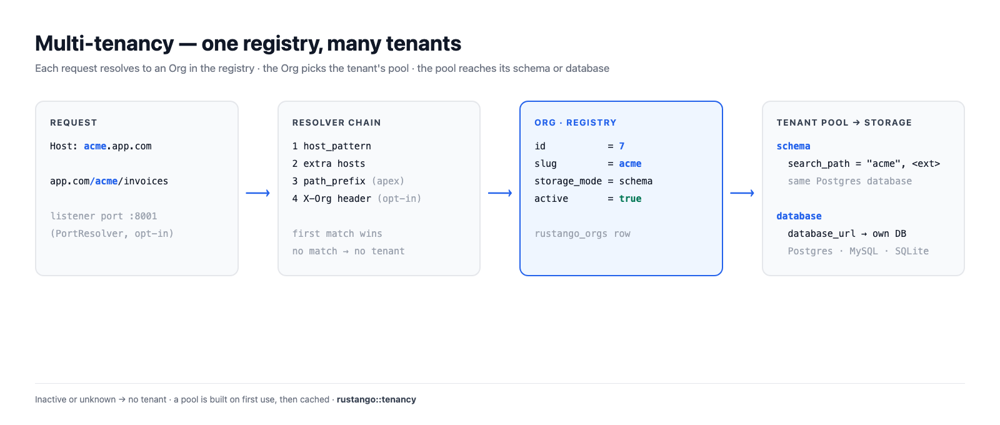
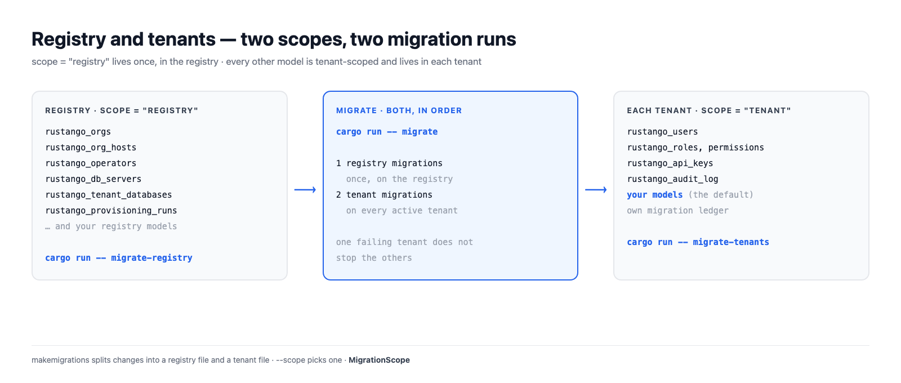

# Multi-Tenancy

Eine rustango-App kann viele Kunden bedienen. Jeder Kunde ist ein **Tenant**:
eine `Org`-Zeile in der **Registry**-Datenbank. Eine Anfrage wird ihrem
Tenant zugeordnet, und die Daten des Tenants liegen in einem eigenen Schema
oder einer eigenen Datenbank.

Diese Seite erklärt, wie die Teile zusammenpassen. Die einzelnen Schritte
findest du in [der Operator-Konsole](operator-console.md), [der `manage`-CLI](manage.md#tenancy-befehle)
und [Tenant-Datenbanken auf einem gespeicherten Server](tenant-databases.md).

[](../img/tenancy.png)

## Inhaltsverzeichnis

- [Registry und Tenant](#registry-und-tenant)
- [Wie eine Anfrage ihren Tenant findet](#wie-eine-anfrage-ihren-tenant-findet)
- [Zwei Wege zu einem Tenant](#zwei-wege-zu-einem-tenant)
- [Speichermodi](#speichermodi)
- [Pools](#pools)
- [Migrationen](#migrationen)
- [Zugangsdaten und Caches hängen an der Org-ID](#zugangsdaten-und-caches-hängen-an-der-org-id)
- [Lebenszyklus](#lebenszyklus)

## Registry und Tenant

Die **Registry** ist die eine Datenbank, die die App beim Start kennt
(`DATABASE_URL`). Sie enthält, was die ganze Installation teilt:

- `rustango_orgs`: eine Zeile pro Tenant, mit Slug, Speichermodus,
  Datenbank-URL, Host, Pfad-Präfix, Port und Aktiv-Flag;
- `rustango_org_hosts`: weitere Hostnamen eines Tenants;
- `rustango_operators`: die Menschen, die die Installation betreiben;
- `rustango_db_servers` und `rustango_tenant_databases`: gespeicherte
  Server und die Datenbanken, die rustango darauf angelegt hat;
- `rustango_provisioning_runs` mit ihren Ereignissen, gemeinsame
  SSO-Anbieter, TOTP-Geräte der Operatoren.

Alles andere liegt **pro Tenant**: `rustango_users`, Rollen und Rechte,
`rustango_api_keys`, das Audit-Log und deine eigenen Modelle.

Ein Modell sagt mit `scope`, wo es liegt. `tenant` ist der Standard, also
schreibst du `scope = "registry"` nur für gemeinsame Tabellen:

```rust
use rustango::sql::Auto;
use rustango::Model;

// Eine gemeinsame Tabelle, in der Registry.
#[derive(Model)]
#[rustango(table = "billing_plans", scope = "registry")]
pub struct BillingPlan {
    #[rustango(primary_key)]
    pub id: Auto<i64>,
    #[rustango(max_length = 64)]
    pub name: String,
}

// Kein scope: `tenant` ist der Standard. Jeder Tenant hat seine eigene Tabelle.
#[derive(Model)]
#[rustango(table = "invoices")]
pub struct Invoice {
    #[rustango(primary_key)]
    pub id: Auto<i64>,
    pub total_cents: i64,
}
```

Operatoren und Tenant-Benutzer mischen sich nie. Operatoren liegen in der
Registry und melden sich auf der Apex-Domain an. Tenant-Benutzer liegen in
ihrem Tenant und sehen die Konsole nie.

[](../img/tenancy-registry.png)

## Wie eine Anfrage ihren Tenant findet

Ein **Resolver** macht aus einer Anfrage eine `Org`. Der Server probiert eine
Kette von Resolvern der Reihe nach, und der erste Treffer gewinnt:

1. **Host.** Der `Host`-Header ist gleich dem `host_pattern` des Tenants,
   zum Beispiel `acme.app.com`. Der Vergleich ist exakt. Gibst du keinen Host an,
   setzt `create-tenant` `<slug>.<apex>`, aber nur ohne `--path-prefix` und
   wenn der Apex gesetzt ist.
2. **Weitere Hosts.** Ein Hostname, der in `rustango_org_hosts` an den
   Tenant gebunden ist. Er schlägt nie den eigenen Host eines anderen
   Tenants.
3. **Pfad-Präfix, nur auf dem Apex.** `app.com/acme/...` trifft den Tenant,
   dessen `path_prefix` `/acme` ist. Auf jedem anderen Host wählt der Pfad
   keinen Tenant.
4. **Header (optional).** `Builder::header_resolver` fügt nach den anderen
   einen Header im Stil von `X-Org` hinzu. Kombiniere ihn mit
   `HeaderResolver::allow_only`: der Client wählt den Header-Wert.

Nur **aktive** Tenants werden getroffen. Der Apex allein
(`RUSTANGO_APEX_DOMAIN`) führt zu keinem Tenant: er zeigt die
Operator-Konsole. Der Apex plus ein Pfad-Präfix führt zu einem, ebenso eine
Apex-Anfrage mit dem Header `X-Org`, wenn `HeaderResolver` aktiv ist. Eine Anfrage ohne Tenant bekommt von den Tenant-Routen ein
404, oder geht an [`unresolved_tenant`](operator-console.md#unbekannte-hosts),
wenn du einen gesetzt hast.

**Port.** Der eingebaute Server (`Builder::serve`, `run-server`) hat kein
Port-Routing und keinen Weg, `PortResolver` in seine Kette zu nehmen. Ein
Tenant, der nur über seinen Port erreichbar ist, wird dort nicht erreicht.
`PortResolver` (er liest den Port des Listeners, nie die URI des Clients)
wirkt nur in einer Kette, die du selbst baust und betreibst.

Ein Tenant ohne Host, ohne Pfad-Präfix und ohne Port ist **nicht
erreichbar** und wird abgelehnt: von `create-tenant`, von der Konsole und von
einer Änderung am Routing.

Ergebnisse werden 30 Sekunden gecacht. Ein anderer Server sieht eine
Änderung an `rustango_orgs` innerhalb von zwei Fingerprint-Abfragen
(`RUSTANGO_HOST_GEN_CHECK_SECS`, Standard 5 Sekunden), und nie später als
der 30-Sekunden-Cache.

Im Handler nimmst du `TenantScope` (hält keine Verbindung) oder `Tenant`
(hält eine Verbindung für die Anfrage):

```rust
use axum::http::StatusCode;
use rustango::extractors::TenantScope;
use rustango::sql::CounterPool as _;

async fn invoice_count(t: TenantScope) -> Result<String, StatusCode> {
    // `t.org` ist die gefundene Org. `t.pool()` ist ihr Pool.
    let n = Invoice::objects()
        .count(t.pool())
        .await
        .map_err(|_| StatusCode::INTERNAL_SERVER_ERROR)?;
    Ok(format!("{}: {n} invoices", t.org.slug))
}
```

## Zwei Wege zu einem Tenant

| Weg | Beispiel | Cookie-`Path` |
|---|---|---|
| Der eigene Host des Tenants | `acme.app.com/admin` | `/` |
| Der Apex plus sein Pfad-Präfix | `app.com/acme/admin` | `/acme` |

Auf seinem eigenen Host hat ein Tenant den Host für sich, also nutzen
Cookies `Path=/`. Browser trennen Cookies nach Host.

Unter einem Pfad-Präfix teilen sich viele Tenants den Apex-Host. Darum nutzen
die Cookies des Tenants `Path=/<prefix>`, und die Cookies von `/acme` gehen
nicht an `/acmecorp`. Links und Weiterleitungen im Tenant-Admin tragen das
Präfix ebenfalls.

Host-Routing ist die stärkere Wahl für die Produktion. Pfad-Präfixe sind
praktisch in der Entwicklung, wo du nur einen Host hast.

## Speichermodi

Jeder Tenant hat einen `storage_mode`: `schema` oder `database`.

[](../img/tenancy-storage-modes.png)

### Schema-Modus (nur Postgres)

Alle Tenants teilen die Postgres-Datenbank der Registry. Jeder Tenant hat
sein eigenes Schema, benannt nach dem Slug, wenn du kein `schema_name`
setzt. Der `search_path` einer Tenant-Verbindung ist:

1. das Schema des Tenants;
2. dann jedes Schema, das nur Erweiterungen enthält, damit Typen und
   Funktionen von Erweiterungen weiter funktionieren.

`public` steht nur dann im Pfad, wenn dort eine Erweiterung liegt. Jedes
andere Schema kommt nur dazu, wenn es nichts als Erweiterungsobjekte enthält
und keine Org es nennt. So erscheinen die Schemas anderer Tenants nie im
Pfad.

Ein Tenant-Pool **öffnet nicht**, wenn:

- das Schema fehlt (führe `migrate-tenants` dafür aus);
- das Schema den Namen einer Datenbank-Rolle hat, deren Sitzungen es zuerst
  sehen würden;
- ein Erweiterungs-Schema im Pfad, etwa `public`, eine Tenant-Tabelle hat,
  die dem Schema des Tenants fehlt. Abfragen würden sonst diese Tabelle
  lesen.

Eine Erweiterung im eigenen Schema des Tenants ist kein Problem: dieses
Schema steht zuerst im Pfad. Eine Erweiterung im Schema eines anderen
Tenants, oder in einem Schema mit eigenen Objekten, bleibt mit einer Warnung
außerhalb des Pfads. Verschiebe
sie mit `ALTER EXTENSION <name> SET SCHEMA public`.

Auf MySQL und SQLite wird der Schema-Modus mit einem Hinweis auf den
Datenbank-Modus abgelehnt.

### Datenbank-Modus (Postgres, MySQL, SQLite)

Jeder Tenant hat seine eigene Datenbank. `database_url` enthält die
Verbindung: eine literale URL, eine `env://VAR`-Referenz oder einen
versiegelten `enc:v1:`-Wert. Es gibt zwei Wege dahin:

- eine vorhandene Datenbank-URL mitbringen;
- rustango die Datenbank und einen eigenen Login auf einem gespeicherten
  Server anlegen lassen. Siehe
  [Tenant-Datenbanken auf einem gespeicherten Server](tenant-databases.md).

Ein Tenant nutzt das Backend der Registry.

### Welchen wählen

| | Schema-Modus | Datenbank-Modus |
|---|---|---|
| Backends | Postgres | Postgres, MySQL, SQLite |
| Isolation | Schemas in einer Datenbank, ein Login | je eine Datenbank, und ein eigener Login auf einem gespeicherten Server |
| Verbindungen | zum Registry-Server | pro Tenant-Datenbank |
| Backup und Wiederherstellung | die ganze Datenbank | pro Tenant |
| Gut für | viele kleine Tenants | weniger, größere oder regulierte Tenants |

Du wählst pro Tenant, also kann eine Installation beides haben.

```bash
cargo run -- create-tenant acme                                  # Schema-Modus, auf einer Postgres-Registry
cargo run -- create-tenant globex --server main                  # Datenbank-Modus, auf einem gespeicherten Server angelegt
cargo run -- create-tenant initech --mode database --database-url "postgres://..."
```

## Pools

`TenantPools` gibt pro Tenant einen Pool aus. Was es tut:

- **Beim ersten Gebrauch gebaut.** Die erste Anfrage für einen Tenant löst
  seine URL auf und verbindet sich. Viele Anfragen für einen kalten Tenant
  teilen sich einen Aufbau.
- **Gecacht und begrenzt.** Bis zu 64 Pools im Datenbank-Modus und 64 im
  Schema-Modus, getrennt gezählt. Über der Grenze wird der am längsten nicht
  genutzte Tenant entfernt und verbindet sich bei seiner nächsten Anfrage neu.
- **Zwei pro Tenant auf Postgres.** Einer für Abfragen (`t.pool()`), einer
  für die Verbindung, die ein `Tenant`-Extraktor hält. So wartet eine
  gehaltene Verbindung nie auf die Abfragen.
- **Bei Änderung neu gebaut.** Ein Pool merkt sich die URL oder das Schema,
  aus dem er gebaut wurde. Nennt die `Org` etwas anderes, baut die nächste
  Anfrage einen neuen Pool.
- **Markiert.** Eine Postgres-Verbindung im Datenbank-Modus trägt
  `application_name=rustango-tenant:<org id>`, damit ein Purge ihre
  Sitzungen beenden kann. Pools im Schema-Modus sind nicht markiert.

Standards: 16 Verbindungen pro Pool im Datenbank-Modus, 8 pro Pool im
Schema-Modus, keine warm gehaltenen Verbindungen, Leerlauf-Timeout
10 Minuten, maximale Lebensdauer 30 Minuten, Acquire-Timeout 30 Sekunden.

Verbindungen multiplizieren sich mit Tenants und Prozessen. Stelle sie mit
`Builder::tenant_pools` ein:

```rust
use rustango::sql::sqlx::Database;
use rustango::tenancy::TenantPoolsConfig;

fn sized<DB: Database>(b: rustango::server::Builder<DB>) -> rustango::server::Builder<DB> {
    b.tenant_pools(TenantPoolsConfig {
        max_cached_database_pools: 200,
        database_pool_max_connections: 4,
        ..Default::default()
    })
}
```

Um den Pool jedes aktiven Tenants im Datenbank-Modus vorab zu öffnen, führe
[`prewarm-pools`](manage.md#prewarm-pools) aus, nutze den Knopf in der
Konsole oder setze `prewarm_active_tenants: true`.

## Migrationen

Jede Migrationsdatei hat einen Scope, `registry` oder `tenant`.
`makemigrations` schreibt in einem Tenancy-Projekt die beiden Arten in
getrennte Dateien; `--scope` wählt eine. Siehe [Migrationen](migrations.md).

| Befehl | Was er ausführt |
|---|---|
| `migrate` | Registry-Migrationen, dann Tenant-Migrationen auf jedem aktiven Tenant |
| [`migrate-registry`](manage.md#migrate-registry) | Registry-Migrationen, nur auf der Registry |
| [`migrate-tenants`](manage.md#migrate-tenants) | Tenant-Migrationen, auf jedem aktiven Tenant |

```bash
cargo run -- makemigrations
cargo run -- migrate
```

Jeder Tenant hat sein eigenes Migrations-Ledger, in seinem Schema oder
seiner Datenbank. Ein fehlschlagender Tenant hält die anderen nicht auf; der
Befehl meldet am Ende jeden Tenant. Im Schema-Modus wird `public` während
der Migration ans Ende des Pfads gesetzt, und die strengen Pfad-Prüfungen
laufen danach.

Der Tenancy-Server migriert nie beim Start. Führe `migrate` als
Deploy-Schritt aus. Die Konsole kann einen Tenant migrieren;
`migrate-tenants` nimmt keinen Slug.

## Zugangsdaten und Caches hängen an der Org-ID

Ein Slug kann zurückkommen. Lösche `acme` endgültig und lege ein neues `acme`
an: es bekommt eine neue Zeile, also eine neue `id`. rustango bindet den
Zustand eines Tenants an einen `TenantSlug`, also an die Org-ID **plus** den
Slug. So bekommt das neue `acme` nichts vom Zustand des alten.

[](../img/tenancy-identity.png)

Was ihn trägt:

- das Sitzungs-Cookie des Tenants und das Impersonation-Handoff-Token;
- JWTs: die Claims `tenant` und `org_id` müssen beide passen;
- HMAC-Signaturschlüssel und MCP-Agent-Schlüssel, die an einen Tenant
  gebunden sind;
- `CacheScope::for_tenant`, der Seiten-Cache, Idempotenz-Schlüssel und
  `CacheScope::locks`, alle mit dem Schlüssel `#org:<id>:<slug>`;
- Links zum Zurücksetzen des Passworts und zur Bestätigung.

API-Schlüssel und Benutzer eines Tenants liegen in seinem eigenen Speicher,
den ein Purge löscht. Eine `Org` ohne ID (nicht aus der Registry gelesen) hat
keinen `TenantSlug`, und die Anmeldung lehnt sie ab.

```rust
use rustango::cache::{BoxedCache, CacheScope};
use rustango::extractors::TenantScope;
use rustango::tenancy::TenantSlug;

fn tenant_cache(cache: BoxedCache, t: &TenantScope) -> Option<BoxedCache> {
    // `None` nur für eine Org, die nicht aus der Registry gelesen wurde.
    let tenant = TenantSlug::of(&t.org)?;
    Some(CacheScope::for_tenant(cache, &tenant).app())
}
```

Mehr unter [Caching unter Multi-Tenancy](caching.md#caching-unter-multi-tenancy).

## Lebenszyklus

| Schritt | Konsole | CLI |
|---|---|---|
| Anlegen | **Organizations → New tenant** | `create-tenant <slug>` |
| Routing, URL, Branding ändern | **Organizations → Edit** | `edit-tenant <slug>` |
| Sperren (Daten bleiben) | **Deactivate** auf der Seite des Tenants | `drop-tenant <slug>` oder `edit-tenant <slug> --deactivate` |
| Zurückholen | die Bearbeiten-Seite des Tenants | `edit-tenant <slug> --activate` |
| Endgültig löschen (kein Zurück) | **Purge** | `purge-tenant <slug>`, im Datenbank-Modus mit `--purge-database` |

Ein gesperrter Tenant wird nicht aufgelöst, also bekommen seine Hosts keinen
Tenant. Sein Slug bleibt bis zu einem Purge vergeben. Ein Purge löscht das
Schema oder die Datenbank, dann die `Org`-Zeile. Auf einem gespeicherten
Server löscht er auch den Login des Tenants; siehe
[einen Tenant löschen](tenant-databases.md#6-einen-tenant-löschen).

Details: [die Operator-Konsole](operator-console.md) und
[Tenancy-Befehle](manage.md#tenancy-befehle).
