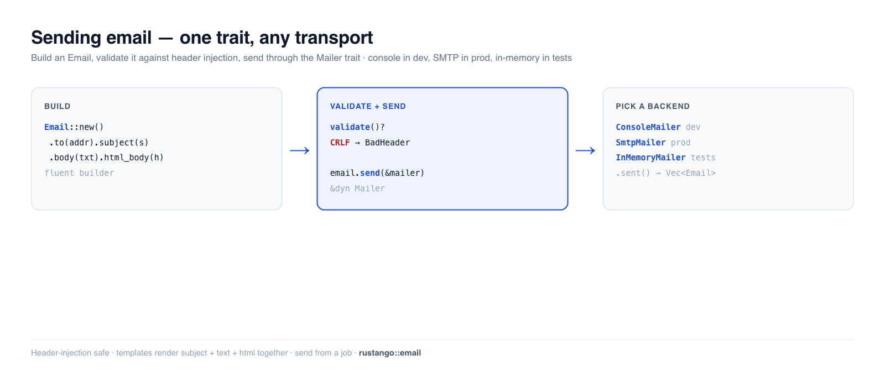

# Sending email

Welcome messages, password resets, receipts, alerts — most apps send
transactional email. **Rustango** gives you a `Mailer` trait with swappable
backends (console for dev, SMTP for production, an in-memory recorder for tests),
a fluent `Email` builder with header-injection protection, and template
rendering. Write `mailer.send(&email)` once; switch from printing to your
terminal to real SMTP with a one-line change.

[](img/email.png)

> **New to a term here?** *transactional email*, *SMTP*, *mailer backend* — see
> the [glossary](glossary.md).

> **Source:** `rustango::email` (`Mailer`, `Email`, `ConsoleMailer`,
> `InMemoryMailer`, `NullMailer`, `SmtpMailer`, `BoxedMailer`, `send_mail`,
> `MailError`) — behind the `email` feature (on by default). SMTP needs the
> `email-smtp` feature. Templates: `rustango::email_templates::EmailRenderer`.
> Queued sending: `rustango::email_jobs`.
>
> **Runnable version:** the build, send, validation and testing snippets are copied from
> [`email_doc.rs`](https://github.com/ujeenet/rustango/blob/main/crates/rustango/tests/email_doc.rs)
> (`cargo test -p rustango --test email_doc`); the send helpers and attachments
> are dogfooded by `email_send_helpers.rs` and `email_attachments.rs`.

## Table of contents

- [Step 1 — Build an email](#step-1--build-an-email)
- [Step 2 — Pick a mailer](#step-2--pick-a-mailer)
- [Step 3 — Send it](#step-3--send-it)
- [Send from a handler](#send-from-a-handler) — the full example
- [Validation and header-injection safety](#validation-and-header-injection-safety)
- [Testing email](#testing-email)
- [Templates](#templates)
- [Send it off the request](#send-it-off-the-request)
- [Reference](#reference)
- [See also](#see-also)

---

## Step 1 — Build an email

`Email` is a fluent builder. Set recipients, subject, and a text and/or HTML
body:

```rust
use rustango::email::Email;

let email = Email::new()
    .to("ada@example.com")
    .from("noreply@example.com")
    .subject("Welcome")
    .body("Thanks for signing up.")              // plain-text part
    .html_body("<p>Thanks for signing up.</p>"); // optional HTML part
```

`.cc(...)`, `.bcc(...)`, `.reply_to(...)`, `.header(name, value)`, and
`.attach(...)` / `.attach_text(filename, text)` are available too.

---

## Step 2 — Pick a mailer

Every backend implements `Mailer`, so your code never names the concrete type —
hold a **`BoxedMailer`** (`Arc<dyn Mailer>`):

| Backend | Feature | Use for |
|---|---|---|
| `ConsoleMailer` | `email` | dev — prints the message to stdout |
| `SmtpMailer` | `email-smtp` | production — real delivery over SMTP |
| `InMemoryMailer` | `email` | tests — records messages, sends nothing |
| `FileMailer` | `email` | dev/CI — writes each message to a file |
| `NullMailer` | `email` | disable email entirely |

Build it from config so it differs per environment (`ConsoleMailer` locally,
`SmtpMailer` in prod) via `email::from_settings(&settings.mail)?`. With
`backend = "smtp"` it fails if the mailer cannot be built (no `smtp_host`, a bad
`from_address`, `smtp_tls` other than `none` / `starttls` / `implicit`, or a build
without `email-smtp`). `backend` accepts `console` (the default off the prod tier; unset on prod is a
`MailError::Config`), `memory`,
`null` / `none`, `file` (needs `file_email_dir`) and `smtp`; any other value is a
`MailError::Config`.

### The `[mail]` settings

`from_settings` reads the `[mail]` section of your `config/*.toml` files. Here is
every key. In development you need none of them, because the console is the
default. For SMTP you need at least `backend` and `smtp_host`:

```toml
# config/prod_settings.toml (or config/default.toml for every tier)
[mail]
backend           = "smtp"               # console | memory | file | null | smtp
smtp_host         = "smtp.example.com"
smtp_port         = 587                  # default: 25 / 587 / 465, from smtp_tls
smtp_tls          = "starttls"           # none | starttls | implicit
smtp_username     = "apikey"
# smtp_password: NOT here. Set RUSTANGO__MAIL__SMTP_PASSWORD (see below).
smtp_timeout_secs = 10                   # unset = no timeout
from_address      = "My App <noreply@example.com>"  # From: when the email sets none

# Optional
server_email         = "ops@example.com"  # From: for mail_admins / mail_managers
email_subject_prefix = "[My App] "        # before mail_admins / mail_managers subjects
admins               = ["ops@example.com"]
managers             = ["team@example.com"]
# file_email_dir     = "var/mail"         # needed with backend = "file"
```

`smtp_username` and `smtp_password` only take effect together. With neither, the
mailer connects without logging in.

The SMTP backend needs the `email-smtp` feature, which the scaffolded project does
not turn on. Add it to the `rustango` line in your `Cargo.toml`:

```toml
rustango = { version = "…", default-features = false, features = ["batteries", "email-smtp"] }
```

Or pass `--features email-smtp` to `cargo rustango new`.

### Keep the SMTP password out of git

`config/*.toml` files are committed, so **never put the password in them.** Every
setting can be set from an environment variable named
`RUSTANGO__SECTION__KEY` (two underscores between the parts). For
`[mail] smtp_password` that is:

```bash
RUSTANGO__MAIL__SMTP_PASSWORD=your-smtp-password
```

On your machine, put that line in `.env`. The scaffolded `main.rs` loads `.env`
before it reads the settings, and the scaffolded `.gitignore` already leaves `.env`
out of git. In production, set the variable in your host's secret settings. The
same pattern works for any other key, such as `RUSTANGO__MAIL__SMTP_USERNAME`.
See also [Managing secrets](security.md#managing-secrets).

---

## Step 3 — Send it

`Email::send` takes any `&dyn Mailer`:

```rust
email.send(&mailer).await?;
```

`from_settings` gives you a `BoxedMailer`, which is an `Arc`. Pass the mailer
inside it with `&*mailer`: `email.send(&*mailer).await?`.

For a quick one-off, `send_mail` skips the builder:

```rust
use rustango::email::send_mail;

send_mail(
    &mailer,
    "Your report is ready",                  // subject
    "Download it from your dashboard.",      // body
    Some("noreply@example.com"),             // from (or None for the default)
    &["ops@example.com", "qa@example.com"],  // recipients
).await?;
```

`send_many` sends a batch in one call.

---

## Send from a handler

The framework does not keep a mailer for you. You build one at boot with
`from_settings` and give it to your routes as an axum `Extension`. A handler then
takes it as an argument.

This example adds a contact form to the app from [Getting started](getting-started.md).
First the route, in a new file. Add `pub mod contact;` to `src/lib.rs`:

```rust
// src/contact.rs
use axum::{http::StatusCode, routing::post, Extension, Json, Router};
use rustango::email::{BoxedMailer, Email};
use serde::Deserialize;

#[derive(Deserialize)]
pub struct ContactForm {
    pub email: String,
    pub message: String,
}

async fn contact(
    Extension(mailer): Extension<BoxedMailer>,
    Json(form): Json<ContactForm>,
) -> StatusCode {
    let sent = Email::new()
        .to("support@example.com")
        .reply_to(form.email)
        .subject("Contact form")
        .body(form.message)
        .send(&*mailer)
        .await;
    match sent {
        Ok(()) => StatusCode::NO_CONTENT,
        // The mail server is down or timed out: the user can try again.
        Err(e) if e.is_retryable() => StatusCode::SERVICE_UNAVAILABLE,
        // A bad address or a newline in a header.
        Err(_) => StatusCode::BAD_REQUEST,
    }
}

pub fn router(mailer: BoxedMailer) -> Router {
    Router::new()
        .route("/contact", post(contact))
        .layer(Extension(mailer))
}
```

Then build the mailer in `src/main.rs` and mount the route. The scaffolder puts
this code in `run()`; keep everything else as it is. Two lines are new:

```rust
// src/main.rs, inside run()
let _ = dotenvy::dotenv();
let loaded = rustango::config::Settings::load_from_env();
let settings = loaded.as_ref().cloned().unwrap_or_default();
let admin_settings = settings.clone();
let mailer = rustango::email::from_settings(&settings.mail)?; // NEW: reads [mail]

rustango::manage::Cli::new()
    .api(urls::api().merge(myblog::contact::router(mailer))) // NEW: mounts /contact
    .try_nest_with(urls::admin_prefix(&settings), move |pool| {
        urls::admin_router(pool, &admin_settings)
    })
    .with_health()
    .with_loaded_settings(loaded)
    .run()
    .await
```

Try it with `cargo run`, and in another terminal:

```bash
curl -X POST http://localhost:8080/contact \
     -H "content-type: application/json" \
     -d '{"email":"ada@example.com","message":"Hello"}'
```

With the default console backend, the email prints in the server's terminal.

The user waits while the email is sent. To answer at once, send it from a job:
see [Send it off the request](#send-it-off-the-request).

---

## Validation and header-injection safety

`Email::validate()` runs before sending (and you can call it yourself). It
rejects incomplete messages **and** defends against header injection — a newline
smuggled into a header is how attackers add a hidden `Bcc`:

```rust
// Missing recipients or an empty subject → MailError::InvalidMessage
Email::new().subject("hi").validate()?;          // Err: no recipients

// A CRLF in any header field → MailError::BadHeader
Email::new()
    .to("a@example.com")
    .subject("Hello\r\nBcc: victim@example.com")  // injection attempt
    .body("x")
    .validate()?;                                  // Err: BadHeader
```

Both are verified in the backing test.

---

## Testing email

Use `InMemoryMailer` — it records every message instead of sending, so tests
assert on what *would* have gone out, with no network:

```rust
use rustango::email::InMemoryMailer;

let mailer = InMemoryMailer::new();
welcome_flow(&mailer).await?;          // your code under test

let sent = mailer.sent();              // Vec<Email>
assert_eq!(sent.len(), 1);
assert_eq!(sent[0].to, vec!["ada@example.com".to_string()]);
assert_eq!(sent[0].subject, "Welcome");
```

---

## Templates

For anything beyond a line of text, render the body from a [Tera](html-views.md)
template instead of inlining HTML. `email_templates::EmailRenderer` (features
`email` + `admin`, both in the default set)
follows a `name.subject.txt` / `name.txt` / `name.html` convention — one template
set produces the subject, the plain-text part, and the HTML part together, so the
three never drift. The HTML part autoescapes; the subject and text part render raw.
The `Mailable` trait packages "a thing that knows how to turn
itself into an `Email`" for reusable messages.

Put the three files in an `email_templates/` folder at the project root:

```text
email_templates/welcome.subject.txt   Welcome, {{ name }}
email_templates/welcome.txt           Hi {{ name }}, thanks for signing up.
email_templates/welcome.html          <p>Hi {{ name }}, thanks for signing up.</p>
```

The subject and the `.txt` file are required; the `.html` file is optional. Then
load the folder once and render by name. The values come from a Tera `Context`,
so add `tera = "1"` to `[dependencies]` in your `Cargo.toml`:

```rust
use rustango::email_templates::EmailRenderer;
use tera::Context;

// Once, at boot. Share it with handlers as Arc<EmailRenderer>, like the mailer.
let renderer = EmailRenderer::from_dir("email_templates")?;

// In the handler:
let mut ctx = Context::new();
ctx.insert("name", "Ada");
let email = renderer.render("welcome", &ctx)?.to("ada@example.com");
email.send(&*mailer).await?;
```

`render` sets only the subject and the bodies. Add `.to(...)`, and `.from(...)`
unless `from_address` is set.

---

## Send it off the request

Sending email inline makes the user wait on your SMTP server and couples the
response to its availability. Send it from a [background job](jobs.md) instead —
the handler returns immediately and a worker delivers it (with retries if SMTP is
down).

`email_jobs` (features `email` + `jobs`, both in the default set) does this for
you. `register_email_job` gives a job queue a handler that holds your mailer.
`dispatch_email` puts an `Email` on the queue. It validates the email first, and
only a `Transport` failure retries. Attachment bytes are queued as base64.

Here is the contact form from [Send from a handler](#send-from-a-handler), changed
to queue the email. The route now holds the queue instead of the mailer:

```rust
// src/contact.rs
use std::sync::Arc;

use axum::{http::StatusCode, routing::post, Extension, Json, Router};
use rustango::email::Email;
use rustango::email_jobs::dispatch_email;
use rustango::jobs::{InMemoryJobQueue, JobError};
use serde::Deserialize;

#[derive(Deserialize)]
pub struct ContactForm {
    pub email: String,
    pub message: String,
}

async fn contact(
    Extension(queue): Extension<Arc<InMemoryJobQueue>>,
    Json(form): Json<ContactForm>,
) -> StatusCode {
    let email = Email::new()
        .to("support@example.com")
        .reply_to(form.email)
        .subject("Contact form")
        .body(form.message);
    // Returns at once; a worker sends the email.
    match dispatch_email(&*queue, &email).await {
        Ok(()) => StatusCode::ACCEPTED,
        Err(JobError::Fatal(_)) => StatusCode::BAD_REQUEST, // the email is not valid
        Err(_) => StatusCode::SERVICE_UNAVAILABLE,          // the queue failed
    }
}

pub fn router(queue: Arc<InMemoryJobQueue>) -> Router {
    Router::new()
        .route("/contact", post(contact))
        .layer(Extension(queue))
}
```

In `src/main.rs`, build the queue, register the email job with the mailer, and
start the workers before `Cli` runs. Stop them in `on_shutdown`:

```rust
// src/main.rs, inside run(). Add at the top of the file:
//   use std::sync::Arc;
//   use rustango::email_jobs::{register_email_job, EmailJobConfig};
//   use rustango::jobs::{InMemoryJobQueue, JobQueue};
let _ = dotenvy::dotenv();
let loaded = rustango::config::Settings::load_from_env();
let settings = loaded.as_ref().cloned().unwrap_or_default();
let admin_settings = settings.clone();

let mailer = rustango::email::from_settings(&settings.mail)?;
let queue = Arc::new(InMemoryJobQueue::with_workers(4));
register_email_job(&*queue, EmailJobConfig::new(mailer)).await;
queue.start().await;
let draining = Arc::clone(&queue);

rustango::manage::Cli::new()
    .api(urls::api().merge(myblog::contact::router(queue)))
    .try_nest_with(urls::admin_prefix(&settings), move |pool| {
        urls::admin_router(pool, &admin_settings)
    })
    .with_health()
    .with_loaded_settings(loaded)
    .on_shutdown(move || async move { draining.shutdown().await })
    .run()
    .await
```

`&*queue` passes the queue inside the `Arc`. To queue your own job
type with the mailer, see [Step 4 of the jobs guide](jobs.md#step-4--wire-it-into-your-app).

---

## Reference

**`Email` builder:** `to` · `cc` · `bcc` · `from` · `reply_to` · `subject` · `body` ·
`html_body` · `header` · `attach` · `attach_text` · `validate()` · `send(&mailer)`.

**Helpers:** `send_mail(mailer, subject, body, from, &recipients)` ·
`send_many(mailer, &emails)` · `from_settings(&MailSettings)` ·
`mail_admins(mailer, &settings.mail, subject, body)` /
`mail_managers(...)` (send to `[mail].admins` / `managers`).

**`MailError`:** `InvalidMessage` (incomplete) · `BadHeader` (CRLF injection) ·
`Transport` (backend/delivery failure, the only one `EmailJob` retries) ·
`Rejected` (the SMTP server refused the message for good) · `Config` (bad `[mail]` section).

---

## See also

- [Background jobs](jobs.md) — deliver email off the request with retries.
- [Account flows](auth-flows.md) — password-reset / verification / magic-link
  emails built on this.
- [HTML views](html-views.md) — the Tera engine email templates also use.
- [Caching](caching.md) — the same swap-the-backend trait pattern.
