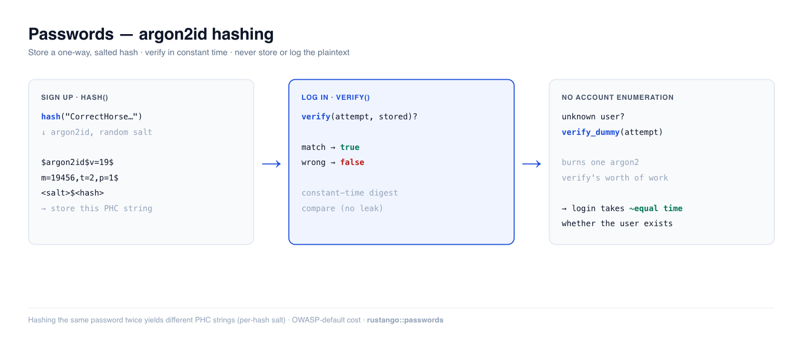

# Contraseñas

Almacenar una contraseña significa almacenar algo que un atacante no puede
revertir ni siquiera con toda tu base de datos en la mano. **Rustango** te ofrece
eso en dos llamadas — `hash` a la entrada, `verify` a la salida — respaldadas por
**argon2id**, el ganador *memory-hard* de la Password Hashing Competition y la
primera opción actual de OWASP. Nunca almacenas, registras ni comparas el texto
plano.

[](../img/auth-passwords.png)

> **Fuente:** `rustango::passwords` (`hash`, `verify`, `verify_dummy`, sus
> formas `_async`, `Argon2Params`, `needs_rehash`, `strength_score`,
> `StrengthIssue`) — detrás de la característica `passwords`
> (activada por defecto). Para las utilidades de contraseña de usuario integradas
> con la multitenencia, consulta `rustango::tenancy::password`.
>
> **Versión ejecutable:** cada fragmento a continuación está copiado del ejemplo
> probado [`auth_demo`](https://github.com/ujeenet/rustango/blob/main/crates/rustango/examples/auth_demo/tests/auth_passwords.rs)
> — `cargo test -p auth_demo --test auth_passwords`.

> **¿Algún término aquí es nuevo para ti?** *hash*, *sal*, *argon2id*, *cadena
> PHC* — consulta el [glosario](glossary.md).

> Esta es la inmersión profunda de la sección «Hashear y verificar contraseñas»
> de la [guía de seguridad](security.md).

---

## Tabla de contenidos
- [Inicio rápido](#inicio-rápido) · [Por qué argon2id](#por-qué-argon2id)
- [Hashear al registrarse](#hashear-al-registrarse) · [Verificar al iniciar sesión](#verificar-al-iniciar-sesión)
- [Inicios de sesión con tiempos seguros](#inicios-de-sesión-con-tiempos-seguros-enumeración-de-cuentas) · [Comprobaciones de robustez](#comprobaciones-de-robustez)
- [Dónde vive el hash](#dónde-vive-el-hash) · [Código asíncrono](#código-asíncrono) · [Coste y rehasheo](#coste-y-rehasheo)
- [Notas y límites](#notas-y-límites)

---

## Inicio rápido

```rust
use rustango::passwords::{hash, verify};

// Signup — store the returned PHC string, never the plaintext.
let stored: String = hash("CorrectHorseBatteryStaple!42")?;

// Login — check an attempt against the stored hash.
if verify("CorrectHorseBatteryStaple!42", &stored)? {
    // credentials good
}
```

`hash` devuelve una [cadena PHC](https://github.com/P-H-C/phc-string-format) — una
línea autodescriptiva que lleva el algoritmo, sus parámetros de coste, la sal
aleatoria y el digest:

```text
$argon2id$v=19$m=19456,t=2,p=1$<base64 salt>$<base64 hash>
```

Como la sal y los parámetros viajan *dentro* de la cadena, `verify` solo necesita
el valor almacenado y el intento — no hay una columna de sal separada que
gestionar.

---

## Por qué argon2id

`hash` usa **argon2id** con los valores por defecto recomendados por OWASP (m=19
MiB, t=2, p=1). argon2id es *memory-hard*: cada intento cuesta RAM real, que es lo
que embota las granjas de GPU/ASIC que hacen que los hashes rápidos (MD5,
SHA-256, incluso bcrypt a bajo coste) sean vulnerables a la fuerza bruta. Dos
propiedades importan para la corrección:

- **El salado es automático y por hash.** Hashear la misma contraseña dos veces
  produce dos cadenas PHC diferentes, de modo que contraseñas idénticas no
  colisionan en tu tabla y los ataques con tablas arcoíris precalculadas no
  aplican.

  ```rust
  let a = hash("same-password-12345")?;
  let b = hash("same-password-12345")?;
  assert_ne!(a, b);                 // different random salt each time
  assert!(verify("same-password-12345", &a)?);
  assert!(verify("same-password-12345", &b)?);
  ```

- **La verificación es de tiempo constante** en la comparación del digest (el
  propio `PasswordVerifier` de argon2), de modo que una fuga de tiempo byte a
  byte no puede revelar qué parte de un intento era correcta.

---

## Hashear al registrarse

```rust
use rustango::passwords::{hash, strength_score};

fn create_user(username: &str, plaintext: &str) -> Result<String, String> {
    // Optional: nudge users away from weak choices (see below).
    let issues = strength_score(plaintext);
    if !issues.is_empty() {
        return Err(format!("password too weak: {issues:?}"));
    }
    // Store the PHC string on the user row (e.g. auth_users.password_hash).
    hash(plaintext).map_err(|e| e.to_string())
}
```

---

## Verificar al iniciar sesión

```rust
use rustango::passwords::verify;

// `stored` is the PHC string you saved at signup.
let ok = verify(attempt, &stored)?;
```

`verify` devuelve:
- `Ok(true)` — el intento coincide.
- `Ok(false)` — no coincide.
- `Err(PasswordError::Verify)` — `stored` no era una cadena PHC válida (una
  columna corrupta o truncada), así que trátalo como un inicio de sesión fallido,
  no como un 500.

### Un handler de login completo

Este es el handler `login` de [Primeros pasos, Paso 14](getting-started.md#paso-14-registro-inicio-de-sesión-y-autenticación-jwt), compilado y probado en el ejemplo `getting_started_blog`. Frena los intentos fallidos con `login_throttle`, ejecuta `verify_dummy_async` para un usuario desconocido, da el mismo `401` para un usuario desconocido y una contraseña incorrecta, y devuelve un JWT de 15 minutos. Los pequeños ayudantes que llama (`normalize`, `server_error`, `bad_credentials`, `jwt_secret`) y los tipos `ApiUser`, `Credentials` y `TokenResponse` están allí en el mismo archivo.

```rust
use axum::extract::State;
use axum::response::{IntoResponse, Response};
use axum::Json;
use rustango::jwt::{self, Claims};
use rustango::login_throttle::{self, ClientIp, LoginRefused, LoginScope};
use rustango::passwords::{self, PasswordError};
use rustango::prelude::*;
use rustango::sql::Pool;

/// `POST /api/login` — check the password and hand out a short-lived token.
pub async fn login(
    State(pool): State<Pool>,
    ip: ClientIp,
    Json(body): Json<Credentials>,
) -> Result<Json<TokenResponse>, Response> {
    // First: with no valid key every login is a 500, right password or not.
    let secret = jwt_secret().map_err(IntoResponse::into_response)?;
    let username = normalize(&body.username);

    // Before any lookup: 429 once this IP (or everyone) failed too often.
    // `Sso(name)`: its own total limit, a per-IP limit shared with SSO sign-ins, no account lock.
    let scope = LoginScope::Sso("blog-api".to_owned());
    let attempt = login_throttle::shared()
        .begin(&scope, &ip, &username)
        .await
        .map_err(IntoResponse::into_response)?;

    let found = ApiUser::objects()
        .where_(ApiUser::username.eq(username))
        .first(&pool)
        .await
        .map_err(|e| server_error(e).into_response())?;

    let Some(user) = found else {
        // Do the same slow work as a real check, so timing does not reveal the name is unknown.
        if passwords::verify_dummy_async(&body.password).await.is_err() {
            return Err(LoginRefused::Busy.into_response()); // 503: no hashing slot free
        }
        attempt.failed().await;
        return Err(bad_credentials().into_response());
    };
    let password_ok = match passwords::verify_async(&body.password, &user.password_hash).await {
        Ok(ok) => ok,
        Err(PasswordError::Busy) => return Err(LoginRefused::Busy.into_response()),
        // A corrupt stored hash counts as a wrong password, not a server error.
        Err(_) => false,
    };
    if !password_ok {
        attempt.failed().await;
        return Err(bad_credentials().into_response());
    }
    attempt.succeeded().await;

    let id = user.id.get().copied().unwrap_or_default();
    let claims = Claims::new(id.to_string()).ttl(TOKEN_TTL); // subject = user id
    let access_token =
        jwt::encode(&claims, &secret).map_err(|e| server_error(e).into_response())?;
    Ok(Json(TokenResponse {
        access_token,
        token_type: "Bearer",
        expires_in: TOKEN_TTL.as_secs(),
    }))
}
```

---

## Inicios de sesión con tiempos seguros (enumeración de cuentas)

Si tu inicio de sesión ejecuta el costoso `verify` **solo** cuando el nombre de
usuario existe, un nombre de usuario desconocido responde notablemente más rápido
que uno real — y esa brecha de tiempo permite a un atacante enumerar las cuentas
válidas. `verify_dummy` la cierra: llámalo en la rama de usuario-no-encontrado (y
cuenta-inactiva) para que cada inicio de sesión invierta el trabajo de un `verify`
de argon2 sin importar el caso.

```rust
use rustango::passwords::{verify, verify_dummy};

let row = users::find_by_username(username).await?;
let authenticated = match row {
    Some(u) if u.is_active => verify(attempt, &u.password_hash)?,
    _ => {
        verify_dummy(attempt); // burn the same work, then fail
        false
    }
};
```

---

## Comprobaciones de robustez

`strength_score` devuelve un `Vec<StrengthIssue>` — vacío significa «lo bastante
bueno». Es una heurística intencionadamente ligera para *animar* a los usuarios,
no una barrera de política estricta; combínala con una comprobación contra listas
de filtraciones (HIBP / pwned-passwords) para despliegues serios.

```rust
use rustango::passwords::{strength_score, StrengthIssue};

assert!(strength_score("Tr0ub4dor&3-CorrectBattery").is_empty());
assert!(strength_score("password123").contains(&StrengthIssue::KnownWeak));
assert!(strength_score("short").contains(&StrengthIssue::TooShort));
```

| `StrengthIssue` | Se activa cuando |
|---|---|
| `TooShort` | menos de 12 caracteres |
| `NoDigitsOrSymbols` | solo letras — sin dígito ni símbolo |
| `NoVariety` | solo letras minúsculas |
| `KnownWeak` | coincide con la pequeña lista integrada de contraseñas débiles (sin distinguir mayúsculas y minúsculas) |

---

## Dónde vive el hash

La cadena PHC no es más que una columna `String` en el modelo de cuenta que sea
tuyo. En el ejemplo
[`auth_demo`](https://github.com/ujeenet/rustango/blob/main/crates/rustango/examples/auth_demo/src/models.rs):

```rust
#[derive(Model, Clone, Debug)]
#[rustango(table = "auth_users", display = "username")]
pub struct User {
    #[rustango(primary_key)]
    pub id: Auto<i64>,
    #[rustango(max_length = 150, unique)]
    pub username: String,
    #[rustango(max_length = 254)]
    pub email: String,
    #[rustango(max_length = 255)]      // PHC strings are ~95 chars at these params
    pub password_hash: String,
    pub is_active: bool,
    pub is_superuser: bool,
}
```

Una vez que el usuario está autenticado, pasa el testigo a una
[sesión](auth-sessions.md) (para aplicaciones de navegador) o emite un
[JWT](auth-jwt.md) (para APIs).

---

## Código asíncrono

`hash`, `verify` y `verify_dummy` son bloqueantes: una llamada a argon2 ocupa un
worker del runtime durante todo el hash. En un handler, llama en su lugar a
`hash_async`, `verify_async` y `verify_dummy_async`. Se ejecutan en el pool
bloqueante, como máximo un trabajo por CPU a la vez.

Un trabajo espera hasta `hash_wait()` un hueco libre (5 s por defecto,
`DEFAULT_HASH_WAIT`) y luego falla con `PasswordError::Busy`. Responde con un
503, igual para un usuario conocido y uno desconocido. Ajusta la espera con
`[auth] hash_wait_ms` o `configure_hash_wait(duration)` al arrancar. Las claves `[auth]` las aplica `manage::Cli` al cargar los ajustes; una app que construye `server::Builder` sin él llama a las funciones en su lugar.

---

## Coste y rehasheo

Los hashes nuevos usan `argon2_params()`, por defecto `Argon2Params::DEFAULT`
(m=19456 KiB, t=2, p=1). Súbelo con `[auth] argon2_memory_kib`,
`argon2_iterations` y `argon2_parallelism`, o llama a
`configure_argon2(Argon2Params::new(m, t, p)?)` al arrancar; un valor fijado en
código gana sobre los ajustes, y las claves solo se aplican vía `manage::Cli`. `Argon2Params::new` rechaza una combinación que
argon2 no acepta.

Los hashes antiguos siguen verificándose, porque su coste vive en la cadena PHC.
`needs_rehash(&stored)` es `true` cuando un hash es más débil que el coste
actual (o no es argon2id v19). Tras un inicio de sesión con éxito:

- `rehash_async(attempt, &stored)` devuelve un hash nuevo cuando toca, si no `None`.
- `upgrade_stored_hash(&pool, Model::SCHEMA, id, attempt, &stored)` también lo
  guarda en la columna `password_hash` de la fila, pero solo si esa columna aún
  contiene `stored`, y devuelve el hash que queda vigente.

---

## Notas y límites

- **Nunca** almacenes, registres ni compares con `==` el texto plano. `hash` →
  almacenar; `verify` → comprobar. Ese es todo el contrato.
- **Los parámetros de coste parten por defecto del suelo de OWASP.** Elevarlos
  más adelante es seguro — los hashes antiguos siguen verificándose (sus
  parámetros viven en la cadena PHC), y
  [`upgrade_stored_hash`](#coste-y-rehasheo) vuelve a hashear en el siguiente
  inicio de sesión con éxito.
- `strength_score` es una heurística, no un motor de políticas — no detectará
  `Summer2024!`. Superpón una búsqueda en listas de filtraciones para una
  aplicación real de la robustez.
- Para aplicaciones multitenencia con el almacén de usuarios del framework,
  prefiere `rustango::tenancy::password` (el mismo argon2id, integrado con el
  modelo de usuario del inquilino). Este módulo es la versión autónoma para
  aplicaciones que poseen su propia tabla User.


---

## Véase también

- [Sesiones](auth-sessions.md)
- [Flujos de cuenta](auth-flows.md)
- [Backends de autenticación](auth-backends.md)
- [Guía de seguridad](security.md)
