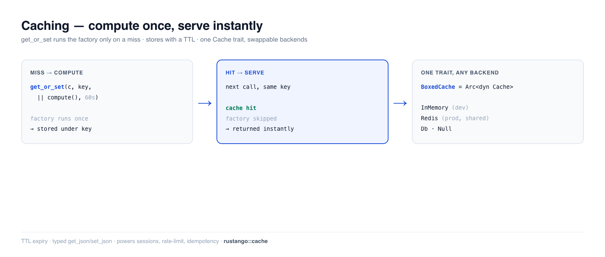

# Caché

La caché almacena el resultado de un trabajo costoso — una consulta pesada, un
fragmento renderizado, una llamada a una API de terceros — para que la siguiente
petición lo obtenga al instante en lugar de recalcularlo. **Rustango** te da un
único trait `Cache` con backends intercambiables (in-memory, Redis, base de
datos), un helper de cálculo-al-fallar (`get_or_set`) y helpers JSON tipados.
Cambia el backend sin tocar un solo sitio de llamada: las llamadas siguen
igual, solo cambia la configuración.

[](../img/caching.png)

> **¿Un término nuevo aquí?** *caché*, *TTL*, *clave*, *backend* — ver el
> [glosario](glossary.md).

> **Fuente:** `rustango::cache` (`Cache`, `InMemoryCache`, `NullCache`,
> `get_or_set`, `get_json`, `set_json`, `BoxedCache`, `from_settings`) — tras la
> feature `cache` (activa por defecto). `RedisCache` requiere la feature
> `cache-redis` (desactivada por defecto).
>
> **Versión ejecutable:** cada fragmento está copiado de
> [`cache_doc.rs`](https://github.com/ujeenet/rustango/blob/main/crates/rustango/tests/cache_doc.rs)
> (`cargo test -p rustango --test cache_doc`); el backend de base de datos se
> prueba con dogfooding sobre SQLite mediante
> [`cache_db_backend_sqlite_live.rs`](https://github.com/ujeenet/rustango/blob/main/crates/rustango/tests/cache_db_backend_sqlite_live.rs).

## Tabla de contenidos

- [Paso 1 — Elegir un backend](#paso-1--elegir-un-backend)
- [Paso 2 — get / set / delete](#paso-2--get--set--delete)
- [Paso 3 — get_or_set (cache-aside)](#paso-3--get_or_set-cache-aside)
- [Valores JSON tipados](#valores-json-tipados)
- [TTL y expiración](#ttl-y-expiración)
- [Cambiar de backend](#cambiar-de-backend)
- [Caché con multi-tenancy](#caché-con-multi-tenancy)
- [Caché de páginas completas](#caché-de-páginas-completas)
- [Referencia](#referencia)
- [Véase también](#véase-también)

---

## Paso 1 — Elegir un backend

Cada backend implementa el mismo trait `Cache`, así que tu código es idéntico sea
cual sea el que elijas. El código de la aplicación mantiene un **`BoxedCache`**
(`Arc<dyn Cache>`) y nunca nombra el tipo concreto:

```rust
use rustango::cache::{BoxedCache, InMemoryCache};
use std::sync::Arc;

let cache: BoxedCache = Arc::new(InMemoryCache::new());
```

| Backend | Feature | `[cache] backend` | Usar para |
|---|---|---|---|
| `InMemoryCache` | `cache` | `memory` *(por defecto)* | dev, tests, un solo proceso (HashMap por proceso + TTL) |
| `RedisCache` | `cache-redis` | `redis` | producción; compartido entre réplicas |
| `DatabaseCache` | `cache` | `db` / `database` | producción sin Redis; una tabla `rustango_cache` |
| `FileCache` | `cache` | `file` | un archivo por clave bajo `file_cache_dir`; compartido solo si el directorio lo está |
| `NullCache` | `cache` | `null` / `none` | deshabilitar la caché (cada lectura falla) — práctico en tests |

No existe el valor `postgres` — el backend de BD es `db` o `database`. Un
comentario de documentación de `CacheSettings` decía lo contrario hasta hace
poco, y un valor no reconocido te da una caché en memoria con una advertencia.

No existe el valor `postgres`: el backend de base de datos es `db` o `database`. Los
valores van en minúsculas. Un valor desconocido o con otras mayúsculas (`Redis`, una
errata), o `file` sin `file_cache_dir`, registra un `error` y recurre a una caché en
memoria; una versión menor posterior lo rechazará.

`FileCache` barre una dieciseisava parte de su directorio en busca de entradas
expiradas cada 16 escrituras. Llama a `FileCache::purge_expired()` de forma periódica
para barrerlo entero. En Unix, los directorios nuevos se crean con 0700 y las entradas
con 0600.

---

## Paso 2 — get / set / delete

El núcleo del trait son cuatro métodos async. `set` toma un TTL opcional
(`None` = sin expiración); `get` retorna `Option<String>` (`None` en un fallo):

```rust
use rustango::cache::{Cache, InMemoryCache};

let cache = InMemoryCache::new();

assert_eq!(cache.get("greeting").await?, None);     // miss
cache.set("greeting", "hello", None).await?;        // store, no expiry
assert_eq!(cache.get("greeting").await?.as_deref(), Some("hello"));
assert!(cache.exists("greeting").await?);

cache.delete("greeting").await?;                    // gone
```

También hay variantes por lotes — `get_many` / `set_many` / `delete_many`.

---

## Paso 3 — get_or_set (cache-aside)

Esta es la que usarás más. `get_or_set` retorna el valor cacheado, o — en un
fallo — ejecuta tu factory, almacena el resultado con un TTL y lo retorna. La
factory **solo se ejecuta en un fallo**:

```rust
use rustango::cache::get_or_set;
use std::time::Duration;

let stats: HomeStats = get_or_set(
    &*cache,                       // &dyn Cache
    "home:stats",
    || async { compute_home_stats(&pool).await },   // runs only on a miss
    Some(Duration::from_secs(60)),                   // cache for 60s
).await?;
```

El test que lo respalda llama a `get_or_set` dos veces para la misma clave y
afirma que la factory se ejecutó **exactamente una vez** — la segunda llamada se
sirve desde la caché.

> **Invalida al escribir.** Cache-aside significa datos obsoletos hasta que
> expira el TTL. Para datos que cambian, haz también `delete(key)` cuando los
> escribes — p. ej. desde una [señal `post_save`](orm.md) que envíes tras guardar (guardar no la
> envía) — para que la siguiente
> lectura recalcule.

---

## Valores JSON tipados

`get_json` / `set_json` serializan cualquier tipo `Serialize`/`Deserialize` a
JSON, de modo que cacheas structs y listas, no solo strings:

```rust
use rustango::cache::{get_json, set_json};

#[derive(serde::Serialize, serde::Deserialize)]
struct Profile { id: i64, name: String }

set_json(&*cache, "profile:7", &profile, None).await?;
let back: Option<Profile> = get_json(&*cache, "profile:7").await?;   // None on a miss
```

(`get_or_set` los usa por debajo, por lo que su tipo de valor debe ser
`Serialize + Deserialize`.)

---

## TTL y expiración

Pasa una `Duration` a `set` (o `get_or_set`) y la entrada desaparece después de
ella. Verificado: una entrada de 50 ms es legible de inmediato y desaparece tras
80 ms.

```rust
cache.set("flash", "x", Some(Duration::from_millis(50))).await?;
// ...50ms later...
assert_eq!(cache.get("flash").await?, None);   // expired
```

`InMemoryCache::with_default_ttl(d)` fija un TTL por defecto que se aplica cuando
pasas `None`.

### Un TTL es una cota superior, no una garantía

`InMemoryCache` está **acotado en tamaño por defecto** — 256 MiB o 100 000
entradas, lo que se alcance primero — con desalojo LRU aproximado. Una avalancha
de claves únicas no puede hacer crecer el proceso sin límite, pero también
significa que **una entrada puede desaparecer antes de que expire su TTL** si es
la menos usada recientemente cuando se alcanza el presupuesto. El desalojo
elimina primero las entradas ya expiradas y después las menos usadas
recientemente, hasta quedar un 10 % por debajo de ambos presupuestos. Las
entradas escritas con `set_forever` (feature flags) quedan fuera de los
presupuestos y nunca se desalojan mientras sigan dentro de sus propios topes —
16 MiB o 10 000 entradas (`.with_max_pinned_bytes(..)` /
`.with_max_pinned_entries(..)`). Por encima, las nuevas entradas `set_forever` se
guardan como entradas normales, desalojables, y se registra un aviso una vez.

Así que trata una lectura de caché como «puede estar ausente» incluso dentro del
TTL. Eso vale para cualquier backend de caché, pero aquí tiene una causa
razonable y ajustable:

```rust
InMemoryCache::new()
    .with_max_bytes(512 * 1024 * 1024)   // subir el presupuesto
    .with_max_entries(0)                 // 0 = sin límite (comportamiento previo al acotado)
```

El TTL en sí se aplica de forma perezosa, en la lectura — no hay hilo de desalojo
en segundo plano, así que una entrada expirada sigue ocupando su hueco hasta que
algo la pida o el desalojo la alcance.

---

## Cambiar de backend

Como todo es el trait `Cache`, cambiar de in-memory a Redis es un cambio de una
línea en el arranque — normalmente impulsado por la configuración para que
difiera según el entorno:

```rust
// Build the cache from `[cache]` settings. `from_settings_async` is the one
// to reach for — it can build the backends that need to connect.
let cache: BoxedCache = rustango::cache::from_settings_async(&settings.cache).await?;
```

| `backend` | `from_settings` (síncrono) | `from_settings_async` |
|---|---|---|
| `memory`, `null`, `file` | ✓ | ✓ |
| `redis` | **pánico** — no se puede construir de forma síncrona | ✓ |
| `db` | **pánico** — necesita un `&Pool` en tiempo de ejecución | error; constrúyelo donde esté el pool |

El resolutor síncrono lanza un pánico en lugar de sustituir el backend. Antes avisaba y
devolvía una caché en memoria, que no es una caché compartida degradada: es
otra distinta. Una caché por proceso multiplica el límite de
`CacheRateLimitLayer` por el número de réplicas y deja de hacer que
`verify_single_use` falle en cerrado, así que el mismo enlace de restablecimiento
funciona una vez por réplica. Ambas cosas están documentadas como funcionales
*porque* la caché es compartida, y un aviso al arrancar no llega a quien depura
eso una semana después.

`db` no puede salir de `[cache]` en absoluto, porque `DatabaseCache` necesita un
pool que los ajustes no llevan:

```rust
let cache = DatabaseCache::new(pool.clone(), "rustango_cache");
cache.ensure_table().await?;
let boxed: BoxedCache = std::sync::Arc::new(cache);
```

En producción, apúntalo a Redis (compartido entre todas tus réplicas):

```rust
use rustango::cache::RedisCache;   // needs the `cache-redis` feature
let cache: BoxedCache = std::sync::Arc::new(RedisCache::new("redis://localhost").await?);
```

Las mismas llamadas `get` / `set` / `get_or_set` — solo cambió el constructor.

---

## Caché con multi-tenancy

`Cache` es un almacén plano indexado por `&str`, y con multi-tenancy eso
convierte la clave natural en la clave que se filtra: un handler — o peor, una
tarea de fondo, que no tiene ningún tenant ambiental del que tirar — escribe
`"stats:monthly"` para un tenant y todos los demás lo leen.

Envuelve la caché compartida en un **`ScopedCache`** para que el namespace se
aplique por ti y el sitio de llamada no pueda olvidarlo:

```rust
use rustango::cache::ScopedCache;

// From the Org the resolver already produced:
let cache = ScopedCache::for_tenant(shared.clone(), &t.org.slug);

cache.set("stats:monthly", &json, ttl).await?;   // stored as tenant:acme:stats:monthly
cache.get("stats:monthly").await?;               // reads only acme's entry
cache.clear().await?;                            // drops ONLY acme's entries
```

`ScopedCache` es en sí mismo un `Cache`, así que encaja en cualquier cosa que
tome un `BoxedCache` — `cache_page`, `cache_fragment`, los rate limiters,
`DistributedLock`. Reenvía al backend interno con las claves mapeadas en lugar
de reimplementar nada, de modo que las primitivas nativas (Redis `INCRBY`,
`SET NX`) conservan su atomicidad. `get_many` / `set_many` / `delete_many` también
se reenvían, pero ningún backend incluido los agrupa aún: cada clave es un viaje
de ida y vuelta.

**Contadores atómicos y bloqueos.** `Cache::incr` está detrás del
[rate limiting](middleware.md) y el bloqueo por cuenta; `Cache::add`
(set-if-absent) está detrás de `DistributedLock`. `Cache::add` es atómico en los tres —
`RedisCache` (`SET NX`), `InMemoryCache` (que mantiene su cerrojo durante el
read-modify-write) y `DatabaseCache`, que hace el test-and-set bajo cerrojos de
fila, de modo que una carrera se resuelve con exactamente un ganador.
`Cache::incr` también es atómico en los tres: `DatabaseCache` lo hace en un solo
upsert. `FileCache` hace ambos bajo un cerrojo por entrada, válido solo en un
host. Así que un `DistributedLock` o un contador exacto entre réplicas funciona
con Redis o con la base de datos.

Dos cosas que conviene saber:

| | |
|---|---|
| **Es un namespace, no una frontera** | Todo sigue viviendo en un solo backend, y el código que tenga la caché *sin acotar* puede leer cualquier clave. La idea es que el camino ergonómico sea el correcto. |
| **`clear()` necesita enumerar claves** | Va por `Cache::delete_prefix`, y todos los backends integrados lo implementan: `InMemoryCache` filtra su mapa, `DatabaseCache` lanza `DELETE … LIKE 'prefix%'` con `%`, `_` y el carácter de escape escapados, `RedisCache` usa `SCAN`+`MATCH` con los metacaracteres de glob escapados, y `FileCache` recorre su directorio y compara la clave guardada en cada entrada. Un backend que no lo implemente ahora devuelve un **error** en lugar de recurrir a un fallback. `DatabaseCache` guarda las claves de más de 255 bytes con hash y compara un prefijo de más de 190 bytes solo por sus primeros 190 bytes, así que puede borrar claves de más, nunca de menos. |

El `Cache::clear()` sin acotar sigue siendo global al proceso, así que usa la
vista acotada siempre que el cambio de un solo tenant sea lo que disparó la
invalidación.

Un tenant nuevo puede reutilizar el slug de un tenant purgado. Para que
`purge-tenant` borre las claves `ScopedCache::for_tenant` del tenant anterior, llama a
`rustango::tenancy::decommission::clear_on_purge(cache)` al arrancar por cada caché
que las guarde.

---

## Caché de páginas completas

`CachePageLayer::new(cache)` (en `rustango::cache_page`) guarda las respuestas GET en
cualquier `BoxedCache`; `.timeout(dur)` fija cuánto tiempo (por defecto 60 s). Es
seguro por defecto:

- Una petición con `Authorization`, `Cookie` o `X-Api-Key` ni se sirve desde la caché
  ni se guarda en ella. Añade más cabeceras de credenciales (una cabecera de token
  propia) con `.credential_headers(["x-my-token"])`.
  `.cache_authenticated(true)` lo desactiva; úsalo solo en una ruta cuya página sea la
  misma para todos los clientes.
- Una respuesta con `Set-Cookie`, o con `Cache-Control: private`, `no-cache` o
  `no-store`, nunca se guarda.
- `.vary_on([...])` incluye cabeceras de la petición en la clave.
- `.key_prefix(..)` da a cada capa su propio espacio de claves (por defecto
  `rustango.cache_page`). `.cache_query(true)` cachea también peticiones `QUERY`,
  con un resumen del cuerpo (hasta 1 MiB) en la clave. `.tenant_agnostic(true)`
  cachea sin tenant resuelto, solo para una página igual para todos los tenants.

Para descartar una página tras una escritura, llama a
`layer.invalidate(&[PageKey::new(path, host)]).await?` sobre un clon de la capa
(añade `.tenant(slug)` a la clave con tenancy). Purga todas las variantes cacheadas
de esa ruta: cualquier query string, cualquier valor de `vary_on`, GET y `QUERY` por
igual. Funciona con un contador de generación por ruta, así que cada GET cacheado lee
una clave de caché pequeña más.

Con tenancy, monta la capa dentro de la capa de tenancy; consulta
[Middleware](middleware.md).

---

## Referencia

**Trait `Cache`:** `get` · `set(key, value, ttl)` · `set_forever` · `delete` ·
`exists` / `has_key` · `clear` · `delete_prefix` · `incr` / `decr` ·
`add` (si no existe) · `touch` (nuevo TTL) · `get_bytes` / `set_bytes` ·
`get_many` / `set_many` / `delete_many` · `get_or(key, default)`.

**Helpers libres:** `get_or_set(cache, key, factory, ttl)` ·
`get_json` / `set_json` · `from_settings(&CacheSettings)` ·
`from_settings_async(&CacheSettings)`.

**Mantenimiento:** `DatabaseCache::purge_expired()` y
`FileCache::purge_expired()` borran las entradas caducadas; llámalos periódicamente.

**Qué está construido sobre la caché:** las [sesiones](auth-sessions.md) del lado
del servidor, la [limitación de tasa](middleware.md) distribuida
(`CacheRateLimitLayer`), las claves de idempotencia y los feature flags toman
todos un `BoxedCache` — de modo que una sola instancia de Redis los respalda a
todos.

---

## Véase también

- [Trabajos en segundo plano](jobs.md) — la otra mitad de mantener rápidas las
  peticiones (diferir el trabajo en lugar de cachear su resultado).
- [Sesiones](auth-sessions.md) — un almacén del lado del servidor construido
  sobre `Cache`.
- [Middleware](middleware.md) — `CacheRateLimitLayer` comparte un contador entre
  réplicas vía la caché.
- [Cookbook del ORM](orm.md) — invalidar lecturas cacheadas desde una señal
  `post_save`.
