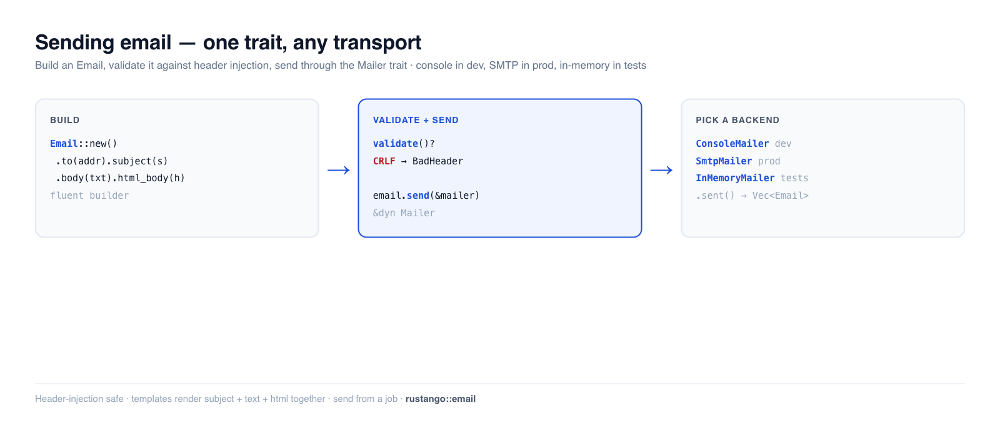

# Enviar correo electrónico

Mensajes de bienvenida, restablecimientos de contraseña, recibos, alertas — la mayoría de las
aplicaciones envían correo transaccional. **Rustango** te ofrece un trait `Mailer` con
backends intercambiables (consola para desarrollo, SMTP para producción, un grabador en memoria
para pruebas), un builder `Email` fluido con protección contra inyección de cabeceras, y el
renderizado de plantillas. Escribe `mailer.send(&email)` una vez; cambia de imprimir
en tu terminal a SMTP real con un cambio de una línea — sin tocar el código que lo llama.

[](../img/email.png)

> **¿Nuevo con algún término aquí?** *correo transaccional*, *SMTP*, *backend de correo* — ver
> el [glosario](glossary.md).

> **Fuente:** `rustango::email` (`Mailer`, `Email`, `ConsoleMailer`,
> `InMemoryMailer`, `NullMailer`, `SmtpMailer`, `BoxedMailer`, `send_mail`,
> `MailError`) — tras la característica `email` (activada por defecto). SMTP necesita la
> característica `email-smtp`. Plantillas: `rustango::email_templates::EmailRenderer`.
> Envío encolado: `rustango::email_jobs`.
>
> **Versión ejecutable:** los snippets de construir, enviar, validar y probar se copian de
> [`email_doc.rs`](https://github.com/ujeenet/rustango/blob/main/crates/rustango/tests/email_doc.rs)
> (`cargo test -p rustango --test email_doc`); los ayudantes de envío y los adjuntos
> se someten a prueba mediante `email_send_helpers.rs` y `email_attachments.rs`.

## Tabla de contenidos

- [Paso 1 — Construye un correo](#paso-1--construye-un-correo)
- [Paso 2 — Elige un mailer](#paso-2--elige-un-mailer)
- [Paso 3 — Envíalo](#paso-3--envíalo)
- [Enviar desde un handler](#enviar-desde-un-handler) — el ejemplo completo
- [Validación y protección contra inyección de cabeceras](#validación-y-protección-contra-inyección-de-cabeceras)
- [Probar el correo](#probar-el-correo)
- [Plantillas](#plantillas)
- [Envíalo fuera de la petición](#envíalo-fuera-de-la-petición)
- [Referencia](#referencia)
- [Véase también](#véase-también)

---

## Paso 1 — Construye un correo

`Email` es un builder fluido. Establece los destinatarios, el asunto, y un cuerpo de texto y/o
HTML:

```rust
use rustango::email::Email;

let email = Email::new()
    .to("ada@example.com")
    .from("noreply@example.com")
    .subject("Welcome")
    .body("Thanks for signing up.")              // plain-text part
    .html_body("<p>Thanks for signing up.</p>"); // optional HTML part
```

`.cc(...)`, `.bcc(...)`, `.reply_to(...)`, `.header(name, value)` y los adjuntos (`.attach(...)` / `.attach_text(filename, text)`) también están disponibles.

---

## Paso 2 — Elige un mailer

Cada backend implementa `Mailer`, de modo que tu código nunca nombra el tipo concreto —
sostén un **`BoxedMailer`** (`Arc<dyn Mailer>`):

| Backend | Característica | Úsalo para |
|---|---|---|
| `ConsoleMailer` | `email` | dev — imprime el mensaje en stdout |
| `SmtpMailer` | `email-smtp` | producción — entrega real por SMTP |
| `InMemoryMailer` | `email` | pruebas — graba los mensajes, no envía nada |
| `FileMailer` | `email` | dev/CI — escribe cada mensaje en un archivo |
| `NullMailer` | `email` | deshabilitar el correo por completo |

Constrúyelo a partir de la configuración para que difiera por entorno (`ConsoleMailer`
en local, `SmtpMailer` en prod) mediante `email::from_settings(&settings.mail)?`. Con
`backend = "smtp"` falla si el mailer no se puede construir (sin `smtp_host`, `from_address`
inválida, `smtp_tls` distinto de `none` / `starttls` / `implicit`, o un build
sin `email-smtp`). `backend` acepta `console` (por defecto fuera de prod; sin definir en prod es un
`MailError::Config`), `memory`,
`null` / `none`, `file` (necesita `file_email_dir`) y `smtp`; cualquier otro valor da
`MailError::Config`.

### Los ajustes de `[mail]`

`from_settings` lee la sección `[mail]` de tus archivos `config/*.toml`. Aquí están
todas las claves. En desarrollo no necesitas ninguna, porque la consola es el
valor por defecto. Para SMTP necesitas al menos `backend` y `smtp_host`:

```toml
# config/prod_settings.toml (or config/default.toml for every tier)
[mail]
backend           = "smtp"               # console | memory | file | null | smtp
smtp_host         = "smtp.example.com"
smtp_port         = 587                  # default: 25 / 587 / 465, from smtp_tls
smtp_tls          = "starttls"           # none | starttls | implicit
smtp_username     = "apikey"
# smtp_password: NOT here. Set RUSTANGO__MAIL__SMTP_PASSWORD (see below).
smtp_timeout_secs = 10                   # unset = no timeout
from_address      = "My App <noreply@example.com>"  # From: when the email sets none

# Optional
server_email         = "ops@example.com"  # From: for mail_admins / mail_managers
email_subject_prefix = "[My App] "        # before mail_admins / mail_managers subjects
admins               = ["ops@example.com"]
managers             = ["team@example.com"]
# file_email_dir     = "var/mail"         # needed with backend = "file"
```

`smtp_username` y `smtp_password` solo funcionan juntos. Sin ninguno de los dos,
el mailer se conecta sin iniciar sesión.

El backend SMTP necesita la característica `email-smtp`, que el proyecto generado
no activa. Añádela a la línea `rustango` de tu `Cargo.toml`:

```toml
rustango = { version = "…", default-features = false, features = ["batteries", "email-smtp"] }
```

O pasa `--features email-smtp` a `cargo rustango new`.

### Mantén la contraseña SMTP fuera de git

Los archivos `config/*.toml` se suben a git, así que **nunca pongas la contraseña
en ellos.** Cualquier ajuste se puede fijar con una variable de entorno llamada
`RUSTANGO__SECTION__KEY` (dos guiones bajos entre las partes). Para
`[mail] smtp_password` es:

```bash
RUSTANGO__MAIL__SMTP_PASSWORD=your-smtp-password
```

En tu máquina, pon esa línea en `.env`. El `main.rs` generado carga `.env` antes de
leer los ajustes, y el `.gitignore` generado ya deja `.env` fuera de git. En
producción, fija la variable en los ajustes de secretos de tu hosting. El mismo
patrón sirve para cualquier otra clave, como `RUSTANGO__MAIL__SMTP_USERNAME`. Mira
también [Gestionar secretos](security.md#gestionar-secretos).

---

## Paso 3 — Envíalo

`Email::send` toma cualquier `&dyn Mailer`:

```rust
email.send(&mailer).await?;
```

`from_settings` te da un `BoxedMailer`, que es un `Arc`. Pasa el mailer que lleva
dentro con `&*mailer`: `email.send(&*mailer).await?`.

Para un envío rápido y puntual, `send_mail` se salta el builder:

```rust
use rustango::email::send_mail;

send_mail(
    &mailer,
    "Your report is ready",                  // subject
    "Download it from your dashboard.",      // body
    Some("noreply@example.com"),             // from (or None for the default)
    &["ops@example.com", "qa@example.com"],  // recipients
).await?;
```

`send_many` envía un lote en una sola llamada.

---

## Enviar desde un handler

El framework no guarda un mailer por ti. Lo construyes al arrancar con
`from_settings` y se lo das a tus rutas como una `Extension` de axum. Después un
handler lo recibe como argumento.

Este ejemplo añade un formulario de contacto a la aplicación de
[Primeros pasos](getting-started.md). Primero la ruta, en un archivo nuevo. Añade
`pub mod contact;` a `src/lib.rs`:

```rust
// src/contact.rs
use axum::{http::StatusCode, routing::post, Extension, Json, Router};
use rustango::email::{BoxedMailer, Email};
use serde::Deserialize;

#[derive(Deserialize)]
pub struct ContactForm {
    pub email: String,
    pub message: String,
}

async fn contact(
    Extension(mailer): Extension<BoxedMailer>,
    Json(form): Json<ContactForm>,
) -> StatusCode {
    let sent = Email::new()
        .to("support@example.com")
        .reply_to(form.email)
        .subject("Contact form")
        .body(form.message)
        .send(&*mailer)
        .await;
    match sent {
        Ok(()) => StatusCode::NO_CONTENT,
        // The mail server is down or timed out: the user can try again.
        Err(e) if e.is_retryable() => StatusCode::SERVICE_UNAVAILABLE,
        // A bad address or a newline in a header.
        Err(_) => StatusCode::BAD_REQUEST,
    }
}

pub fn router(mailer: BoxedMailer) -> Router {
    Router::new()
        .route("/contact", post(contact))
        .layer(Extension(mailer))
}
```

Luego construye el mailer en `src/main.rs` y monta la ruta. El scaffolder pone
este código en `run()`; deja todo lo demás como está. Hay dos líneas nuevas:

```rust
// src/main.rs, inside run()
let _ = dotenvy::dotenv();
let loaded = rustango::config::Settings::load_from_env();
let settings = loaded.as_ref().cloned().unwrap_or_default();
let admin_settings = settings.clone();
let mailer = rustango::email::from_settings(&settings.mail)?; // NEW: reads [mail]

rustango::manage::Cli::new()
    .api(urls::api().merge(myblog::contact::router(mailer))) // NEW: mounts /contact
    .try_nest_with(urls::admin_prefix(&settings), move |pool| {
        urls::admin_router(pool, &admin_settings)
    })
    .with_health()
    .with_loaded_settings(loaded)
    .run()
    .await
```

Pruébalo con `cargo run` y, en otra terminal:

```bash
curl -X POST http://localhost:8080/contact \
     -H "content-type: application/json" \
     -d '{"email":"ada@example.com","message":"Hello"}'
```

Con el backend de consola por defecto, el correo aparece en la terminal del
servidor.

El usuario espera mientras se envía el correo. Para responder al momento, envíalo
desde un trabajo: mira [Envíalo fuera de la petición](#envíalo-fuera-de-la-petición).

---

## Validación y protección contra inyección de cabeceras

`Email::validate()` se ejecuta antes de enviar (y puedes llamarlo tú mismo). Rechaza
mensajes incompletos **y** defiende contra la inyección de cabeceras — un salto de línea
introducido a escondidas en una cabecera es la forma en que los atacantes añaden un `Bcc` oculto:

```rust
// Missing recipients or an empty subject → MailError::InvalidMessage
Email::new().subject("hi").validate()?;          // Err: no recipients

// A CRLF in any header field → MailError::BadHeader
Email::new()
    .to("a@example.com")
    .subject("Hello\r\nBcc: victim@example.com")  // injection attempt
    .body("x")
    .validate()?;                                  // Err: BadHeader
```

Ambos se verifican en el test de respaldo.

---

## Probar el correo

Usa `InMemoryMailer` — graba cada mensaje en lugar de enviarlo, de modo que las pruebas
afirman sobre lo que *se habría* enviado, sin red:

```rust
use rustango::email::InMemoryMailer;

let mailer = InMemoryMailer::new();
welcome_flow(&mailer).await?;          // your code under test

let sent = mailer.sent();              // Vec<Email>
assert_eq!(sent.len(), 1);
assert_eq!(sent[0].to, vec!["ada@example.com".to_string()]);
assert_eq!(sent[0].subject, "Welcome");
```

---

## Plantillas

Para cualquier cosa más allá de una línea de texto, renderiza el cuerpo a partir de una plantilla
[Tera](html-views.md) en lugar de incrustar HTML. `email_templates::EmailRenderer`
(características `email` + `admin`, ambas por defecto) sigue una convención `name.subject.txt` / `name.txt` / `name.html` — un solo
conjunto de plantillas produce el asunto, la parte de texto plano y la parte HTML juntos, de modo
que las tres nunca divergen. El trait `Mailable` empaqueta «algo que sabe convertirse
a sí mismo en un `Email`» para mensajes reutilizables.

Pon los tres archivos en una carpeta `email_templates/` en la raíz del proyecto:

```text
email_templates/welcome.subject.txt   Welcome, {{ name }}
email_templates/welcome.txt           Hi {{ name }}, thanks for signing up.
email_templates/welcome.html          <p>Hi {{ name }}, thanks for signing up.</p>
```

El asunto y el archivo `.txt` son obligatorios; el archivo `.html` es opcional.
Después carga la carpeta una vez y renderiza por nombre. Los valores vienen de un
`Context` de Tera, así que añade `tera = "1"` a `[dependencies]` en tu `Cargo.toml`:

```rust
use rustango::email_templates::EmailRenderer;
use tera::Context;

// Once, at boot. Share it with handlers as Arc<EmailRenderer>, like the mailer.
let renderer = EmailRenderer::from_dir("email_templates")?;

// In the handler:
let mut ctx = Context::new();
ctx.insert("name", "Ada");
let email = renderer.render("welcome", &ctx)?.to("ada@example.com");
email.send(&*mailer).await?;
```

`render` solo fija el asunto y los cuerpos. Añade `.to(...)`, y `.from(...)` si
`from_address` no está fijado.

---

## Envíalo fuera de la petición

Enviar el correo en línea hace que el usuario espere a tu servidor SMTP y acopla la
respuesta a su disponibilidad. Envíalo en su lugar desde un [trabajo en segundo plano](jobs.md) —
el handler retorna de inmediato y un worker lo entrega (con reintentos si el SMTP está
caído).

`email_jobs` (características `email` + `jobs`, ambas en el conjunto por defecto)
lo hace por ti. `register_email_job` le da a una cola de trabajos un handler que
guarda tu mailer. `dispatch_email` pone un `Email` en la cola. Primero valida el
correo, y solo un fallo de `Transport` se reintenta. Los bytes de los adjuntos se
encolan como base64.

Este es el formulario de contacto de [Enviar desde un handler](#enviar-desde-un-handler),
cambiado para encolar el correo. Ahora la ruta guarda la cola en vez del mailer:

```rust
// src/contact.rs
use std::sync::Arc;

use axum::{http::StatusCode, routing::post, Extension, Json, Router};
use rustango::email::Email;
use rustango::email_jobs::dispatch_email;
use rustango::jobs::{InMemoryJobQueue, JobError};
use serde::Deserialize;

#[derive(Deserialize)]
pub struct ContactForm {
    pub email: String,
    pub message: String,
}

async fn contact(
    Extension(queue): Extension<Arc<InMemoryJobQueue>>,
    Json(form): Json<ContactForm>,
) -> StatusCode {
    let email = Email::new()
        .to("support@example.com")
        .reply_to(form.email)
        .subject("Contact form")
        .body(form.message);
    // Returns at once; a worker sends the email.
    match dispatch_email(&*queue, &email).await {
        Ok(()) => StatusCode::ACCEPTED,
        Err(JobError::Fatal(_)) => StatusCode::BAD_REQUEST, // the email is not valid
        Err(_) => StatusCode::SERVICE_UNAVAILABLE,          // the queue failed
    }
}

pub fn router(queue: Arc<InMemoryJobQueue>) -> Router {
    Router::new()
        .route("/contact", post(contact))
        .layer(Extension(queue))
}
```

En `src/main.rs`, construye la cola, registra el trabajo de correo con el mailer e
inicia los workers antes de que se ejecute `Cli`. Detenlos en `on_shutdown`:

```rust
// src/main.rs, inside run(). Add at the top of the file:
//   use std::sync::Arc;
//   use rustango::email_jobs::{register_email_job, EmailJobConfig};
//   use rustango::jobs::{InMemoryJobQueue, JobQueue};
let _ = dotenvy::dotenv();
let loaded = rustango::config::Settings::load_from_env();
let settings = loaded.as_ref().cloned().unwrap_or_default();
let admin_settings = settings.clone();

let mailer = rustango::email::from_settings(&settings.mail)?;
let queue = Arc::new(InMemoryJobQueue::with_workers(4));
register_email_job(&*queue, EmailJobConfig::new(mailer)).await;
queue.start().await;
let draining = Arc::clone(&queue);

rustango::manage::Cli::new()
    .api(urls::api().merge(myblog::contact::router(queue)))
    .try_nest_with(urls::admin_prefix(&settings), move |pool| {
        urls::admin_router(pool, &admin_settings)
    })
    .with_health()
    .with_loaded_settings(loaded)
    .on_shutdown(move || async move { draining.shutdown().await })
    .run()
    .await
```

`&*queue` pasa la cola que hay dentro del `Arc`. Para encolar tu propio tipo de
trabajo con el mailer, mira
[el Paso 4 de la guía de trabajos](jobs.md#paso-4--cablearlo-en-tu-aplicación).

---

## Referencia

**Builder `Email`:** `to` · `cc` · `bcc` · `from` · `reply_to` · `subject` · `body` ·
`html_body` · `header` · `attach` · `attach_text` · `validate()` · `send(&mailer)`.

**Ayudantes:** `send_mail(mailer, subject, body, from, &recipients)` ·
`send_many(mailer, &emails)` · `from_settings(&MailSettings)` ·
`mail_admins(mailer, &settings.mail, subject, body)` /
`mail_managers(...)` (send to `[mail].admins` / `managers`).

**`MailError`:** `InvalidMessage` (incompleto) · `BadHeader` (inyección CRLF) ·
`Transport` (fallo de backend/entrega, el único que `EmailJob` reintenta) ·
`Rejected` (el servidor SMTP rechaza el mensaje de forma definitiva) · `Config` (sección `[mail]` incorrecta).

---

## Véase también

- [Trabajos en segundo plano](jobs.md) — entregar el correo fuera de la petición con reintentos.
- [Flujos de cuenta](auth-flows.md) — correos de restablecimiento de contraseña / verificación /
  enlace mágico construidos sobre esto.
- [Vistas HTML](html-views.md) — el motor Tera que también usan las plantillas de correo.
- [Caché](caching.md) — el mismo patrón de trait «cambia-el-backend».
