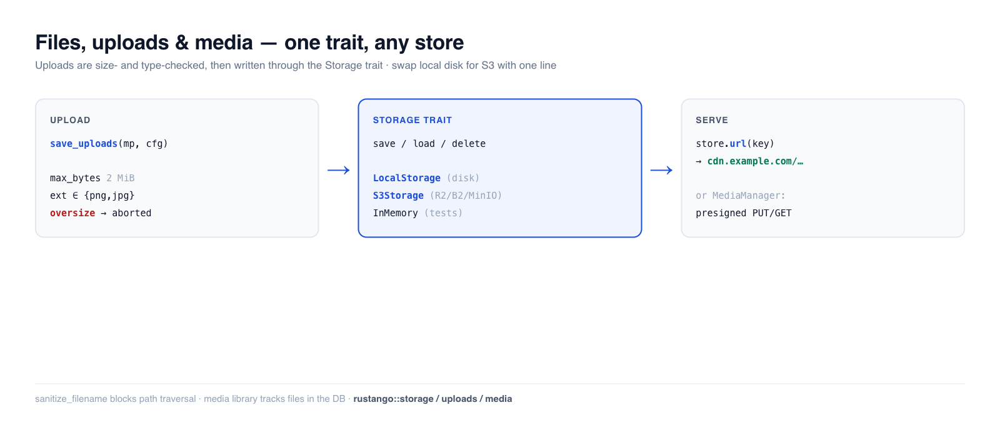

# Archivos, subidas y medios

Casi toda aplicación almacena archivos de usuario — avatares, adjuntos, informes exportados,
imágenes. **Rustango** te ofrece un trait `Storage` con backends intercambiables (disco
local, almacenamiento de objetos compatible con S3, en memoria para pruebas), un ayudante de
**subida** multipart seguro con guardas de tamaño/tipo, y — cuando necesitas una
biblioteca de medios rastreada — un `MediaManager` respaldado por base de datos con URLs
prefirmadas. Escribe tu código una sola vez contra el trait; cambia de disco local a S3 con un
cambio de una línea.

[](../img/files.png)

> **¿Nuevo con algún término aquí?** *backend de almacenamiento*, *multipart*, *almacenamiento de
> objetos*, *URL prefirmada* — ver el [glosario](glossary.md).

> **Fuente:** `rustango::storage` (`Storage`, `LocalStorage`, `InMemoryStorage`,
> `s3::S3Storage`, `azure::AzureBlobStorage`, `StorageRegistry`, `BoxedStorage`), `rustango::uploads` (`save_uploads`,
> `UploadConfig`, `sanitize_filename`), y `rustango::media`
> (`Media`, `MediaManager`) — tras las características `storage` / `uploads` / `storage-s3` /
> `storage-azure` / `media` (todas activadas por defecto).
>
> **Versión ejecutable:** los snippets de Storage + guardas de subida se copian de
> [`files_doc.rs`](https://github.com/ujeenet/rustango/blob/main/crates/rustango/tests/files_doc.rs)
> (`cargo test -p rustango --test files_doc`); el flujo multipart `save_uploads` de
> extremo a extremo se somete a prueba mediante los tests internos en
> `crates/rustango/src/uploads.rs`, y la biblioteca de medios mediante
> [`media_sqlite_live.rs`](https://github.com/ujeenet/rustango/blob/main/crates/rustango/tests/media_sqlite_live.rs).

## Tabla de contenidos

- [Paso 1 — Elige un backend de almacenamiento](#paso-1--elige-un-backend-de-almacenamiento)
- [Paso 2 — Guarda, carga y sirve archivos](#paso-2--guarda-carga-y-sirve-archivos)
- [Paso 3 — Acepta una subida](#paso-3--acepta-una-subida)
- [Nombres de archivo seguros](#nombres-de-archivo-seguros)
- [Producción: almacenamiento compatible con S3](#producción-almacenamiento-compatible-con-s3)
- [Producción: Azure Blob Storage](#producción-azure-blob-storage)
- [Archivos grandes: transmítelos en streaming](#archivos-grandes-transmítelos-en-streaming)
- [Varios discos desde la configuración](#varios-discos-desde-la-configuración)
- [La biblioteca de medios](#la-biblioteca-de-medios)
- [Referencia](#referencia)
- [Véase también](#véase-también)

---

## Paso 1 — Elige un backend de almacenamiento

Cada backend implementa el mismo trait `Storage`, de modo que tu código nunca nombra el tipo
concreto — sostiene un **`BoxedStorage`** (`Arc<dyn Storage>`):

```rust
use rustango::storage::{BoxedStorage, LocalStorage};
use std::path::PathBuf;
use std::sync::Arc;

let storage: BoxedStorage = Arc::new(LocalStorage::new(PathBuf::from("./uploads")));
```

| Backend | Característica | Úsalo para |
|---|---|---|
| `LocalStorage` | `storage` | despliegues de un solo servidor — archivos en disco local |
| `S3Storage` | `storage-s3` | producción — almacenamiento de objetos S3 / R2 / B2 / MinIO |
| `AzureBlobStorage` | `storage-azure` | producción — Azure Blob Storage (Azurite en desarrollo) |
| `InMemoryStorage` | `storage` | pruebas — un `HashMap`, nunca toca el disco |

---

## Paso 2 — Guarda, carga y sirve archivos

El trait son cuatro métodos async, indexados por una ruta en forma de cadena. `save` escribe
bytes, `load` los vuelve a leer, más `exists` / `delete`:

```rust
use rustango::storage::{Storage, InMemoryStorage};

let store = InMemoryStorage::new();
store.save("avatars/7.png", &png_bytes).await?;
assert!(store.exists("avatars/7.png").await?);
let bytes = store.load("avatars/7.png").await?;
store.delete("avatars/7.png").await?;
```

**Servir el archivo.** Adjunta una URL base (tu CDN o host estático) y `url(key)`
construye la dirección pública que almacenas en el modelo y entregas al navegador:

```rust
let store = LocalStorage::new("./uploads".into())
    .with_base_url("https://cdn.example.com/uploads");

store.url("docs/report.pdf");   // Some("https://cdn.example.com/uploads/docs/report.pdf")
```

Sin una URL base, `url()` devuelve `None` — en su lugar transmitirías los bytes a través de un
handler. `LocalStorage` también protege contra el path traversal en las claves.

---

## Paso 3 — Acepta una subida

`save_uploads` consume un cuerpo `Multipart` de axum, valida cada archivo contra un
`UploadConfig`, y escribe los supervivientes en tu `Storage` — en streaming, de modo que un archivo
sobredimensionado se rechaza a mitad de transferencia en lugar de almacenarse primero en memoria.

```rust
use rustango::uploads::{save_uploads, UploadConfig};
use axum::extract::Multipart;

async fn upload(mp: Multipart) -> Result<Json<Vec<String>>, (StatusCode, String)> {
    let cfg = UploadConfig::new("avatars/")          // key prefix
        .max_bytes(2 * 1024 * 1024)                  // reject files over 2 MiB
        .allowed_extensions(&["png", "jpg", "jpeg", "webp"])
        .randomize_filename(true);                   // avoid collisions

    // UploadError is not a response: map it yourself.
    let saved = save_uploads(mp, &cfg, &storage)     // Vec<SavedUpload>
        .await
        .map_err(|e| (StatusCode::BAD_REQUEST, e.to_string()))?;
    Ok(Json(saved.into_iter().map(|s| s.key).collect()))
}
```

Las guardas se aplican (y se verifican): `allowed_extensions` es **insensible a mayúsculas y
minúsculas** (`"PNG"` y `"png"` son lo mismo), y `max_bytes` aborta el stream en cuanto se
excede el tamaño. Los tests internos de `uploads` conducen cuerpos multipart reales y
afirman que los archivos aterrizan en el almacenamiento, que los archivos sobredimensionados se
rechazan y que las extensiones no permitidas se deniegan.

Valores por defecto: `max_bytes` 10 MiB, `max_files` 20, `randomize_filename`
activo (un prefijo UUID en la clave). Sin `allowed_extensions` se acepta cualquier
extensión salvo las que un navegador ejecuta como script (`html`, `svg`, `xml`,
`js`, … — `uploads::ACTIVE_EXTENSIONS`). El primer error detiene el bucle y borra
los archivos ya guardados, así que una petición rechazada no deja nada. Cada
`SavedUpload` lleva `key`, `original_filename`, `content_type` (lo que dice el
cliente — no te fíes) y `size_bytes`.

```rust
let cfg = UploadConfig::new("avatars/").allowed_extensions(&["PNG", "Jpg"]);
assert!(cfg.allowed_extensions.contains("png"));   // normalized to lowercase
assert!(cfg.allowed_extensions.contains("jpg"));
```

---

## Nombres de archivo seguros

Nunca confíes en un nombre de archivo suministrado por el cliente. `sanitize_filename` lo reduce a
un basename seguro — eliminando componentes de directorio (path traversal) y reemplazando
caracteres inseguros:

```rust
use rustango::uploads::sanitize_filename;

sanitize_filename("../../etc/passwd");   // "passwd"   — no traversal
sanitize_filename("my photo!.png");      // "my_photo_.png"
sanitize_filename("");                    // "upload"   — never empty
```

`save_uploads` lo aplica por ti; llámalo directamente solo si construyes claves a mano.

---

## Producción: almacenamiento compatible con S3

Para despliegues multi-servidor, cambia `LocalStorage` por `S3Storage` (tras la
característica `storage-s3`). Habla la API de S3 con un firmante SigV4 hecho a mano, de modo que
funciona con **AWS S3, Cloudflare R2, Backblaze B2 y MinIO**. El trait es
idéntico — solo cambia el constructor:

```rust
use rustango::storage::s3::S3Storage;   // needs the `storage-s3` feature

use rustango::storage::s3::{S3Config, S3Credentials};

let cfg = S3Config::new("my-bucket", "us-east-1")
    .with_endpoint("https://<account>.r2.cloudflarestorage.com"); // R2 / B2 / MinIO; omit for AWS
let creds = S3Credentials::new(access_key_id, secret_access_key);
let storage: BoxedStorage = Arc::new(S3Storage::new(cfg, creds));
// save / load / delete / url — exactly the same calls as LocalStorage
```

Tus handlers y modelos no cambian; solo cambia el cableado en el arranque.

---

## Producción: Azure Blob Storage

`AzureBlobStorage` (tras `storage-azure`) firma las llamadas del servidor con la
Shared Key de la cuenta y entrega URLs SAS de servicio para GET y PUT prefirmados:

```rust
use rustango::storage::azure::{AzureBlobStorage, AzureConfig};

let key = std::env::var("AZURE_STORAGE_KEY")?; // base64, from the portal
let cfg = AzureConfig::new("myaccount", key, "uploads");
// Azurite: cfg.endpoint("http://127.0.0.1:10000/devstoreaccount1")
let storage: BoxedStorage = Arc::new(AzureBlobStorage::new(cfg)?);
```

Diferencias con S3 que una subida directa debe respetar:

- El navegador debe enviar cada cabecera de `storage.presigned_put_headers(&put)`,
  que añade `x-ms-blob-type: BlockBlob`. La regla CORS de la cuenta debe
  permitirla junto con `Content-Type` e `If-None-Match`.
- Una SAS no puede firmar cabeceras, así que la URL no impone tamaño ni tipo.
  Confirma la subida con `metadata`. `MediaManager::begin_upload` rechaza un
  disco Azure; sube a través del servidor con `save_bytes`. Un PUT de solo
  creación recibe `c` sin `w`, así que la URL sigue sin poder sustituir un blob.
- Un solo PUT admite hasta 5000 MiB; por encima, `save_stream` prepara bloques.

---

## Archivos grandes: transmítelos en streaming

`save` y `load` reciben y devuelven buffers completos. Para un objeto grande, o
para mantener el bucket privado y pasar las subidas por tu servidor, usa
`save_stream` y `load_stream`: los fragmentos pasan según llegan, así que la
memoria se mantiene plana. Un `ByteStream` sale de un `Body` de axum, una
`reqwest::Response`, `Bytes` o un `Vec<u8>`.

```rust
use axum::{body::Body, extract::{Path, State}, http::{header, HeaderMap, StatusCode}};
use rustango::storage::{BoxedStorage, ByteStream, PutConditions, StorageError};

// PUT /files: proxy the request body into storage.
async fn upload(State(storage): State<BoxedStorage>, headers: HeaderMap, body: Body)
    -> Result<String, StatusCode>
{
    let len = headers
        .get(header::CONTENT_LENGTH)
        .and_then(|v| v.to_str().ok()?.parse::<u64>().ok())
        .ok_or(StatusCode::LENGTH_REQUIRED)?;
    let key = format!("uploads/{}", uuid::Uuid::new_v4());
    let put = PutConditions::new().create_only();
    storage
        .save_stream(&key, len, ByteStream::from(body), &put)
        .await
        .map_err(|_| StatusCode::BAD_REQUEST)?;
    Ok(key)
}

// GET /files/{*key}: stream it back.
async fn download(State(storage): State<BoxedStorage>, Path(key): Path<String>)
    -> Result<Body, StatusCode>
{
    let stream = storage.load_stream(&key).await.map_err(|e| match e {
        StorageError::NotFound(_) => StatusCode::NOT_FOUND,
        _ => StatusCode::BAD_GATEWAY,
    })?;
    Ok(Body::from_stream(stream))
}
```

`save_stream` escribe exactamente `len` bytes. Un cuerpo de otro tamaño, o un
`put.content_length` distinto de `len`, se rechaza, y `create_only` rechaza una
clave existente. Un cuerpo que falla o se descarta no deja nada atrás. Una capa
de límite de cuerpo en la ruta debe permitir el tamaño que aceptas.

| Backend | Cómo hace streaming |
|---------|----------------|
| `LocalStorage` | archivo temporal en el directorio de destino, fsync y luego rename; `create_only` usa enlaces, así que nunca sustituye un archivo |
| `S3Storage` | un PUT de hasta 5 GiB; por encima, una subida multipart de hasta 10.000 partes (5 TiB), con una parte en vuelo. Por https el cuerpo se envía como `UNSIGNED-PAYLOAD`; por http plano (MinIO local, SeaweedFS) se firma cada fragmento de 64 KiB. `create_only` envía `If-None-Match: *` (en el Complete para multipart), que respetan AWS, MinIO y SeaweedFS |
| `AzureBlobStorage` | un Put Blob de hasta 5000 MiB; por encima, Put Block por cada parte y luego un Put Block List. `create_only` envía `If-None-Match: *` (en la lista) |
| `InMemoryStorage` | junta el cuerpo en memoria; `create_only` se comprueba bajo su cerrojo |
| otros | el default del trait: reúne el cuerpo en memoria y luego llama a `save`; rechaza `create_only` |

Una subida multipart fallida o descartada se aborta, y Azure nunca muestra
bloques sin confirmar, así que nunca se ve un objeto parcial. Un servidor que
conserva partes tras una caída debería tener igualmente una regla de ciclo de
vida que elimine las subidas multipart incompletas. `create_only` de
`LocalStorage` necesita enlaces duros; en FAT, SMB o algunos montajes FUSE
falla con un error que lo indica.

---

## Varios discos desde la configuración

Una app puede mezclar backends — dos buckets S3, un contenedor Azure, una caché
local — como discos con nombre. Decláralos en `[storage]` y construye un
`StorageRegistry`:

```toml
[storage]
default = "uploads"

[storage.disks.uploads]
driver          = "azure"
account         = "myaccount"
container       = "uploads"
public_endpoint = "https://files.example.com"   # optional: links browsers follow

[storage.disks.archive]
driver = "s3"
bucket = "archive"
region = "eu-west-1"
cdn    = "https://cdn.example.com/archive"

[storage.disks.cache]
driver = "local"
root   = "./var/cache"
```

```rust
let registry = StorageRegistry::from_settings(&settings.storage)?;
let uploads = registry.default_disk().expect("default disk");
```

Las claves quedan fuera del archivo: `RUSTANGO__STORAGE__DISKS__UPLOADS__ACCOUNT_KEY`,
`RUSTANGO__STORAGE__DISKS__ARCHIVE__SECRET_ACCESS_KEY`. Los nombres de disco van en
minúsculas `[a-z0-9_]` para que estas sustituciones lleguen a ellos. Un driver cuya
feature no está compilada es un error que nombra el disco, no un disco que falta en
silencio. `public_endpoint` hace que las URLs prefirmadas y `url()` apunten a la
dirección a la que llegan los navegadores, mientras que las lecturas y escrituras
siguen usando `endpoint`.

---

## La biblioteca de medios

Cuando los archivos son registros de primera clase — rastreados en la base de datos, navegables en
el admin, con entrega por CDN/prefirmada — recurre a `rustango::media` en lugar de a
`Storage` en bruto. `MediaManager` persiste una fila `Media` por archivo y
admite dos flujos de subida:

- **Del lado del servidor:** `manager.save_bytes(...)` almacena los bytes y la fila en una sola
  llamada.
- **Directo al almacenamiento:** `manager.begin_upload(...)` devuelve una URL de **PUT
  prefirmado** a la que el navegador sube directamente (tu servidor nunca hace de proxy de los
  bytes), luego confirmas la fila. El PUT debe enviar cada cabecera de
  `ticket.headers` (`Content-Type`, `If-None-Match: *` y `x-ms-blob-type` en
  Azure), así que la regla CORS del bucket debe permitirlas. La URL puede crear el
  objeto una vez y nunca sustituirlo. Concede también `s3:ListBucket`: sin él, S3
  responde a un objeto que falta con 403, y finalize devuelve 502 en lugar de
  marcar la fila como `Failed`.

```rust
use rustango::media::{Media, MediaManager};

let manager = MediaManager::new_pool(pool.clone(), registry);
// Hand the browser a short-lived download link:
// Devuelve Option<String> — None en backends que no pueden firmar (p. ej. disco local).
let Some(url) = manager.presigned_get(&media, Duration::from_secs(3600)).await else {
    return Err(/* sin URL firmada para este backend */);
};
```

También gestiona el borrado lógico y la purga de huérfanos. El flujo completo se somete a prueba
en `media_sqlite_live.rs`; los métodos prefirmados y de subida directa del manager
funcionan en los tres backends.

### Servir medios en una página pública

Una página pública **no** pasa por `media::router`. Ese router es la API de
gestión interna — subidas, borrados, etiquetas, navegación — y responde `401`
a quien no haya iniciado sesión, en todas sus rutas, por diseño.

Resuelve la URL desde tu propio handler:

```rust
// tu propia ruta pública
let url = manager.public_url(media_id).await?;   // Option<String>, sin firma
```

`public_url` es una consulta a la base de datos más una cadena; no firma nada
ni espera a un firmante, y por eso encaja en una página. Dos modelos de
entrega, y elegir entre ellos es la decisión real:

| | bucket público / CDN | bucket privado + presignado |
|---|---|---|
| dirección | `manager.public_url(id)` — estable | `manager.presigned_get(&m, ttl)` — caduca |
| cacheable | sí, por navegadores y CDN | no; el router envía `no-store` |
| quién puede descargar | cualquiera con la URL | cualquiera con la URL, hasta que caduque |
| para qué | páginas públicas, `` | el router de gestión, herramientas internas |

`public_url` te dice **dónde** se serviría el objeto; no lo hace legible.
Apúntalo a un bucket privado y obtendrás una URL correcta y un 403 — ese caso
quiere una URL presignada, que deliberadamente no es cacheable ni compartible.

Para archivos en disco local en lugar de un bucket, el handler de estáticos ya
hace esto y no necesita ninguna fila de medios:

```rust
Cli::new().with_uploads("/uploads", "./var/uploads")
```

**Si estabas a punto de escribir un authorizer `AllowAll` para que funcione
una página pública, para.** Eso abre las 16 rutas — incluidas `DELETE` y el
`PUT` presignado — a todo el mundo, que es justo el agujero que cerró 0.57.7.

### El router de gestión necesita una política de autorización

`media::router` monta 16 rutas JSON sobre el manager, todas ellas acciones de
gestión sobre la biblioteca. **Todas están protegidas y no hay un valor por
defecto permisivo.** Constrúyelo con `media_router_with` y pasa una política:

```rust
use rustango::media::router::{media_router_with, MediaPerms};

let app = axum::Router::new()
    .nest("/media", media_router_with(manager, MediaPerms::new(pool)));
```

`media_router(manager)` — el constructor antiguo — está obsoleto y ahora
responde `403` en cada ruta. Es un cambio de comportamiento deliberado en
0.57.7: antes, esas rutas no tomaban ningún extractor de autenticación,
autorización ni tenant, así que `GET /media/{id}` devolvía la fila **y una
URL de descarga prefirmada de S3** a cualquiera capaz de adivinar un entero,
y `POST /uploads/begin` emitía un `PUT` prefirmado para un prefijo de clave
elegido por quien llamaba.

`MediaPerms` (necesita la feature `tenancy`) comprueba los codenames de
permiso `{tabla}.{acción}` que el admin ya usa — `rustango_media.view` para
leer, `rustango_media_collections.add` para crear una carpeta, etc. Móntalo
**dentro** de `require_auth`, que es lo que inyecta la identidad que lee; sin
eso toda petición es un `401`. Los superusuarios se saltan la comprobación de
codenames — pero **no** `allow_disks`, que también les obliga: `is_superuser`
eleva dentro de un tenant, y el almacén de objetos se comparte entre todos.
Solo un superusuario puede fijar el `uploaded_by_id` de otro usuario, y archivar
en una colección (subida, movimiento o una colección anidada) también necesita
`rustango_media_collections.view`.

Tres cosas que no hace:

- **Decisiones a nivel de fila.** Un `rustango_media.view` lee *cualquier*
  fila de medios por id. `MediaManager` tiene un único pool, así que un
  despliegue multi-tenant acota las filas por su cuenta — para eso
  implementas `MediaAuthorizer`. `MediaTarget` nombra la fila (`Media(id)`,
  `Collection(id)`, `CollectionSubtree(id)`, …) precisamente para que se pueda
  escribir una política por fila. `?recursive` sobre el contenido de una colección
  llega como `CollectionContents { id, recursive: true }` — el mismo destino,
  marcado — para que una política pueda ser más estricta con la lectura amplia sin
  perder la colección que nombra.
- **Acotar el almacén de objetos.** `disk` lo suministra quien llama en
  `POST /uploads/begin` y el `StorageRegistry` es de todo el proceso, así que
  un pool por inquilino aísla la base de datos y no el bucket: un
  `rustango_media.add` a secas escribe en cualquier disco que el proceso
  conozca. Indica cuáles con
  `MediaPerms::new(pool).allow_disks(["user-uploads"])`. Los prefijos dentro de
  un disco siguen necesitando `MediaAuthorizer`, que recibe `key_prefix`.
- **Adivinar qué significa una ruta nueva.** `MediaAction` y `MediaTarget`
  son `#[non_exhaustive]`: termina una política propia en `_ => false` y una
  ruta añadida más adelante llegará denegada en lugar de permitida.

Conviene saberlo al escribir la tuya: `DELETE /collections/{id}` borra el
**subárbol** completo y reasigna los medios de cada nivel, así que llega como
`Delete(CollectionSubtree(id))` y no como `Delete(Collection(id))` — y bajo
`MediaPerms` necesita `rustango_media.change` además de
`rustango_media_collections.delete`, porque escribe en la tabla de medios.
[UPGRADING.md](https://github.com/ujeenet/rustango/blob/main/UPGRADING.md)
tiene las notas de migración.

### Cómo se crean las tablas de medios

Las tablas de medios (`rustango_media`, `rustango_media_collections`,
`rustango_media_tags`, `rustango_media_tag_links`) son modelos gestionados. Su
esquema se envía como una **migración de sistema** y se crea — por inquilino, cuando la
característica `media` está activada — de la misma forma que el resto de las propias tablas del
framework, cada vez que ejecutas `migrate` / aprovisionas un inquilino. No hay un paso perezoso de
«crear en el primer uso»; si la característica está desactivada, las tablas nunca se crean.

> **Actualización desde antes de 0.51.** Las versiones anteriores creaban las tablas de medios de
> forma perezosa mediante una llamada DDL `ensure_table` en lugar de una migración. En el primer
> `migrate` (o aprovisionamiento de inquilino) tras la actualización, el framework **reconcilia
> automáticamente**:
> como las tablas ya existen, la migración de medios generada se registra en
> el libro mayor de migraciones de sistema *sin* volver a ejecutar su `CREATE TABLE`, y tus
> filas existentes quedan intactas. **No se requiere ningún paso manual** — la actualización
> que de otro modo fallaría con `relation already exists` / `table already exists`
> ahora simplemente funciona.
>
> **Actualiza a 0.51.2 o posterior, no a 0.51.1.** 0.51.0 pasó las tablas de medios a
> migraciones de sistema y 0.51.1 prometió esta reconciliación — las pruebas entre
> versiones contra bases de datos reales 0.46–0.50 mostraron que ninguna funcionaba, y
> **ambas están retiradas (yanked)**. La guarda de reconciliación exigía que una migración
> fuera solo `CreateTable`, mientras que una migración inicial generada son tablas *e*
> índices, así que abandonaba en cada caso real. 0.51.2 es la versión en la que esto
> funciona de verdad.

---

## Referencia

**Trait `Storage`:** `save(key, &bytes)` · `load(key)` · `delete(key)` ·
`exists(key)` · `url(key) -> Option<String>`, más los métodos con default `save_with_content_type`,
`presigned_get_url(key, ttl)`, `presigned_put_url(key, ttl, &put)`, `presigned_put_headers(&put)`, `metadata(key)`,
`save_stream(key, len, body, &put)` y `load_stream(key)`
(un backend que firma sobrescribe el par presign; los defaults devuelven `None`).

**`UploadConfig`:** `new(prefix)` · `.max_bytes(n)` · `.max_files(n)` · `.allowed_extensions(&[..])`
(insensible a mayúsculas/minúsculas) · `.randomize_filename(bool)`. Usado por
`save_uploads(multipart, &cfg, &storage)`.

**Backends:** `LocalStorage` (disco) · `S3Storage` (almacenamiento de objetos, `storage-s3`) · `AzureBlobStorage` (`storage-azure`)
· `InMemoryStorage` (pruebas). Todos devuelven un `BoxedStorage`.

---

## Véase también

- [El admin](admin.md) — los medios y los widgets de FK muestran los archivos subidos en la UI.
- [Trabajos en segundo plano](jobs.md) — redimensiona/transcodifica una subida fuera de la petición.
- [Caché](caching.md) — el mismo patrón de trait «cambia-el-backend».
- [Guía de seguridad](security.md) — validar entradas de subida no confiables.
