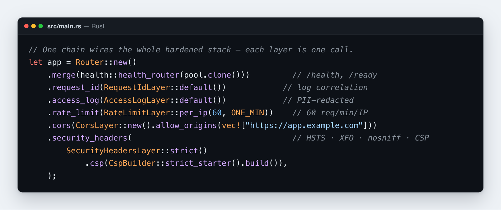

# Guía de seguridad

Esta guía cubre todas las funciones de seguridad que incluye **Rustango** y cómo combinarlas. Si ya has usado algún framework web, la mayoría te resultarán familiares — los nombres difieren, pero las ideas son las mismas. Cada función de abajo suele ser una sola línea de configuración. Cuando estés listo para desplegar, ejecuta `manage check --deploy` para una auditoría automatizada.

[](../img/security.png)

## Tabla de contenidos

- [La lista de comprobación de defensa en profundidad](#la-lista-de-comprobación-de-defensa-en-profundidad)
- [Establecer cabeceras de seguridad](#establecer-cabeceras-de-seguridad)
- [Permitir peticiones de origen cruzado (CORS)](#permitir-peticiones-de-origen-cruzado-cors)
- [Limitar la tasa de peticiones](#limitar-la-tasa-de-peticiones)
- [Permitir o bloquear IPs](#permitir-o-bloquear-ips)
- [Protección contra CSRF](#protección-contra-csrf)
- [Prevenir XSS](#prevenir-xss)
- [Prevenir la inyección SQL](#prevenir-la-inyección-sql)
- [Autenticar usuarios](#autenticar-usuarios)
- [Hashear y verificar contraseñas](#hashear-y-verificar-contraseñas)
- [Emitir y refrescar JWTs](#emitir-y-refrescar-jwts)
- [Autenticar con claves de API](#autenticar-con-claves-de-api)
- [Añadir autenticación de dos factores (TOTP)](#añadir-autenticación-de-dos-factores-totp)
- [Enviar URLs firmadas (enlaces mágicos)](#enviar-urls-firmadas-enlaces-mágicos)
- [Verificar webhooks entrantes](#verificar-webhooks-entrantes)
- [Mantener los secretos fuera de tus registros](#mantener-los-secretos-fuera-de-tus-registros)
- [Rastrear peticiones a través de servicios](#rastrear-peticiones-a-través-de-servicios)
- [Gestionar secretos](#gestionar-secretos)
- [Auditar antes de desplegar](#auditar-antes-de-desplegar)

---

## La lista de comprobación de defensa en profundidad

La buena seguridad surge de muchas capas pequeñas, no de un único gran muro. Una aplicación **Rustango** en producción debería apilar las capas de abajo — la mayoría son una línea cada una. El resto de esta guía explica cada una.

```rust
let app = Router::new()
    .route("/...", ...)
    .merge(health::health_router(pool.clone()))         // /health, /ready
    .request_id(RequestIdLayer::default())              // log correlation
    .access_log(AccessLogLayer::default())              // PII-redacted by default
    .rate_limit(RateLimitLayer::per_ip(60, ONE_MIN))    // 60 req/min/IP
    .cors(CorsLayer::new().allow_origins(vec!["..."])) // explicit allowlist
    .security_headers(                                   // HSTS + XFO + nosniff + Referrer + CSP
        SecurityHeadersLayer::strict()
            .csp(CspBuilder::strict_starter().build()),
    );
// Plus: TLS termination at reverse proxy.
// Plus: argon2 for passwords, JWT lifecycle for tokens, TOTP for MFA.
```

---

## Establecer cabeceras de seguridad

Las cabeceras de seguridad le indican al navegador cómo proteger a tus usuarios (bloquear el clickjacking, forzar HTTPS, detener el sniffing del tipo de contenido). `SecurityHeadersLayer` establece el conjunto estándar con una sola línea — las cabeceras de protección habituales, sin tener que nombrarlas una a una. (Una "capa" es el término de **Rustango** para el middleware; la adjuntas a tu router.)

> Análisis en profundidad: [Middleware](middleware.md) cubre cómo funcionan las capas, el orden, el catálogo completo de las incorporadas, y cómo escribir la tuya propia (locale, zona horaria, cabeceras, CSRF).

```rust
use rustango::security_headers::{SecurityHeadersLayer, SecurityHeadersRouterExt, CspBuilder};

let app = router.security_headers(SecurityHeadersLayer::strict());
```

### Preajustes

| Preajuste | Cuándo usarlo |
|---|---|
| `strict()` | Producción: HSTS preload + XFO=DENY + nosniff + Referrer-Policy=same-origin + COOP=same-origin + Permissions-Policy restringida |
| `relaxed()` | Incrustable en iframes: SAMEORIGIN + HSTS de 1 año |
| `dev()` | Local: solo nosniff (sin HSTS para evitar bloquear localhost en HTTPS para siempre) |
| `empty()` | Construir desde cero |

`SecurityHeadersLayer::default()` es `strict()`. `from_preset(name)` elige un preset por nombre (`"strict"`, `"relaxed"`, `"dev"`, `"none"` o `"empty"`); un nombre desconocido da `strict()`, nunca ninguna cabecera. `from_settings(&settings.security)` lee `[security] headers_preset`, `csp` y `hsts_max_age_secs` (`0` desactiva HSTS). Una cabecera que el handler ya puso se conserva.

Dos capas más van aquí. `host_validation::AllowedHostsLayer::new(["example.com", ".example.com"])` responde `400` a una petición cuyo `Host` no está en la lista (`.example.com` cubre también sus subdominios). `ssl_redirect::SslRedirectLayer::new()` responde al HTTP plano con un `301` a HTTPS; detrás de un proxy que termina TLS, añade `.proxy_ssl_header("X-Forwarded-Proto", "https")`, o redirige en bucle.

### CSP personalizada

```rust
let csp = CspBuilder::new()
    .default_src(&["'self'"])
    // The placeholder becomes a per-request nonce only under CspNonceLayer (below).
    .script_src(&["'self'", "'nonce-__RUSTANGO_NONCE__'", "https://cdn.example.com"])
    .style_src(&["'self'", "'nonce-__RUSTANGO_NONCE__'"])
    .img_src(&["'self'", "data:", "https:"])
    .font_src(&["'self'", "data:"])
    .connect_src(&["'self'", "wss://realtime.example.com"])
    .frame_ancestors(&["'none'"])                 // disallow embedding (clickjacking)
    .object_src(&["'none'"])
    .directive("base-uri", &["'self'"])
    .build();

let layer = SecurityHeadersLayer::strict().csp(csp);
```

`'nonce-__RUSTANGO_NONCE__'` (la constante `csp_nonce::CSP_NONCE_PLACEHOLDER`) es solo un marcador. Monta `csp_nonce::CspNonceLayer::default()` con `.csp_nonce(...)` **después** de `.security_headers(...)`, para que se ejecute por fuera: crea un nonce aleatorio por petición, lo pone en la petición como `Extension<Nonce>` y sustituye el marcador en la cabecera CSP. Sin ella, el navegador recibe el marcador literal y bloquea todo script y estilo inline.

Las [páginas de error](html-views.md#páginas-de-error) incorporadas y las plantillas del admin ponen el mismo nonce en sus etiquetas inline, así que pasan esta política.

### Despliegue gradual de CSP

Usa `csp_report_only` para monitorizar sin romper producción:

```rust
let layer = SecurityHeadersLayer::strict()
    .csp(CspBuilder::strict_starter().build())
    .csp_report_only(true);                       // sends Content-Security-Policy-Report-Only
```

Tras verificar que no hay errores de consola → cambia a `csp_report_only(false)` para aplicarla.

---

## Permitir peticiones de origen cruzado (CORS)

CORS controla qué otros sitios web tienen permiso para llamar a tu API desde un navegador. Por defecto los navegadores bloquean estas llamadas; tú vuelves a habilitar orígenes específicos. Enumera tus dominios front-end reales en producción y nunca lo abras a todo el mundo.

```rust
use rustango::cors::{CorsLayer, CorsRouterExt};

// Production
let layer = CorsLayer::new()
    .allow_origins(vec!["https://app.example.com", "https://admin.example.com"])
    .allow_methods(vec!["GET", "POST", "PUT", "PATCH", "DELETE"])
    .allow_headers(vec!["content-type", "authorization"])
    .allow_credentials(true)
    .max_age(Duration::from_secs(3600));

// Dev only
let layer = CorsLayer::permissive();              // any origin, common methods
```

`CorsLayer::new()` no permite ningún origen hasta que añadas alguno. `CorsLayer::from_settings(&settings.security)` lee `[security] cors_allowed_origins`: una lista vacía da `None` (no montar nada), `"*"` da `permissive()`, y orígenes con nombre dan una lista de permitidos con los métodos comunes (QUERY incluido) y las cabeceras de petición `Content-Type`, `Authorization`, `X-Date`, `Idempotency-Key`, `If-Match`, `If-None-Match`. Ambos exponen `Retry-After`, `Idempotent-Replayed`, `ETag`, `Location`, `Link` a los scripts. `cors_allowed_headers` y `cors_expose_headers` se suman a esas listas, y `cors_allow_credentials = true` envía `Access-Control-Allow-Credentials` con orígenes con nombre; con `"*"` se rechaza con un error en el log, y una entrada de cabecera `"*"` se descarta.

**Nota de seguridad:** con credenciales DEBES enumerar orígenes explícitos. `allow_credentials(true)` junto a `allow_any_origin()` no te da CORS comodín con credenciales — eso no existe, y pedirlo no te da ninguna de las dos mitades.

Rustango responde con `Access-Control-Allow-Origin: *` y **sin** cabecera `Access-Control-Allow-Credentials`, de modo que el navegador bloquea la petición con credenciales. Las versiones antiguas devolvían reflejado el origen solicitante, que es justo lo que los navegadores *sí* aceptan junto a credenciales: esa combinación era un agujero real, legible por cualquier sitio que el usuario visitara, y esta página lo describía como algo que el navegador rechazaría.

Usa `.allow_origins([...])` con los orígenes que realmente sirves. Esa ruta no cambia y sigue enviando `Access-Control-Allow-Credentials: true`.

---

## Limitar la tasa de peticiones

La limitación de tasa restringe cuántas peticiones puede hacer un cliente en una ventana de tiempo. Úsala para frenar los inicios de sesión por fuerza bruta, el scraping y el abuso. Puedes limitar por IP, por clave de API o globalmente para un endpoint costoso.

```rust
use rustango::rate_limit::{RateLimitLayer, RateLimitRouterExt};

// Per-IP
router.rate_limit(RateLimitLayer::per_ip(60, Duration::from_secs(60)));

// Per-API-key (header)
router.rate_limit(RateLimitLayer::per_header("authorization", 1000, Duration::from_secs(3600)));

// Global ceiling for an expensive endpoint
router.rate_limit(RateLimitLayer::global(10, Duration::from_secs(1)));
```

Cuando se agota: `429 Too Many Requests` con la cabecera `Retry-After`. Cada respuesta exitosa incluye `X-RateLimit-Limit` + `X-RateLimit-Remaining`. La capa es un cubo de tokens: `capacity` peticiones, rellenadas a lo largo de `refill_period`. Guarda como mucho 100.000 cubos; cámbialo con `.max_buckets(n)`.

> **Detrás de un proxy inverso, nombra tus proxies o `per_ip` no limita nada útil**. `RateLimitLayer::per_ip` se basa en el socket de conexión, que detrás de un proxy es la dirección del *proxy* — de modo que todos los clientes comparten un único cubo. Un solo cliente ruidoso limita entonces a todos los demás, y ningún atacante individual llega a ser limitado.
>
> Monta `RealIpLayer` **y dile a qué saltos creer**:
>
> ```rust
> use rustango::real_ip::{HeaderStrategy, RealIpLayer, RealIpRouterExt};
>
> app.rate_limit(RateLimitLayer::per_ip(60, Duration::from_secs(60)))
>    .real_ip(
>        RealIpLayer::new(HeaderStrategy::XForwardedFor)
>            .trust_proxies(["10.0.0.0/8"])?,   // tu ingress, no internet
>    );
> ```
>
> **El orden es determinante y falla en silencio.** Las capas se aplican de fuera hacia dentro en último lugar, así que `real_ip` debe añadirse *después* de `rate_limit` para ejecutarse *antes*. Al revés, el limitador no ve ninguna dirección resuelta y vuelve a basarse calladamente en el socket — avisa una vez cuando llega una cabecera de reenvío sin dirección resuelta.
>
> **`trust_proxies` no es decoración opcional.** `X-Forwarded-For` lo fija quien lo envía. Sin una lista de proxies declarada la cabecera es solo una afirmación, así que el limitador la ignora por completo y se basa en el socket — deliberadamente. Si no lo hiciera, cualquier cliente podría acuñar un cubo nuevo por petición variando una cabecera, convirtiendo «el límite es demasiado grueso» en «no hay límite». `RealIp` (la afirmación) sirve para registro; solo `TrustedRealIp`, que aparece cuando el par coincide con `trust_proxies`, basa un limitador.
>
> **Una regla para cada lector de IP.** Límites de tasa, throttles de ViewSet, límites de login, señales de auth y el log de acceso usan la misma dirección: `TrustedRealIp` (leer `X-Forwarded-For` de derecha a izquierda, tomar el primer salto que no esté en `trust_proxies`), si no el socket. Ninguno lee el salto de la izquierda: lo escribe el cliente.
>
> Nombra las direcciones desde las que tu ingress conecta realmente. Confiar en un rango más amplio entrega la elusión a cualquiera dentro de él.

### Límites de login incorporados

Cada login por contraseña incorporado (admin, consola de operador, admin de tenant, `/auth/login` de JWT) pasa por `rustango::login_throttle` antes de buscar al usuario. Comprueba, por orden, un bloqueo por nombre de usuario (5 fallos, 15 min) que cuenta los nombres desconocidos igual que los reales, un límite por IP (20 logins fallidos/min; IPv6 cuenta por /64) y un límite global por login (600 logins fallidos/min cada uno para el admin, la consola de operador y cada tenant). Un login correcto no cuenta contra los límites. Un nombre de usuario que inició sesión desde una IP en los últimos 30 días se salta desde esa IP un límite global agotado, para que un ataque desde muchas IP no pueda bloquear a todos los usuarios; su límite por IP y su bloqueo por nombre siguen aplicándose. Una vez encontrada la fila del usuario, el bloqueo sigue también al nombre de usuario guardado, así que las grafías que la base de datos trata como iguales (MySQL hace coincidir `alicé` con `alice`) comparten un bloqueo. HTTP Basic y las claves de API tienen su propio ámbito y solo cuentan fallos. Un login rechazado recibe `429` con `Retry-After`, y la misma respuesta exista o no la cuenta.

Detrás de un proxy inverso, monta `RealIpLayer` con tus proxies como se muestra arriba; una app `Cli` llama en su lugar a `Cli::with_trusted_proxies(["127.0.0.1/32"])?`. Sin ello, todos los clientes tienen la dirección del proxy y comparten un único cubo por IP; se registra una advertencia una vez cuando llegan cabeceras de reenvío.

El hash de contraseñas ejecuta como mucho un trabajo por CPU, compartido por todos los logins; HTTP Basic, las claves de API y los secretos de agente pueden usar como mucho la mitad de los huecos. Un login que espera más de `hash_wait_ms` (5 s) por un hueco recibe `503` con `Retry-After`, tanto para usuarios conocidos como desconocidos.

Ajústalos bajo `[auth]`: `login_ip_limit`, `login_ip_window_secs`, `login_global_limit`, `login_global_window_secs`, `lockout_threshold`, `lockout_duration_secs`, `hash_wait_ms`. Un valor fijado en código (`login_throttle::configure_shared`, `account_lockout::configure_shared`, `passwords::configure_hash_wait`) prevalece sobre estas claves. Los cubos por IP y global son por proceso salvo que instales `login_throttle::configure_shared(LoginThrottle::with_cache(limits, cache))`, que los cuenta en ventanas fijas en una caché compartida (ante un error de caché ambos vuelven al proceso; una ráfaga que cruza el borde de una ventana puede llegar al doble de un límite; las apps que comparten una caché comparten los contadores salvo que cada una use su propio `ScopedCache`); el primer login registra una advertencia mientras sean por proceso. El bloqueo por nombre de usuario usa `account_lockout::shared()`, que puedes respaldar con una caché compartida mediante `account_lockout::configure_shared`. Los fallos cuentan en una ventana fija (1 hora por defecto) que empieza con el primer fallo, así que un atacante tiene `lockout_threshold - 1` intentos por ventana sin bloqueo; los límites por IP y global acotan el resto.

**Campo de inicio de sesión.** Los usuarios de un tenant inician sesión con su nombre de usuario, salvo con `[auth] login_field = "email"` (o `Cli::login_field(LoginField::Email)` / `server::Builder::login_field`, que prevalecen sobre la clave). El email requiere la feature `sso`, que añade la columna `email`. El email coincide sin distinguir mayúsculas en cada backend, en el formulario de inicio de sesión del tenant (etiqueta "Email"), en HTTP Basic y en `/auth/login` (`{"username": …}` o `{"email": …}`), y el bloqueo de inicio de sesión de arriba sigue al email guardado. Cada usuario necesita su propio email: un usuario sin email no puede iniciar sesión, y un email que comparten dos usuarios (sin distinguir mayúsculas) no deja entrar a ninguno. El servidor registra al arrancar cada tenant con usuarios así; avisa en lugar de negarse a arrancar, para que los datos de un tenant no tumben a todos. `create-user --email` lo fija.

`RateLimitLayer` es **local al proceso** — cuenta las peticiones solo dentro de una instancia en ejecución, lo cual está bien si ejecutas una sola instancia. Si ejecutas varias instancias (réplicas) detrás de un balanceador de carga, cada una mantendría su propio recuento, de modo que el límite real se multiplica. Para compartir un único recuento entre todas las réplicas, usa `rate_limit_cache::CacheRateLimitLayer`, que delega en cualquier implementación de `cache::Cache` (empareja con `cache::RedisCache` para un contador compartido incrementado atómicamente por el `INCRBY` de Redis):

```rust
use rustango::cache::RedisCache;
use rustango::rate_limit::KeyBy;
use rustango::rate_limit_cache::{CacheRateLimitLayer, CacheRateLimitRouterExt};

let cache: rustango::cache::BoxedCache =
    std::sync::Arc::new(RedisCache::new("redis://localhost").await?);

let app = axum::Router::new()
    .route("/api/login", axum::routing::post(login))
    .cache_rate_limit(
        CacheRateLimitLayer::new(cache, 5, Duration::from_secs(60))
            .key_by(KeyBy::Ip)
            .key_prefix("login"),
    );
```

Cuenta en ventanas fijas, así que una ráfaga a caballo de un borde de ventana puede llegar al doble del límite. Un error de caché deja pasar la petición (fail open) y registra un aviso.

> **Keyear por una cabecera secreta es seguro de compartir.** Con `key_by(KeyBy::Header("authorization"))` o `"x-api-key"`, el limitador respaldado por caché **hashea** el valor de la cabecera antes de usarlo como clave, de modo que un Redis compartido nunca almacena una credencial viva donde alguien con acceso de lectura a las claves pudiera cosecharla. `KeyBy::Ip` necesita `ConnectInfo` (o un `RealIpLayer` con `trust_proxies` delante); sin ello, el limitador avisa una vez y recae en un único bucket compartido.


---

## Permitir o bloquear IPs

Restringe las rutas sensibles (como tu admin) a un conjunto conocido de direcciones IP, o bloquea a abusadores concretos. Una lista de permitidos autoriza solo las redes enumeradas; una lista de bloqueo deniega las enumeradas.

```rust
use rustango::ip_filter::{IpFilterLayer, IpFilterRouterExt};

// Internal admin only
let admin_router = admin_router
    .ip_filter(IpFilterLayer::allow_only(vec![
        "10.0.0.0/8",
        "192.168.0.0/16",
        "203.0.113.0/24",
    ])?);

// Block known abusers
let public_router = public_router
    .ip_filter(IpFilterLayer::block(vec!["203.0.113.42"])?);
```

**IPv4 + IPv6 soportados.** Seguro entre familias (un CIDR IPv4 no coincide con direcciones IPv6). Devuelve `403 Forbidden` al rechazar.

**Importante:** **Rustango** lee la IP del cliente desde `ConnectInfo<SocketAddr>`. Monta con:

```rust
axum::serve(listener, app.into_make_service_with_connect_info::<SocketAddr>()).await?;
```

Una petición sin `ConnectInfo` la rechaza `allow_only` y la deja pasar `block`; cámbialo con `.allow_no_ip(bool)`. Detrás de un proxy inverso, el par es el proxy. Llama a `.behind_trusted_proxy()` para comprobar en su lugar la IP del cliente que resolvió un `RealIpLayer` con `trust_proxies`. El filtro debe ir dentro de ese `RealIpLayer` (añade `.real_ip(...)` después de `.ip_filter(...)`), o comprueba la dirección del proxy y una lista de bloqueo deja pasar a todos. `ip_filter` nunca lee por sí mismo una cabecera de reenvío.

---

## Protección contra CSRF

> **CSRF y las APIs de token.** CSRF protege las peticiones **autenticadas por
> cookie**. Una API puramente de token / Bearer / [JWT](auth-jwt.md) no es un
> objetivo de CSRF — no le apliques la capa CSRF (o darás un 403 a clientes
> legítimos). Para una SPA que *sí* usa cookies, lee la cookie `rustango_csrf`
> y reenvíala en la cabecera `X-CSRF-Token`.

CSRF (falsificación de petición en sitios cruzados) es cuando otro sitio engaña al navegador de un usuario que ha iniciado sesión para que envíe una petición a tu aplicación. La defensa es un token secreto en cada formulario, que el servidor vuelve a comprobar en cada escritura. El middleware CSRF vive en `rustango::forms::csrf` (detrás de la función `csrf`, que se activa automáticamente con la función `admin`):

```rust
use rustango::forms::csrf;

let app = Router::new()
    .route("/contact", get(form).post(submit))
    .layer(csrf::layer());
```

`csrf::layer()` toma el flag `Secure` de la cookie de `session::secure_cookies()`: la política de arranque (`[security] secure_cookies`, que la ruta `manage` pone a `true` por defecto), si no `Secure` en el tier prod. Las CBV de `template_views` emiten su cookie con `forms::csrf::ensure_token`, que sigue la misma política. `csrf::with_config(CsrfConfig)` usa en su lugar `CsrfConfig::secure` (por defecto `true`); en `http://localhost` llama a `CsrfConfig::default().allow_insecure_for_dev()`, o el navegador descarta la cookie y cada POST recibe `403`. `with_config` fija también los nombres de cookie/cabecera y `trusted_origins` — orígenes extra permitidos junto al propio Host de la petición (`.trust_origin("https://app.example.com")`, se admiten comodines `*.example.com`). La comprobación de Origin se ejecuta aunque esté vacío: un `Origin` ajeno recibe `403`, y sobre TLS también un POST sin `Origin`. En las plantillas, `{{ csrf_token }}` te da el token en bruto y `{{ csrf_input }}` un `<input>` oculto listo para usar — escríbelo como `{{ csrf_input | safe }}`, porque Tera autoescapa las plantillas `.html`: sin el filtro la página renderiza un `<input …>` literal visible, el formulario no lleva campo `_csrf` y cada POST devuelve 403. Ambas variables solo están en el contexto para las CBV de `template_views` o después de llamar tú mismo a `forms::csrf::stamp_into_context` — un handler escrito a mano no tiene ninguna. Usa el patrón de cookie de doble envío. GET, HEAD, OPTIONS y TRACE son seguros, y también QUERY salvo que se active `require_csrf_on_query`. En cualquier otro método la capa comprueba la cabecera `X-CSRF-Token` (o el campo de formulario `_csrf`) contra la cookie `rustango_csrf`; una discrepancia devuelve `403 Forbidden`.

**Eximir endpoints recolectores.** `CsrfConfig::exempt_prefix("/path")` (repetible) omite la aplicación de CSRF para los métodos inseguros en peticiones cuya ruta comienza con el prefijo dado. Esto es para endpoints de solo anexado, sin estado de autenticación, alcanzados vía `navigator.sendBeacon` — por ejemplo, un recolector de analíticas — que no pueden establecer una cabecera `X-CSRF-Token` y, cuando la página se sirve desde una caché de CDN que elimina `Set-Cookie`, puede que no lleven ninguna cookie CSRF en absoluto. Mantén los prefijos estrechos y nunca eximas nada que lea o escriba estado de autenticación.

Con la funcionalidad `mcp`, `Cli::with_csrf()` y `with_csrf_config()` eximen por sí mismos los endpoints MCP: `{prefix}`, `{prefix}/token` y `{prefix}/oauth/token` para el `[mcp] prefix` (por defecto `/mcp`), nada más por debajo. Los clientes MCP no envían cookie CSRF. El router tenant comprueba allí un token de agente; el `mcp::router(pool)` de base única no comprueba ninguno, así que pon tu propia autenticación delante. Un prefijo `/` no exime nada y registra un aviso. La exención se aplica aunque no haya un router MCP montado, y el arranque registra un aviso con las rutas: no pongas rutas con autenticación por cookie en ellas.

**El auto-admin.** En cuanto llamas a `.with_session_auth(...)`, CSRF se monta automáticamente en cada mutación del admin — crear, actualizar, borrar, acciones masivas, limpieza de auditoría — y cada formulario del admin renderiza su token por ti. No hay nada que cablear ni forma de desactivarlo.

La condición es deliberada, no incidental: CSRF defiende credenciales que el navegador adjunta por su cuenta, así que es la cookie de sesión la que lo hace significativo. Un admin construido sin `with_session_auth` no tiene ninguna credencial gestionada por rustango que falsificar, y sus mutaciones son alcanzables directamente por cualquiera que llegue a la ruta — eso es un hueco de autenticación, no de CSRF, y CSRF no lo estrecharía. Eso solo vale mientras delante no haya una credencial que el navegador adjunte solo. HTTP Basic (`protect_with_basic_auth`) o tu propia auth por cookie lo es, así que los POST cross-site viajan con ella — y montar `csrf::layer()` tú mismo no lo arregla, porque el admin solo renderiza tokens de formulario con `with_session_auth`, así que cada POST devuelve 403. Usa `with_session_auth` para un admin de navegador.

Las versiones antiguas de este párrafo afirmaban que la protección era incondicional cuando la única ruta protegida era `POST /login`. Cualquier otra mutación del admin aceptaba un POST entre sitios montado sobre la sesión del administrador — incluida la limpieza de auditoría, de modo que la misma clase de petición podía borrar su propio rastro.

---

## Prevenir XSS

XSS (scripting entre sitios) ocurre cuando la entrada del usuario se renderiza como HTML y se ejecuta como código en el navegador de otra persona. La solución es escapar cualquier entrada del usuario antes de que llegue a la página. **Rustango** maneja esto de dos maneras:

**1. Auto-escape de plantillas Tera** — Tera es el motor de plantillas de **Rustango**. Cada `{{ var }}` se escapa como HTML automáticamente en toda plantilla que construye el framework, sea cual sea su extensión. Con `template_extensions::html_tera()` / `html_tera_from_glob(glob)` tu propio motor hace lo mismo; un `Tera::new` a secas solo escapa `.html`, `.htm` y `.xml`. Solo las partes de texto plano del correo (asunto y cuerpo `.txt` de `EmailRenderer`) se renderizan sin escapar. Usa `{{ var | safe }}` para desactivarlo — raro, y peligroso, así que hazlo solo con HTML en el que confíes plenamente.

**2. Ayudante de escape manual** — para cuando construyes HTML en código Rust en lugar de en una plantilla:

```rust
use rustango::text::html_escape;

let safe = html_escape(user_input);
// "<script>" → "&lt;script&gt;"
// "a & b" → "a &amp; b"
```

Reemplaza `&`, `<`, `>`, `"`, `'`. Adecuado para el contenido de elementos HTML + atributos entre comillas dobles.

Para la defensa XSS basada en CSP, consulta [Establecer cabeceras de seguridad](#establecer-cabeceras-de-seguridad).

---

## Prevenir la inyección SQL

La inyección SQL ocurre cuando la entrada del usuario se pega directamente en una cadena SQL y cambia la consulta. El ORM de **Rustango** detiene esto por diseño: usa el enlace de parámetros de sqlx en todas partes — cada valor se envía como un marcador de posición enlazado (`$1, $2, ...` en PostgreSQL, `?` en MySQL y SQLite), nunca pegado en el texto de la consulta. (sqlx es la biblioteca de base de datos subyacente.) **No puedes concatenar accidentalmente la entrada del usuario en SQL a través de la API del ORM.**

Hay dos puntos en los que hay que tener cuidado:

**1. Nombres de tabla y columna en `bulk_actions`:**

Los marcadores de posición protegen los valores, pero no pueden llevar un identificador (un nombre de tabla o columna), así que esos necesitan su propia protección. Las acciones masivas escriben a través del ORM, así que ningún nombre en bruto llega al SQL. Una acción incorporada que fija una columna la busca en el esquema del modelo; un nombre que el modelo no tiene falla con `BulkActionError::InvalidIdent`. Las claves elegidas son un `PkSet`, tipado según la clave primaria del modelo: una clave del tipo equivocado falla con `InvalidPk`, y un conjunto admite como mucho 10.000 claves. Esta protección se ejecuta por ti — no la llamas tú mismo.

**2. La salida de emergencia de SQL en bruto:**

Si desciendes a `sqlx` en bruto, enlaza cada *valor* como un parámetro y nunca pegues un *identificador* (nombre de tabla o columna) que provenga de la entrada del usuario en la cadena de la consulta — los marcadores de posición no pueden llevar identificadores:

```rust
// ✅ values go through bound placeholders
sqlx::query("SELECT * FROM posts WHERE id = $1")
    .bind(1).fetch_all(&pool).await?;

// ❌ NEVER interpolate a user-supplied identifier into the SQL string
let sql = format!("SELECT * FROM \"{user_table}\" WHERE id = $1");
sqlx::query(&sql).bind(1).fetch_all(&pool).await?;
```

---

## Autenticar usuarios

La autenticación es cómo confirmas quién está haciendo una petición. **Rustango** incluye tres backends listos para usar (autenticación Basic, claves de API y JWTs) y te permite escribir el tuyo propio implementando un único trait. Los adjuntas a las rutas, y las peticiones sin una credencial reconocida obtienen un `401`.

> **SSO del admin.** Para permitir que los operadores inicien sesión en el admin con
> un IdP externo (Google, Microsoft/Azure AD, GitHub, o cualquier proveedor
> OpenID Connect) en lugar de una contraseña, habilita la función `admin-sso` —
> consulta la [guía de SSO](sso.md). Los proveedores se **gestionan desde la UI
> del admin como filas** (varios por superficie; por inquilino, o un conjunto
> compartido entre inquilinos), con el secreto de cliente **cifrado en reposo**.
> Inicia sesión con la cuenta enlazada al subject del IdP (el enlace por email es
> opcional por proveedor y nunca se aplica a superusuarios ni staff; sin
> auto-aprovisionamiento) y reutiliza la sesión existente.

### Tres backends listos para usar

```rust
use rustango::tenancy::auth_backends::{ModelBackend, ApiKeyBackend, JwtBackend};
use rustango::tenancy::middleware::{RouterAuthExt, CurrentUser};
use std::sync::Arc;

let backends = vec![
    Arc::new(ModelBackend) as _,                   // Authorization: Basic <b64>
    Arc::new(ApiKeyBackend) as _,                   // Authorization: Bearer <prefix>.<secret>
    Arc::new(JwtBackend::new(secret)) as _,         // Authorization: Bearer <jwt>
];

// `require_auth` / `require_perm` are `Router::layer` calls: each wraps the
// routes registered BEFORE it. Chaining them on one router would put /me
// behind post.add. Gate the permission on an inner sub-router instead.
let posts = Router::new()
    .route("/posts/new", post(create_post))
    .require_perm("post.add");     // inner: needs the codename

let app = Router::new()
    .route("/me", get(profile))
    .merge(posts)
    .require_auth(backends);       // outer: resolves the user first
```

El middleware prueba cada backend en orden. El primero que tiene éxito gana; el primero que devuelve un error duro detiene la cadena. `require_perm` responde `401` sin usuario, `403` sin el codename y `503` cuando falla la lectura del permiso. `optional_auth(backends)` resuelve el usuario igual pero deja pasar las peticiones anónimas. Las tres necesitan la capa de tenancy montada por fuera; sin `TenantContext` fallan de forma segura con `500`.

### Escribir tu propio backend

```rust
use rustango::tenancy::auth_backends::{AuthBackend, AuthUser, AuthError};
use async_trait::async_trait;

pub struct OAuthBackend { /* ... */ }

#[async_trait]
impl AuthBackend for OAuthBackend {
    async fn authenticate(&self, parts: &Parts, pool: &rustango::sql::Pool)
        -> Result<Option<AuthUser>, AuthError>
    {
        // Read your custom header, validate, look up the user
        Ok(None)  // means: not my request, try next backend
    }
}
```

---

## Hashear y verificar contraseñas

Nunca almacenes las contraseñas como texto plano. Hashéalas al registrarse con `hash`, y al iniciar sesión compara el intento con `verify`. Usa `strength_score` para rechazar contraseñas débiles antes siquiera de hashearlas.

```rust
use rustango::passwords::{hash, verify, strength_score, StrengthIssue};

// Signup
let issues = strength_score(&new_password);
if !issues.is_empty() {
    return Err(format!("password too weak: {issues:?}"));
}
let hashed = hash(&new_password)?;

// Login
let ok = verify(&attempted, &user.password_hash)?;
```

`hash` y `verify` bloquean el hilo durante todo el hash. En código async usa `hash_async` / `verify_async`, que corren en el pool de hasheo acotado y devuelven `PasswordError::Busy` cuando no se libera un hueco a tiempo. Tras un login correcto, `needs_rehash(stored)` te dice que el hash está por debajo del coste actual; `rehash_async` da el nuevo.

El hasheo usa **argon2id** (el valor predeterminado recomendado por OWASP desde 2023 — resiste mejor el crackeo por GPU que bcrypt). Los hashes se almacenan en formato de cadena PHC, así que puedes cambiar los parámetros más tarde sin romper los hashes antiguos.

La **comprobación de fortaleza** incorporada es intencionadamente mínima. Para despliegues serios, comprueba también las contraseñas contra la API HIBP / pwned-passwords para rechazar las que se sabe que se han filtrado.

> **Análisis en profundidad:** [Contraseñas](auth-passwords.md) — internos de argon2id, salado automático, inicios de sesión seguros ante el tiempo (`verify_dummy`), y dónde vive el hash. Una vez autenticado, delega en una [Sesión](auth-sessions.md) (navegador) o un [JWT](auth-jwt.md) (API).

---

## Emitir y refrescar JWTs

Un JWT (JSON Web Token) es un token firmado que un cliente envía en lugar de iniciar sesión cada vez. `JwtLifecycle` maneja todo el flujo: un token de acceso de corta duración más un token de refresco de mayor duración, con verificación, refresco y revocación incorporados.

```rust
use rustango::tenancy::jwt_lifecycle::{JwtLifecycle, JwtTokenPair, JwtIssueError};
use serde_json::json;

let jwt = JwtLifecycle::new(secret)
    .with_access_ttl(900)                         // 15 min
    .with_refresh_ttl(7 * 86400);                 // 7 days
```

Estos son también los valores por defecto. `JwtLifecycle::new` hace panic cuando `secret` tiene menos de 32 bytes, porque con una clave corta cualquiera puede acuñar tokens. `issue_pair(user_id)` emite un par sin claims propios, `issue_access_with` un solo token de acceso, y `verify_refresh` comprueba un token de refresco.

### Emitir un token con claims personalizados (sin consulta a la BD al verificar)

```rust
let pair = jwt.issue_pair_with(user_id, json!({
    "roles":  ["admin", "editor"],
    "tenant": "acme",
    "scope":  "read:posts write:posts",
    "email":  "alice@example.com",
}).as_object().unwrap().clone())?;
```

Los "claims" son los hechos clave/valor que incrustas en el token (roles, inquilino, etc.); el cliente los devuelve y tú los lees sin tocar la base de datos. Los nombres de claim reservados (`sub`, `exp`, `jti`, `typ`) son usados por el framework y no pueden aparecer en tus claims personalizados — intentarlo devuelve `JwtIssueError::ReservedClaim`.

### Verificar un token

```rust
let claims = jwt.verify_access(&access_token).await
    .ok_or(StatusCode::UNAUTHORIZED)?;

let roles: Vec<String> = claims.get_custom("roles").unwrap_or_default();
let tenant: String = claims.get_custom("tenant").unwrap_or_default();
```

### Refrescar un token (mantiene tus claims personalizados)

```rust
let new_pair = jwt.refresh(&refresh_token).await
    .ok_or(StatusCode::UNAUTHORIZED)?;
// new_pair has the same roles + scope + tenant
```

El JTI (su ID único) del antiguo token de refresco se añade a una lista negra para que no pueda reutilizarse — esto bloquea los ataques de repetición donde se reenvía un token antiguo robado. Un token de refresco es de un solo uso: de dos refrescos del mismo token, aunque sean a la vez, el segundo recibe `None`.

### Refrescar con permisos revisados de nuevo

```rust
// returns Result<Option<JwtTokenPair>, JwtIssueError>:
// Err on a reserved-claim collision, Ok(None) on an invalid/expired refresh.
let new_pair = jwt.refresh_with(&refresh_token, json!({
    "roles": ["viewer"],     // role was demoted since login
    "tenant": "acme",
}).as_object().unwrap().clone()).await?
    .ok_or(StatusCode::UNAUTHORIZED)?;
```

### Revocar un token

```rust
jwt.revoke(&access_token).await;     // adds JTI to blacklist; false if the token isn't ours
jwt.revoke(&refresh_token).await;
```

La lista negra en memoria por defecto (`InMemoryJtiStore`) limpia por sí sola las entradas caducadas, pero vive en un único proceso y olvida cada revocación al reiniciar. Para despliegues multiproceso, instala un almacén compartido y duradero vía `JwtLifecycle::new(secret).with_jti_store(store)` — `store` es cualquier `Arc<dyn JtiStore>`. Solo se incluye `InMemoryJtiStore`, así que el respaldado por Redis o por BD lo escribes tú. Sin un almacén compartido, un token que revocas en una réplica todavía puede repetirse en otra hasta que caduque. Desde v0.52 todas estas llamadas son `async` — `verify_*`, `refresh*` y `revoke` esperan al almacén, de modo que un almacén duradero puede ser una única escritura condicional en lugar de una caché de consistencia eventual con volcado en segundo plano.

> **Análisis en profundidad:** [API de auth JWT](auth-jwt-api.md) — el router incorporado `/api/auth/login|refresh|logout|me`, el refresco deslizante, y el almacén de revocación de JTI. Para un único token autogestionado, consulta [JWT (independiente)](auth-jwt.md). Para restringir rutas de navegador/API por inicio de sesión, consulta los [decoradores de acceso](auth-decorators.md).

---

## Autenticar con claves de API

Las claves de API permiten que scripts y servicios se autentiquen sin nombre de usuario, contraseña o sesión — útil para el acceso máquina a máquina. Generas una clave, se la muestras al usuario una vez, y almacenas solo su prefijo y su hash.

```rust
use rustango::api_keys::{generate_key_async, verify_key_async, split_token};

// Issuance
let (full_token, prefix, hash) = generate_key_async().await?;
// Format: {8-char hex prefix}.{32-char hex secret}
// Show full_token to the user once. Store prefix + hash in your DB.

// Verification on each request
let (prefix, secret) = split_token(&inbound_header)
    .ok_or(StatusCode::UNAUTHORIZED)?;
let row = lookup_by_prefix(prefix).await?;
if !verify_key_async(secret, &row.hash).await? {
    return Err(StatusCode::UNAUTHORIZED);
}
```

Estas claves funcionan directamente con el `ApiKeyBackend` de multi-tenencia — ambos usan el mismo formato `{prefix}.{secret}` con secretos hasheados con argon2id, así que una clave emitida aquí autentica allí sin trabajo adicional.

---

## Añadir autenticación de dos factores (TOTP)

TOTP es el código de 6 dígitos de una aplicación autenticadora — un segundo factor sobre la contraseña. Generas un secreto por usuario, lo muestras como un código QR para inscribirse, y luego verificas el código que teclean en cada inicio de sesión. Sigue el estándar RFC 6238.

```rust
use rustango::totp::{TotpSecret, otpauth_url, verify};

// Enrollment
let secret = TotpSecret::generate();                           // 20 random bytes
user.totp_secret = secret.to_base32();                          // store in DB
let qr_url = otpauth_url("MyApp", &user.email, &secret);        // encode as QR

// Verification on login
let secret = TotpSecret::from_base32(&user.totp_secret).unwrap();
if !verify(&secret, &user_supplied_code, 30, 6, 1) {            // 6 digits, ±30s drift
    return Err("bad TOTP code");
}
```

Funciona con Google Authenticator, Authy, 1Password, Bitwarden y otras aplicaciones autenticadoras estándar.

`verify` acepta el mismo código otra vez hasta que caduca. Para códigos de un solo uso, llame a `matched_step`, guarde el paso que devuelve y acepte un código solo si su paso es posterior al guardado. El inicio de sesión integrado del admin lo hace así.

Con la funcionalidad `totp`, el bare admin también tiene inicio de sesión en dos pasos. Cada usuario se registra en `<admin>/account/totp`, y se pide un dispositivo confirmado en cada login, SSO incluido. Desactivarlo pide un código actual; si se pierde el dispositivo, ejecute `manage reset-admin-totp <username>` (`reset-operator-totp` para un operador). El registro, la desactivación y los códigos erróneos escriben filas de auditoría.

La consola de operadores tiene el mismo segundo factor, opcional por operador u obligatorio para todos; vea [Inicio de sesión en dos pasos](operator-console.md#inicio-de-sesión-en-dos-pasos).

**Códigos de recuperación** (códigos de respaldo de un solo uso para cuando un usuario pierde su teléfono) todavía no se incluyen. El patrón común es almacenar de 8 a 10 códigos hasheados por usuario y consumir uno cada vez que se usa.

---

## Enviar URLs firmadas (enlaces mágicos)

Una URL firmada lleva una firma a prueba de manipulaciones, de modo que puedes confiar en ella sin una sesión — perfecta para inicios de sesión con enlace mágico, restablecimientos de contraseña y enlaces de descarga de tiempo limitado. Firmas una URL con `sign` (opcionalmente con una caducidad) y la verificas con `verify` cuando el usuario hace clic.

```rust
use rustango::signed_url::{sign, verify, SignedUrlError};
use std::time::Duration;

// Issue a 1-hour magic-link login URL
let url = sign(
    "https://app.example.com/auth/login?email=alice@x.com",
    secret,
    Some(Duration::from_secs(3600)),
);
// Send via email...

// On the callback handler
match verify(&incoming_url, secret) {
    Ok(()) => { /* identity confirmed */ }
    Err(SignedUrlError::Expired) => { /* prompt to request a new link */ }
    Err(SignedUrlError::InvalidSignature) => { /* tampered — log + 401 */ }
    Err(_) => { /* malformed */ }
}
```

Usos comunes:
- Inicio de sesión con enlace mágico (envía por email una URL de un solo uso en lugar de pedir la contraseña)
- Confirmación de restablecimiento de contraseña
- Descargas de archivos de tiempo limitado
- Enlaces de "Haz clic aquí para verificar tu email"
- Enlaces de baja de suscripción (sin necesidad de auth; la propia URL prueba la intención)

La firma es un HMAC-SHA256 sobre el esquema, el host, la ruta y la query, ordenada antes para que el orden de los parámetros no importe. Cambiar cualquiera de ellos, `expires` incluido, la rompe.

**Estos enlaces no son de un solo uso.** `verify` solo comprueba la firma y la caducidad, así que un enlace filtrado (una cabecera Referer, el historial del navegador, un correo reenviado) sigue funcionando hasta que caduca. Para un enlace que inicia sesión o cambia datos, usa las variantes `verify_single_use` de `auth_flows`, o borra el registro tras el primer clic.

> Análisis en profundidad: [Flujos de cuenta](auth-flows.md) construye el restablecimiento de contraseña, la verificación de email y el inicio de sesión con enlace mágico sobre esta primitiva de URL firmada.

---

## Verificar webhooks entrantes

Un webhook es una llamada de retorno HTTP que otro servicio te envía (un pago tuvo éxito, ocurrió un push). Comprueba siempre su firma para saber que realmente vino de ese servicio y que el cuerpo no fue modificado. `verify_signature` maneja los formatos comunes.

Stripe y Slack no firman solo el cuerpo: firman una marca de tiempo unida a él, y esa marca es lo que impide un replay. Construye esa cadena tú mismo y comprueba la marca de tiempo, como abajo. Stripe firma `"{t}.{body}"` con todo tu secreto `whsec_…` como clave; Slack firma `"v0:{ts}:{body}"` y envía `v0=<hex>`.

```rust
use axum::{body::Bytes, http::HeaderMap, http::StatusCode};
use rustango::webhook::{verify_signature, SignatureFormat};

/// Stripe sends `Stripe-Signature: t=<unix>,v1=<hex>[,v1=<hex>]`
/// and signs `"{t}.{body}"`, not the body alone.
fn verify_stripe(secret: &[u8], header: &str, body: &[u8], now: i64, tolerance: i64) -> bool {
    let mut ts = None;
    let mut sigs = Vec::new();
    for part in header.split(',') {
        match part.split_once('=') {
            Some(("t", t)) => ts = Some(t),
            Some(("v1", sig)) => sigs.push(sig),
            _ => {}
        }
    }
    let Some(ts) = ts else { return false };
    let Ok(t) = ts.parse::<i64>() else {
        return false;
    };
    if (now - t).abs() > tolerance {
        return false; // stale or future-dated: a replay
    }
    let mut signed = format!("{ts}.").into_bytes();
    signed.extend_from_slice(body);
    sigs.iter()
        .any(|sig| verify_signature(SignatureFormat::HexSha256, secret, &signed, sig))
}

async fn handle_stripe_webhook(headers: HeaderMap, body: Bytes) -> StatusCode {
    let Ok(secret) = std::env::var("STRIPE_WEBHOOK_SECRET") else {
        return StatusCode::INTERNAL_SERVER_ERROR;
    };
    let header = headers
        .get("stripe-signature")
        .and_then(|v| v.to_str().ok())
        .unwrap_or("");
    let now = std::time::SystemTime::now()
        .duration_since(std::time::UNIX_EPOCH)
        .map_or(0, |d| d.as_secs() as i64);
    if !verify_stripe(secret.as_bytes(), header, &body, now, 300) {
        return StatusCode::UNAUTHORIZED;
    }
    // ... process the verified payload
    StatusCode::OK
}
```

| Formato | Firma | Usado por |
|---|---|---|
| `HexSha256WithPrefix` | cuerpo, `sha256=<hex>` | GitHub (`X-Hub-Signature-256`) |
| `HexSha256` | los bytes que pases, hex en bruto | valores `v1=` de Stripe / `v0=` de Slack sobre las cadenas de arriba |
| `Base64Sha256` | cuerpo, base64 estándar | Shopify (`X-Shopify-Hmac-Sha256`) |

### Webhooks de `webhook_delivery`

Los envíos propios de Rustango llevan `X-Webhook-Signature-V2`, firmada sobre el id, el evento, la marca de tiempo y el cuerpo. Compruébala con `verify_delivery` y luego descarta un `X-Webhook-Id` que ya hayas visto dentro de `max_age`. Elige un `max_age` más largo que el tiempo que los jobs pueden pasar en cola.

```rust
use axum::{body::Bytes, http::HeaderMap, http::StatusCode};
use rustango::webhook::{verify_delivery, DeliveryHeaders, SignatureFormat};

fn check(secret: &[u8], headers: &HeaderMap, body: &Bytes) -> StatusCode {
    let h = |name| headers.get(name).and_then(|v| v.to_str().ok()).unwrap_or("");
    let signed = DeliveryHeaders::new(
        h("x-webhook-id"),
        h("x-webhook-event"),
        h("x-webhook-timestamp"),
        h("x-webhook-signature-v2"),
    );
    let max_age = std::time::Duration::from_secs(600);
    if !verify_delivery(SignatureFormat::HexSha256WithPrefix, secret, &signed, body, max_age) {
        return StatusCode::UNAUTHORIZED;
    }
    // ... drop a repeated id, then process
    StatusCode::OK
}
```

La antigua `X-Webhook-Signature` cubre solo el cuerpo y se sigue enviando mientras los receptores pasan a v2.

Una entrega que recibe 408, 429 o 5xx, o que falla en el transporte, se reintenta: 8 ejecuciones en total, esperando 1s y duplicando la espera. `WebhookSubscription::max_attempts(n)` y `retry_backoff(base)` cambian ambos valores para una suscripción. Un `Retry-After` en un 429 o 503, en segundos o como fecha HTTP, hace que el siguiente reintento espere al menos ese tiempo, pero nunca más allá de dos minutos después del envío, para que la marca de tiempo firmada siga vigente. Las demás respuestas 4xx van al dead-letter de inmediato; `retry_status_codes([...])` añade códigos que reintentar. Los reintentos reutilizan la primera marca de tiempo, así que el `max_age` del receptor debe cubrir toda la ventana de reintentos.

La comparación de la firma es de tiempo constante, lo que significa que siempre tarda la misma cantidad de tiempo tanto si la conjetura es correcta como si es incorrecta. Eso detiene los ataques de temporización, donde un atacante mide diminutas diferencias en el tiempo de respuesta para adivinar el secreto un carácter a la vez.

Las llamadas salientes a URLs que puede fijar la configuración (envío de webhooks, `webhook_callback` de Slack, descubrimiento OAuth2/OIDC, token y userinfo) rechazan direcciones de loopback, privadas, link-local y de metadatos, y nunca siguen redirecciones. Para llegar a un IdP o un hook de Slack en tu propia red, inclúyelo en `RUSTANGO_OUTBOUND_ALLOW` (hosts y CIDRs separados por comas, p. ej. `10.0.5.0/24,idp.internal`); todo lo demás sigue rechazado. Una entrada de host confía en lo que resuelva ese nombre, así que incluye solo nombres que controles. La lista nunca se aplica al envío de webhooks: una suscripción lo activa con `allow_private_targets(true)`. Tampoco se aplica a los proveedores SSO propios de un tenant, que fija un admin del tenant: esos leen `RUSTANGO_TENANT_OUTBOUND_ALLOW` (vacía por defecto, así que solo direcciones públicas).

Estas llamadas ignoran `HTTPS_PROXY`/`NO_PROXY`. Para enviarlas a través de un proxy de salida, define `RUSTANGO_OUTBOUND_PROXY` (p. ej. `http://proxy.internal:3128`); el propio proxy puede ser privado. La app sigue resolviendo y comprobando antes cada destino, así que necesita DNS local para ellos; un fallo de resolución rechaza la llamada. El proxy vuelve a resolver el nombre, así que también debe rechazar destinos privados y de metadatos: 10.0.0.0/8, 172.16.0.0/12, 192.168.0.0/16, 127.0.0.0/8, 169.254.0.0/16 (incl. 169.254.169.254, 169.254.170.2, 169.254.170.23), 100.64.0.0/10 (incl. 100.100.100.200), ::1, fc00::/7 (incl. fd00:ec2::254, fd00:ec2::23) y fe80::/10. Sin proxy, las direcciones se vuelven a comprobar al conectar.

---

## Mantener los secretos fuera de tus registros

Las URLs registradas pueden filtrar contraseñas y tokens que aparecen en las cadenas de consulta. `AccessLogLayer` enmascara automáticamente los parámetros de credenciales conocidos antes de escribir la línea de registro (PII = información de identificación personal).

```rust
let app = router.access_log(AccessLogLayer::default());
```

Por defecto, un parámetro de consulta se reemplaza por `[redacted]` cuando su nombre contiene una palabra secreta, comparada por palabras, así que `api_key`, `reset_token` y `X-Api-Key` cuentan todos. Las palabras incluyen `password`, `pass`, `pwd`, `token`, `jwt`, `secret`, `key`, `signature`, `auth`, `credential`, `cookie`, `session` y `otp`, más los nombres OAuth `code`, `state` y `assertion`.

Añadir a la lista:

```rust
let layer = AccessLogLayer::default()
    .redact_additional("session_id")
    .redact_additional("private_key");
```

Reemplazar la lista completa:

```rust
let layer = AccessLogLayer::default()
    .redact(vec!["only_this".into()]);
```

`token`, `signature` y `code` siguen ocultos incluso tras `.redact(...)`, porque el framework pone credenciales en ellos.

Nota: esto solo redacta las **cadenas de consulta**. Para depurar los cuerpos o las cabeceras de las peticiones, filtra en el origen con `tracing::Subscriber`.

---

## Rastrear peticiones a través de servicios

Un ID de petición etiqueta cada línea de registro de una petición con el mismo ID, de modo que puedes seguir esa petición a través de los manejadores — y a través de los servicios. `RequestIdLayer` añade uno a cada petición.

```rust
let app = router.request_id(RequestIdLayer::default());
```

Reutiliza un `X-Request-Id` entrante solo si viene de un proxy nombrado en `RealIpLayer::trust_proxies` (o `Cli::with_trusted_proxies`), para que los servicios encadenados compartan un ID, y, si no, genera un ID base64 de 22 caracteres nuevo. Los IDs entrantes deben tener como mucho 128 caracteres ASCII visibles, sin comillas ni barra invertida, lo que bloquea la inyección de cabeceras y de logs.

En los manejadores:

```rust
async fn handler(id: rustango::request_id::RequestId) -> String {
    tracing::info!(req_id = %id.0, "handling /me");
    format!("req {}", id.0)
}
```

Para poner el ID en cada línea de log de la petición, monta también `tracing_layer::TracingLayer::new()`: su span de petición tiene un campo `request_id` que la capa rellena. Sin ella, el ID solo llega a la cabecera de respuesta.

En una configuración de confianza cero, donde no confías en los IDs enviados por los servicios upstream, genera siempre el tuyo propio:

```rust
router.request_id(RequestIdLayer::always_generate());
```

---

## Gestionar secretos

Nunca codifiques secretos (contraseñas de base de datos, claves de API) directamente en tu código fuente. Léelos en tiempo de ejecución a través del trait `Secrets`, que abstrae dónde viven realmente. (Un "trait" es la versión de Rust de una interfaz.) El `EnvSecrets` incorporado lee de las variables de entorno.

```rust
use rustango::secrets::{Secrets, EnvSecrets, BoxedSecrets};
use std::sync::Arc;

// Env vars (with optional prefix)
let secrets: BoxedSecrets = Arc::new(EnvSecrets::with_prefix("MYAPP_"));

let db_pwd = secrets.require("DB_PASSWORD").await?;       // reads MYAPP_DB_PASSWORD
let redis_url = secrets.get("REDIS_URL").await?;          // None when unset
```

Para obtener secretos de Vault, AWS Secrets Manager o GCP Secret Manager, implementa el trait tú mismo — es solo un método asíncrono, `get`. En tests usa `InMemorySecrets::new().with(&[("DB_PASSWORD", "x")])`.

---

## Auditar antes de desplegar

Antes de ir a producción, ejecuta la auditoría incorporada. Detecta configuraciones erróneas comunes — como un secreto de firma ausente o demasiado corto — que no quieres descubrir en producción.

```bash
manage check --deploy
```

Comprobaciones siempre activas (se ejecutan con o sin `--deploy`):
- ✅ Modelos registrados en el inventario
- ✅ BD accesible (`SELECT 1`)
- ✅ Migraciones en disco para los modelos registrados

Comprobaciones adicionales de `--deploy` (endurecimiento para producción):
- ✅ `RUSTANGO_ENV` es `prod` o `production`
- ✅ `RUSTANGO_SESSION_SECRET` establecida y **decodificando a** ≥ 32 bytes (la clave HMAC para la firma de cookies + JWT — `SECRET_KEY` **no** la lee el framework), sin ningún marcador de posición del scaffolder dejado dentro. Es base64: `openssl rand -base64 32` da 44 caracteres. Un secreto de 32 *caracteres* son solo 24 bytes y se rechaza — por `check --deploy` y por el runtime; ese es justamente el punto, porque la comprobación medía la cadena codificada y aprobaba un valor que la app luego rechazaba
- ✅ Hay una base de datos configurada: `DATABASE_URL`, o `DB_USER` + `DB_NAME` (y advierte si apunta a localhost)
- ⚠️ Advertencias de coherencia de `RUSTANGO_APEX_DOMAIN` / `RUSTANGO_BIND` para la tenencia + el enlace no de loopback
- ⚠️ Ajustes con valores de dev en el tier prod: `[security] headers_preset`, `secure_cookies = false`, `hsts_max_age_secs = 0`, `allowed_hosts` vacío o `"*"`, `"*"` en `cors_allowed_origins`, `csrf_trusted_origins` vacío, sin `secure_ssl_redirect`; `[server] request_timeout_secs` y `max_body_bytes` sin fijar; un `[auth] argon2_memory_kib` bajo; un `[auth.jwt] access_ttl_secs` de más de una hora; `[mail] backend` sin fijar o `console`
- ⚠️ Un router de admin sin autenticación, un almacén de bloqueo de logins local al proceso, la collation y la zona horaria de la base de datos, modelos cuyo `required_db_vendor` o `required_db_features` le faltan a la base, y proveedores SSO que rechazarían a todo usuario

`RUSTANGO_SECRET_KEY` es otra clave: cifra los secretos guardados, como los secretos de cliente SSO. Con el aprovisionamiento de tenants montado, `check --deploy` avisa si falta o tiene menos de 32 bytes.

Devuelve un código de salida distinto de cero ante cualquier hallazgo de **nivel de error** (bueno para las puertas de CI). Las advertencias no provocan un fallo pero aparecen en la salida.

Para comprobaciones más allá de las que se incluyen, extiende con código personalizado en tu binario `manage` antes de reenviar a `manage::run`.

---

## Lo que TODAVÍA NO se incluye

Un par de flujos de extremo a extremo todavía necesitan ensamblarse a partir de las primitivas de abajo:

- **Restablecimiento de contraseña + verificación de email** — los ayudantes de emisión/verificación de tokens existen (`auth_flows::confirm_password_reset_pool`, además de los viajes de ida y vuelta de verificación de email) y la canalización de email se incluye por separado, pero no hay un único ciclo prefabricado de vista + email + validación conectado para ti.
- **Redacción de PII del cuerpo / las cabeceras de la petición** en `access_log` — existe la redacción de registros a nivel de campo (consulta [Mantener los secretos fuera de tus registros](#mantener-los-secretos-fuera-de-tus-registros)), pero no la depuración automática del cuerpo o las cabeceras de la petición.

Ya incluido (no recurras a un apaño):

- **Inicio de sesión social OAuth2 / OIDC** — `oauth2::providers` incluye ayudantes para Google, GitHub, Microsoft, GitLab y Discord (además de `OAuth2Provider::from_discovery` para cualquier proveedor OIDC), y `oauth2::router::oauth2_router` monta las rutas de inicio de sesión + callback; su hook `OnAuthSuccess` busca al usuario por `AuthSuccess::identity_key()` y establece la cookie de sesión.
- **Bloqueo por cuenta** — `rustango::account_lockout::Lockout` (respaldado por caché; `is_locked` / `record_failure` / `clear`, con `max_attempts` + `lockout_duration` configurables).
- **Endpoint de informe de CSP** — `security_headers::csp_report_router(path)` + `SecurityHeadersLayer::csp_report_uri(uri)`.
- **Limitación de tasa distribuida** — `rate_limit_cache::CacheRateLimitLayer` (consulta [Limitar la tasa de peticiones](#limitar-la-tasa-de-peticiones)).

Hasta que aterricen los flujos no incluidos, ensámblalos a partir de las primitivas de arriba (`signed_url::sign` para los tokens de restablecimiento de contraseña, la canalización de email para la entrega, etc.).

---

## Véase también

- [Middleware](middleware.md) — cómo se adjuntan las capas de seguridad, su orden, y el catálogo completo.
- [Autenticación](auth-passwords.md) — contraseñas, sesiones, JWTs, claves de API, HMAC, backends de auth, y flujos de cuenta, cada uno en profundidad.
- [Convenciones de API](api-conventions.md) — las reglas de tipo de error y tipo de retorno detrás de estas APIs.
