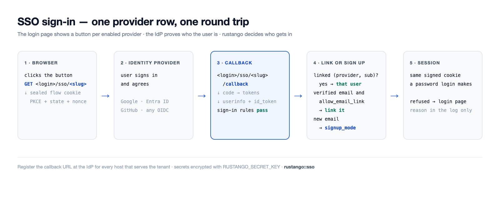
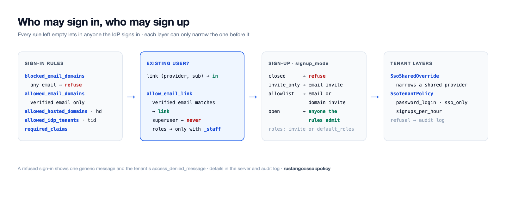

# SSO (OpenID Connect / inicio de sesión social)

Inicia sesión con un proveedor de identidad externo (IdP) en vez de una
contraseña local: Google, Microsoft Entra ID, GitHub, GitLab, Discord o
**cualquier proveedor OpenID Connect** (Okta, Auth0, Keycloak, …). Cada
proveedor es una fila que añades en el admin: sin fichero de
configuración, sin recompilar.

[](../img/sso-flow.png)

## Configurar SSO en cuatro pasos

1. **Crea una app en el IdP.** Registra una aplicación web (un «cliente
   OAuth» o «registro de app»). Copia su **client ID** y su **client
   secret**. Las [guías por proveedor](#guías-por-proveedor) dicen dónde.
2. **Registra la URL de callback** en el IdP, para cada host que sirve la
   página de inicio de sesión. Es `<login>/sso/<slug>/callback` en ese
   host; ver [URL de callback](#url-de-callback). Elige ahora el `slug`,
   p. ej. `google`.
3. **Añade la fila del proveedor.** En el admin del tenant, añade una fila
   al modelo `rustango_sso_providers`: `slug`, `label`, `kind`,
   `client_id`, `client_secret` e `issuer_url` cuando `kind` es `oidc`.
   Solo un superusuario puede añadir o cambiar filas de proveedor. Cada
   campo tiene un texto de ayuda bajo su entrada; la
   [referencia de campos](#referencia-de-campos) lista los mismos textos.
   `RUSTANGO_SECRET_KEY` debe estar definida, o el secreto no se puede
   guardar.
4. **Prueba el inicio de sesión.** Abre la página de inicio de sesión en
   una ventana privada y usa el botón nuevo. Un inicio rechazado muestra
   un mensaje genérico; el motivo está en el log del servidor
   (`sso refused`) y en el log de auditoría. `manage check --deploy`
   detecta un proveedor que rechazaría a todos los usuarios existentes.

El SSO inicia sesión con el usuario **enlazado** a la identidad del IdP: una fila
`rustango_sso_links` por `(provider, sub)`. El correo que envía el IdP nunca basta
por sí solo. Un usuario que entra por primera vez se enlaza por su correo verificado
solo si el proveedor tiene **`allow_email_link`** activado (desactivado por
defecto), y nunca si la cuenta es superusuario o, sin `allow_email_link_staff`,
staff (tenant: tiene algún rol o permiso directo; bare-admin: cualquier cuenta). Esas cuentas las enlaza un administrador,
que añade la fila `SsoLink` en el admin; la línea de log del rechazo indica el
subject. (El flujo de miembro, más abajo, también puede crear una cuenta para un
correo desconocido; está desactivado por defecto.)

> **Fuente:** el núcleo independiente del admin `rustango::sso` (`SsoProvider`,
> `build_provider`, `verified_email`, `ResolvedSso`, `SsoError`), la tabla de
> enlaces `rustango::sso::link` (`SsoLink`, `ProviderKey`, `sign_in`), el cableado del
> bare-admin `rustango::admin::sso`, el SSO por tenant/consola
> (proveedores compartidos: la tabla del registro `rustango_shared_sso_providers`,
> editada en la consola del operador) y el SSO de miembro
> `rustango::tenancy::member_auth`.

## URL de callback

El callback se construye en cada petición con el host y el `slug`:
`https://<host><login>/sso/<slug>/callback`. En las superficies de admin
el esquema es `https` salvo que un proxy de confianza envíe
`X-Forwarded-Proto`; el flujo de miembros también usa `http` en un host
loopback (ver [SSO de miembro](#sso-de-miembro-usuario-final)). Registra
una URL por cada host donde se usa el proveedor.

| Superficie de inicio de sesión | Tenant en su propio host | Tenant bajo un prefijo de ruta |
|---|---|---|
| Admin del tenant (`<login>` es `/login`) | `https://acme.example.com/login/sso/<slug>/callback` | `https://app.example.com/acme/login/sso/<slug>/callback` |
| Inicio de sesión de miembros (`member_sso_router`, `login_base` por defecto `/auth`) | `https://acme.example.com/auth/sso/<slug>/callback` | `https://app.example.com/acme/auth/sso/<slug>/callback` |
| Admin básico (sin tenancy), montado en `/admin` | `https://admin.example.com/admin/login/sso/<slug>/callback` | — |

Con `RouteConfig::legacy()` el `<login>` del admin del tenant es
`/__login`. Un tenant accesible en su propio host y bajo un prefijo
necesita las dos URL. Para un proveedor compartido, la consola del
operador muestra la URL de callback a registrar junto a cada fila.

## Guías por proveedor

### Google

1. En la consola de Google Cloud, abre *APIs & Services → Credentials* y
   crea un *OAuth client ID* de tipo *Web application*.
2. Añade la URL de callback en *Authorized redirect URIs*.
3. Fila del proveedor: `kind = google`, el client ID y el secreto. Deja
   `issuer_url` vacío. Scopes por defecto: `openid email profile`.
4. Para permitir solo tu Google Workspace, pon `allowed_hosted_domains`
   (el claim `hd`), p. ej. `client.org`.

### Microsoft Entra ID

1. En el centro de administración de Entra, abre *App registrations → New
   registration*. Añade la URL de callback como redirect URI *Web*.
2. Copia el *Application (client) ID*. En *Certificates & secrets*, crea
   un client secret y copia su valor.
3. Fila del proveedor: `kind = microsoft`. Usa el endpoint `common`; con
   `allowed_idp_tenants` vacío, cualquier directorio de Entra puede entrar.
   Pon tu *Directory (tenant) ID* para permitir solo tu directorio; así
   sus emails cuentan como verificados y `role_map` y `required_claims`
   se aplican. `check --deploy` avisa cuando `role_map` o
   `required_claims` están puestos y `allowed_idp_tenants` está vacío.
4. No uses `kind = oidc` con un emisor de Entra de un solo directorio
   (`…/<tenant-id>/v2.0`): esa fila no se trata como Microsoft, Entra no
   envía `email_verified`, así que la vinculación por email, el registro y
   `allowed_email_domains` rechazan a todos.

### GitHub

1. En GitHub, abre *Settings → Developer settings → OAuth Apps → New OAuth
   App*. Pon la URL de callback en *Authorization callback URL*.
2. Copia el client ID y genera un client secret.
3. Fila del proveedor: `kind = github`. Scopes por defecto:
   `read:user user:email`. El email verificado viene de `/user/emails`.
   GitHub no envía id_token, así que una regla que lo necesita, como
   `allowed_idp_tenants`, rechaza.

### OpenID Connect genérico

1. Crea un cliente web (confidential) en tu IdP y añade la URL de callback.
2. Fila del proveedor: `kind = oidc`, el client ID y el secreto, e
   `issuer_url`, por ejemplo `https://<org>.okta.com`,
   `https://<host>/realms/<realm>` (Keycloak) o
   `https://<tenant>.auth0.com/`.
3. rustango lee `<issuer>/.well-known/openid-configuration` para encontrar
   los endpoints, una vez por emisor y hora. Scopes por defecto:
   `openid email profile`.

`check --deploy` avisa de la vinculación por email en un proveedor `oidc`
y de un emisor `http://` que no es loopback.

## Referencia de campos

Son los textos de ayuda que el admin muestra bajo cada entrada (allí en
inglés).

### `SsoProvider` y `SharedSsoProvider`

Los proveedores propios de un tenant son filas `SsoProvider`. Los
proveedores compartidos de la consola del operador (`SharedSsoProvider`)
tienen los mismos campos y muestran los mismos textos.

| Campo | Qué poner |
|---|---|
| `slug` | Id corto en las URL del proveedor, p. ej. `google`: el IdP devuelve a los usuarios a `<login>/sso/<slug>/callback`. Único; un slug nuevo implica una URL de callback nueva en el IdP. |
| `label` | Texto del botón de inicio de sesión, p. ej. `Sign in with Google`. |
| `kind` | `google`, `microsoft`, `github`, `gitlab` o `discord` para un proveedor integrado, u `oidc` para cualquier otro proveedor OpenID Connect (entonces rellena la URL del emisor). |
| `issuer_url` | Solo para `oidc`: la URL del emisor, p. ej. `https://<org>.okta.com` o `https://<host>/realms/<realm>`. Los endpoints se leen de `<issuer>/.well-known/openid-configuration`; para Microsoft Entra ID usa el tipo `microsoft`. |
| `client_id` | Client ID (ID de aplicación) del registro de la app en tu proveedor de identidad. |
| `client_secret` | Client secret del mismo registro de la app. Se guarda cifrado con `RUSTANGO_SECRET_KEY`. |
| `enabled` | Mostrar el botón de este proveedor en la página de inicio de sesión. |
| `sort_order` | Orden de los botones en la página de inicio de sesión; los números menores van primero. |
| `scopes` | Scopes de OAuth separados por espacios, p. ej. `openid email profile`. Vacío: los scopes por defecto del tipo. |
| `allow_email_link` | Seguridad: vincular un primer inicio de sesión a la cuenta existente con el mismo email verificado; la contraseña de esa cuenta deja de funcionar, sus sesiones terminan, sus claves API se borran y sus claves de agente se desactivan. Nunca un superusuario, y un usuario con cualquier rol o permiso solo con la vinculación por email para staff; el admin básico lo ignora. |
| `allowed_email_domains` | Seguridad: solo pueden entrar usuarios cuyo email verificado esté en estos dominios. Lista separada por comas o saltos de línea: `client.org` es solo ese dominio, `*.client.org` solo sus subdominios. Vacío: cualquier dominio. |
| `blocked_email_domains` | Los usuarios con un email en estos dominios nunca entran, aunque la lista permitida los tenga. Mismo formato que la lista permitida. |
| `allowed_idp_tenants` | IDs de directorio (tenant) de Microsoft Entra que pueden entrar, separados por comas, leídos de un id_token verificado. Vacío: cualquier directorio de Entra puede entrar con un proveedor `microsoft`. |
| `allowed_hosted_domains` | Dominios de Google Workspace (el claim `hd`) que pueden entrar, separados por comas, p. ej. `client.org`. |
| `required_claims` | Objeto JSON de claims que debe llevar un inicio de sesión, cada uno con uno de sus valores: `{"roles": ["App.User"]}`. `{}`: no se exige ningún claim. |
| `signup_mode` | Seguridad: quién obtiene una cuenta nueva en el primer inicio de sesión: `closed` (nadie), `invite_only` (una invitación para el email), `allowlist` (una invitación para el email o su dominio) u `open` (cualquiera que las reglas de acceso admitan). Vacío: el valor por defecto de la página de inicio de sesión. |
| `default_roles` | Roles del tenant que recibe un usuario nuevo, separados por comas, p. ej. `Viewer`. Una invitación con roles los sustituye. |
| `role_map` | Objeto JSON de un grupo o rol de app del IdP a roles del tenant: `{"Admins": "Editor"}` o `{"Admins": ["Editor", "Viewer"]}`. |
| `role_claims` | Claims que lee el mapa de roles, separados por comas. Vacío: `groups,roles`. |
| `sync_roles_on_login` | Aplicar el mapa de roles en cada inicio de sesión, no solo en el primero. Solo se añaden o quitan los roles del mapa. |
| `username_from` | De dónde sale el nombre de usuario de un usuario nuevo: la parte local del email, el email completo o el `preferred_username` del IdP (si falta, la parte local). |
| `username_clash` | Qué pasa si ese nombre de usuario ya existe: añadir un sufijo corto o rechazar el registro. |
| `sync_profile` | Actualizar el nombre y el email del usuario desde el IdP en cada inicio de sesión. Nunca para un superusuario. |
| `allow_email_link_staff` | Seguridad: con la vinculación por email activa, vincular también a usuarios con cualquier rol o permiso. Un superusuario nunca se vincula por email. |
| `sso_only` | Los usuarios vinculados a través de este proveedor no pueden entrar con contraseña, aunque el proveedor esté desactivado. |
| `auto_deactivate_after_days` | Tras tantos días sin uso, `sso-deactivate-idle` desactiva a los usuarios que registró este proveedor y que no pueden usar contraseña: solo SSO aquí, o el login con contraseña desactivado en el tenant. Vacío: nunca. |
| `session_ttl_secs` | Sesión más larga, en segundos, tras entrar con este proveedor. Vacío: la duración normal de la sesión. |
| `superuser_session_ttl_secs` | Sesión más larga, en segundos, para un superusuario que entra con este proveedor. Vacío: la duración normal de la sesión. |

### `SsoTenantPolicy`

Los ajustes de todo el tenant, una fila.

| Campo | Qué poner |
|---|---|
| `name` | Siempre `default`: el tenant usa esta única fila. |
| `access_denied_message` | Mensaje en la página de inicio de sesión tras un inicio SSO rechazado, p. ej. a quién contactar. Se muestra como texto plano. |
| `password_login` | El formulario de contraseña: `on`, `off` (también para superusuarios) o `superusers_only` (solo en `?local=1`, para superusuarios). |
| `sso_only` | Nadie salvo un superusuario puede entrar con contraseña. |
| `default_provider` | Slug del proveedor que la página de inicio de sesión abre directamente, salvo en `?local=1` o tras un error. |
| `signups_per_hour` | Máximo de registros SSO por hora. Vacío: 100; `0`: sin límite. |

### `SsoLandingRule`

Adónde lleva un inicio de sesión sin `?next=`. Las reglas se aplican por
`position` y gana la primera que coincide. El control de acceso conserva `next`
para cada página que redirige, así que las reglas valen cuando el inicio no trae
`next`, por ejemplo uno empezado en la propia página de inicio de sesión. Valen para el inicio con SSO y con
contraseña en el admin del tenant y en el admin básico; el inicio de los miembros
las ignora. Una regla cuya ruta no pasa la comprobación de `next` (p. ej. la
página de inicio de sesión) se salta. Si falta la tabla, no hay reglas.

| Campo | Qué poner |
|---|---|
| `position` | Las reglas se prueban desde el número más bajo y gana la primera que coincide. A igual número decide el id. |
| `match_kind` | `role`: el usuario tiene el rol de `match_value` (nunca en el admin básico, que no tiene roles). `claim`: el inicio SSO trae el claim `match_name` con `match_value`, leído como un claim del mapa de roles. `any`: todo inicio de sesión; póngala al final como valor por defecto. |
| `match_name` | El nombre del claim, solo para reglas `claim`. Vacío en las demás. |
| `match_value` | El nombre del rol (`role`) o el valor del claim (`claim`), comparado exactamente. Vacío para `any`. |
| `landing_url` | Una ruta de este sitio que empieza por `/`, como en el host propio del tenant, p. ej. `/admin/reports`. El prefijo de ruta se añade solo. No es control de acceso: la página debe comprobar los permisos. |

### `SsoSharedOverride`

La restricción de un proveedor compartido por un tenant. Los campos vacíos
mantienen el valor compartido.

| Campo | Qué poner |
|---|---|
| `shared_slug` | Slug del proveedor compartido que esta fila restringe para este tenant. |
| `shared_provider_id` | La fila del proveedor compartido a la que está ligado este ajuste, fijada en su primer uso. |
| `shared_issuer` | El emisor de esa fila al ligarse. Si la fila compartida cambia de emisor, se rechaza el inicio de sesión hasta volver a añadir el ajuste. |
| `allowed_email_domains` | Seguridad: solo estos dominios de email pueden entrar aquí, además de las reglas compartidas. Mismo formato con comas o saltos de línea que en el proveedor. |
| `blocked_email_domains` | Más dominios de email que nunca entran aquí. |
| `allowed_idp_tenants` | IDs de directorio de Microsoft permitidos aquí, separados por comas. Restringe la lista compartida. |
| `allowed_hosted_domains` | Dominios de Google Workspace permitidos aquí, separados por comas. Restringe la lista compartida. |
| `required_claims` | Más claims que debe llevar un inicio de sesión aquí, en JSON: `{"roles": ["App.User"]}`. |
| `signup_mode` | Seguridad: el registro aquí. Solo puede ser más estricto que el del proveedor compartido. Vacío: el valor compartido. |
| `allow_email_link` | Desactivado: aquí no hay vinculación por email. Vacío o activado: el ajuste compartido. |
| `allow_email_link_staff` | Desactivado: aquí la vinculación por email nunca vincula a un usuario con cualquier rol o permiso. Vacío o activado: el ajuste compartido. |
| `sso_only` | Activado: los usuarios de este proveedor no pueden entrar aquí con contraseña. |
| `session_ttl_secs` | Un límite de sesión más corto aquí, en segundos. Vacío: el valor compartido. |
| `superuser_session_ttl_secs` | Un límite de sesión de superusuario más corto aquí, en segundos. Vacío: el valor compartido. |
| `allowed_roles` | Roles que el proveedor compartido puede dar aquí, separados por comas. Vacío: ninguno. |

### `SsoInvite`

Una invitación para registrarse por SSO.

| Campo | Qué poner |
|---|---|
| `provider_slug` | Slug del proveedor para el que vale la invitación. Vacío: cualquier proveedor. |
| `target` | Quién puede registrarse: un email (`ann@client.org`) o un dominio (`@client.org`, o `*.client.org` para sus subdominios). Una invitación de dominio necesita un máximo de usos o una caducidad. |
| `roles` | Roles que recibe el usuario nuevo, separados por comas. Sustituyen los roles por defecto del proveedor. |
| `expires_at` | Después de este momento la invitación deja de valer. Vacío: no caduca. |
| `max_uses` | Cuántos registros pueden usar esta invitación. Vacío: sin límite. |
| `link_user_id` | Solo para revincular: el usuario existente que vincula el siguiente inicio de sesión, en vez de una cuenta nueva. Lo fija la acción Re-link. |
| `link_key` | Solo para revincular: el proveedor por el que debe llegar el siguiente inicio de sesión. Lo fija la acción Re-link; déjalo vacío. |

## Funcionalidades y quién las usa

Desde **0.49** el núcleo de SSO es su propia funcionalidad, independiente del
auto-admin, de modo que un inicio de sesión de usuario final (miembro) puede
compilarse sin arrastrar `crate::admin`:

| Funcionalidad | Arrastra | Te da |
|---|---|---|
| `sso` | `oauth2`, `casts` | El núcleo independiente del admin: `rustango::sso` — el handshake OIDC / OAuth social, el modelo `SsoProvider` respaldado por BD (secreto cifrado en reposo vía `casts`) y el flujo de miembro (`tenancy::member_auth`, con `tenancy`). |
| `admin-sso` | `admin`, `sso` | Lo anterior **más** el cableado de inicio de sesión del bare-admin (`rustango::admin::sso`) — botones de SSO en la página de inicio de sesión del admin que acuñan la sesión de administrador. |

```toml
[dependencies]
# Admin login with SSO:
rustango = { version = "0.66", features = ["admin-sso"] }
# Member (end-user) SSO without the auto-admin:
rustango = { version = "0.66", features = ["tenancy", "sso"] }
```

`admin::sso_provider` y las rutas históricas del núcleo `admin::sso::*` son
ahora **shims de reexportación** sobre `sso::provider` / `sso::*`, de modo que
los imports existentes de `crate::admin::sso::{build_provider, ResolvedSso, …}` y
`crate::admin::sso_provider::SsoProvider` siguen resolviéndose sin cambios.
Desde 0.58 `rustango_sso_providers` tiene una columna `allow_email_link` y existe
una tabla `rustango_sso_links`; `makemigrations` emite ambas.

El correo que compara el enlace opcional por correo es la columna `email`. En el modelo
`User` del tenant está condicionado por la funcionalidad **`sso`** (movida fuera de
`admin-sso` en 0.49, de modo que las compilaciones solo con SSO de miembro siguen
obteniendo la columna); el `AdminUser.email` escueto permanece tras `admin-sso`.
Activar o desactivar la funcionalidad emite una migración `AddColumn` / `DropColumn`
para esa columna.

## Cómo funciona

1. La página de inicio de sesión muestra un botón **«Iniciar sesión con
   &lt;proveedor&gt;»** por cada proveedor habilitado.
2. Al hacer clic en uno (`GET <login>/sso/<slug>`) se redirige al IdP con una
   cookie de flujo firmada y de vida corta (PKCE + `state` CSRF).
3. El IdP devuelve al usuario a `<login>/sso/<slug>/callback`.
4. rustango verifica el flujo, intercambia el código y lee `/userinfo`.
5. Busca el enlace para este proveedor y el `sub` del IdP. Sin enlace, y con
   `allow_email_link` activado, un correo **verificado** que coincide con un
   usuario no privilegiado crea el enlace.
6. Si el usuario enlazado está activo, acuña la **misma sesión de cookie firmada**
   que produce un inicio de sesión con contraseña — de modo que cada control
   existente (superusuario / permisos, invalidación en vivo por cambio de
   contraseña) sigue aplicándose.
7. En otro caso, el usuario es devuelto a la página de inicio de sesión con un
   error genérico (los detalles van al log del servidor, nunca al navegador).

En el admin del tenant, `GET <login>/sso/<slug>?next=/ruta` lleva a `/ruta`
tras iniciar sesión. La ruta viaja en la cookie de flujo firmada y pasa la
misma comprobación que el inicio de sesión con contraseña: solo mismo origen y
dentro del prefijo de ruta del tenant. Sin un `next` válido deciden las
[reglas de destino](#ssolandingrule) del tenant, y sin coincidencia el inicio
lleva a `admin_url`. La página de inicio de sesión pasa su propio `?next` a los
botones SSO y nunca inventa uno. El
admin básico hace lo mismo sin la regla del prefijo, conserva la ruta durante
el paso TOTP y vuelve a su prefijo.

La tabla de enlaces es un modelo migrado normal: en el almacenamiento del tenant
para los inicios de sesión de tenant, y en la base de datos del admin para el
bare-admin. Un enlace se compara de forma exacta (issuer y subject con clave
SHA-256; el correo solo ignora mayúsculas ASCII), sea cual sea la collation de
la base de datos.

El **secreto** del cliente está **cifrado en reposo** — la columna `client_secret`
es un cast [`EncryptedString`](#almacenamiento-de-secretos), descifrado en memoria solo en el
momento del inicio de sesión.

## Los proveedores son filas, gestionadas en el admin

Cada proveedor es una fila `SsoProvider`, un modelo normal del admin:
se añade, edita y activa desde la UI del admin, sin redesplegar. Los
campos están en la [referencia de campos](#referencia-de-campos). Solo un
superusuario puede añadir, cambiar o borrar filas `SsoProvider` y
`SsoLink`; el resto del staff las lista con los permisos habituales. Los
endpoints se descubren al iniciar sesión, sin configuración por proveedor.

## Dónde gestiona los proveedores cada superficie

- **Admin de un solo tenant / independiente** (`crate::admin`): las filas
  `SsoProvider` son una tabla global sencilla, gestionada desde el bare-admin.
  Requiere `Builder::with_session_auth` (el SSO acuña la misma sesión).
- **Admin de tenant** (multi-tenancy): cada tenant gestiona sus **propias**
  filas `SsoProvider` desde su admin — granular, autoservicio, aislado por
  tenant.
- **Consola de operador** (multi-tenancy): un operador define un
  **`SharedSsoProvider`** una vez y se ofrece a **todos** los tenants
  (un Google a nivel de empresa, por ejemplo). Gestionado desde el panel
  *Shared SSO* de la consola (`/sso-shared`, funcionalidad `admin-sso`;
  cualquier operador ve la lista, los cambios requieren una consola
  editable), donde *Allow email linking* alterna
  `allow_email_link` en el sitio (el id y sus enlaces se conservan). La opción
  se aplica a **todos** los tenants. *Edit* (`/sso-shared/{id}/edit`) cambia
  un proveedor en el sitio (mismo id y slug; un secreto vacío conserva el
  guardado), y cada fila muestra la URL de callback que hay que registrar en
  el IdP. El campo de URL del issuer solo aparece para `oidc`. Un alta o una
  edición rechazada vuelve a mostrar el formulario (estado 400) con los valores
  escritos y el error, nunca el secreto.

En la página de inicio de sesión de un tenant los dos conjuntos se fusionan, y ante
un choque de slug **gana el propio proveedor del tenant** sobre el compartido — así
un tenant puede anular un proveedor compartido para sí mismo.

Registra la [URL de callback](#url-de-callback) en el IdP. Un usuario se enlaza mediante el enlace opcional por correo (usuarios de
tenant no privilegiados), o cuando un superusuario añade una fila `SsoLink`:
`provider_source` (`tenant`, `shared`, `admin`, o `app` para un inicio de sesión nativo), `provider_id` (el id de la fila
del proveedor), `issuer` (`kind`, o `kind|issuer_url` sin barra final), `subject`
y `user_id`. El admin calcula `key_sha256`. La
línea de log del rechazo (`sso refused`) lleva `provider_id`, `issuer` y `subject`.
Añadir una fila requiere la autenticación por sesión del admin
(`Builder::with_session_auth`, o `with_session` del admin de tenant); sin ella,
nadie puede añadir enlaces.

Un enlace creado más de una hora antes que la cuenta a la que apunta (un id
reutilizado tras una restauración, por ejemplo) se borra, y el inicio de sesión
sigue como sin enlace. Un enlace cuyo usuario ya no existe se borra en el
siguiente inicio de sesión, y borrar un usuario en el admin borra sus enlaces.
Si los valores `created_at` de las cuentas se importan o se rellenan después de
sus enlaces, `rustango::sso::link::set_stale_links(StaleLinks::Warn)` solo
registra un aviso y aun así inicia sesión.

Con la funcionalidad `totp`, un usuario del bare admin con un dispositivo TOTP
confirmado aún debe escribir un código tras el SSO. El admin muestra el
formulario del código y guarda el inicio de sesión pendiente 5 minutos en una
cookie firmada; el formulario envía a `<login>/sso-totp`. El admin de tenant no
tiene paso TOTP.

`manage check --deploy` avisa de un proveedor activado que rechazaría a todo
usuario existente: sin filas `SsoLink`, y enlace por correo desactivado o solo
usuarios privilegiados. En el bare admin, es cualquier proveedor sin enlaces.
También avisa del enlace por correo en un proveedor `kind = "oidc"`, un issuer
`http://` que no es loopback, y un proveedor compartido que registra usuarios.

## SSO de miembro (usuario final)

Las superficies anteriores inician sesión a las personas en un **admin**.
`tenancy::member_auth` es el análogo orientado a miembros: inicia la sesión de un
usuario final en el propio pool de usuarios de un tenant (`rustango_users`) y
acuña una **sesión de miembro**, de modo que un socio de gimnasio / cliente SaaS
puede «Iniciar sesión con Google» sin tocar el admin. Reutiliza exactamente el mismo
núcleo `rustango::sso` y las propias filas `SsoProvider` del tenant — solo difiere
la sesión que acuña, razón por la cual vive tras la funcionalidad `sso` (no
`admin-sso`) y no necesita auto-admin.

Monta `member_sso_router` en una pila `rustango::server::Builder` (lee el
`Arc<TenantContext>` resuelto que el builder inyecta):

```rust
use rustango::tenancy::member_auth::{member_sso_router, MemberAuthConfig};

let members = member_sso_router(MemberAuthConfig {
    login_base:     "/auth".into(),   // buttons link to /auth/sso/<slug>
    landing_url:    "/".into(),       // post-login destination (a same-origin ?next on the begin URL wins)
    auto_provision: true,             // create a user from a verified email on first sign-in
    session_ttl:    7 * 24 * 60 * 60, // 7 days
    ..Default::default()
});
```

Con varios backends compilados, `member_sso_router` es para el tipo de tenant
por defecto (Postgres); usa `member_sso_router_for::<sqlx::Sqlite>` (o `MySql`).

Monta dos rutas por slug a partir de `login_base`:

- `GET {login_base}/sso/{slug}` — inicia el handshake, redirige al IdP.
- `GET {login_base}/sso/{slug}/callback` — lo completa, encuentra-o-aprovisiona
  al miembro, acuña la cookie de sesión.

Un tenant con prefijo de ruta recibe las mismas dos rutas bajo su prefijo.

Diferencias respecto al flujo del admin:

- **Esquema del callback.** El `redirect_uri` del miembro toma su esquema del
  `X-Forwarded-Proto` de un proxy de confianza (y su host de
  `X-Forwarded-Host`); si no, `http` en un host loopback
  (`localhost`, `*.localhost`, una IP loopback) y `https` en cualquier otro, así que
  `localhost.example.com` recibe `https`.
- **Aprovisionamiento automático.** El `signup_mode` de un proveedor ([Quién puede registrarse](#quién-puede-registrarse)) manda; si no hay ninguno, `auto_provision = true` funciona como `open`. Con `auto_provision = true` (opcional; el valor por
  defecto es `false`), un correo de IdP verificado sin una fila `rustango_users` coincidente
  **crea** una — nombre de usuario a partir de la parte local del correo (deduplicado
  ante un choque), un hash de contraseña aleatorio real pero inutilizable (los
  usuarios de SSO no pueden iniciar sesión con contraseña) — y la enlaza. Un
  correo que coincide con una cuenta existente sigue la regla `allow_email_link`
  de arriba. Ponlo a `false` para rechazar correos desconocidos. Un inicio de
  sesión nativo (una app que verificó su propio ID token) llama a
  `sso::policy::admit` con `AdmitRequest::new(pool, Surface::Member,
  &ProviderKey::app(issuer), &policy, &Identity::from_profile(profile))` y
  `tenancy::member_auth::TenantAccounts(pool)`; la `EffectivePolicy` que pasa
  es la política de inicio de sesión, así que pon ahí sus reglas. El
  `find_or_provision_member` obsoleto aún aplica las reglas de un proveedor de
  tenant, pero una clave de app no tiene ninguna: con `auto_provision` registra
  cualquier correo verificado.
- **Su propia cookie de sesión.** La cookie de miembro
  (`rustango_member_session`) está **separada por dominio** de las cookies de
  sesión de tenant / admin: el mensaje firmado lleva una etiqueta por dominio y
  un claim de audiencia, de modo que una cookie de miembro nunca puede validarse
  como una cookie de tenant/admin (o viceversa) aunque ambas estén firmadas con
  `RUSTANGO_SESSION_SECRET`. Está ligada al slug (una cookie acuñada para `acme`
  nunca autentica en `globex`) y se invalida con una rotación de contraseña
  (a la par que la sesión del admin).
- **Cierre de sesión.** `member_auth::logout(&pool, &user)` cierra las sesiones
  del miembro en todos los dispositivos y devuelve el valor `Set-Cookie` que
  borra la cookie. En un tenant con prefijo de ruta usa `logout_at`, que borra
  la cookie en la ruta del prefijo.

Lee el miembro actual en un handler con el extractor **`CurrentMember`** — el
análogo de miembro de `SessionUser`. Es infalible
(`None` para sesiones anónimas / caducadas / rotadas / entre tenants),
así que se compone con rutas públicas:

```rust
use rustango::tenancy::member_auth::CurrentMember;

async fn dashboard(CurrentMember(member): CurrentMember) -> impl axum::response::IntoResponse {
    match member {
        Some(user) => format!("Hi, {}", user.username),
        None => "Please sign in".to_owned(),
    }
}
```

> **Alcance v1.** El SSO de miembro resuelve proveedores únicamente a partir de las
> propias filas `SsoProvider` del tenant — la fusión de `SharedSsoProvider` a nivel
> de registro y un hook `provision` personalizado son seguimientos futuros.

## Quién puede iniciar sesión

Cada proveedor (y cada proveedor compartido en la consola del operador)
tiene reglas de inicio de sesión. Las reglas vacías admiten a cualquiera
que el IdP autentique.

[](../img/sso-policy.png)

Los campos de reglas son `allowed_email_domains`, `blocked_email_domains`,
`allowed_idp_tenants`, `allowed_hosted_domains` y `required_claims`; su
formato está en la [referencia de campos](#referencia-de-campos). La lista
bloqueada se comprueba con cualquier email del IdP, verificado o no; la
permitida, solo con uno verificado. Un claim de `required_claims` puede
ser una cadena o una lista, y un claim ausente rechaza.

El admin y la consola del operador guardan las listas en una forma canónica
y rechazan valores que no se pueden interpretar. Un valor inválido escrito
por otra vía rechaza todo inicio de sesión con ese proveedor.

Un inicio de sesión rechazado va al log del servidor y al log de auditoría
(`source = sso:<surface>`, `changes.rule`, p. ej. `domain_not_allowed`).
El navegador ve un mensaje genérico; la página de login del tenant muestra
además el `access_denied_message` del tenant (de `SsoTenantPolicy`), escapado.

La ruta de miembros (`member_sso_router`) solo resuelve los proveedores
propios del tenant; los proveedores compartidos, y su endurecimiento por
el tenant, aún no se aplican ahí.

### Confianza en el id_token

Los datos del perfil vienen de `/userinfo` sobre TLS. Los claims que solo
trae el id_token (`tid`, `iss`, `xms_edov`) se usan solo si el id_token
pasa: firma contra el JWKS del emisor (RS256 o ES256; en caché según su
`max-age` y recargado como mucho una vez por minuto ante una clave
desconocida), `aud` contiene el client id, `exp`/`nbf` con un minuto de
margen, el emisor (Microsoft: `https://login.microsoftonline.com/{tid}/v2.0`)
y el mismo `sub` que userinfo. Si no, esos claims faltan y una regla que los
necesita rechaza. Un email de Microsoft cuenta como verificado si `xms_edov`
es verdadero, o si el proveedor fija `allowed_idp_tenants` y el `tid` del
token está en la lista.

## Quién puede registrarse

Un proveedor también puede crear la cuenta en el primer inicio de sesión.
Solo ocurre si ningún enlace ni ninguna cuenta coincide con el email
verificado, y solo después de pasar las reglas de inicio de sesión de arriba.

Los campos de registro son `signup_mode`, `default_roles`, `role_map`,
`role_claims`, `sync_roles_on_login`, `username_from`, `username_clash`,
`sync_profile` y `allow_email_link_staff` (ver la
[referencia de campos](#referencia-de-campos)). Con `signup_mode` vacío,
el login del tenant está cerrado y el flujo de miembros sigue
`MemberAuthConfig::auto_provision`; el admin básico nunca registra a
nadie. Un usuario nuevo recibe los roles de la invitación o `default_roles`, más
los roles que da `role_map`. Un proveedor con JWKS (descubrimiento OIDC, Microsoft, Google) toma
los claims de roles solo de un id_token verificado; uno solo con userinfo,
de userinfo. `sync_roles_on_login` solo añade o quita roles nombrados en
`role_map`; los roles dados a mano se quedan, y un inicio de sesión sin
claims de roles no cambia nada.

Un usuario nuevo nunca es superusuario. Los roles pasan por el motor de
permisos (`UserRole`); un nombre de rol sin fila `Role` se omite y se anota
en el registro de auditoría (`sso_role_unknown`). El usuario, su enlace
(`provisioned = true`), sus roles y el uso de la invitación se escriben en
una sola transacción.

**Invitaciones** (`SsoInvite`, solo superusuarios en el admin del tenant):
un email (`ann@client.org`) o un dominio (`@client.org`, o `*.client.org`
para sus subdominios). Pueden nombrar un proveedor, llevar roles, caducar
(`expires_at`) y limitar usos (`max_uses`). Un uso se cuenta de forma
atómica: dos registros que compiten por el último uso crean una sola
cuenta. `.../rustango_sso_invites/bulk` añade muchas a la vez desde una
lista pegada o una columna CSV.

**Desenlazar y volver a enlazar.** En las filas `SsoLink`, las acciones
*Unlink* y *Re-link on next sign-in* (solo superusuarios). Re-link borra el
enlace y deja una invitación de un solo uso, válida 7 días, que vuelve a
enlazar al mismo usuario en su próximo inicio de sesión por el mismo
proveedor con su email verificado, aunque tenga un subject nuevo. Nunca
vuelve a enlazar a un superusuario; a un usuario con roles, solo con
`allow_email_link_staff`.

Las colisiones de nombre de usuario y correo ignoran mayúsculas como el
backend: PostgreSQL pliega Unicode, SQLite solo letras ASCII y MySQL sigue la
collation de la columna (por defecto también los acentos, `ané` y `ane`
colisionan). Con nombres de usuario ASCII la respuesta es igual en todas partes.

`check --deploy` no marca como bloqueante a un proveedor con registro
abierto, y avisa de `signup_mode = open` sin `allowed_email_domains`,
`allowed_hosted_domains` ni `allowed_idp_tenants`.

## Contraseñas, sesiones y ciclo de vida

Los campos del proveedor `sso_only`, `session_ttl_secs`,
`superuser_session_ttl_secs` y `auto_deactivate_after_days`, y la fila
`SsoTenantPolicy`, están en la [referencia de campos](#referencia-de-campos).
`sso_only` cubre el login con contraseña, el login JSON, HTTP Basic y los
enlaces de restablecimiento. Una sesión dura lo más corto entre el límite
del proveedor y la duración de la ruta. `sso-deactivate-idle` nunca
desactiva a un superusuario ni a un usuario con un vínculo hecho por un
admin.

Un superusuario solo sigue `password_login`; `sso_only` nunca lo bloquea.
Una contraseña rechazada parece incorrecta. Una regla ilegible rechaza; una configuración ilegible solo deja entrar a superusuarios. Un proveedor desactivado mantiene a sus usuarios `sso_only`, un vínculo a uno borrado cuenta como `sso_only` hasta que un admin lo quite. `sso_only` cubre los logins con contraseña (tenant y bare admin) y los restablecimientos, no las claves API ni los secretos de agentes MCP. `sso-deactivate-idle` solo desactiva a usuarios que no pueden usar contraseña. Cerrar sesión lleva a `?local=1`, y la redirección automática ocurre como mucho una vez por minuto, para que una sesión perdida no cree un bucle.

**Proveedores compartidos.** El `SsoSharedOverride` de un tenant endurece un proveedor compartido, nunca lo relaja, y nombra en `allowed_roles` los roles que puede otorgar (sin override: ninguno). El override también puede desactivar la vinculación por correo (`allow_email_link`, `allow_email_link_staff`). Se vincula a la fila del proveedor compartido en el primer inicio de sesión: una fila renombrada lo conserva, una fila nueva con el slug antiguo no, y una fila que cambia de issuer rechaza el inicio de sesión hasta que se vuelva a crear el override.

**Microsoft multiinquilino.** Un proveedor `microsoft` (u `oidc` en `/common` u `/organizations`) acepta usuarios de cualquier directorio de Entra. Su `role_map` y sus `required_claims` solo cuentan si `allowed_idp_tenants` fija el `tid` del token; si no, no se conceden roles y las claims obligatorias rechazan. `check --deploy` avisa de una fila que pone `role_map` o `required_claims` sin `allowed_idp_tenants`.

**Límite y auditoría.** Los callbacks SSO tienen su propio límite por IP (429), aparte del de contraseñas. Vínculos, registros, re-vínculos y cambios de roles van al registro de auditoría (`sso_linked`, `sso_signup`, `sso_relinked`, `sso_roles_synced`); los rechazos como mucho cinco veces por sujeto en diez minutos.

**Bloqueo de cuenta.** El bloqueo tras contraseñas fallidas no detiene el SSO. Para detener a un usuario, ponga `active = false`.

## Almacenamiento de secretos

`client_secret` se almacena **cifrado en reposo** con XChaCha20-Poly1305
(AEAD), con la clave derivada de la variable de entorno
**`RUSTANGO_SECRET_KEY`**. Se descifra en memoria solo al iniciar sesión, para
autenticarse ante el endpoint de token del IdP. Así, un volcado de BD filtrado nunca
expone el secreto, y cada tenant conserva su propio secreto sin una variable de
entorno por proveedor.

> Establece `RUSTANGO_SECRET_KEY` en el despliegue. Se le aplica SHA-256 para
> obtener una clave de 32 bytes; usa al menos 32 caracteres aleatorios (con el
> aprovisionamiento de tenants montado, `check --deploy` avisa de una clave más corta). Sin
> ella, guardar o usar un proveedor falla de inmediato — la misma postura que
> ante una URL de base de datos ausente.

Para rotar la clave, pon el valor nuevo en `RUSTANGO_SECRET_KEY` y el antiguo en
`RUSTANGO_SECRET_KEY_PREVIOUS`. La lectura recurre a la clave antigua. En un
despliegue multi-tenant, `manage reseal-tenant-secrets --apply` vuelve a sellar
después los secretos SSO compartidos y de los tenants con la clave nueva.

## Proveedores (presets)

Presets integrados: `google`, `microsoft` (Azure AD), `github`, `gitlab`,
`discord`. Para cualquier otra cosa, usa `kind = "oidc"` con un `issuer_url` —
rustango ejecuta el descubrimiento de OpenID Connect para encontrar los endpoints (una vez por
emisor y hora).
(Sign in with Apple no es un preset; necesita verificación de id_token/JWKS.)

## Notas de seguridad

- **Primero el enlace** — decide el enlace `(provider, sub)`; el correo solo lo
  usa el enlace opcional por correo, y solo si está verificado.
- **Sin enlaces privilegiados por correo** — un superusuario nunca se enlaza
  por correo, y quien tiene roles solo con `allow_email_link_staff`. Un enlace creado por correo sigue funcionando después
  de ascender al usuario; bórralo si no se desea.
- **Sin aprovisionamiento automático en el bare admin** — un correo desconocido
  no puede entrar. Un proveedor del admin de tenant solo registra cuando su
  `signup_mode` lo permite.
- **Secretos cifrados en reposo** (`RUSTANGO_SECRET_KEY`), descifrados solo en
  memoria al iniciar sesión; los formularios de edición enmascaran el secreto
  almacenado.
- La cookie de flujo es de vida corta (10 min), `HttpOnly`, `SameSite=Lax`
  y `Secure` según la configuración — **no** según el esquema de la petición. La
  precedencia es `security.secure_cookies` (`true` por defecto en el camino de
  `manage`, así que falla de forma cerrada), y si no hay nada definido, «segura en
  el nivel prod» a partir de `RUSTANGO_ENV`. Nada comprueba si la petición llegó
  realmente por HTTPS. El handshake lleva PKCE + un `state` firmado.
- Las sesiones de SSO son la sesión de administrador corriente — rotar o
  desactivar al usuario vinculado las invalida a través del control en vivo
  existente.
- El modelo de confianza es `/userinfo` sobre TLS; los claims del id_token
  cuentan solo tras la verificación JWKS (ver [confianza en el id_token](#confianza-en-el-id_token)).
  Antepón HTTPS al admin.

## Endurecimiento

- **Vincular por email bloquea la contraseña.** Cuando el SSO vincula una
  cuenta de tenant existente por email (o por una invitación de re-vínculo), su
  contraseña queda inutilizable, sus sesiones terminan, sus claves API se
  borran y sus claves de agente se desactivan, en la misma transacción. Quien registró el email antes que su dueño pierde la cuenta; el
  dueño restablece la contraseña para volver a usar una. Cualquier rol, incluso
  sin permisos, cuenta como privilegiado para vincular por email.
- **Un flujo, un uso.** Un callback completa un flujo una sola vez (por
  proceso; el código de un solo uso del IdP cubre otras réplicas). Los inicios
  de sesión OIDC envían un `nonce`; un id_token verificado sin él, o con otro,
  se rechaza (`id_token_replayed`). El destino del flujo de miembros es el
  `?next` de la URL de inicio, sellado en el flujo; un `?next` en el callback se
  ignora.
- **Cookies de flujo `__Host-`** en HTTPS con `Path=/` (admin simple, tenant en
  su propio host); allí solo se lee ese nombre. Un tenant con prefijo de ruta
  mantiene el nombre simple, y el `?next` de miembros debe quedar bajo el prefijo.
- **Invitaciones.** Una invitación de dominio para un sufijo público o un correo
  gratuito (`@gmail.com`, `*.co.uk`) se rechaza, y una invitación de dominio
  necesita `max_uses` o `expires_at`. Los nombres visibles del IdP se limitan a
  150 caracteres.
- **Host del admin simple.** Con `security.allowed_hosts` (o
  `Builder::allowed_hosts`), la URI de redirección SSO solo se construye para un
  host de la lista. Sin lista acepta cualquier host, y el admin avisa al arrancar.

### Tenants en su propio host y bajo un prefijo

Un tenant se alcanza en su propio host (cookies en `Path=/`) y en el host apex
bajo su prefijo (`app.example.com/acme`, cookies en `Path=/acme`). Los tenants
con prefijo comparten un origen con la consola del operador y entre sí: el
`Path` de una cookie no es allí una frontera de seguridad. Sesiones y flujos
están ligados al slug del tenant por su MAC, así que la cookie de un tenant
nunca abre la de otro. Para un tenant alcanzable de ambas formas, registre las
dos URL de callback en el IdP:
`https://acme.example.com/login/sso/<slug>/callback` y
`https://app.example.com/acme/login/sso/<slug>/callback` (`/__login` con `RouteConfig::legacy()`).

## Véase también

- [Guía de seguridad](security.md) · [Autenticación](auth-flows.md)
