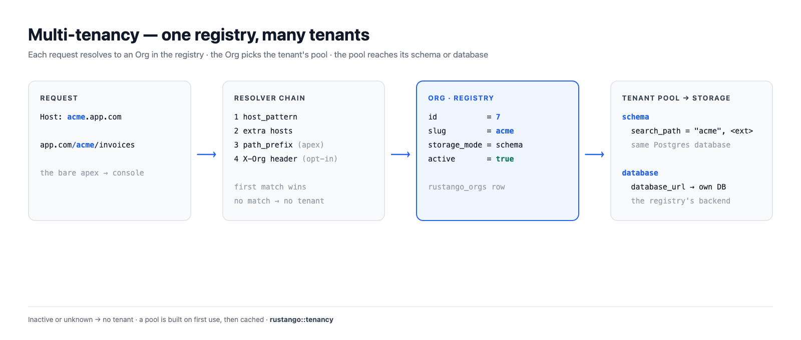
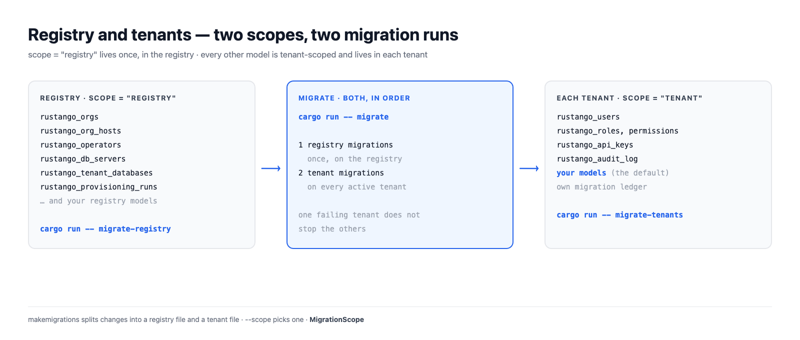

# Multi-tenancy

Una app rustango puede servir a muchos clientes. Cada cliente es un
**tenant**: una fila `Org` en la base de datos **registry**. Cada petición se
asocia a su tenant, y los datos del tenant viven en su propio schema o en su
propia base de datos.

Esta página explica cómo encajan las piezas. Para los pasos, mira
[la consola de operador](operator-console.md), [la CLI `manage`](manage.md#comandos-de-tenancy)
y [bases de datos de tenant en un servidor guardado](tenant-databases.md).

[](../img/tenancy.png)

## Tabla de contenidos

- [Registry y tenant](#registry-y-tenant)
- [Cómo una petición encuentra su tenant](#cómo-una-petición-encuentra-su-tenant)
- [Dos formas de llegar a un tenant](#dos-formas-de-llegar-a-un-tenant)
- [Modos de almacenamiento](#modos-de-almacenamiento)
- [Pools](#pools)
- [Migraciones](#migraciones)
- [Credenciales y cachés se atan al id de la org](#credenciales-y-cachés-se-atan-al-id-de-la-org)
- [Ciclo de vida](#ciclo-de-vida)

## Registry y tenant

El **registry** es la única base de datos que la app conoce al arrancar
(`DATABASE_URL`). Guarda lo que comparte todo el despliegue:

- `rustango_orgs`: una fila por tenant, con su slug, modo de almacenamiento,
  URL de base de datos, host, prefijo de ruta, puerto y estado activo;
- `rustango_org_hosts`: hostnames extra de un tenant;
- `rustango_operators`: las personas que operan el despliegue;
- `rustango_db_servers` y `rustango_tenant_databases`: servidores guardados
  y las bases de datos que rustango creó en ellos;
- `rustango_provisioning_runs` y sus eventos, proveedores SSO compartidos,
  dispositivos TOTP de los operadores.

Todo lo demás vive **por tenant**: `rustango_users`, roles y permisos,
`rustango_api_keys`, el registro de auditoría y tus propios modelos.

Un modelo dice dónde vive con `scope`. `tenant` es el valor por defecto, así
que solo escribes `scope = "registry"` para tablas compartidas:

```rust
use rustango::sql::Auto;
use rustango::Model;

// Una tabla compartida, en el registry.
#[derive(Model)]
#[rustango(table = "billing_plans", scope = "registry")]
pub struct BillingPlan {
    #[rustango(primary_key)]
    pub id: Auto<i64>,
    #[rustango(max_length = 64)]
    pub name: String,
}

// Sin scope: `tenant` es el valor por defecto. Cada tenant tiene su tabla.
#[derive(Model)]
#[rustango(table = "invoices")]
pub struct Invoice {
    #[rustango(primary_key)]
    pub id: Auto<i64>,
    pub total_cents: i64,
}
```

Operadores y usuarios de tenant nunca se mezclan. Los operadores viven en el
registry y entran por el dominio apex. Los usuarios de tenant viven en su
tenant y nunca ven la consola.

[](../img/tenancy-registry.png)

## Cómo una petición encuentra su tenant

Un **resolver** convierte una petición en una `Org`. El servidor prueba una
cadena de resolvers en orden, y gana el primero que coincide:

1. **Host.** La cabecera `Host` es igual al `host_pattern` del tenant, por
   ejemplo `acme.app.com`. La comparación es exacta. Si no das un host,
   `create-tenant` pone `<slug>.<apex>`, pero solo sin `--path-prefix` y con
   el apex configurado.
2. **Hosts extra.** Un hostname atado al tenant en `rustango_org_hosts`.
   Nunca gana al host propio de otro tenant.
3. **Prefijo de ruta, solo en el apex.** `app.com/acme/...` coincide con el
   tenant cuyo `path_prefix` es `/acme`. En cualquier otro host la ruta no
   elige tenant.
4. **Cabecera (opcional).** `Builder::header_resolver` añade una cabecera al
   estilo `X-Org` después de las demás. Úsala con
   `HeaderResolver::allow_only`: el cliente elige el valor de la cabecera.

Solo coinciden los tenants **activos**. El apex solo (`RUSTANGO_APEX_DOMAIN`)
no resuelve a ningún tenant: sirve la consola de operador. El apex más un
prefijo de ruta sí resuelve, y también una petición al apex con la cabecera
`X-Org` cuando `HeaderResolver` está activo. Una petición sin
tenant recibe un 404 de las rutas de tenant, o va a
[`unresolved_tenant`](operator-console.md#hosts-desconocidos) si lo
configuras.

**Puerto.** El servidor incluido (`Builder::serve`, `run-server`) no
enruta por puerto, y no hay forma de añadir `PortResolver` a su cadena. Un
tenant que solo se alcanza por su puerto no se alcanza ahí. `PortResolver`
(lee el puerto del listener, nunca la URI del cliente) solo funciona en una
cadena que construyes y sirves tú.

Un tenant sin host, sin prefijo de ruta y sin puerto es **inalcanzable**, y
se rechaza: en `create-tenant`, en la consola y en una edición que cambie el
enrutado.

Los resultados se cachean 30 segundos. Otro servidor ve un cambio en
`rustango_orgs` dentro de dos consultas de huella
(`RUSTANGO_HOST_GEN_CHECK_SECS`, 5 segundos por defecto), y nunca después
de la caché de 30 segundos.

En un handler, usa `TenantScope` (no retiene conexión) o `Tenant` (retiene
una conexión durante la petición):

```rust
use axum::http::StatusCode;
use rustango::extractors::TenantScope;
use rustango::sql::CounterPool as _;

async fn invoice_count(t: TenantScope) -> Result<String, StatusCode> {
    // `t.org` es la Org encontrada. `t.pool()` es su pool.
    let n = Invoice::objects()
        .count(t.pool())
        .await
        .map_err(|_| StatusCode::INTERNAL_SERVER_ERROR)?;
    Ok(format!("{}: {n} invoices", t.org.slug))
}
```

## Dos formas de llegar a un tenant

| Forma | Ejemplo | `Path` de la cookie |
|---|---|---|
| El host propio del tenant | `acme.app.com/admin` | `/` |
| El apex más su prefijo de ruta | `app.com/acme/admin` | `/acme` |

En su propio host el tenant tiene el host para él, así que las cookies usan
`Path=/`. Los navegadores separan las cookies por host.

Bajo un prefijo de ruta muchos tenants comparten el host apex. Por eso las
cookies del tenant usan `Path=/<prefix>`, y las cookies de `/acme` no se
envían a `/acmecorp`. Los enlaces y redirecciones del admin del tenant
llevan el prefijo también.

El enrutado por host es la opción más fuerte en producción. Los prefijos de
ruta son útiles en desarrollo, donde tienes un solo host.

## Modos de almacenamiento

Cada tenant tiene un `storage_mode`: `schema` o `database`.

[](../img/tenancy-storage-modes.png)

### Modo schema (solo Postgres)

Todos los tenants comparten la base de datos Postgres del registry. Cada
tenant tiene su schema, con el nombre del slug salvo que pongas
`schema_name`. El `search_path` de una conexión de tenant es:

1. el schema del tenant;
2. después cada schema que solo tiene extensiones, para que los tipos y
   funciones de las extensiones sigan funcionando.

`public` está en la ruta solo cuando una extensión vive allí. Cualquier otro
schema entra solo cuando no tiene más que objetos de extensiones y ninguna
org lo nombra, así que los schemas de otros tenants nunca aparecen en la
ruta.

Un pool de tenant **no se abre** cuando:

- falta el schema (ejecuta `migrate-tenants` para él);
- el schema tiene el nombre de un rol de la base de datos, cuyas sesiones lo
  verían primero;
- un schema de extensiones en la ruta, como `public`, tiene una tabla de
  tenant que falta en el schema del tenant. Las consultas leerían esa tabla.

Una extensión en el propio schema del tenant no es problema: ese schema va
primero en la ruta. Una extensión en el schema de otro tenant, o en un
schema con objetos propios, queda fuera de la ruta, con un aviso. Muévela con
`ALTER EXTENSION <name> SET SCHEMA public`.

En MySQL y SQLite el modo schema se rechaza con un mensaje que apunta al
modo database.

### Modo database (Postgres, MySQL, SQLite)

Cada tenant tiene su propia base de datos. `database_url` guarda la
conexión: una URL literal, una referencia `env://VAR` o un valor sellado
`enc:v1:`. Hay dos formas de tenerla:

- traer la URL de una base de datos existente;
- dejar que rustango cree la base de datos y un login propio en un servidor
  guardado. Mira
  [bases de datos de tenant en un servidor guardado](tenant-databases.md).

Un tenant usa el backend del registry.

### Cuál elegir

| | Modo schema | Modo database |
|---|---|---|
| Backends | Postgres | Postgres, MySQL, SQLite |
| Aislamiento | schemas en una base de datos, un login | una base de datos cada uno, y su propio login en un servidor guardado |
| Conexiones | al servidor del registry | por base de datos de tenant |
| Copia y restauración | toda la base de datos | por tenant |
| Bueno para | muchos tenants pequeños | menos tenants, más grandes o regulados |

Eliges por tenant, así que un despliegue puede tener los dos.

```bash
cargo run -- create-tenant acme                                  # modo schema, en un registry Postgres
cargo run -- create-tenant globex --server main                  # modo database, creado en un servidor guardado
cargo run -- create-tenant initech --mode database --database-url "postgres://..."
```

## Pools

`TenantPools` entrega un pool por tenant. Lo que hace:

- **Se construye al primer uso.** La primera petición de un tenant resuelve
  su URL y conecta. Muchas peticiones a un tenant frío comparten una sola
  construcción.
- **En caché y con límite.** Hasta 64 pools de modo database y 64 de modo
  schema, contados por separado. Pasado el límite se expulsa el tenant usado
  hace más tiempo, que reconecta en su siguiente petición.
- **Dos por tenant en Postgres.** Uno para consultas (`t.pool()`) y otro
  para la conexión que retiene un extractor `Tenant`, para que una conexión
  retenida nunca espere a las consultas.
- **Se reconstruye al cambiar.** Un pool recuerda la URL o el schema con que
  se creó. Cuando la `Org` nombra otro, la siguiente petición crea un pool
  nuevo.
- **Etiquetado.** Una conexión Postgres en modo database lleva
  `application_name=rustango-tenant:<org id>`, para que una purga pueda
  terminar sus sesiones. Los pools de modo schema no se etiquetan.

Por defecto: 16 conexiones por pool de modo database, 8 por pool de modo
schema, ninguna conexión inactiva mantenida, timeout de inactividad
10 minutos, vida máxima 30 minutos, timeout de acquire 30 segundos.

Las conexiones se multiplican por tenant y por proceso. Ajústalas con
`Builder::tenant_pools`:

```rust
use rustango::sql::sqlx::Database;
use rustango::tenancy::TenantPoolsConfig;

fn sized<DB: Database>(b: rustango::server::Builder<DB>) -> rustango::server::Builder<DB> {
    b.tenant_pools(TenantPoolsConfig {
        max_cached_database_pools: 200,
        database_pool_max_connections: 4,
        ..Default::default()
    })
}
```

Para abrir de antemano el pool de cada tenant activo en modo database,
ejecuta [`prewarm-pools`](manage.md#prewarm-pools), usa el botón de la
consola o pon `prewarm_active_tenants: true`.

## Migraciones

Cada archivo de migración tiene un scope, `registry` o `tenant`.
`makemigrations` en un proyecto con tenancy escribe los dos tipos en
archivos separados; `--scope` elige uno. Mira [migraciones](migrations.md).

| Comando | Qué ejecuta |
|---|---|
| `migrate` | migraciones del registry, luego migraciones de tenant en cada tenant activo |
| [`migrate-registry`](manage.md#migrate-registry) | migraciones del registry, solo en el registry |
| [`migrate-tenants`](manage.md#migrate-tenants) | migraciones de tenant, en cada tenant activo |

```bash
cargo run -- makemigrations
cargo run -- migrate
```

Cada tenant tiene su propio registro de migraciones, en su schema o su base
de datos. Un tenant que falla no detiene a los demás; el comando informa de
cada tenant al final. En modo schema se añade `public` al final de la ruta
mientras el tenant migra, y las comprobaciones estrictas de la ruta se
ejecutan después.

El servidor con tenancy nunca migra al arrancar. Ejecuta `migrate` como paso
del despliegue. La consola puede migrar un tenant; `migrate-tenants` no
acepta slug.

## Credenciales y cachés se atan al id de la org

Un slug puede volver. Purga `acme` y crea un `acme` nuevo: tiene una fila
nueva, así que un `id` nuevo. rustango ata el estado del tenant a un
`TenantSlug`, que es el id de la org **más** el slug. Así el nuevo `acme` no
recibe nada del estado del anterior.

[](../img/tenancy-identity.png)

Lo que lo lleva:

- la cookie de sesión del tenant y el token de traspaso de suplantación;
- los JWT: los claims `tenant` y `org_id` deben coincidir los dos;
- las claves de firma HMAC y las claves de agentes MCP atadas a un tenant;
- `ScopedCache::for_tenant`, la caché de página, las claves de idempotencia
  y `DistributedLock::for_tenant`, todos con la clave `#org:<id>:<slug>`;
- los enlaces de restablecer contraseña y de verificación.

Las claves API y los usuarios del tenant viven en su propio almacenamiento,
que una purga borra. Una `Org` sin id (no leída del registry) no tiene
`TenantSlug`, y la autenticación la rechaza.

```rust
use rustango::cache::{BoxedCache, ScopedCache};
use rustango::extractors::TenantScope;
use rustango::tenancy::TenantSlug;

fn tenant_cache(cache: BoxedCache, t: &TenantScope) -> Option<ScopedCache> {
    // `None` solo para una Org que no se leyó del registry.
    let tenant = TenantSlug::of(&t.org)?;
    Some(ScopedCache::for_tenant(cache, &tenant))
}
```

Más en [caché con multi-tenancy](caching.md#caché-con-multi-tenancy).

## Ciclo de vida

| Paso | Consola | CLI |
|---|---|---|
| Crear | **Organizations → New tenant** | `create-tenant <slug>` |
| Editar enrutado, URL, marca | **Organizations → Edit** | `edit-tenant <slug>` |
| Suspender (conserva los datos) | **Deactivate** en la página del tenant | `drop-tenant <slug>` o `edit-tenant <slug> --deactivate` |
| Reactivar | la página de edición del tenant | `edit-tenant <slug> --activate` |
| Purgar (sin vuelta atrás) | **Purge** | `purge-tenant <slug>`, más `--purge-database` en modo database |

Un tenant suspendido no se resuelve, así que sus hosts no tienen tenant. Su
slug sigue ocupado hasta una purga. Una purga borra el schema o la base de
datos, y después la fila `Org`. En un servidor guardado también borra el
login del tenant; mira [purgar un tenant](tenant-databases.md#6-purgar-un-tenant).

Detalles: [la consola de operador](operator-console.md) y
[comandos de tenancy](manage.md#comandos-de-tenancy).
