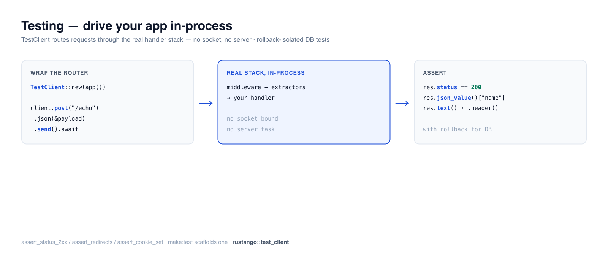

# Pruebas

Las pruebas rápidas y fiables necesitan controlar tu aplicación igual que lo hace
un cliente: sin arrancar un servidor ni tocar la red. El `TestClient` de
**Rustango** ejecuta tu router **en proceso**: llamas a `client.get("/path")`, la
petición se enruta a través de la pila real (extractores, middleware, manejadores)
y te devuelve la respuesta para hacer aserciones. Añade el aislamiento por
reversión de transacción para las pruebas de base de datos y un conjunto de
aserciones de respuesta, y tienes un entorno completo de pruebas de integración
sin salir del proceso.

[](../img/testing.png)

> **¿Hay algún término nuevo para ti aquí?** *router*, *handler*, *fixture*, *rollback* — consulta el
> [glosario](glossary.md).

> **Fuente:** `rustango::test_client` (`TestClient`, `TestResponse`) — necesita
> la feature `admin`, porque envuelve un `axum::Router`. `rustango::test_db`
> (`with_rollback`) no depende de ninguna feature. `rustango::test_assertions`
> siempre se compila, pero sus helpers de respuesta (`assert_status_2xx`,
> `assert_redirects`, `assert_cookie_set`, …) necesitan una feature HTTP como
> `admin` o `manage`.
>
> **Versión ejecutable:** los fragmentos de abajo *son* una prueba que pasa —
> [`testing_doc.rs`](https://github.com/ujeenet/rustango/blob/main/crates/rustango/tests/testing_doc.rs)
> (`cargo test -p rustango --test testing_doc`). Casi cualquier otro `*_doc.rs`
> de este repositorio usa `TestClient` de la misma manera.

## Tabla de contenidos

- [Paso 1 — Controla tu aplicación con TestClient](#paso-1--controla-tu-aplicación-con-testclient)
- [Paso 2 — Haz aserciones sobre la respuesta](#paso-2--haz-aserciones-sobre-la-respuesta)
- [Enviar JSON, cabeceras y cuerpos](#enviar-json-cabeceras-y-cuerpos)
- [Probar una API real](#probar-una-api-real)
- [Pruebas de base de datos con reversión](#pruebas-de-base-de-datos-con-reversión)
- [Suites en vivo, y por qué una ejecución en verde puede no probar nada](#suites-en-vivo-y-por-qué-una-ejecución-en-verde-puede-no-probar-nada)
- [Ayudantes de aserción de respuesta](#ayudantes-de-aserción-de-respuesta)
- [Véase también](#véase-también)

---

## Paso 1 — Controla tu aplicación con TestClient

Envuelve cualquier `axum::Router` en un `TestClient` y envía peticiones — no se
enlaza ningún socket, no se genera ninguna tarea de servidor. La petición fluye a
través de tu middleware y tus manejadores reales:

```rust
use rustango::test_client::TestClient;

let client = TestClient::new(app());          // app() returns your Router

let res = client.get("/ping").send().await;   // routed in-process
assert_eq!(res.status, 200);
```

`TestClient` tiene `get` / `post` / `put` / `patch` / `delete` / `head` /
`query`, más `request(method, path)`, cada uno devolviendo un constructor que
finalizas con `.send().await`.

El cliente se comporta como un navegador en `http://testserver`:

- **Un cookie jar.** `Set-Cookie` se guarda y se reenvía en peticiones
  posteriores a rutas que coinciden. Léelo con `cookie(name)` o `cookies()`,
  siémbralo con `set_cookie`, vacíalo con `clear_cookies`.
- **`Host: testserver`**, y un `Origin` del mismo origen en métodos no seguros,
  salvo que la petición fije los suyos.
- **Dirección del par `127.0.0.1`.** Cámbiala por petición con
  `.remote_addr(addr)`.
- **El CSRF se aplica.** Envía el token con `.with_csrf()` (la cabecera
  `X-CSRF-Token`) o un campo de formulario `_csrf`; `csrf_token()` lo lee.

---

## Paso 2 — Haz aserciones sobre la respuesta

`TestResponse` expone el estado y el cuerpo en la forma que necesites:

```rust
let res = client.get("/ping").send().await;

res.status;                 // u16 — e.g. 200
res.text();                 // body as a String
res.header("content-type"); // Option<&str>
```

```rust
// JSON, two ways:
let res = client.post("/echo").json(&json!({ "name": "Ada" })).send().await;
assert_eq!(res.json_value()["name"], "Ada");   // untyped

#[derive(serde::Deserialize)]
struct Out { name: String }
let out: Out = res.json();                       // typed
assert_eq!(out.name, "Ada");
```

---

## Enviar JSON, cabeceras y cuerpos

El constructor de peticiones encadena todo antes de `.send()`:

```rust
let res = client
    .post("/api/posts")
    .header("authorization", "Bearer <token>")   // auth, content negotiation, …
    .json(&json!({ "title": "Hello", "body": "..." }))
    .send()
    .await;
assert_eq!(res.status, 201);
```

Usa `.form(&[("k", "v")])` para un cuerpo de formulario, `.body(...)` para
bytes sin procesar, y una ruta inexistente devuelve un `404` real — verificado
en la prueba de respaldo.

`.send_following_redirects(max_hops)` sigue hasta ese número de redirecciones
como un navegador y devuelve la respuesta final con la cadena
`(status, location)`. `client.get_following_redirects(path, max_hops)` es el
atajo para `GET`.

### Iniciar sesión

- `client.login(path, &[("username", "ada"), ("password", "…")])` inicia sesión
  por el formulario: carga `path` para obtener un token CSRF si el jar no tiene
  uno y luego envía los campos. La cookie de sesión queda en el jar.
- `client.logout(Some(path))` envía un POST a la ruta de cierre de sesión;
  `logout(None)` solo vacía el jar.
- Con `tenancy`, `force_login_tenant_user(&secret, slug, &user, ttl_secs)` y
  `force_login_operator(&secret, &operator, ttl_secs)` ponen una cookie de
  sesión en el jar sin el formulario. La fila debe estar guardada.

---

## Probar una API real

`app()` en tus pruebas no es más que tu router. Para una API respaldada por base de
datos, constrúyela exactamente como lo hace `main.rs` pero con un pool de pruebas —
el patrón que usa la mayoría de las pruebas `*_doc.rs`:

```rust
async fn app() -> axum::Router {
    let pool = test_pool().await;                 // a sqlite::memory: or test DB pool
    PostViewSet::router("/api/posts", pool)
}

#[tokio::test]
async fn create_then_list() {
    let client = TestClient::new(app().await);
    let created = client.post("/api/posts")
        .json(&json!({ "title": "Hi", "body": "b" }))
        .send().await;
    assert_eq!(created.status, 201);

    let list = client.get("/api/posts").send().await;
    assert!(list.json_value()["results"].is_array());
}
```

Esta es la prueba de [ViewSets](viewsets.md) de aquella guía — el mismo `TestClient`.

---

## Pruebas de base de datos con reversión

Las pruebas que escriben en una base de datos no deben filtrar estado entre sí.
`test_db::with_rollback` ejecuta tu prueba dentro de una transacción y **la revierte**
al final, de modo que cada prueba parte del mismo estado limpio y nada persiste:

```rust
use rustango::test_db::with_rollback;

#[tokio::test]
async fn creating_a_post_persists_it() {
    with_rollback(&pool, |tx| Box::pin(async move {
        // ... insert + assert against `&mut *tx.lock().await?` ...
        // everything here is rolled back when the closure returns
        Ok(())
    })).await.unwrap();
}
```

El `Box::pin` es obligatorio, no una cuestión de estilo: el límite es
`for<'tx> FnOnce(&'tx AtomicTx) -> Pin<Box<dyn Future<…> + Send + 'tx>>`,
que es como el closure puede tomar prestado `tx` a través de sus propios puntos
de await. Un `atomic()` sobre el mismo pool dentro del closure es un savepoint y
también se revierte; suelta el guard antes de él o de un `bulk_insert_pool`, o
fallan con `NestedAtomic`. El closure devuelve `Result<T, ExecError>`, y
`with_rollback` también — la reversión ocurre en cualquier caso, así que el
`unwrap` es por tus aserciones, no por la limpieza.

Para SQLite, las pruebas `*_sqlite_live.rs` repartidas por este repositorio usan en
su lugar una base de datos en memoria por prueba — también totalmente aislada, con
cero configuración externa.

El código que debe confirmar de verdad (señales, hooks `on_commit`) no corre
bajo un rollback. Usa `with_truncate_after(&pool, &["posts"], || async move { … })`:
el cuerpo confirma y después se vacían las tablas indicadas, aunque el cuerpo
entre en pánico. Ejecuta esas pruebas de una en una tras un
`tokio::sync::Mutex` compartido. `truncate_tables(&pool, &[…])` es solo el
vaciado.

### Más helpers

| Módulo | Qué te da |
|---|---|
| `test_server::LiveServer` (`admin`) | Un socket real: `LiveServer::spawn(router)`, luego `url(path)` |
| `test_factory` | `Sequence` (un contador que construye valores) y el trait `Factory` con `build_batch(n)` |
| `test_data` | `setup_test_data!` / `setup_test_data_async!`: un fixture construido una vez por proceso |
| `test_settings` (`config`) | `with_overridden(settings, future)`: `Settings::load` devuelve `settings` dentro del future |
| `test_filter` | `tags!("slow")` al inicio de una prueba; `RUSTANGO_TEST_TAGS` / `RUSTANGO_TEST_EXCLUDE_TAGS` eligen qué corre |

---

## Suites en vivo, y por qué una ejecución en verde puede no probar nada

Las pruebas llamadas `*_live.rs` hablan con una base de datos real. La mayoría no
necesita nada de ti; el resto necesita una variable de entorno y, **cuando falta,
no fallan. Hacen un `return` y la ejecución informa de éxito.**

Es deliberado — mantiene `cargo test` funcionando en un portátil sin servidor —
pero significa que una ejecución que pasa no es prueba de que la suite se haya
ejecutado. Conviene saberlo antes de leer un resultado en verde como cobertura.

### Qué variable quiere cada suite

| Variable | Suites | Qué necesitan |
|---|---:|---|
| *(ninguna)* | 228 | Nada — una SQLite en memoria o en archivo temporal. Se ejecutan siempre. |
| `DATABASE_URL` | 181 | Un servidor PostgreSQL accesible. |
| `MYSQL_TEST_URL` | 113 | Un servidor MySQL 8+ accesible. **No** `DATABASE_URL`. |
| `REDIS_TEST_URL` | 2 | Un Redis accesible. |

Una suite que lee dos variables se cuenta en ambas, así que la columna no suma el
número de archivos.

Las suites `*_tri.rs` se cuentan bajo ambas variables de servidor. Ellas no leen
ninguna variable — lo hace `Backend::pool()` — y su brazo SQLite se ejecuta sin
nada configurado, así que contarlas como «no necesita nada» sería técnicamente
defendible y prácticamente falso: los dos brazos que necesitan un servidor son
la razón de ser de esas suites. Levanta ambos servidores, o una suite tri
informará un recuento sano habiendo ejercitado un backend de tres.

MySQL es la que pilla a la gente: lee su propia variable, así que un shell con
solo `DATABASE_URL` definida ejecuta las suites de Postgres y se salta en
silencio todas las de MySQL.

### Ejecútalas de una en una

Las suites en vivo comparten una base de datos y la mayoría borra o vacía las
tablas del framework en su preparación, así que ejecutarlas en paralelo las hace
pelearse por el catálogo. Usa el perfil `live`, que fija `test-threads = 1`:

```bash
cargo nextest run --profile live --workspace --all-features
```

Sin él los fallos son muchos y ninguno es real: 758 contra PostgreSQL, 95 contra
MySQL, 0 en ambos con el perfil. Los guards `tokio::sync::Mutex` dentro de esas
suites no ayudan, porque nextest ejecuta cada prueba en su propio proceso y un
mutex en uno no llega a otro.

Es un apaño, no una solución: unas bases de datos por proceso devolverían el
paralelismo.

### Distinguir un salto de un aprobado

La mayoría de los saltos son un `return` temprano y pelado, sin salida alguna.
Una minoría imprime antes una línea en stderr, que `cargo test` oculta salvo que
se la pidas:

```bash
cargo test --test <name> -- --nocapture
```

La señal fiable es el recuento. Una suite en vivo que informa de `0 passed` — o
de bastantes menos de las que contiene el archivo — se saltó.
`running 2 tests … 2 passed` sin ningún servidor en marcha significa que esas dos
pruebas retornaron pronto.

Si quieres que una suite falle en lugar de saltarse cuando falta su servidor,
define la variable con una URL deliberadamente incorrecta: entonces fallará al
conectar, que es una señal más ruidosa y más honesta que un salto.

---

## Ayudantes de aserción de respuesta

Para valores `axum::Response` sin procesar (por ejemplo, de `tower::oneshot`),
`test_assertions` ofrece comprobaciones legibles de una línea para estado, contenido,
redirecciones y cookies:

```rust
use rustango::test_assertions::{assert_status_2xx, assert_redirects, assert_cookie_set};

assert_status_2xx(&res);
assert_redirects(&res, "/login?next=/dashboard");
assert_cookie_set(&res, "rustango_session", None);
```

También disponibles: `assert_status` / `assert_status_in` / `assert_status_4xx` /
`assert_status_5xx`, `assert_header`, `assert_content_type`,
`assert_redirect_chain`, `assert_cookie_not_set`, y `assert_messages`.

---

## Véase también

- [ViewSets](viewsets.md) · [Vistas HTML](html-views.md) — a qué apuntas el
  `TestClient`.
- [Middleware](middleware.md) — `TestClient` también ejercita las capas (sin base
  de datos, mediante `tower::oneshot` en `middleware.rs`).
- [Primeros pasos](getting-started.md) — el Paso 16 escribe la primera prueba.
- [CLI `manage`](manage.md) — `make:test` genera un módulo de pruebas.
