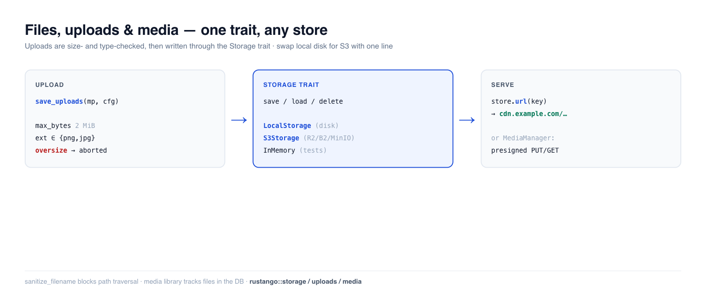

# Files, uploads & media

Almost every app stores user files — avatars, attachments, exported reports,
images. **Rustango** gives you a `Storage` trait with swappable backends (local
disk, S3-compatible object storage, in-memory for tests), a safe multipart
**upload** helper with size/type guards, and — when you need a tracked media
library — a database-backed `MediaManager` with presigned URLs. Write your code
once against the trait; switch from local disk to S3 with a one-line change.

[](img/files.png)

> **New to a term here?** *storage backend*, *multipart*, *object storage*,
> *presigned URL* — see the [glossary](glossary.md).

> **Source:** `rustango::storage` (`Storage`, `LocalStorage`, `InMemoryStorage`,
> `s3::S3Storage`, `azure::AzureBlobStorage`, `StorageRegistry`, `BoxedStorage`), `rustango::uploads` (`save_uploads`,
> `UploadConfig`, `sanitize_filename`), and `rustango::media`
> (`Media`, `MediaManager`) — behind the `storage` / `uploads` / `storage-s3` /
> `storage-azure` / `media` features (all on by default).
>
> **Runnable version:** the Storage + upload-guard snippets are copied from
> [`files_doc.rs`](https://github.com/ujeenet/rustango/blob/main/crates/rustango/tests/files_doc.rs)
> (`cargo test -p rustango --test files_doc`); the end-to-end multipart
> `save_uploads` flow is dogfooded by the in-file tests in
> `crates/rustango/src/uploads.rs`, and the media library by
> [`media_sqlite_live.rs`](https://github.com/ujeenet/rustango/blob/main/crates/rustango/tests/media_sqlite_live.rs).

## Table of contents

- [Step 1 — Pick a storage backend](#step-1--pick-a-storage-backend)
- [Step 2 — Save, load, and serve files](#step-2--save-load-and-serve-files)
- [Step 3 — Accept an upload](#step-3--accept-an-upload)
- [Upload an avatar, end to end](#upload-an-avatar-end-to-end)
- [Safe filenames](#safe-filenames)
- [Production: S3-compatible storage](#production-s3-compatible-storage)
- [Production: Azure Blob Storage](#production-azure-blob-storage)
- [Large files: stream them](#large-files-stream-them)
- [Several disks from config](#several-disks-from-config)
- [The media library](#the-media-library)
- [Reference](#reference)
- [See also](#see-also)

---

## Step 1 — Pick a storage backend

Every backend implements the same `Storage` trait, so your code never names the
concrete type — it holds a **`BoxedStorage`** (`Arc<dyn Storage>`):

```rust
use rustango::storage::{BoxedStorage, LocalStorage};
use std::path::PathBuf;
use std::sync::Arc;

let storage: BoxedStorage = Arc::new(LocalStorage::new(PathBuf::from("./uploads")));
```

| Backend | Feature | Use for |
|---|---|---|
| `LocalStorage` | `storage` | single-server deployments — files on local disk |
| `S3Storage` | `storage-s3` | production — S3 / R2 / B2 / MinIO object storage |
| `AzureBlobStorage` | `storage-azure` | production — Azure Blob Storage (Azurite in dev) |
| `InMemoryStorage` | `storage` | tests — a `HashMap`, never touches disk |

---

## Step 2 — Save, load, and serve files

The trait is four async methods, keyed by a string path. `save` writes bytes,
`load` reads them back, plus `exists` / `delete`:

```rust
use rustango::storage::{Storage, InMemoryStorage};

let store = InMemoryStorage::new();
store.save("avatars/7.png", &png_bytes).await?;
assert!(store.exists("avatars/7.png").await?);
let bytes = store.load("avatars/7.png").await?;
store.delete("avatars/7.png").await?;
```

**Serving the file.** Attach a base URL (your CDN or static host) and `url(key)`
builds the public address you store on the model and hand to the browser:

```rust
let store = LocalStorage::new("./uploads".into())
    .with_base_url("https://cdn.example.com/uploads");

store.url("docs/report.pdf");   // Some("https://cdn.example.com/uploads/docs/report.pdf")
```

Without a base URL, `url()` returns `None`. Then either serve the folder with
`Cli::with_uploads` ([avatar example](#upload-an-avatar-end-to-end)) or stream
the bytes through your own handler ([Large files](#large-files-stream-them)).
`LocalStorage` also guards against path traversal in keys.

---

## Step 3 — Accept an upload

`save_uploads` consumes an axum `Multipart` body, validates each file against an
`UploadConfig`, and writes the survivors to your `Storage` — streaming, so an
oversize file is rejected mid-transfer instead of buffering into memory first.

```rust
use axum::extract::{Multipart, State};
use axum::http::StatusCode;
use axum::Json;
use rustango::storage::BoxedStorage;
use rustango::uploads::{save_uploads, UploadConfig};

async fn upload(
    State(storage): State<BoxedStorage>,             // router state, see below
    mp: Multipart,                                   // must be the last argument
) -> Result<Json<Vec<String>>, (StatusCode, String)> {
    let cfg = UploadConfig::new("avatars/")          // key prefix
        .max_bytes(2 * 1024 * 1024)                  // reject files over 2 MiB
        .allowed_extensions(&["png", "jpg", "jpeg", "webp"])
        .randomize_filename(true);                   // avoid collisions

    // UploadError is not a response: map it yourself.
    let saved = save_uploads(mp, &cfg, &storage)     // Vec<SavedUpload>
        .await
        .map_err(|e| (StatusCode::BAD_REQUEST, e.to_string()))?;
    Ok(Json(saved.into_iter().map(|s| s.key).collect()))
}
```

The storage reaches the handler as router state:
`Router::new().route("/upload", post(upload)).with_state(storage)`. The
[avatar example](#upload-an-avatar-end-to-end) below shows the whole wiring.

The guards are enforced (and verified): `allowed_extensions` is **case-insensitive**
(`"PNG"` and `"png"` are the same), and `max_bytes` aborts the stream as soon as
the size is exceeded. The in-file `uploads` tests drive real multipart bodies and
assert files land in storage, oversize files are rejected, and disallowed
extensions are refused.

Defaults: `max_bytes` 10 MiB, `max_files` 20, `randomize_filename` on (a UUID
prefix on the key). With no `allowed_extensions`, any extension is accepted
except the ones a browser runs as script (`html`, `svg`, `xml`, `js`, … —
`uploads::ACTIVE_EXTENSIONS`). The first error stops the loop and deletes the
files already saved, so a refused request leaves nothing behind. Each
`SavedUpload` carries `key`, `original_filename`, `content_type` (as the client
claimed it — do not trust it) and `size_bytes`.

```rust
let cfg = UploadConfig::new("avatars/").allowed_extensions(&["PNG", "Jpg"]);
assert!(cfg.allowed_extensions.contains("png"));   // normalized to lowercase
assert!(cfg.allowed_extensions.contains("jpg"));
```

---

## Upload an avatar, end to end

This puts the pieces together in the app from
[Getting started](getting-started.md): a profile with an avatar, a route that
accepts the image, and a URL the browser can load. Files go to `./var/uploads`
on local disk.

### 1. Store the key on a model

Store the storage key, not the file and not the URL. Add a model below `Post`
in `src/blog/models.rs`. The `use rustango::{Auto, Model};` line from Step 8
already covers it:

```rust
#[derive(Model, Clone, Debug)]
#[rustango(table = "profiles")]
pub struct Profile {
    #[rustango(primary_key)]
    pub id: Auto<i64>,

    pub user_id: i64,

    // Storage key, e.g. "avatars/3f2c…-me.png". None until the first upload.
    pub avatar_key: Option<String>,
}
```

Then create the table, as in Step 9:

```bash
cargo run -- makemigrations
cargo run -- migrate
```

The URL is built from the key when you need it. Move the files to S3 later and
no row changes.

`avatar_key` has no `max_length`, so it is a `TEXT` column. The key keeps the
client's file name, and `save_uploads` does not shorten it, so a fixed
`VARCHAR` length could be too short.

### 2. Accept the upload and save the key

The handler needs two things: the database pool and the storage. Put both in
one state struct. Add this to `src/blog/views.rs`. Skip any `use` line the file
already has: the same `use` twice does not compile.

```rust
use axum::extract::{Multipart, Path, State};
use axum::http::StatusCode;
use axum::Json;
use rustango::sql::Pool;
use rustango::storage::BoxedStorage;
use rustango::uploads::{save_uploads, UploadConfig};

use crate::blog::models::Profile;

/// What the avatar routes need: the database and the file storage.
#[derive(Clone)]
pub struct AvatarState {
    pub pool: Pool,
    pub storage: BoxedStorage,
}

type HttpError = (StatusCode, String);

fn server_error(e: impl std::fmt::Display) -> HttpError {
    (StatusCode::INTERNAL_SERVER_ERROR, e.to_string())
}

/// POST /profiles/{id}/avatar with a multipart form that holds one image.
pub async fn upload_avatar(
    State(state): State<AvatarState>,
    Path(id): Path<i64>,
    mp: Multipart,
) -> Result<Json<serde_json::Value>, HttpError> {
    let mut profile = Profile::objects()
        .find(id, &state.pool)
        .await
        .map_err(server_error)?
        .ok_or((StatusCode::NOT_FOUND, "no such profile".to_owned()))?;

    let cfg = UploadConfig::new("avatars/")
        .max_bytes(2 * 1024 * 1024) // 2 MiB
        .max_files(1)
        .allowed_extensions(&["png", "jpg", "jpeg", "webp"]);
    let saved = save_uploads(mp, &cfg, &state.storage)
        .await
        .map_err(|e| (StatusCode::BAD_REQUEST, e.to_string()))?;
    let Some(file) = saved.into_iter().next() else {
        return Err((StatusCode::BAD_REQUEST, "send one file".to_owned()));
    };

    // Save the key on the row. If that fails, remove the new file.
    let old_key = profile.avatar_key.replace(file.key.clone());
    if let Err(e) = profile.save(&state.pool).await {
        let _ = state.storage.delete(&file.key).await;
        return Err(server_error(e));
    }
    // Nothing points at the old file any more.
    if let Some(old) = old_key {
        let _ = state.storage.delete(&old).await;
    }

    Ok(Json(serde_json::json!({
        "key": file.key,
        "url": state.storage.url(&file.key), // "/uploads/avatars/…-me.png"
    })))
}
```

`find` returns `Ok(None)` when no row has that id, so the handler answers
`404`. `save` writes the row back on PostgreSQL, MySQL and SQLite alike.

`Multipart` comes from axum's `multipart` feature. Rustango's `uploads` feature
turns it on, so this builds as is. Add `"multipart"` to the `axum` features in
your `Cargo.toml` too, so your code names what it uses.

### 3. Create the storage and mount the route

Build the storage once, next to the router that uses it. Add this to
`src/blog/urls.rs`, which already has `use axum::Router;`:

```rust
use std::path::PathBuf;
use std::sync::Arc;

use axum::routing::post;
use rustango::sql::Pool;
use rustango::storage::{BoxedStorage, LocalStorage};

use crate::blog::views::{upload_avatar, AvatarState};

/// The folder that holds uploads, and the URL prefix that serves it.
pub const UPLOAD_DIR: &str = "./var/uploads";
pub const UPLOAD_URL: &str = "/uploads";

pub fn avatar_routes(pool: Pool) -> Router {
    let storage: BoxedStorage = Arc::new(
        LocalStorage::new(PathBuf::from(UPLOAD_DIR)).with_base_url(UPLOAD_URL),
    );
    Router::new()
        .route("/{id}/avatar", post(upload_avatar))
        .with_state(AvatarState { pool, storage })
}
```

Then add two lines to the `Cli` chain in `src/main.rs`:

```rust
rustango::manage::Cli::new()
    .api(urls::api())
    // … the lines you already have …
    .nest_with("/profiles", myblog::blog::urls::avatar_routes)
    .with_uploads(myblog::blog::urls::UPLOAD_URL, myblog::blog::urls::UPLOAD_DIR)
    .with_loaded_settings(loaded)
    .run()
    .await
```

`nest_with` builds the router from the pool the server opens, as in Step 12b.
It needs its own prefix: a second `nest_with("/api", …)` would clash with the
ViewSet. `with_uploads` serves the files in `./var/uploads` at `/uploads/…`.
It sends HTML, SVG and XML as downloads, so an uploaded page cannot run script
on your site. `LocalStorage` creates the folders on the first save. The
scaffolded `.gitignore` already leaves `var/` out of git.

### 4. Try it

Create a profile row first, in the admin (Step 11) or with `save` as in
Step 10. Then:

```bash
curl -F "avatar=@me.png" http://localhost:8080/profiles/1/avatar
# {"key":"avatars/3f2c…-me.png","url":"/uploads/avatars/3f2c…-me.png"}

curl -O http://localhost:8080/uploads/avatars/3f2c…-me.png
```

Put the `url` in an ``. A `.gif` gets `400` with the message
``file extension `gif` not allowed``.

> **This route has no login check.** Anyone can replace any avatar. Before
> you ship it, put it behind your authentication and check that the signed-in
> user owns the profile. See [Auth decorators](auth-decorators.md).

**Private files.** `with_uploads` serves every file to anyone who has the
URL. For files only some users may see, skip `with_uploads` and the base URL,
and stream the file through a handler that checks access first: the `download`
handler in [Large files](#large-files-stream-them) is that handler.

**More than one server.** Local disk works for one server. With several, use
`S3Storage` or `AzureBlobStorage` and give it a public URL; `url()` then points
at the bucket and you drop `with_uploads`. The handler does not change.

### The request body limit

axum caps a request body at 2 MiB by default, and `Multipart` reads under that
cap. The cap counts the whole form, not one file. So without a change, the
10 MiB `max_bytes` default can never be reached, and a file close to 2 MiB
fails as a multipart parse error.

Raise the cap with `max_body_bytes` in `config/default.toml`:

```toml
[server]
max_body_bytes = 5242880   # 5 MiB: room for a 2 MiB file and the form
```

or with the environment variable `RUSTANGO__SERVER__MAX_BODY_BYTES=5242880`.
The `Cli` turns it into a `BodyLimitLayer` (`rustango::body_limit`) on the API
and on every router added with `nest_with`, and it replaces axum's 2 MiB cap.
A request whose `Content-Length` is larger gets `413 Payload Too Large`
before your handler runs. Set it a little above your largest `max_bytes`.

To let one route take more than the rest, give it its own cap, and its own
timeout (`0` means none, so a slow upload is not cut at
`request_timeout_secs`). The key is the route pattern as you registered it,
nest prefix included:

```toml
[server]
max_body_bytes = 2097152
request_timeout_secs = 30

[server.routes."/api/uploads"]
max_body_bytes = 1073741824   # 1 GiB on this route only
request_timeout_secs = 0
```

In code it is `BodyLimitLayer::new(n).route("/api/uploads", 1 << 30)` and
`RequestTimeoutLayer::new(t).exempt("/api/uploads")` (or `.route(pattern, t)`).
With route entries and no `max_body_bytes`, other routes keep axum's 2 MiB.
The timeout ends when the handler returns its response, so a streamed
download, an SSE stream or a WebSocket after its upgrade is never cut.

The `Cli` reads this setting only when it has your settings. The scaffolded
`main.rs` passes them with `.with_loaded_settings(loaded)`. Without that call
(or `.with_settings_from_env()`) the value is ignored, and the server logs a
warning that names it.

---

## Safe filenames

Never trust a client-supplied filename. `sanitize_filename` reduces it to a safe
basename — stripping directory components (path traversal) and replacing unsafe
characters:

```rust
use rustango::uploads::sanitize_filename;

sanitize_filename("../../etc/passwd");   // "passwd"   — no traversal
sanitize_filename("my photo!.png");      // "my_photo_.png"
sanitize_filename("");                    // "upload"   — never empty
```

`save_uploads` applies this for you; call it directly only if you build keys by
hand.

---

## Production: S3-compatible storage

For multi-server deployments, swap `LocalStorage` for `S3Storage` (behind the
`storage-s3` feature). It speaks the S3 API with a hand-rolled SigV4 signer, so
it works with **AWS S3, Cloudflare R2, Backblaze B2, and MinIO**. The trait is
identical — only the constructor changes:

```rust
use rustango::storage::s3::S3Storage;   // needs the `storage-s3` feature

use rustango::storage::s3::{S3Config, S3Credentials};

let cfg = S3Config::new("my-bucket", "us-east-1")
    .with_endpoint("https://<account>.r2.cloudflarestorage.com"); // R2 / B2 / MinIO; omit for AWS
let creds = S3Credentials::new(access_key_id, secret_access_key);
let storage: BoxedStorage = Arc::new(S3Storage::new(cfg, creds));
// save / load / delete / url — exactly the same calls as LocalStorage
```

Your handlers and models don't change; only the wiring at startup does.

---

## Production: Azure Blob Storage

`AzureBlobStorage` (behind `storage-azure`) signs server calls with the
account's Shared Key and hands out service SAS URLs for presigned GET and PUT:

```rust
use rustango::storage::azure::{AzureBlobStorage, AzureConfig};

let key = std::env::var("AZURE_STORAGE_KEY")?; // base64, from the portal
let cfg = AzureConfig::new("myaccount", key, "uploads");
// Azurite: cfg.endpoint("http://127.0.0.1:10000/devstoreaccount1")
let storage: BoxedStorage = Arc::new(AzureBlobStorage::new(cfg)?);
```

Differences from S3 a direct upload has to respect:

- The browser must send every header in `storage.presigned_put_headers(&put)`,
  which adds `x-ms-blob-type: BlockBlob`. The account's CORS rule must allow it
  along with `Content-Type` and `If-None-Match`.
- A SAS cannot sign headers, so size and type are not enforced by the URL.
  Confirm the upload with `metadata`. `MediaManager::begin_upload` refuses an
  Azure disk; upload through the server with `save_bytes`. A create-only PUT is
  granted `c` without `w`, so the URL still cannot replace a blob.
- A single PUT holds up to 5000 MiB; `save_stream` stages blocks above that.

---

## Large files: stream them

`save` and `load` take and return whole buffers. For a large object, or to keep
the bucket private and pass uploads through your server, use `save_stream` and
`load_stream`: chunks go through as they arrive, so memory stays flat. A
`ByteStream` comes from an axum `Body`, a `reqwest::Response`, `Bytes` or a
`Vec<u8>`.

```rust
use axum::{body::Body, extract::{Path, State}, http::{header, HeaderMap, StatusCode}};
use rustango::storage::{BoxedStorage, ByteStream, PutConditions, StorageError};

// PUT /files: proxy the request body into storage.
async fn upload(State(storage): State<BoxedStorage>, headers: HeaderMap, body: Body)
    -> Result<String, StatusCode>
{
    let len = headers
        .get(header::CONTENT_LENGTH)
        .and_then(|v| v.to_str().ok()?.parse::<u64>().ok())
        .ok_or(StatusCode::LENGTH_REQUIRED)?;
    let key = format!("uploads/{}", uuid::Uuid::new_v4());
    let put = PutConditions::new().create_only();
    storage
        .save_stream(&key, len, ByteStream::from(body), &put)
        .await
        .map_err(|_| StatusCode::BAD_REQUEST)?;
    Ok(key)
}

// GET /files/{*key}: stream it back.
async fn download(State(storage): State<BoxedStorage>, Path(key): Path<String>)
    -> Result<Body, StatusCode>
{
    let stream = storage.load_stream(&key).await.map_err(|e| match e {
        StorageError::NotFound(_) => StatusCode::NOT_FOUND,
        _ => StatusCode::BAD_GATEWAY,
    })?;
    Ok(Body::from_stream(stream))
}
```

`save_stream` writes exactly `len` bytes. A body of another size, or a
`put.content_length` other than `len`, is refused, and `create_only` refuses an
existing key. A body that fails or is dropped leaves nothing behind. A
body-limit layer on the route must allow the size you accept.

| Backend | How it streams |
|---------|----------------|
| `LocalStorage` | temp file in the target directory, fsync, then rename; `create_only` links, so it never replaces a file |
| `S3Storage` | one PUT up to 5 GiB; above, a multipart upload of up to 10,000 parts (5 TiB), one part in flight. Over https the body is sent as `UNSIGNED-PAYLOAD`; over plain http (local MinIO, SeaweedFS) every 64 KiB chunk is signed. `create_only` sends `If-None-Match: *` (on Complete for multipart), which AWS, MinIO and SeaweedFS honour |
| `AzureBlobStorage` | one Put Blob up to 5000 MiB; above, Put Block for each part then one Put Block List. `create_only` sends `If-None-Match: *` (on the list) |
| `InMemoryStorage` | collects the body in memory; `create_only` is checked under its lock |
| others | the trait default: collects the body in memory, then `save`; it refuses `create_only` |

A failed or dropped multipart upload is aborted, and Azure never shows
uncommitted blocks, so no partial object is ever visible. A server that keeps
parts after a crash should still have a lifecycle rule that removes incomplete
multipart uploads. `LocalStorage` `create_only` needs hard links; on FAT, SMB or
some FUSE mounts it fails with an error that says so.

---

## Several disks from config

One app can mix backends — two S3 buckets, an Azure container, a local cache —
as named disks. Declare them in `[storage]` and build a `StorageRegistry`:

```toml
[storage]
default = "uploads"

[storage.disks.uploads]
driver          = "azure"
account         = "myaccount"
container       = "uploads"
public_endpoint = "https://files.example.com"   # optional: links browsers follow

[storage.disks.archive]
driver = "s3"
bucket = "archive"
region = "eu-west-1"
cdn    = "https://cdn.example.com/archive"

[storage.disks.cache]
driver = "local"
root   = "./var/cache"
```

```rust
let registry = StorageRegistry::from_settings(&settings.storage)?;
let uploads = registry.default_disk().expect("default disk");
```

Keys stay out of the file: `RUSTANGO__STORAGE__DISKS__UPLOADS__ACCOUNT_KEY`,
`RUSTANGO__STORAGE__DISKS__ARCHIVE__SECRET_ACCESS_KEY`. Disk names are lowercase
`[a-z0-9_]` so these overrides can reach them. A driver whose feature is
not compiled in is an error naming the disk, not a silently missing disk.
`public_endpoint` makes presigned URLs and `url()` point at the address browsers
reach, while reads and writes keep using `endpoint`.

---

## The media library

When files are first-class records — tracked in the database, browsable in the
admin, with CDN/presigned delivery — reach for `rustango::media`
instead of raw `Storage`. `MediaManager` persists a `Media` row per file and
supports two upload flows:

- **Server-side:** `manager.save_bytes(...)` stores the bytes and the row in one
  call.
- **Direct-to-storage:** `manager.begin_upload(...)` returns a **presigned PUT**
  URL the browser uploads to directly (your server never proxies the bytes),
  then you confirm the row. The PUT must send every header in
  `ticket.headers` (`Content-Type`, `If-None-Match: *`, and `x-ms-blob-type` on
  Azure), so the bucket's CORS rule must allow them. The URL can create the object once and never replace it.
  Grant `s3:ListBucket` too: without it S3 answers a missing object with 403,
  and finalize returns 502 instead of marking the row `Failed`.

```rust
use rustango::media::{Media, MediaManager};

let manager = MediaManager::new(pool.clone(), registry);
// Hand the browser a short-lived download link:
// Returns Option<String> — None on backends that cannot sign (e.g. local disk).
let Some(url) = manager.presigned_get(&media, Duration::from_secs(3600)).await else {
    return Err(/* no signed URL for this backend */);
};
```

It also handles soft-delete and orphan purging. The full flow is dogfooded in
`media_sqlite_live.rs`; the manager's presigned and direct-upload methods
run on all three backends.

### Serving media on a public page

A public page does **not** go through `media::router`. That router is the
internal management API — uploads, deletes, tagging, browsing — and it
answers `401` to anyone not signed in, on every route, by design.

Render the URL from your own handler instead:

```rust
// your own public route
let url = manager.public_url(media_id).await?;   // Option<String>, no signature
```

`public_url` is a database lookup plus a string; it mints nothing and awaits
no signer, which is why it suits a page. Two delivery models, and choosing
between them is the actual decision:

| | public bucket / CDN | private bucket + presigned |
|---|---|---|
| address | `manager.public_url(id)` — stable | `manager.presigned_get(&m, ttl)` — expires |
| cacheable | yes, by browsers and CDNs | no; the router sends `no-store` |
| who may fetch | anyone with the URL | anyone with the URL, until it expires |
| use for | public pages, `` | the management router, internal tools |

`public_url` tells you where the object *would* be served from; it does not
make the object readable. Point it at a private bucket and you get a correct
URL and a 403 — that case wants a presigned URL, which is deliberately not
cacheable and not shareable.

For files on local disk rather than a bucket, the static handler already does
this and needs no media row at all:

```rust
Cli::new().with_uploads("/uploads", "./var/uploads")
```

**If you were about to write an `AllowAll` authorizer to make a public page
work, stop.** That opens all 16 routes — including `DELETE` and the presigned
`PUT` — to everyone, which is the hole 0.57.7 closed.

### The management router needs an authorization policy

`media::router` mounts 16 JSON routes over the manager, all of them operator
actions on the library. **Every one is gated, and there is no permissive
default.** Build it with `media_router_with` and supply a policy:

```rust
use rustango::media::router::{media_router_with, MediaPerms};

let app = axum::Router::new()
    .nest("/media", media_router_with(manager, MediaPerms::new(pool)));
```

`media_router(manager)` — the old constructor — is deprecated (removed in 0.65.0) and now
answers `403` on every route. That is a deliberate behaviour change in
0.57.7: before it, those routes took no authentication, authorization or
tenant extractor at all, so `GET /media/{id}` returned the row **and a
presigned S3 download URL** to anyone who could guess an integer, and
`POST /uploads/begin` minted a presigned `PUT` for a caller-chosen key
prefix.

`MediaPerms` (needs the `tenancy` feature) checks the `{table}.{action}`
permission codenames the admin already uses — `rustango_media.view` to read,
`rustango_media_collections.add` to create a folder, and so on. Mount it
**inside** `require_auth`, which is what injects the identity it reads;
without that every request is a `401`. Superusers skip the codename check —
but **not** `allow_disks`, which binds them too: `is_superuser` elevates
inside one tenant, and the object store is shared across all of them.
Only a superuser may set another user's `uploaded_by_id`, and filing into a
collection (upload, move or a nested collection) also needs
`rustango_media_collections.view`.

Three things it does not do:

- **Row-level decisions.** A grant of `rustango_media.view` reads *any* media
  row by id. `MediaManager` holds one pool, so a multi-tenant deployment
  scopes rows itself — implement `MediaAuthorizer` for that. `MediaTarget`
  names the row (`Media(id)`, `Collection(id)`, `CollectionSubtree(id)`, …)
  precisely so a per-row policy can be written. `?recursive` on a collection's
  contents arrives as `CollectionContents { id, recursive: true }` — same
  target, flagged — so a policy can be stricter about the wide read without
  losing the collection it names.
- **Scope the object store.** `disk` is caller-supplied on
  `POST /uploads/begin` and the `StorageRegistry` is process-wide, so
  pool-per-tenant isolates the database and not the bucket: a bare
  `rustango_media.add` grant writes into any disk the process knows about.
  Say which ones with `MediaPerms::new(pool).allow_disks(["user-uploads"])`.
  Prefixes within a disk still need `MediaAuthorizer`, which is handed
  `key_prefix`.
- **Guess what a new route means.** Both `MediaAction` and `MediaTarget` are
  `#[non_exhaustive]`, so end a hand-written policy on `_ => false` and a
  route added in a later release arrives denied rather than allowed.

Worth knowing when you write your own: `DELETE /collections/{id}` deletes the
whole **subtree** and re-parents the media under every level of it, so it
arrives as `Delete(CollectionSubtree(id))` rather than
`Delete(Collection(id))` — and under `MediaPerms` it needs
`rustango_media.change` as well as `rustango_media_collections.delete`,
because it writes to the media table.
[UPGRADING.md](https://github.com/ujeenet/rustango/blob/main/UPGRADING.md) has
the migration notes.

### How the media tables are created

The media tables (`rustango_media`, `rustango_media_collections`,
`rustango_media_tags`, `rustango_media_tag_links`) are managed models. Their
schema ships as a **system migration** and is created — per tenant, when the
`media` feature is enabled — the same way as the rest of the framework's own
tables, whenever you run `migrate` / provision a tenant. There is no lazy
"create on first use" step; if the feature is off, the tables are never created.

> **Upgrading from before 0.51.** Earlier versions created the media tables
> lazily via an `ensure_table` DDL call rather than a migration. On the first
> `migrate` (or tenant provision) after upgrading, the framework **auto-reconciles**:
> because the tables already exist, the generated media migration is recorded in
> the system-migration ledger *without* re-running its `CREATE TABLE`, and your
> existing rows are left untouched. **No manual step is required** — the upgrade
> that would otherwise fail with `relation already exists` / `table already exists`
> now just works.
>
> **Upgrade to 0.51.2 or later, not 0.51.1.** 0.51.0 moved the media tables onto
> system migrations and 0.51.1 claimed this reconcile — cross-version testing
> against real 0.46–0.50 databases showed neither worked, and **both are yanked**.
> The reconcile guard demanded a migration be purely `CreateTable`, while a
> generated initial migration is tables *and* indexes, so it bailed on every real
> one. 0.51.2 is the release where this actually fires.

---

## Static assets: hashed names, SRI and one-file images

Your own CSS, JS and WASM are not uploads; serve them with
`static_files::StaticFiles`. Apps without `admin` turn on just the
`static-files` feature (and `security-headers`, `test-client` as needed).

`AssetManifest` gives each file a content-hashed name and a Subresource
Integrity hash. Mount it with the files so the hashed names are served
`immutable` for a year, and link to them from templates:

```rust
use rustango::static_files::{static_router, AssetManifest, StaticFiles};

let manifest = AssetManifest::from_dir("static")?.prefix("/static");
let app = Router::new()
    .nest("/static", static_router(StaticFiles::new("static").manifest(manifest.clone())));
manifest.register_tera(&mut tera); // asset_url(name=...) and asset_integrity(name=...)
```

```html
<script src="{{ asset_url(name='js/app.js') }}"
        integrity="{{ asset_integrity(name='js/app.js') }}" crossorigin="anonymous"></script>
```

The manifest is built from the files as they are at boot, so it never goes
stale; `to_json()` writes it for a bundler. To ship one binary with no
`static/` folder, compile the directory in:

```rust
use rustango::static_files::{AssetManifest, EmbeddedDir, StaticFiles};

static ASSETS: EmbeddedDir = rustango::embed_static!("static");
let manifest = AssetManifest::from_embedded(&ASSETS).prefix("/static");
let files = StaticFiles::embedded(ASSETS).manifest(manifest);
```

`embed_static!` leaves out names starting with `.`. Edits rebuild the crate; a
new file needs `println!("cargo:rerun-if-changed=static");` in `build.rs`.

---

## Reference

**`Storage` trait:** `save(key, &bytes)` · `load(key)` · `delete(key)` ·
`exists(key)` · `url(key) -> Option<String>`, plus defaulted `save_with_content_type`,
`presigned_get_url(key, ttl)`, `presigned_put_url(key, ttl, &put)`, `presigned_put_headers(&put)`, `metadata(key)`,
`save_stream(key, len, body, &put)` and `load_stream(key)`
(a signing backend overrides the presign pair; the defaults return `None`).

**`UploadConfig`:** `new(prefix)` · `.max_bytes(n)` · `.max_files(n)` · `.allowed_extensions(&[..])`
(case-insensitive) · `.randomize_filename(bool)`. Used by
`save_uploads(multipart, &cfg, &storage)`.

**Backends:** `LocalStorage` (disk) · `S3Storage` (object storage, `storage-s3`) · `AzureBlobStorage` (`storage-azure`)
· `InMemoryStorage` (tests). All return a `BoxedStorage`.

---

## See also

- [The admin](admin.md) — media and FK widgets surface uploaded files in the UI.
- [Background jobs](jobs.md) — resize/transcode an upload off the request.
- [Caching](caching.md) — the same swap-the-backend trait pattern.
- [Security guide](security.md) — validating untrusted upload input.
- [Common tasks](common-tasks.md) — short answers that point at full examples.
