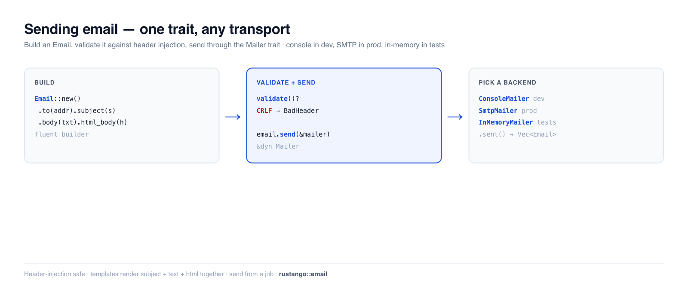

# Envoyer des e-mails

Messages de bienvenue, réinitialisations de mot de passe, reçus, alertes — la plupart des
applications envoient des e-mails transactionnels. **Rustango** vous offre un trait `Mailer` avec
des backends interchangeables (console pour le développement, SMTP pour la production, un
enregistreur en mémoire pour les tests), un builder `Email` fluide avec protection contre
l'injection d'en-têtes, et le rendu de templates. Écrivez `mailer.send(&email)` une seule fois ;
passez de l'impression dans votre terminal à un vrai SMTP avec un changement d'une ligne — sans
toucher au code appelant.

[](../img/email.png)

> **Un terme vous est inconnu ?** *e-mail transactionnel*, *SMTP*, *backend de messagerie* — voir
> le [glossaire](glossary.md).

> **Source :** `rustango::email` (`Mailer`, `Email`, `ConsoleMailer`,
> `InMemoryMailer`, `NullMailer`, `SmtpMailer`, `BoxedMailer`, `send_mail`,
> `MailError`) — derrière la fonctionnalité `email` (activée par défaut). SMTP nécessite la
> fonctionnalité `email-smtp`. Templates : `rustango::email_templates::EmailRenderer`.
> Envoi en file : `rustango::email_jobs`.
>
> **Version exécutable :** les snippets de construction, d'envoi, de validation et de test sont copiés depuis
> [`email_doc.rs`](https://github.com/ujeenet/rustango/blob/main/crates/rustango/tests/email_doc.rs)
> (`cargo test -p rustango --test email_doc`) ; les helpers d'envoi et les pièces jointes
> sont mis à l'épreuve par `email_send_helpers.rs` et `email_attachments.rs`.

## Table des matières

- [Étape 1 — Construire un e-mail](#étape-1--construire-un-e-mail)
- [Étape 2 — Choisir un mailer](#étape-2--choisir-un-mailer)
- [Étape 3 — L'envoyer](#étape-3--lenvoyer)
- [Envoyer depuis un handler](#envoyer-depuis-un-handler) — l'exemple complet
- [Validation et protection contre l'injection d'en-têtes](#validation-et-protection-contre-linjection-den-têtes)
- [Tester les e-mails](#tester-les-e-mails)
- [Templates](#templates)
- [L'envoyer en dehors de la requête](#lenvoyer-en-dehors-de-la-requête)
- [Référence](#référence)
- [Voir aussi](#voir-aussi)

---

## Étape 1 — Construire un e-mail

`Email` est un builder fluide. Définissez les destinataires, l'objet, et un corps texte et/ou
HTML :

```rust
use rustango::email::Email;

let email = Email::new()
    .to("ada@example.com")
    .from("noreply@example.com")
    .subject("Welcome")
    .body("Thanks for signing up.")              // plain-text part
    .html_body("<p>Thanks for signing up.</p>"); // optional HTML part
```

`.cc(...)`, `.bcc(...)`, `.reply_to(...)`, `.header(name, value)`, `.attach(...)` / `.attach_text(filename, text)`, et les pièces jointes sont également disponibles.

---

## Étape 2 — Choisir un mailer

Chaque backend implémente `Mailer`, si bien que votre code ne nomme jamais le type concret —
tenez un **`BoxedMailer`** (`Arc<dyn Mailer>`) :

| Backend | Fonctionnalité | À utiliser pour |
|---|---|---|
| `ConsoleMailer` | `email` | dev — imprime le message sur stdout |
| `SmtpMailer` | `email-smtp` | production — livraison réelle par SMTP |
| `InMemoryMailer` | `email` | tests — enregistre les messages, n'envoie rien |
| `FileMailer` | `email` | dev/CI — écrit chaque message dans un fichier |
| `NullMailer` | `email` | désactive complètement l'e-mail |

Construisez-le à partir de la configuration afin qu'il diffère selon l'environnement (`ConsoleMailer`
en local, `SmtpMailer` en prod) via `email::from_settings(&settings.mail)?`. Avec
`backend = "smtp"`, il échoue si le mailer ne peut pas être construit (pas de `smtp_host`,
`from_address` invalide, `smtp_tls` autre que `none` / `starttls` / `implicit`, ou un build
sans `email-smtp`). `backend` accepte `console` (par défaut hors prod ; non défini en prod, c'est une
`MailError::Config`), `memory`,
`null` / `none`, `file` (exige `file_email_dir`) et `smtp` ; toute autre valeur donne
`MailError::Config`.

### Les réglages `[mail]`

`from_settings` lit la section `[mail]` de vos fichiers `config/*.toml`. Voici
toutes les clés. En développement, vous n'en avez besoin d'aucune, car la console
est la valeur par défaut. Pour SMTP, il faut au moins `backend` et `smtp_host` :

```toml
# config/prod_settings.toml (or config/default.toml for every tier)
[mail]
backend           = "smtp"               # console | memory | file | null | smtp
smtp_host         = "smtp.example.com"
smtp_port         = 587                  # default: 25 / 587 / 465, from smtp_tls
smtp_tls          = "starttls"           # none | starttls | implicit
smtp_username     = "apikey"
# smtp_password: NOT here. Set RUSTANGO__MAIL__SMTP_PASSWORD (see below).
smtp_timeout_secs = 10                   # unset = no timeout
from_address      = "My App <noreply@example.com>"  # From: when the email sets none

# Optional
server_email         = "ops@example.com"  # From: for mail_admins / mail_managers
email_subject_prefix = "[My App] "        # before mail_admins / mail_managers subjects
admins               = ["ops@example.com"]
managers             = ["team@example.com"]
# file_email_dir     = "var/mail"         # needed with backend = "file"
```

`smtp_username` et `smtp_password` ne marchent qu'ensemble. Sans aucun des deux,
le mailer se connecte sans s'authentifier.

Le backend SMTP a besoin de la fonctionnalité `email-smtp`, que le projet généré
n'active pas. Ajoutez-la à la ligne `rustango` de votre `Cargo.toml` :

```toml
rustango = { version = "…", default-features = false, features = ["batteries", "email-smtp"] }
```

Ou passez `--features email-smtp` à `cargo rustango new`.

### Garder le mot de passe SMTP hors de git

Les fichiers `config/*.toml` sont commités, donc **n'y mettez jamais le mot de
passe.** Tout réglage peut être défini par une variable d'environnement nommée
`RUSTANGO__SECTION__KEY` (deux tirets bas entre les parties). Pour
`[mail] smtp_password`, c'est :

```bash
RUSTANGO__MAIL__SMTP_PASSWORD=your-smtp-password
```

Sur votre machine, mettez cette ligne dans `.env`. Le `main.rs` généré charge
`.env` avant de lire les réglages, et le `.gitignore` généré laisse déjà `.env`
hors de git. En production, définissez la variable dans les réglages de secrets de
votre hébergeur. Le même principe vaut pour toute autre clé, comme
`RUSTANGO__MAIL__SMTP_USERNAME`. Voir aussi [Gérer les secrets](security.md#gérer-les-secrets).

---

## Étape 3 — L'envoyer

`Email::send` prend n'importe quel `&dyn Mailer` :

```rust
email.send(&mailer).await?;
```

`from_settings` vous donne un `BoxedMailer`, qui est un `Arc`. Passez le mailer
qu'il contient avec `&*mailer` : `email.send(&*mailer).await?`.

Pour un envoi ponctuel rapide, `send_mail` évite le builder :

```rust
use rustango::email::send_mail;

send_mail(
    &mailer,
    "Your report is ready",                  // subject
    "Download it from your dashboard.",      // body
    Some("noreply@example.com"),             // from (or None for the default)
    &["ops@example.com", "qa@example.com"],  // recipients
).await?;
```

`send_many` envoie un lot en un seul appel.

---

## Envoyer depuis un handler

Le framework ne garde pas de mailer pour vous. Vous le construisez au démarrage
avec `from_settings` et le donnez à vos routes comme `Extension` axum. Un handler
le reçoit ensuite en argument.

Cet exemple ajoute un formulaire de contact à l'application de
[Bien démarrer](getting-started.md). D'abord la route, dans un nouveau fichier.
Ajoutez `pub mod contact;` à `src/lib.rs` :

```rust
// src/contact.rs
use axum::{http::StatusCode, routing::post, Extension, Json, Router};
use rustango::email::{BoxedMailer, Email};
use serde::Deserialize;

#[derive(Deserialize)]
pub struct ContactForm {
    pub email: String,
    pub message: String,
}

async fn contact(
    Extension(mailer): Extension<BoxedMailer>,
    Json(form): Json<ContactForm>,
) -> StatusCode {
    let sent = Email::new()
        .to("support@example.com")
        .reply_to(form.email)
        .subject("Contact form")
        .body(form.message)
        .send(&*mailer)
        .await;
    match sent {
        Ok(()) => StatusCode::NO_CONTENT,
        // The mail server is down or timed out: the user can try again.
        Err(e) if e.is_retryable() => StatusCode::SERVICE_UNAVAILABLE,
        // A bad address or a newline in a header.
        Err(_) => StatusCode::BAD_REQUEST,
    }
}

pub fn router(mailer: BoxedMailer) -> Router {
    Router::new()
        .route("/contact", post(contact))
        .layer(Extension(mailer))
}
```

Puis construisez le mailer dans `src/main.rs` et montez la route. Le scaffolder met
ce code dans `run()` ; gardez tout le reste tel quel. Deux lignes sont nouvelles :

```rust
// src/main.rs, inside run()
let _ = dotenvy::dotenv();
let loaded = rustango::config::Settings::load_from_env();
let settings = loaded.as_ref().cloned().unwrap_or_default();
let admin_settings = settings.clone();
let mailer = rustango::email::from_settings(&settings.mail)?; // NEW: reads [mail]

rustango::manage::Cli::new()
    .api(urls::api().merge(myblog::contact::router(mailer))) // NEW: mounts /contact
    .try_nest_with(urls::admin_prefix(&settings), move |pool| {
        urls::admin_router(pool, &admin_settings)
    })
    .with_health()
    .with_loaded_settings(loaded)
    .run()
    .await
```

Essayez avec `cargo run` et, dans un autre terminal :

```bash
curl -X POST http://localhost:8080/contact \
     -H "content-type: application/json" \
     -d '{"email":"ada@example.com","message":"Hello"}'
```

Avec le backend console par défaut, l'e-mail s'affiche dans le terminal du serveur.

L'utilisateur attend pendant l'envoi de l'e-mail. Pour répondre tout de suite,
envoyez-le depuis une tâche : voir
[L'envoyer en dehors de la requête](#lenvoyer-en-dehors-de-la-requête).

---

## Validation et protection contre l'injection d'en-têtes

`Email::validate()` s'exécute avant l'envoi (et vous pouvez l'appeler vous-même). Elle
rejette les messages incomplets **et** défend contre l'injection d'en-têtes — un saut de ligne
introduit subrepticement dans un en-tête est la façon dont les attaquants ajoutent un `Bcc` caché :

```rust
// Missing recipients or an empty subject → MailError::InvalidMessage
Email::new().subject("hi").validate()?;          // Err: no recipients

// A CRLF in any header field → MailError::BadHeader
Email::new()
    .to("a@example.com")
    .subject("Hello\r\nBcc: victim@example.com")  // injection attempt
    .body("x")
    .validate()?;                                  // Err: BadHeader
```

Les deux sont vérifiés dans le test de support.

---

## Tester les e-mails

Utilisez `InMemoryMailer` — il enregistre chaque message au lieu d'envoyer, si bien que les tests
affirment sur ce qui *serait* parti, sans réseau :

```rust
use rustango::email::InMemoryMailer;

let mailer = InMemoryMailer::new();
welcome_flow(&mailer).await?;          // your code under test

let sent = mailer.sent();              // Vec<Email>
assert_eq!(sent.len(), 1);
assert_eq!(sent[0].to, vec!["ada@example.com".to_string()]);
assert_eq!(sent[0].subject, "Welcome");
```

---

## Templates

Pour tout ce qui va au-delà d'une ligne de texte, rendez le corps à partir d'un template
[Tera](html-views.md) plutôt que d'inliner du HTML. `email_templates::EmailRenderer`
(fonctionnalités `email` + `admin`, toutes deux par défaut) suit une convention `name.subject.txt` / `name.txt` / `name.html` — un seul
ensemble de templates produit l'objet, la partie texte brut et la partie HTML ensemble, si bien que
les trois ne divergent jamais. Le trait `Mailable` empaquette « une chose qui sait se transformer
elle-même en `Email` » pour des messages réutilisables.

Mettez les trois fichiers dans un dossier `email_templates/` à la racine du projet :

```text
email_templates/welcome.subject.txt   Welcome, {{ name }}
email_templates/welcome.txt           Hi {{ name }}, thanks for signing up.
email_templates/welcome.html          <p>Hi {{ name }}, thanks for signing up.</p>
```

Le sujet et le fichier `.txt` sont obligatoires ; le fichier `.html` est
facultatif. Chargez ensuite le dossier une fois et rendez par nom. Les valeurs
viennent d'un `Context` Tera, donc ajoutez `tera = "1"` à `[dependencies]` dans
votre `Cargo.toml` :

```rust
use rustango::email_templates::EmailRenderer;
use tera::Context;

// Once, at boot. Share it with handlers as Arc<EmailRenderer>, like the mailer.
let renderer = EmailRenderer::from_dir("email_templates")?;

// In the handler:
let mut ctx = Context::new();
ctx.insert("name", "Ada");
let email = renderer.render("welcome", &ctx)?.to("ada@example.com");
email.send(&*mailer).await?;
```

`render` ne définit que le sujet et les corps. Ajoutez `.to(...)`, et `.from(...)`
si `from_address` n'est pas défini.

---

## L'envoyer en dehors de la requête

Envoyer l'e-mail en ligne fait attendre l'utilisateur après votre serveur SMTP et couple la
réponse à sa disponibilité. Envoyez-le plutôt depuis une [tâche d'arrière-plan](jobs.md) —
le handler renvoie immédiatement et un worker le livre (avec des relances si le SMTP est
indisponible).

`email_jobs` (fonctionnalités `email` + `jobs`, toutes deux dans l'ensemble par
défaut) le fait pour vous. `register_email_job` donne à une file de tâches un
handler qui garde votre mailer. `dispatch_email` met un `Email` dans la file. Il
valide d'abord l'e-mail, et seul un échec `Transport` est relancé. Les octets des
pièces jointes sont mis en file en base64.

Voici le formulaire de contact de [Envoyer depuis un handler](#envoyer-depuis-un-handler),
modifié pour mettre l'e-mail en file. La route garde maintenant la file au lieu du
mailer :

```rust
// src/contact.rs
use std::sync::Arc;

use axum::{http::StatusCode, routing::post, Extension, Json, Router};
use rustango::email::Email;
use rustango::email_jobs::dispatch_email;
use rustango::jobs::{InMemoryJobQueue, JobError};
use serde::Deserialize;

#[derive(Deserialize)]
pub struct ContactForm {
    pub email: String,
    pub message: String,
}

async fn contact(
    Extension(queue): Extension<Arc<InMemoryJobQueue>>,
    Json(form): Json<ContactForm>,
) -> StatusCode {
    let email = Email::new()
        .to("support@example.com")
        .reply_to(form.email)
        .subject("Contact form")
        .body(form.message);
    // Returns at once; a worker sends the email.
    match dispatch_email(&*queue, &email).await {
        Ok(()) => StatusCode::ACCEPTED,
        Err(JobError::Fatal(_)) => StatusCode::BAD_REQUEST, // the email is not valid
        Err(_) => StatusCode::SERVICE_UNAVAILABLE,          // the queue failed
    }
}

pub fn router(queue: Arc<InMemoryJobQueue>) -> Router {
    Router::new()
        .route("/contact", post(contact))
        .layer(Extension(queue))
}
```

Dans `src/main.rs`, construisez la file, enregistrez la tâche d'e-mail avec le
mailer et démarrez les workers avant que `Cli` ne tourne. Arrêtez-les dans
`on_shutdown` :

```rust
// src/main.rs, inside run(). Add at the top of the file:
//   use std::sync::Arc;
//   use rustango::email_jobs::{register_email_job, EmailJobConfig};
//   use rustango::jobs::{InMemoryJobQueue, JobQueue};
let _ = dotenvy::dotenv();
let loaded = rustango::config::Settings::load_from_env();
let settings = loaded.as_ref().cloned().unwrap_or_default();
let admin_settings = settings.clone();

let mailer = rustango::email::from_settings(&settings.mail)?;
let queue = Arc::new(InMemoryJobQueue::with_workers(4));
register_email_job(&*queue, EmailJobConfig::new(mailer)).await;
queue.start().await;
let draining = Arc::clone(&queue);

rustango::manage::Cli::new()
    .api(urls::api().merge(myblog::contact::router(queue)))
    .try_nest_with(urls::admin_prefix(&settings), move |pool| {
        urls::admin_router(pool, &admin_settings)
    })
    .with_health()
    .with_loaded_settings(loaded)
    .on_shutdown(move || async move { draining.shutdown().await })
    .run()
    .await
```

`&*queue` passe la file contenue dans l'`Arc`. Pour mettre en file votre propre
type de tâche avec le mailer, voir
[l'Étape 4 du guide des tâches](jobs.md#étape-4--câbler-dans-votre-application).

---

## Référence

**Builder `Email` :** `to` · `cc` · `bcc` · `from` · `reply_to` · `subject` · `body` ·
`html_body` · `header` · `attach` · `attach_text` · `validate()` · `send(&mailer)`.

**Helpers :** `send_mail(mailer, subject, body, from, &recipients)` ·
`send_many(mailer, &emails)` · `from_settings(&MailSettings)` ·
`mail_admins(mailer, &settings.mail, subject, body)` /
`mail_managers(...)` (send to `[mail].admins` / `managers`).

**`MailError` :** `InvalidMessage` (incomplet) · `BadHeader` (injection CRLF) ·
`Transport` (échec de backend/livraison, le seul que `EmailJob` réessaie) ·
`Rejected` (le serveur SMTP refuse le message pour de bon) · `Config` (section `[mail]` invalide).

---

## Voir aussi

- [Tâches d'arrière-plan](jobs.md) — livrer l'e-mail en dehors de la requête avec des relances.
- [Flux de compte](auth-flows.md) — e-mails de réinitialisation de mot de passe / vérification /
  lien magique construits là-dessus.
- [Vues HTML](html-views.md) — le moteur Tera qu'utilisent aussi les templates d'e-mail.
- [Mise en cache](caching.md) — le même motif de trait « change-le-backend ».
