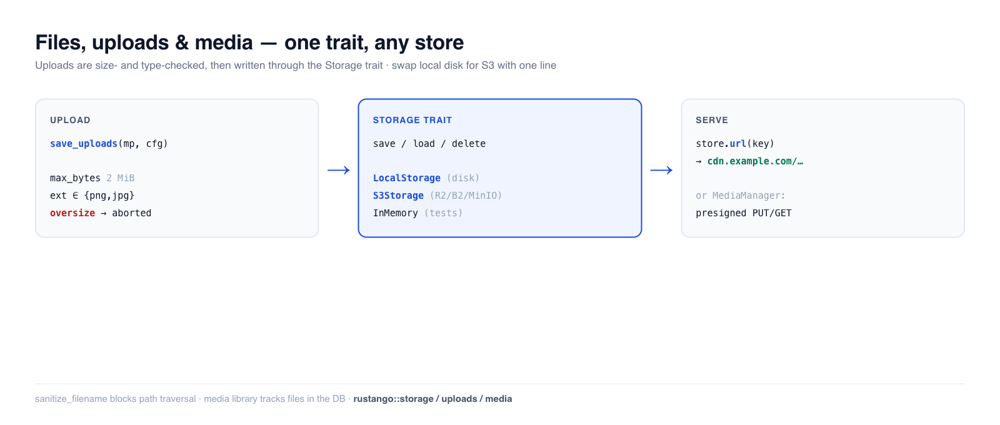

# Fichiers, téléversements et médias

Presque toutes les applications stockent des fichiers utilisateur — avatars, pièces jointes,
rapports exportés, images. **Rustango** vous offre un trait `Storage` avec des backends
interchangeables (disque local, stockage objet compatible S3, en mémoire pour les tests), un helper
de **téléversement** multipart sûr avec des garde-fous de taille/type, et — lorsque vous avez besoin
d'une médiathèque suivie — un `MediaManager` adossé à une base de données avec des URL présignées.
Écrivez votre code une seule fois contre le trait ; passez du disque local à S3 avec un changement
d'une ligne.

[](../img/files.png)

> **Un terme vous est inconnu ?** *backend de stockage*, *multipart*, *stockage objet*,
> *URL présignée* — voir le [glossaire](glossary.md).

> **Source :** `rustango::storage` (`Storage`, `LocalStorage`, `InMemoryStorage`,
> `s3::S3Storage`, `azure::AzureBlobStorage`, `StorageRegistry`, `BoxedStorage`), `rustango::uploads` (`save_uploads`,
> `UploadConfig`, `sanitize_filename`), et `rustango::media`
> (`Media`, `MediaManager`) — derrière les fonctionnalités `storage` / `uploads` / `storage-s3` /
> `storage-azure` / `media` (toutes activées par défaut).
>
> **Version exécutable :** les snippets Storage + garde-fous de téléversement sont copiés depuis
> [`files_doc.rs`](https://github.com/ujeenet/rustango/blob/main/crates/rustango/tests/files_doc.rs)
> (`cargo test -p rustango --test files_doc`) ; le flux multipart `save_uploads` de bout
> en bout est mis à l'épreuve par les tests intégrés dans
> `crates/rustango/src/uploads.rs`, et la médiathèque par
> [`media_sqlite_live.rs`](https://github.com/ujeenet/rustango/blob/main/crates/rustango/tests/media_sqlite_live.rs).

## Table des matières

- [Étape 1 — Choisir un backend de stockage](#étape-1--choisir-un-backend-de-stockage)
- [Étape 2 — Enregistrer, charger et servir des fichiers](#étape-2--enregistrer-charger-et-servir-des-fichiers)
- [Étape 3 — Accepter un téléversement](#étape-3--accepter-un-téléversement)
- [Téléverser un avatar de bout en bout](#téléverser-un-avatar-de-bout-en-bout)
- [Noms de fichiers sûrs](#noms-de-fichiers-sûrs)
- [Production : stockage compatible S3](#production--stockage-compatible-s3)
- [Production : Azure Blob Storage](#production--azure-blob-storage)
- [Gros fichiers : les diffuser en flux](#gros-fichiers--les-diffuser-en-flux)
- [Plusieurs disques depuis la configuration](#plusieurs-disques-depuis-la-configuration)
- [La médiathèque](#la-médiathèque)
- [Référence](#référence)
- [Voir aussi](#voir-aussi)

---

## Étape 1 — Choisir un backend de stockage

Chaque backend implémente le même trait `Storage`, si bien que votre code ne nomme jamais le type
concret — il tient un **`BoxedStorage`** (`Arc<dyn Storage>`) :

```rust
use rustango::storage::{BoxedStorage, LocalStorage};
use std::path::PathBuf;
use std::sync::Arc;

let storage: BoxedStorage = Arc::new(LocalStorage::new(PathBuf::from("./uploads")));
```

| Backend | Fonctionnalité | À utiliser pour |
|---|---|---|
| `LocalStorage` | `storage` | déploiements mono-serveur — fichiers sur disque local |
| `S3Storage` | `storage-s3` | production — stockage objet S3 / R2 / B2 / MinIO |
| `AzureBlobStorage` | `storage-azure` | production — Azure Blob Storage (Azurite en dev) |
| `InMemoryStorage` | `storage` | tests — un `HashMap`, ne touche jamais au disque |

---

## Étape 2 — Enregistrer, charger et servir des fichiers

Le trait tient en quatre méthodes async, indexées par un chemin sous forme de chaîne. `save` écrit
des octets, `load` les relit, plus `exists` / `delete` :

```rust
use rustango::storage::{Storage, InMemoryStorage};

let store = InMemoryStorage::new();
store.save("avatars/7.png", &png_bytes).await?;
assert!(store.exists("avatars/7.png").await?);
let bytes = store.load("avatars/7.png").await?;
store.delete("avatars/7.png").await?;
```

**Servir le fichier.** Attachez une URL de base (votre CDN ou hôte statique) et `url(key)`
construit l'adresse publique que vous stockez sur le modèle et remettez au navigateur :

```rust
let store = LocalStorage::new("./uploads".into())
    .with_base_url("https://cdn.example.com/uploads");

store.url("docs/report.pdf");   // Some("https://cdn.example.com/uploads/docs/report.pdf")
```

Sans URL de base, `url()` renvoie `None`. Servez alors le dossier avec
`Cli::with_uploads` ([exemple de l'avatar](#téléverser-un-avatar-de-bout-en-bout)) ou
diffusez les octets par votre propre handler ([Gros fichiers](#gros-fichiers--les-diffuser-en-flux)).
`LocalStorage` protège aussi contre la traversée de chemin dans les clés.

---

## Étape 3 — Accepter un téléversement

`save_uploads` consomme un corps `Multipart` axum, valide chaque fichier contre un
`UploadConfig`, et écrit les survivants dans votre `Storage` — en streaming, si bien qu'un fichier
surdimensionné est rejeté en cours de transfert au lieu d'être mis en tampon en mémoire d'abord.

```rust
use axum::extract::{Multipart, State};
use axum::http::StatusCode;
use axum::Json;
use rustango::storage::BoxedStorage;
use rustango::uploads::{save_uploads, UploadConfig};

async fn upload(
    State(storage): State<BoxedStorage>,             // router state, see below
    mp: Multipart,                                   // must be the last argument
) -> Result<Json<Vec<String>>, (StatusCode, String)> {
    let cfg = UploadConfig::new("avatars/")          // key prefix
        .max_bytes(2 * 1024 * 1024)                  // reject files over 2 MiB
        .allowed_extensions(&["png", "jpg", "jpeg", "webp"])
        .randomize_filename(true);                   // avoid collisions

    // UploadError is not a response: map it yourself.
    let saved = save_uploads(mp, &cfg, &storage)     // Vec<SavedUpload>
        .await
        .map_err(|e| (StatusCode::BAD_REQUEST, e.to_string()))?;
    Ok(Json(saved.into_iter().map(|s| s.key).collect()))
}
```

Le stockage arrive au handler comme état du routeur :
`Router::new().route("/upload", post(upload)).with_state(storage)`. L'[exemple de
l'avatar](#téléverser-un-avatar-de-bout-en-bout) ci-dessous montre tout le câblage.

Les garde-fous sont appliqués (et vérifiés) : `allowed_extensions` est **insensible à la casse**
(`"PNG"` et `"png"` sont identiques), et `max_bytes` interrompt le stream dès que la taille est
dépassée. Les tests `uploads` intégrés pilotent de vrais corps multipart et affirment que les
fichiers atterrissent dans le stockage, que les fichiers surdimensionnés sont rejetés, et que les
extensions non autorisées sont refusées.

Valeurs par défaut : `max_bytes` 10 Mio, `max_files` 20, `randomize_filename` actif
(un préfixe UUID dans la clé). Sans `allowed_extensions`, toute extension est
acceptée sauf celles qu'un navigateur exécute comme script (`html`, `svg`, `xml`,
`js`, … — `uploads::ACTIVE_EXTENSIONS`). La première erreur arrête la boucle et
supprime les fichiers déjà enregistrés : une requête refusée ne laisse rien. Chaque
`SavedUpload` porte `key`, `original_filename`, `content_type` (tel que le client
l'annonce — ne vous y fiez pas) et `size_bytes`.

```rust
let cfg = UploadConfig::new("avatars/").allowed_extensions(&["PNG", "Jpg"]);
assert!(cfg.allowed_extensions.contains("png"));   // normalized to lowercase
assert!(cfg.allowed_extensions.contains("jpg"));
```

---

## Téléverser un avatar de bout en bout

Voici les pièces réunies dans l'application de [Bien démarrer](getting-started.md) :
un profil avec un avatar, une route qui accepte l'image et une URL que le
navigateur peut charger. Les fichiers vont dans `./var/uploads` sur le disque
local.

### 1. Stocker la clé sur un modèle

Stockez la clé de stockage, pas le fichier ni l'URL. Ajoutez un modèle sous
`Post` dans `src/blog/models.rs`. La ligne `use rustango::{Auto, Model};` de
l'étape 8 le couvre déjà :

```rust
#[derive(Model, Clone, Debug)]
#[rustango(table = "profiles")]
pub struct Profile {
    #[rustango(primary_key)]
    pub id: Auto<i64>,

    pub user_id: i64,

    // Storage key, e.g. "avatars/3f2c…-me.png". None until the first upload.
    pub avatar_key: Option<String>,
}
```

Puis créez la table, comme à l'étape 9 :

```bash
cargo run -- makemigrations
cargo run -- migrate
```

L'URL est construite à partir de la clé quand vous en avez besoin. Si vous
déplacez les fichiers vers S3 plus tard, aucune ligne ne change.

`avatar_key` n'a pas de `max_length` : c'est donc une colonne `TEXT`. La clé garde
le nom de fichier du client, et `save_uploads` ne le raccourcit pas ; une longueur
`VARCHAR` fixe pourrait être trop courte.

### 2. Accepter le téléversement et enregistrer la clé

Le handler a besoin de deux choses : le pool de la base de données et le
stockage. Mettez-les dans une struct d'état. Ajoutez ceci dans
`src/blog/views.rs`. Sautez toute ligne `use` que le fichier a déjà : le même
`use` deux fois ne compile pas.

```rust
use axum::extract::{Multipart, Path, State};
use axum::http::StatusCode;
use axum::Json;
use rustango::sql::Pool;
use rustango::storage::BoxedStorage;
use rustango::uploads::{save_uploads, UploadConfig};

use crate::blog::models::Profile;

/// What the avatar routes need: the database and the file storage.
#[derive(Clone)]
pub struct AvatarState {
    pub pool: Pool,
    pub storage: BoxedStorage,
}

type HttpError = (StatusCode, String);

fn server_error(e: impl std::fmt::Display) -> HttpError {
    (StatusCode::INTERNAL_SERVER_ERROR, e.to_string())
}

/// POST /profiles/{id}/avatar with a multipart form that holds one image.
pub async fn upload_avatar(
    State(state): State<AvatarState>,
    Path(id): Path<i64>,
    mp: Multipart,
) -> Result<Json<serde_json::Value>, HttpError> {
    let mut profile = Profile::objects()
        .find(id, &state.pool)
        .await
        .map_err(server_error)?
        .ok_or((StatusCode::NOT_FOUND, "no such profile".to_owned()))?;

    let cfg = UploadConfig::new("avatars/")
        .max_bytes(2 * 1024 * 1024) // 2 MiB
        .max_files(1)
        .allowed_extensions(&["png", "jpg", "jpeg", "webp"]);
    let saved = save_uploads(mp, &cfg, &state.storage)
        .await
        .map_err(|e| (StatusCode::BAD_REQUEST, e.to_string()))?;
    let Some(file) = saved.into_iter().next() else {
        return Err((StatusCode::BAD_REQUEST, "send one file".to_owned()));
    };

    // Save the key on the row. If that fails, remove the new file.
    let old_key = profile.avatar_key.replace(file.key.clone());
    if let Err(e) = profile.save(&state.pool).await {
        let _ = state.storage.delete(&file.key).await;
        return Err(server_error(e));
    }
    // Nothing points at the old file any more.
    if let Some(old) = old_key {
        let _ = state.storage.delete(&old).await;
    }

    Ok(Json(serde_json::json!({
        "key": file.key,
        "url": state.storage.url(&file.key), // "/uploads/avatars/…-me.png"
    })))
}
```

`find` renvoie `Ok(None)` quand aucune ligne n'a cet id, et le handler répond
`404`. `save` réécrit la ligne de la même façon sur PostgreSQL, MySQL et SQLite.

`Multipart` vient de la feature `multipart` d'axum. La feature `uploads` de
Rustango l'active, donc ce code compile tel quel. Ajoutez quand même
`"multipart"` aux features d'`axum` dans votre `Cargo.toml`, pour que votre code
nomme ce qu'il utilise.

### 3. Créer le stockage et monter la route

Construisez le stockage une seule fois, à côté du routeur qui l'utilise. Ajoutez
ceci dans `src/blog/urls.rs`, qui a déjà `use axum::Router;` :

```rust
use std::path::PathBuf;
use std::sync::Arc;

use axum::routing::post;
use rustango::sql::Pool;
use rustango::storage::{BoxedStorage, LocalStorage};

use crate::blog::views::{upload_avatar, AvatarState};

/// The folder that holds uploads, and the URL prefix that serves it.
pub const UPLOAD_DIR: &str = "./var/uploads";
pub const UPLOAD_URL: &str = "/uploads";

pub fn avatar_routes(pool: Pool) -> Router {
    let storage: BoxedStorage = Arc::new(
        LocalStorage::new(PathBuf::from(UPLOAD_DIR)).with_base_url(UPLOAD_URL),
    );
    Router::new()
        .route("/{id}/avatar", post(upload_avatar))
        .with_state(AvatarState { pool, storage })
}
```

Puis ajoutez deux lignes à la chaîne `Cli` dans `src/main.rs` :

```rust
rustango::manage::Cli::new()
    .api(urls::api())
    // … the lines you already have …
    .nest_with("/profiles", myblog::blog::urls::avatar_routes)
    .with_uploads(myblog::blog::urls::UPLOAD_URL, myblog::blog::urls::UPLOAD_DIR)
    .with_loaded_settings(loaded)
    .run()
    .await
```

`nest_with` construit le routeur à partir du pool que le serveur ouvre, comme à
l'étape 12b. Il lui faut son propre préfixe : un second `nest_with("/api", …)`
entrerait en conflit avec le ViewSet. `with_uploads` sert les fichiers de
`./var/uploads` sous `/uploads/…`. Il envoie le HTML, le SVG et le XML en
téléchargement, pour qu'une page téléversée ne puisse pas exécuter de script sur
votre site. `LocalStorage` crée les dossiers au premier enregistrement. Le
`.gitignore` généré exclut déjà `var/` de git.

### 4. Essayer

Créez d'abord une ligne de profil, dans l'admin (étape 11) ou avec `save` comme à
l'étape 10. Puis :

```bash
curl -F "avatar=@me.png" http://localhost:8080/profiles/1/avatar
# {"key":"avatars/3f2c…-me.png","url":"/uploads/avatars/3f2c…-me.png"}

curl -O http://localhost:8080/uploads/avatars/3f2c…-me.png
```

Mettez l'`url` dans un ``. Un `.gif` reçoit `400` avec le message
``file extension `gif` not allowed``.

> **Cette route ne vérifie aucune connexion.** N'importe qui peut remplacer
> n'importe quel avatar. Avant de la mettre en production, placez-la derrière
> votre authentification et vérifiez que l'utilisateur connecté possède le profil.
> Voir [Décorateurs d'accès](auth-decorators.md).

**Fichiers privés.** `with_uploads` sert chaque fichier à quiconque a l'URL. Pour
des fichiers que seuls certains utilisateurs peuvent voir, n'utilisez ni
`with_uploads` ni l'URL de base, et diffusez le fichier par un handler qui
vérifie l'accès d'abord : le handler `download` de
[Gros fichiers](#gros-fichiers--les-diffuser-en-flux) est ce handler.

**Plus d'un serveur.** Le disque local convient pour un seul serveur. Avec
plusieurs, utilisez `S3Storage` ou `AzureBlobStorage` avec une URL publique ;
`url()` pointe alors vers le bucket et vous retirez `with_uploads`. Le handler ne
change pas.

### La limite du corps de requête

axum limite par défaut le corps d'une requête à 2 Mio, et `Multipart` lit sous
cette limite. Elle compte tout le formulaire, pas un seul fichier. Sans
changement, la valeur par défaut de 10 Mio de `max_bytes` n'est donc jamais
atteinte, et un fichier proche de 2 Mio échoue en erreur d'analyse multipart.

Relevez la limite avec `max_body_bytes` dans `config/default.toml` :

```toml
[server]
max_body_bytes = 5242880   # 5 MiB: room for a 2 MiB file and the form
```

ou avec la variable d'environnement `RUSTANGO__SERVER__MAX_BODY_BYTES=5242880`.
Le `Cli` en fait un `BodyLimitLayer` (`rustango::body_limit`) sur l'API et sur
chaque routeur ajouté avec `nest_with`, et il remplace la limite de 2 Mio d'axum.
Une requête dont le `Content-Length` est plus grand reçoit
`413 Payload Too Large` avant que votre handler ne s'exécute. Réglez-la un peu
au-dessus de votre plus grand `max_bytes`.

Le `Cli` ne lit ce réglage que s'il a votre configuration. Le `main.rs` généré la
passe avec `.with_loaded_settings(loaded)`. Sans cet appel (ou
`.with_settings_from_env()`), la valeur est ignorée, et le serveur journalise un
avertissement qui la nomme.

---

## Noms de fichiers sûrs

Ne faites jamais confiance à un nom de fichier fourni par le client. `sanitize_filename` le réduit
à un basename sûr — en retirant les composantes de répertoire (traversée de chemin) et en
remplaçant les caractères dangereux :

```rust
use rustango::uploads::sanitize_filename;

sanitize_filename("../../etc/passwd");   // "passwd"   — no traversal
sanitize_filename("my photo!.png");      // "my_photo_.png"
sanitize_filename("");                    // "upload"   — never empty
```

`save_uploads` l'applique pour vous ; ne l'appelez directement que si vous construisez des clés à la
main.

---

## Production : stockage compatible S3

Pour les déploiements multi-serveurs, remplacez `LocalStorage` par `S3Storage` (derrière la
fonctionnalité `storage-s3`). Il parle l'API S3 avec un signeur SigV4 fait maison, si bien qu'il
fonctionne avec **AWS S3, Cloudflare R2, Backblaze B2 et MinIO**. Le trait est
identique — seul le constructeur change :

```rust
use rustango::storage::s3::S3Storage;   // needs the `storage-s3` feature

use rustango::storage::s3::{S3Config, S3Credentials};

let cfg = S3Config::new("my-bucket", "us-east-1")
    .with_endpoint("https://<account>.r2.cloudflarestorage.com"); // R2 / B2 / MinIO; omit for AWS
let creds = S3Credentials::new(access_key_id, secret_access_key);
let storage: BoxedStorage = Arc::new(S3Storage::new(cfg, creds));
// save / load / delete / url — exactly the same calls as LocalStorage
```

Vos handlers et vos modèles ne changent pas ; seul le câblage au démarrage change.

---

## Production : Azure Blob Storage

`AzureBlobStorage` (derrière `storage-azure`) signe les appels serveur avec la
Shared Key du compte et délivre des URL SAS de service pour les GET et PUT
présignés :

```rust
use rustango::storage::azure::{AzureBlobStorage, AzureConfig};

let key = std::env::var("AZURE_STORAGE_KEY")?; // base64, from the portal
let cfg = AzureConfig::new("myaccount", key, "uploads");
// Azurite: cfg.endpoint("http://127.0.0.1:10000/devstoreaccount1")
let storage: BoxedStorage = Arc::new(AzureBlobStorage::new(cfg)?);
```

Différences avec S3 qu'un téléversement direct doit respecter :

- Le navigateur doit envoyer chaque en-tête de `storage.presigned_put_headers(&put)`,
  qui ajoute `x-ms-blob-type: BlockBlob`. La règle CORS du compte doit
  l'autoriser, ainsi que `Content-Type` et `If-None-Match`.
- Une SAS ne peut pas signer d'en-têtes : la taille et le type ne sont donc pas
  imposés par l'URL. Confirmez le téléversement avec `metadata`.
  `MediaManager::begin_upload` refuse un disque Azure ; téléversez via le
  serveur avec `save_bytes`. Un PUT en création seule reçoit `c` sans `w`,
  donc l'URL ne peut toujours pas remplacer un blob.
- Un seul PUT contient jusqu'à 5000 Mio ; au-delà, `save_stream` prépare des blocs.

---

## Gros fichiers : les diffuser en flux

`save` et `load` prennent et renvoient des tampons entiers. Pour un gros objet,
ou pour garder le bucket privé et faire passer les téléversements par votre
serveur, utilisez `save_stream` et `load_stream` : les morceaux passent au fur et
à mesure de leur arrivée, donc la mémoire reste stable. Un `ByteStream` vient
d'un `Body` axum, d'une `reqwest::Response`, de `Bytes` ou d'un `Vec<u8>`.

```rust
use axum::{body::Body, extract::{Path, State}, http::{header, HeaderMap, StatusCode}};
use rustango::storage::{BoxedStorage, ByteStream, PutConditions, StorageError};

// PUT /files: proxy the request body into storage.
async fn upload(State(storage): State<BoxedStorage>, headers: HeaderMap, body: Body)
    -> Result<String, StatusCode>
{
    let len = headers
        .get(header::CONTENT_LENGTH)
        .and_then(|v| v.to_str().ok()?.parse::<u64>().ok())
        .ok_or(StatusCode::LENGTH_REQUIRED)?;
    let key = format!("uploads/{}", uuid::Uuid::new_v4());
    let put = PutConditions::new().create_only();
    storage
        .save_stream(&key, len, ByteStream::from(body), &put)
        .await
        .map_err(|_| StatusCode::BAD_REQUEST)?;
    Ok(key)
}

// GET /files/{*key}: stream it back.
async fn download(State(storage): State<BoxedStorage>, Path(key): Path<String>)
    -> Result<Body, StatusCode>
{
    let stream = storage.load_stream(&key).await.map_err(|e| match e {
        StorageError::NotFound(_) => StatusCode::NOT_FOUND,
        _ => StatusCode::BAD_GATEWAY,
    })?;
    Ok(Body::from_stream(stream))
}
```

`save_stream` écrit exactement `len` octets. Un corps d'une autre taille, ou un
`put.content_length` différent de `len`, est refusé, et `create_only` refuse une
clé existante. Un corps qui échoue ou est abandonné ne laisse rien derrière lui.
Une couche de limite de corps sur la route doit autoriser la taille que vous
acceptez.

| Backend | Comment il diffuse |
|---------|----------------|
| `LocalStorage` | fichier temporaire dans le répertoire cible, fsync, puis renommage ; `create_only` crée un lien, donc il ne remplace jamais un fichier |
| `S3Storage` | un seul PUT jusqu'à 5 Gio ; au-delà, un téléversement multipart jusqu'à 10 000 parties (5 Tio), une partie en vol. En https, le corps est envoyé en `UNSIGNED-PAYLOAD` ; en http simple (MinIO local, SeaweedFS), chaque morceau de 64 Kio est signé. `create_only` envoie `If-None-Match: *` (sur Complete en multipart), ce que respectent AWS, MinIO et SeaweedFS |
| `AzureBlobStorage` | un seul Put Blob jusqu'à 5000 Mio ; au-delà, Put Block pour chaque partie puis un seul Put Block List. `create_only` envoie `If-None-Match: *` (sur la liste) |
| `InMemoryStorage` | rassemble le corps en mémoire ; `create_only` est vérifié sous son verrou |
| autres | le défaut du trait : rassemble le corps en mémoire, puis `save` ; il refuse `create_only` |

Un téléversement multipart échoué ou abandonné est annulé, et Azure n'affiche
jamais les blocs non validés : aucun objet partiel n'est donc jamais visible. Un
serveur qui conserve des parties après un crash devrait quand même avoir une
règle de cycle de vie qui supprime les téléversements multipart incomplets. Le
`create_only` de `LocalStorage` demande des liens physiques ; sur FAT, SMB ou
certains montages FUSE, il échoue avec une erreur qui le dit.

---

## Plusieurs disques depuis la configuration

Une application peut mélanger les backends — deux buckets S3, un conteneur
Azure, un cache local — sous forme de disques nommés. Déclarez-les dans
`[storage]` et construisez un `StorageRegistry` :

```toml
[storage]
default = "uploads"

[storage.disks.uploads]
driver          = "azure"
account         = "myaccount"
container       = "uploads"
public_endpoint = "https://files.example.com"   # optional: links browsers follow

[storage.disks.archive]
driver = "s3"
bucket = "archive"
region = "eu-west-1"
cdn    = "https://cdn.example.com/archive"

[storage.disks.cache]
driver = "local"
root   = "./var/cache"
```

```rust
let registry = StorageRegistry::from_settings(&settings.storage)?;
let uploads = registry.default_disk().expect("default disk");
```

Les clés restent hors du fichier : `RUSTANGO__STORAGE__DISKS__UPLOADS__ACCOUNT_KEY`,
`RUSTANGO__STORAGE__DISKS__ARCHIVE__SECRET_ACCESS_KEY`. Les noms de disque sont
en minuscules `[a-z0-9_]` pour que ces surcharges puissent les atteindre. Un
driver dont la feature n'est pas compilée est une erreur qui nomme le disque,
pas un disque silencieusement absent. `public_endpoint` fait pointer les URL
présignées et `url()` vers l'adresse que les navigateurs atteignent, tandis que
les lectures et écritures continuent d'utiliser `endpoint`.

---

## La médiathèque

Lorsque les fichiers sont des enregistrements de première classe — suivis en base de données,
parcourables dans l'admin, avec une livraison CDN/présignée — tournez-vous vers
`rustango::media` plutôt que vers `Storage` brut. `MediaManager` persiste une ligne `Media` par
fichier et prend en charge deux flux de téléversement :

- **Côté serveur :** `manager.save_bytes(...)` stocke les octets et la ligne en un seul
  appel.
- **Direct vers le stockage :** `manager.begin_upload(...)` renvoie une URL de **PUT présigné**
  vers laquelle le navigateur téléverse directement (votre serveur ne relaie jamais les octets),
  puis vous confirmez la ligne. Le PUT doit envoyer chaque en-tête de
  `ticket.headers` (`Content-Type`, `If-None-Match: *`, et `x-ms-blob-type` sur
  Azure), donc la règle CORS du bucket doit les autoriser. L'URL peut créer
  l'objet une fois et ne jamais le remplacer. Accordez aussi `s3:ListBucket` :
  sans lui, S3 répond 403 pour un objet manquant, et la finalisation renvoie 502
  au lieu de marquer la ligne `Failed`.

```rust
use rustango::media::{Media, MediaManager};

let manager = MediaManager::new(pool.clone(), registry);
// Hand the browser a short-lived download link:
// Renvoie Option<String> — None sur les backends qui ne savent pas signer (p. ex. disque local).
let Some(url) = manager.presigned_get(&media, Duration::from_secs(3600)).await else {
    return Err(/* pas d'URL signée pour ce backend */);
};
```

Il gère aussi la suppression douce et la purge des orphelins. Le flux complet est mis à l'épreuve
dans `media_sqlite_live.rs` ; les méthodes présignées et de téléversement direct du manager
fonctionnent sur les trois backends.

### Servir des médias sur une page publique

Une page publique ne passe **pas** par `media::router`. Ce routeur est l'API
de gestion interne — envois, suppressions, tags, navigation — et il répond
`401` à quiconque n'est pas authentifié, sur chacune de ses routes, par
conception.

Calculez plutôt l'URL depuis votre propre handler :

```rust
// votre propre route publique
let url = manager.public_url(media_id).await?;   // Option<String>, sans signature
```

`public_url` est une requête en base plus une chaîne ; il ne signe rien et
n'attend aucun signataire, et c'est pourquoi il convient à une page. Deux
modèles de livraison, et choisir entre eux est la vraie décision :

| | bucket public / CDN | bucket privé + présigné |
|---|---|---|
| adresse | `manager.public_url(id)` — stable | `manager.presigned_get(&m, ttl)` — expire |
| cachable | oui, par les navigateurs et les CDN | non ; le routeur envoie `no-store` |
| qui peut récupérer | quiconque a l'URL | quiconque a l'URL, jusqu'à expiration |
| pour quoi | pages publiques, `` | le routeur de gestion, outils internes |

`public_url` indique **où** l'objet *serait* servi ; il ne le rend pas
lisible. Pointez-le vers un bucket privé et vous obtiendrez une URL correcte
et un 403 — ce cas veut une URL présignée, délibérément ni cachable ni
partageable.

Pour des fichiers sur disque local plutôt que dans un bucket, le handler de
fichiers statiques fait déjà cela, sans aucune ligne média :

```rust
Cli::new().with_uploads("/uploads", "./var/uploads")
```

**Si vous alliez écrire un authorizer `AllowAll` pour faire marcher une page
publique, arrêtez.** Cela ouvre les 16 routes — y compris `DELETE` et le `PUT`
présigné — à tout le monde, ce qui est exactement la faille que 0.57.7 a
refermée.

### Le routeur de gestion exige une politique d'autorisation

`media::router` monte 16 routes JSON au-dessus du manager, toutes des actions
de gestion sur la médiathèque. **Toutes sont protégées, et il n'existe aucun
défaut permissif.** Construisez-le avec `media_router_with` et fournissez une
politique :

```rust
use rustango::media::router::{media_router_with, MediaPerms};

let app = axum::Router::new()
    .nest("/media", media_router_with(manager, MediaPerms::new(pool)));
```

`media_router(manager)` — l'ancien constructeur — est déprécié (supprimé en 0.65.0) et répond
désormais `403` sur chaque route. C'est un changement de comportement
délibéré en 0.57.7 : auparavant ces routes ne prenaient aucun extracteur
d'authentification, d'autorisation ni de tenant, si bien que
`GET /media/{id}` renvoyait la ligne **et une URL de téléchargement S3
présignée** à quiconque savait deviner un entier, et `POST /uploads/begin`
émettait un `PUT` présigné pour un préfixe de clé choisi par l'appelant.

`MediaPerms` (nécessite la feature `tenancy`) vérifie les codenames de
permission `{table}.{action}` que l'admin utilise déjà —
`rustango_media.view` pour lire, `rustango_media_collections.add` pour créer
un dossier, etc. Montez-le **à l'intérieur** de `require_auth`, qui injecte
l'identité qu'il lit ; sans cela toute requête est un `401`. Les
superutilisateurs contournent la vérification des codenames — mais **pas**
`allow_disks`, qui les lie aussi : `is_superuser` élève les droits au sein d'un
tenant, et le stockage d'objets est partagé entre tous. Seul un
superutilisateur peut définir l'`uploaded_by_id` d'un autre utilisateur, et
classer dans une collection (téléversement, déplacement ou collection
imbriquée) demande aussi `rustango_media_collections.view`.

Trois choses qu'il ne fait pas :

- **Les décisions au niveau de la ligne.** Un `rustango_media.view` lit
  *n'importe quelle* ligne de média par id. `MediaManager` détient un seul
  pool, un déploiement multi-tenant délimite donc les lignes lui-même —
  c'est le rôle de `MediaAuthorizer`. `MediaTarget` nomme la ligne
  (`Media(id)`, `Collection(id)`, `CollectionSubtree(id)`, …) exactement
  pour qu'une politique par ligne puisse être écrite. `?recursive` sur le
  contenu d'une collection arrive comme `CollectionContents { id, recursive: true }`
  — même cible, avec un drapeau — pour qu'une politique puisse être plus
  stricte sur la lecture large sans perdre la collection qu'elle nomme.
- **Délimiter le stockage d'objets.** `disk` est fourni par l'appelant sur
  `POST /uploads/begin` et le `StorageRegistry` est à l'échelle du processus :
  un pool par locataire isole la base de données et non le bucket, donc un
  simple `rustango_media.add` écrit dans n'importe quel disque que le processus
  connaît. Précisez lesquels avec
  `MediaPerms::new(pool).allow_disks(["user-uploads"])`. Les préfixes au sein
  d'un disque exigent toujours `MediaAuthorizer`, qui reçoit `key_prefix`.
- **Deviner ce que signifie une nouvelle route.** `MediaAction` et
  `MediaTarget` sont `#[non_exhaustive]` : terminez votre politique par
  `_ => false` et une route ajoutée plus tard arrivera refusée plutôt
  qu'autorisée.

À retenir si vous écrivez la vôtre : `DELETE /collections/{id}` supprime tout
le **sous-arbre** et réaffecte les médias à chaque niveau, il arrive donc
comme `Delete(CollectionSubtree(id))` et non `Delete(Collection(id))` — et
sous `MediaPerms` il exige `rustango_media.change` en plus de
`rustango_media_collections.delete`, parce qu'il écrit dans la table des
médias.
[UPGRADING.md](https://github.com/ujeenet/rustango/blob/main/UPGRADING.md)
contient les notes de migration.

### Comment les tables de médias sont créées

Les tables de médias (`rustango_media`, `rustango_media_collections`,
`rustango_media_tags`, `rustango_media_tag_links`) sont des modèles gérés. Leur
schéma est livré sous forme de **migration système** et est créé — par locataire, quand la
fonctionnalité `media` est activée — de la même façon que le reste des propres tables du framework,
chaque fois que vous exécutez `migrate` / provisionnez un locataire. Il n'y a pas d'étape paresseuse
de « création à la première utilisation » ; si la fonctionnalité est désactivée, les tables ne sont
jamais créées.

> **Mise à niveau depuis une version antérieure à 0.51.** Les versions plus anciennes créaient les
> tables de médias de façon paresseuse via un appel DDL `ensure_table` plutôt que via une migration.
> Au premier `migrate` (ou provisionnement de locataire) après la mise à niveau, le framework
> **réconcilie automatiquement** :
> parce que les tables existent déjà, la migration de médias générée est enregistrée dans
> le registre des migrations système *sans* réexécuter son `CREATE TABLE`, et vos
> lignes existantes sont laissées intactes. **Aucune étape manuelle n'est requise** — la mise à
> niveau qui échouerait autrement avec `relation already exists` / `table already exists`
> fonctionne désormais tout simplement.
>
> **Passez à 0.51.2 ou plus récent, pas à 0.51.1.** 0.51.0 a déplacé les tables de
> médias vers les migrations système et 0.51.1 annonçait cette réconciliation —
> des tests entre versions sur de vraies bases 0.46–0.50 ont montré qu'aucune des
> deux ne fonctionnait, et **les deux sont retirées (yanked)**. La garde de
> réconciliation exigeait qu'une migration soit purement `CreateTable`, alors
> qu'une migration initiale générée contient des tables *et* des index : elle
> abandonnait donc sur chaque cas réel. 0.51.2 est la version où elle se
> déclenche réellement.

---

## Référence

**Trait `Storage` :** `save(key, &bytes)` · `load(key)` · `delete(key)` ·
`exists(key)` · `url(key) -> Option<String>`, plus les méthodes par défaut `save_with_content_type`,
`presigned_get_url(key, ttl)`, `presigned_put_url(key, ttl, &put)`, `presigned_put_headers(&put)`, `metadata(key)`,
`save_stream(key, len, body, &put)` et `load_stream(key)`
(un backend qui signe surcharge la paire presign ; les défauts renvoient `None`).

**`UploadConfig` :** `new(prefix)` · `.max_bytes(n)` · `.max_files(n)` · `.allowed_extensions(&[..])`
(insensible à la casse) · `.randomize_filename(bool)`. Utilisé par
`save_uploads(multipart, &cfg, &storage)`.

**Backends :** `LocalStorage` (disque) · `S3Storage` (stockage objet, `storage-s3`) · `AzureBlobStorage` (`storage-azure`)
· `InMemoryStorage` (tests). Tous renvoient un `BoxedStorage`.

---

## Voir aussi

- [L'admin](admin.md) — les médias et les widgets de FK font apparaître les fichiers téléversés dans l'UI.
- [Tâches d'arrière-plan](jobs.md) — redimensionnez/transcodez un téléversement en dehors de la requête.
- [Mise en cache](caching.md) — le même motif de trait « change-le-backend ».
- [Guide de sécurité](security.md) — valider une entrée de téléversement non fiable.
- [Tâches courantes](common-tasks.md) — des réponses courtes qui renvoient aux exemples complets.
