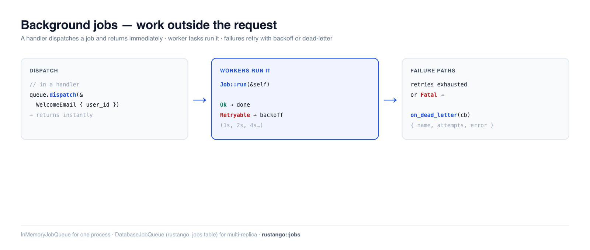

# Tâches d'arrière-plan

Certains travaux ne devraient pas avoir lieu pendant une requête — envoyer un
e-mail de bienvenue, redimensionner un fichier importé, synchroniser une API
tierce. Le faire en ligne fait attendre l'utilisateur et couple la réponse à un
appel externe instable. Une **tâche d'arrière-plan** déplace ce travail sur une
file : le handler retourne immédiatement, et un pool de workers exécute la tâche
quelques instants plus tard, avec des **nouvelles tentatives automatiques** et
un chemin **dead-letter** pour les échecs — une file de tâches, entièrement
en Rust.

[](../img/jobs.png)

> **Un terme vous est inconnu ?** *file*, *worker*, *nouvelle tentative/backoff*,
> *dead-letter* — voir le [glossaire](glossary.md).

> **Source :** `rustango::jobs` (`Job`, `JobQueue`, `InMemoryJobQueue`,
> `JobError`, `JobDeadLetter`) et `rustango::jobs::DatabaseJobQueue` (la file
> adossée à une table, alias de `pg::PgJobQueue`) — derrière la feature `jobs` ;
> `DatabaseJobQueue` et `make:worker` demandent aussi `jobs-postgres` (toutes
> deux activées par défaut).
>
> **Version exécutable :** les extraits in-memory, nouvelle tentative et
> dead-letter sont copiés depuis [`jobs_doc.rs`](https://github.com/ujeenet/rustango/blob/main/crates/rustango/tests/jobs_doc.rs)
> (`cargo test -p rustango --test jobs_doc`) ; la file persistante est
> éprouvée en dogfooding sur SQLite par
> [`jobs_sqlite_live.rs`](https://github.com/ujeenet/rustango/blob/main/crates/rustango/tests/jobs_sqlite_live.rs)
> (`cargo test -p rustango --features sqlite,jobs-postgres --test jobs_sqlite_live`).

## Table des matières

- [Étape 1 — Définir une tâche](#étape-1--définir-une-tâche)
- [Étape 2 — Démarrer une file](#étape-2--démarrer-une-file)
- [Étape 3 — Dispatcher depuis un handler](#étape-3--dispatcher-depuis-un-handler)
- [Étape 4 — Câbler dans votre application](#étape-4--câbler-dans-votre-application) — l'exemple complet
- [Faire tourner les workers (CLI + production)](#faire-tourner-les-workers-cli--production)
- [Nouvelles tentatives et backoff](#nouvelles-tentatives-et-backoff)
- [Le contexte de la tâche : id, tentative, arrêt](#le-contexte-de-la-tâche--id-tentative-arrêt)
- [Le handler dead-letter](#le-handler-dead-letter)
- [La file persistante (production)](#la-file-persistante-production)
- [Les tâches en multi-tenancy](#les-tâches-en-multi-tenancy)
- [Les balayages planifiés en multi-tenancy](#les-balayages-planifiés-en-multi-tenancy)
- [Référence](#référence)
- [Voir aussi](#voir-aussi)

---

## Étape 1 — Définir une tâche

Une tâche est une structure sérialisable qui implémente `Job`. La charge utile
est ce qui est mis en file (sérialisé en JSON) ; `run()` est le travail. `NAME`
route une charge utile mise en file vers son handler, il doit donc être unique.

Générez un squelette avec la CLI — `cargo run -- make:job WelcomeEmail` écrit
`src/welcome_email.rs` ; ajoutez `pub mod welcome_email;` à `src/lib.rs` — ou
écrivez-le à la main :

```rust
// src/welcome_email.rs
use rustango::jobs::{Job, JobError};
use serde::{Deserialize, Serialize};

#[derive(Serialize, Deserialize)]
pub struct WelcomeEmail {
    pub to: String,
}

#[async_trait::async_trait]   // the scaffolded Cargo.toml has `async-trait`
impl Job for WelcomeEmail {
    const NAME: &'static str = "welcome_email";

    async fn run(&self) -> Result<(), JobError> {
        tracing::info!(to = %self.to, "welcome email job ran");
        Ok(())
    }
}
```

`run()` ne reçoit que le payload : ni pool de base de données, ni mailer. Mettez
donc dans le payload ce dont la tâche a besoin, comme l'adresse.
L'[Étape 4](#étape-4--câbler-dans-votre-application) donne un mailer à la tâche,
pour qu'elle puisse vraiment envoyer.

`run()` retourne :

- `Ok(())` — terminé.
- `Err(JobError::Retryable(msg))` — transitoire ; le worker réessaie avec
  backoff.
- `Err(JobError::Fatal(msg))` — permanent ; passe les nouvelles tentatives,
  dead-letter immédiatement.

Surchargez `const MAX_ATTEMPTS: u32 = 3;` sur l'impl pour changer le plafond de
**tentatives totales** — pas de nouvelles tentatives. La valeur par défaut de 5
correspond à une exécution initiale plus quatre reprises ; `MAX_ATTEMPTS = 3`
donne deux reprises. `0` compte comme `1` : la tâche s'exécute une fois.

Un handler qui a besoin d'un état que le payload ne peut pas porter, comme un
mailer, s'enregistre avec `queue.register_with(move |job: WelcomeEmail| async move { … })`.
Cette closure s'exécute à la place de `Job::run` et peut garder les valeurs que
vous y déplacez. Les deux files intégrées le prennent en charge. L'Étape 4 en
montre une complète.

---

## Étape 2 — Démarrer une file

Pour un processus unique (et pour le dev et les tests), `InMemoryJobQueue`
exécute les tâches sur des tâches worker tokio — sans base de données.
**Enregistrez chaque type de tâche, puis `start()` les workers** (les tâches ne
sont pas prises en charge tant que vous ne le faites pas) :

```rust
use rustango::jobs::{InMemoryJobQueue, JobQueue};
use std::sync::Arc;

let queue = Arc::new(InMemoryJobQueue::with_workers(4));   // 4 worker tasks
queue.register::<WelcomeEmail>().await;                    // before start/dispatch
queue.start().await;

// ... app runs ...

queue.shutdown().await;   // on shutdown: drain in-flight jobs, then stop
```

`shutdown()` accorde un délai de grâce aux tâches en cours (`shutdown_grace`,
5 s par défaut), puis les interrompt et les remet en file. Les tâches en file et
les nouvelles tentatives en attente restent en file, et un nouveau `start()` les
reprend.

Les tâches sont **at-least-once** (au moins une fois). Une tâche en cours voit
l'arrêt via [`JobCtx::stopping`](#le-contexte-de-la-tâche--id-tentative-arrêt),
et une tâche interrompue repart du début (la file en base libère sa ligne même
si la tâche venait de se terminer). L'interruption
consomme une tentative. Rendez chaque tâche idempotente.

Conservez le `Arc<InMemoryJobQueue>` dans l'état de votre application pour que
les handlers puissent l'atteindre.

> **In-memory signifie in-memory.** Les tâches en file ou en cours sont
> **perdues au redémarrage**. Pour tout ce que vous ne pouvez pas vous permettre
> de perdre, utilisez la [file persistante](#la-file-persistante-production).

---

## Étape 3 — Dispatcher depuis un handler

Une fois la file en marche, le dispatch tient en un appel — il met en file et
retourne immédiatement, de sorte que la requête n'attend pas le travail :

```rust
queue.dispatch(&WelcomeEmail { to: "ada@example.com".into() }).await?;
```

Un worker la prend en charge et exécute `run()` quelques instants plus tard.
Vérifié de bout en bout : les trois tâches dispatchées s'exécutent toutes sur
les workers.

```rust
for to in ["a@example.com", "b@example.com", "c@example.com"] {
    queue.dispatch(&WelcomeEmail { to: to.into() }).await.unwrap();
}
// → all three WelcomeEmail::run() calls execute on the worker pool
```

---

## Étape 4 — Câbler dans votre application

Les étapes 1 à 3 assemblées pour l'application de [Bien démarrer](getting-started.md) :
donnez un mailer à la tâche, enregistrez-la **une seule fois au démarrage**,
lancez les workers, passez la file à une route, et drainez à l'arrêt.

D'abord le fichier de la tâche. Il garde la tâche `WelcomeEmail` de l'Étape 1 et
ajoute deux choses : une fonction `register` et une route `/signup`.

```rust
// src/welcome_email.rs
use std::sync::Arc;

use axum::{http::StatusCode, routing::post, Extension, Json, Router};
use rustango::email::{BoxedMailer, Email};
use rustango::jobs::{InMemoryJobQueue, Job, JobError, JobQueue};
use serde::{Deserialize, Serialize};

#[derive(Serialize, Deserialize)]
pub struct WelcomeEmail {
    pub to: String,
}

#[async_trait::async_trait]
impl Job for WelcomeEmail {
    const NAME: &'static str = "welcome_email";

    // Not called here: `register` below gives the queue a handler instead.
    async fn run(&self) -> Result<(), JobError> {
        tracing::info!(to = %self.to, "welcome email job ran");
        Ok(())
    }
}

/// Register the job with a handler that holds the mailer. Call it once at
/// boot, before `start()`.
pub async fn register<Q: JobQueue>(queue: &Q, mailer: BoxedMailer) {
    queue
        .register_with(move |job: WelcomeEmail| {
            // The closure runs once per job, so each run takes its own copy.
            let mailer = mailer.clone();
            async move {
                Email::new()
                    .to(job.to)
                    .subject("Welcome")
                    .body("Thanks for signing up.")
                    .send(&*mailer)
                    .await
                    .map_err(|e| {
                        if e.is_retryable() {
                            JobError::Retryable(e.to_string()) // mail server down
                        } else {
                            JobError::Fatal(e.to_string()) // bad address: no retry
                        }
                    })
            }
        })
        .await;
}

#[derive(Deserialize)]
pub struct Signup {
    pub email: String,
}

async fn signup(
    Extension(queue): Extension<Arc<InMemoryJobQueue>>,
    Json(form): Json<Signup>,
) -> StatusCode {
    // ... create the user here ...
    // `dispatch` returns at once; a worker sends the email.
    match queue.dispatch(&WelcomeEmail { to: form.email }).await {
        Ok(()) => StatusCode::CREATED,
        Err(e) => {
            tracing::error!(error = %e, "could not queue the welcome email");
            StatusCode::INTERNAL_SERVER_ERROR
        }
    }
}

pub fn router(queue: Arc<InMemoryJobQueue>) -> Router {
    Router::new()
        .route("/signup", post(signup))
        .layer(Extension(queue))
}
```

`mailer` est un `Arc`, donc `&*mailer` passe le mailer qu'il contient.

Ensuite `src/main.rs`. C'est le fichier généré de Bien démarrer, avec la file en
plus. Le scaffolder met le corps dans `run()` ; les lignes vont là. Les lignes
marquées `NEW` sont les ajouts — gardez les lignes de l'admin et des réglages :

```rust
// src/main.rs: keep the scaffolded main(), which calls run()
use std::sync::Arc;

use myblog::urls;
use rustango::jobs::{InMemoryJobQueue, JobQueue}; // NEW

async fn run() -> Result<(), Box<dyn std::error::Error>> {
    let _ = dotenvy::dotenv();
    let loaded = rustango::config::Settings::load_from_env();
    let settings = loaded.as_ref().cloned().unwrap_or_default();
    let admin_settings = settings.clone();

    // NEW 1. The mailer, from the [mail] settings (see the email guide).
    let mailer = rustango::email::from_settings(&settings.mail)?;

    // NEW 2. Build the queue and register every job type BEFORE start().
    let queue = Arc::new(InMemoryJobQueue::with_workers(4));
    myblog::welcome_email::register(&*queue, mailer).await;
    queue
        .on_dead_letter(|dl| async move {
            tracing::error!(job = dl.name, attempts = dl.attempts, error = %dl.error,
                            "job dead-lettered");
        })
        .await;

    // NEW 3. Start the workers — tokio tasks that run inside THIS process.
    queue.start().await;
    let draining = Arc::clone(&queue);

    rustango::manage::Cli::new()
        // NEW 4. Mount the /signup route, which holds the queue.
        .api(urls::api().merge(myblog::welcome_email::router(queue)))
        .try_nest_with(urls::admin_prefix(&settings), move |pool| {
            urls::admin_router(pool, &admin_settings)
        })
        .with_health()
        .with_loaded_settings(loaded)
        // NEW 5. Drain the queue after the server stops (SIGINT and SIGTERM).
        .on_shutdown(move || async move { draining.shutdown().await })
        .run()
        .await
}
```

Essayez avec `cargo run` et, dans un autre terminal :

```bash
curl -X POST http://localhost:8080/signup \
     -H "content-type: application/json" \
     -d '{"email":"ada@example.com"}'
```

La requête répond `201` tout de suite. Avec le backend mail par défaut (la
console), l'e-mail s'affiche dans le terminal du serveur un instant plus tard.

Pour envoyer un `Email` construit dans le handler, vous n'avez pas besoin de votre
propre type de tâche : `rustango::email_jobs::register_email_job` et
`dispatch_email` le font en deux appels. Voir
[L'envoyer en dehors de la requête](email.md#lenvoyer-en-dehors-de-la-requête).

> **Mettez le drainage dans `on_shutdown`, pas après `run()`.** Les versions
> antérieures de cet exemple appelaient `queue.shutdown()` à la ligne *suivant* `run()`, et cette ligne ne
> pouvait jamais s'exécuter : rien ne gérait SIGTERM, donc l'arrêt de
> l'orchestrateur tuait le processus sur-le-champ. `run()` retourne désormais
> sur signal — mais `on_shutdown` reste le bon endroit, car le hook s'exécute
> aussi sur le chemin tenancy et s'ordonne correctement vis-à-vis du drainage
> du serveur.

> **Stockez le type de file concret.** Le trait `JobQueue` n'est **pas
> object-safe** (ses `register`/`dispatch` sont génériques), donc vous ne pouvez
> pas conserver `Arc<dyn JobQueue>` dans l'état — gardez le
> `Arc<InMemoryJobQueue>` concret (ou `Arc<DatabaseJobQueue>`).

### Une tâche qui lit la base de données

Dans `main.rs`, une tâche ne peut pas garder le pool de base de données du
serveur. `Cli` ouvre ce pool au démarrage du serveur, donc après la construction
de votre file. Vous avez deux options :

- Mettez les données dans le payload, comme `WelcomeEmail` le fait avec
  l'adresse. Le handler, lui, peut lire la base : une route montée avec
  `nest_with` reçoit le pool, comme dans
  [Bien démarrer, étape 12b](getting-started.md#12b-monter-les-routes).
- Exécutez la tâche dans un [processus worker](#un-processus-worker-dédié-production).
  Il ouvre son propre pool, et `register_with` peut garder le pool à côté du
  mailer.

---

## Faire tourner les workers (CLI + production)

`start()` spawn les workers en tant que **tâches tokio à l'intérieur du
processus courant**. Ainsi, quand vous lancez votre application avec la CLI —
`cargo run` (qui exécute le serveur) — les workers tournent juste à côté de lui.
Pour la plupart des applications, c'est tout ce dont vous avez besoin : **un seul
processus sert les requêtes *et* draine la file** ; il n'y a pas de commande
worker distincte.

```bash
cargo run                 # starts the server AND the in-process workers
cargo run -- make:job WelcomeEmail   # scaffold a new job type
```

### Un processus worker dédié (production)

À l'échelle, vous voulez souvent des workers **séparés** de la couche web — pour
qu'un pic de trafic ne puisse pas affamer les tâches, et que vous mettiez à
l'échelle chacun indépendamment. Avec la [file
persistante](#la-file-persistante-production), chaque processus tire de la même
table `rustango_jobs`, donc lancez simplement un second binaire, sans serveur,
qui construit la file, la démarre, et bloque jusqu'à un signal.
`cargo run -- make:worker Worker` écrit un squelette. Ici le worker ouvre son
propre pool, donc sa closure `register_with` peut garder le pool et le mailer. La
tâche lit le modèle `Post` de Bien démarrer :

```rust
// src/bin/worker.rs — run with `cargo run --bin worker`
use std::sync::Arc;

use myblog::blog::models::Post;
use myblog::welcome_email::WelcomeEmail;
use rustango::email::Email;
use rustango::jobs::{DatabaseJobQueue, JobError, JobQueue};
use rustango::sql::{FetcherPool, Pool};

#[rustango::main]
async fn main() -> Result<(), Box<dyn std::error::Error>> {
    // A worker never runs main.rs, so it loads `.env` and the settings itself.
    let _ = dotenvy::dotenv();
    let settings = rustango::config::Settings::load_from_env()?;
    let mailer = rustango::email::from_settings(&settings.mail)?;
    let pool = Pool::connect_from_env().await?; // DATABASE_URL
    DatabaseJobQueue::ensure_table_pool(&pool).await?;

    let queue = Arc::new(DatabaseJobQueue::with_workers_pool(pool.clone(), 8));
    // Register the SAME job types the web process dispatches.
    queue
        .register_with(move |job: WelcomeEmail| {
            let pool = pool.clone();
            let mailer = mailer.clone();
            async move {
                let posts = Post::objects()
                    .fetch(&pool)
                    .await
                    .map_err(|e| JobError::Retryable(e.to_string()))?;
                Email::new()
                    .to(job.to)
                    .subject("Welcome")
                    .body(format!("There are {} posts waiting for you.", posts.len()))
                    .send(&*mailer)
                    .await
                    .map_err(|e| JobError::Retryable(e.to_string()))
            }
        })
        .await;
    queue.start().await;

    // Blocks until Ctrl-C (SIGINT) *or* SIGTERM. `tokio::signal::ctrl_c()`
    // alone is SIGINT-only on Unix, so a worker waiting on it is killed
    // outright by `docker stop` / a pod eviction and drains nothing.
    rustango::shutdown::shutdown_signal().await;
    queue.shutdown().await;                     // drain in-flight, then exit
    Ok(())
}
```

Déployez-le comme son propre conteneur/service et mettez-le à l'échelle sur **N
réplicas** — ils tirent tous de la table partagée en toute sécurité. Le
processus web n'a alors besoin que de `dispatch`, mais doit `register` chaque type de job qu'il envoie (sans `start()`), ou construire sa file avec `.allow_unregistered_dispatch()` ; un dispatch non enregistré est refusé. Associez le worker à un balayage périodique
[`reclaim_stuck_jobs_pool`](#la-file-persistante-production) pour récupérer les
tâches d'un worker crashé.

Deux files différentes sur une même table (par exemple un mailer et un
générateur de rapports, avec leurs propres handlers) prennent les tâches l'une
de l'autre. Donnez à chacune son propre nom avec `.queue_name("mailer")` côté
dispatch et côté worker : une file nommée n'exécute que ses tâches, une file
sans nom que les tâches sans nom. Les workers antérieurs à `queue_name`
l'ignorent et exécutent aussi les tâches nommées : arrêtez-les avant de
dispatcher sur une file nommée.

---

## Nouvelles tentatives et backoff

Une tâche qui retourne `Retryable` est remise en file avec un **backoff
exponentiel** (1s, 2s, 4s, 8s, …, plafonné à 1024s) jusqu'à épuisement des
`MAX_ATTEMPTS` tentatives totales. Utilisez-le pour les échecs transitoires — un
timeout, une API rate-limitée, un deadlock :

```rust
#[async_trait::async_trait]
impl Job for FlakyImport {
    const NAME: &'static str = "flaky_import";
    async fn run(&self) -> Result<(), JobError> {
        match call_external_api().await {
            Ok(_)  => Ok(()),
            Err(e) => Err(JobError::Retryable(e.to_string())),   // try again later
        }
    }
}
```

Le test sous-jacent dispatche une tâche qui échoue une fois puis réussit, et
affirme qu'elle **s'est exécutée plus d'une fois et a fini par réussir** — la
nouvelle tentative a bien lieu.

Pour changer l'attente de toutes les tâches d'un type, surchargez
`fn retry_backoff(failed_attempt: u32) -> Duration` dans l'impl
(`failed_attempt` vaut 0 après la première exécution). Pour fixer le plafond ou
l'attente depuis le payload, surchargez `fn max_attempts(&self) -> u32` ou
`fn retry_delay(&self, failed_attempt: u32) -> Duration` ; par défaut ils
renvoient `MAX_ATTEMPTS` et `retry_backoff`. Le plafond est lu au dispatch.
`jobs::exponential_backoff(base, failed_attempt)` est la courbe par défaut avec
votre propre base : `base`, doublée à chaque échec, plafonnée à `base · 1024`.

---

## Le contexte de la tâche : id, tentative, arrêt

Les deux files appellent `Job::run_with(&self, ctx: &JobCtx)`. Par défaut, il
appelle `run()` : les tâches qui n'implémentent que `run` fonctionnent sans
changement. Surchargez-le pour lire :

- `ctx.id()` — l'id de la tâche, le même à chaque nouvelle tentative. Unique dans sa file seulement.
- `ctx.idempotency_key(scope)` — l'id sous votre portée, pour un système externe.
- `ctx.attempt()` — 1 à la première exécution, 2 à la première nouvelle tentative.
- `ctx.stopping()` / `ctx.is_stopping()` — la file s'arrête ; terminez dans le
  délai `shutdown_grace`, sinon l'exécution est interrompue et remise en file.

Utilisez `idempotency_key` comme clé vue par un système externe, pour qu'un débit
relancé ne soit pas débité deux fois. L'id de la file en base est l'id de la ligne
plus son heure de mise en file : une table recréée ne le répète pas. Les tenants
qui ont leur propre table de tâches repartent tout de même de la ligne 1 ; passez
une portée qui distingue les tables, comme le slug du tenant :

```rust
use rustango::jobs::{Job, JobCtx, JobError};

#[async_trait::async_trait]
impl Job for ChargeCard {
    const NAME: &'static str = "charge_card";

    async fn run(&self) -> Result<(), JobError> {
        Err(JobError::Fatal("ChargeCard runs through run_with".into()))
    }

    async fn run_with(&self, ctx: &JobCtx) -> Result<(), JobError> {
        let key = ctx.idempotency_key(&self.tenant);   // la même clé à chaque nouvelle tentative
        stripe_charge(self.order_id, self.cents, &key)
            .await
            .map_err(|e| JobError::Retryable(e.to_string()))
    }
}
```

Un handler passé à `register_with` reçoit seulement le payload, pas le contexte.

---

## Le handler dead-letter

Quand une tâche épuise ses nouvelles tentatives — ou retourne `Fatal`
immédiatement — elle est remise au callback **dead-letter** au lieu de
disparaître. Enregistrez-en un (avant `start`) pour journaliser, alerter, ou
persister l'échec :

```rust
queue
    .on_dead_letter(|dl| async move {
        // dl: JobDeadLetter { name, payload, attempts, error }
        tracing::error!(job = dl.name, attempts = dl.attempts, error = %dl.error,
                        "job dead-lettered");
    })
    .await;
```

Une erreur `Fatal` passe les nouvelles tentatives et atterrit ici dès la
première tentative :

```rust
async fn run(&self) -> Result<(), JobError> {
    Err(JobError::Fatal("unprocessable payload".into()))   // → dead-letter now
}
```

Le test confirme que le callback se déclenche exactement une fois pour une tâche
`Fatal`, avec le `name` et l'`error` de la tâche intacts.

---

## La file persistante (production)

`InMemoryJobQueue` est mono-processus et oublie tout au redémarrage. Pour de
vrais déploiements — plusieurs workers, plusieurs réplicas, des tâches qui
doivent survivre à un crash — utilisez **`DatabaseJobQueue`** (le même type que
`PgJobQueue`). Les tâches vivent dans une table `rustango_jobs` ; les workers
réservent une ligne dans une transaction (`FOR UPDATE SKIP LOCKED` sur PostgreSQL
et MySQL, un seul `UPDATE … RETURNING` sur SQLite), donc c'est sûr entre
processus. Elle est **tri-dialecte** (PostgreSQL, MySQL,
SQLite). Les définitions `Job` de l'étape 1 sont inchangées.

```rust
use rustango::jobs::DatabaseJobQueue;   // = rustango::jobs::pg::PgJobQueue
use rustango::jobs::JobQueue;
use std::sync::Arc;
use std::time::Duration;

// 1. Create the jobs table once at boot (idempotent, tri-dialect).
DatabaseJobQueue::ensure_table_pool(&pool).await?;

// 2. Build the queue over your pool + N workers, and start it.
let queue = Arc::new(
    DatabaseJobQueue::with_workers_pool(pool.clone(), 4)
        .poll_interval(Duration::from_millis(50)),
);
queue.register::<WelcomeEmail>().await;
queue.start().await;

// 3. Dispatch exactly as before — now it's durable.
queue.dispatch(&WelcomeEmail { to: "ada@example.com".into() }).await?;
```

**Dispatcher dans une transaction.** Dans un bloc `atomic` sur le pool propre
de la file, `dispatch` rejoint le bloc : la tâche est annulée avec lui, et aucun
worker ne se réveille avant le commit. Ne gardez pas le `TxGuard` du bloc
pendant l'appel.

**Récupérer les workers crashés.** Si un worker meurt en cours de tâche, la
ligne reste verrouillée. Lancez un balayage périodique pour relâcher les verrous
plus anciens qu'un seuil afin qu'un autre worker reprenne la tâche :

```rust
// e.g. from a scheduled task every few minutes:
let reclaimed = DatabaseJobQueue::reclaim_stuck_jobs_pool(&pool, Duration::from_secs(300)).await?;
```

Ou laissez la file le faire : `.reclaim_stuck_after(Duration::from_secs(300))` sur
le builder balaie le pool de la file au `start`, puis toutes les
`min(seuil, 60s)`. C'est désactivé par défaut, et le seuil est relevé à au moins
trois heartbeats.

Une tâche en cours rafraîchit son verrou toutes les `heartbeat_interval` (10 s
par défaut) : gardez donc le seuil bien au-dessus. Chaque prise en charge
consomme une tentative, donc une tâche qui fait planter son worker passe en
dead-letter une fois ses `MAX_ATTEMPTS` exécutions épuisées. Une tâche qui
panique est un échec `Retryable` ; le worker continue de tourner.

Le flux dispatch-and-run et `reclaim_stuck_jobs_pool` sont tous deux éprouvés en
dogfooding contre SQLite dans `jobs_sqlite_live.rs`.

---

## Les tâches en multi-tenancy

Un worker n'est pas une requête. Rien n'a résolu de tenant pour lui — aucun
host, aucun en-tête, aucun middleware ne s'est exécuté — donc **une tâche ne
porte aucun contexte de tenant** : `run(&self)` ne reçoit que le payload
désérialisé. L'isolation vient **du pool sur lequel la file a été construite**,
et la règle en découle :

> Une file par pool de tenant. Un id de tenant dans le payload, c'est du
> routage, pas de l'isolation.

C'est cette seule décision qui rend chaque mode sûr :

| Mode | Où vit `rustango_jobs` | Pourquoi un worker reste cadré |
|---|---|---|
| `database` | dans la base de données / le fichier SQLite propre au tenant | les lignes d'un autre tenant ne sont pas dans la table que le worker interroge — les lectures inter-tenants ne sont pas exprimables |
| `schema` (PG) | dans le schéma du tenant | `scoped_pool_dyn` renvoie un pool dont les **connect options** embarquent `search_path`, et non un `SET` par requête — chaque checkout est donc cadré pour toute la durée de vie du pool, y compris pour un worker qui vit des jours |

Construisez les files au démarrage, une par tenant actif :

```rust
use rustango::core::Column as _;
use rustango::jobs::{DatabaseJobQueue, JobQueue};
use rustango::sql::FetcherPool as _;
use rustango::tenancy::{Org, TenantPools};
use std::sync::Arc;
use std::time::Duration;

let pools = Arc::new(TenantPools::new(registry));
let registry_pool = pools.registry_pool();

// The registry holds the tenant list; each `Org` names its own
// database (or PG schema).
let orgs: Vec<Org> = Org::objects()
    .where_(Org::active.eq(true))
    .fetch(&registry_pool)
    .await?;

let mut queues = Vec::new();
for org in orgs {
    let pool = pools.scoped_pool_dyn(&org).await?;   // scoped for its lifetime
    DatabaseJobQueue::ensure_table_pool(&pool).await?;

    let queue = Arc::new(
        DatabaseJobQueue::with_workers_pool(pool, 2)
            .poll_interval(Duration::from_secs(1)),
    );
    queue.register::<WelcomeEmail>().await;
    queue.start().await;
    queues.push((org.slug, queue));
}
```

Le dispatch part alors vers la file *de ce tenant* — dans un handler de
requête, celle indexée par l'`Org` que le resolver a déjà produit.

**Ce qu'il ne faut pas faire.** Une seule file sur le pool du registry avec un
champ `org_id` dans le payload met les tâches de tous les tenants dans une
table partagée, et laisse chaque `run()` se souvenir de re-cadrer. Un seul
re-cadrage oublié est une écriture inter-tenants. S'il vous faut une file
partagée pour des raisons opérationnelles, résolvez le pool du tenant comme
*première* chose que fait `run()`, et ne touchez plus au pool du registry
ensuite.

**Limites connues.** Le framework ne fait pas le fan-out pour vous : pas de
superviseur de workers par tenant, pas de `Job::run(&ctx)` avec le tenant
attaché, et pas de balayage `reclaim_stuck_jobs_pool` conscient du tenant —
vous itérez vous-même sur les tenants, comme ci-dessus (`.reclaim_stuck_after(..)`
sur la file de chaque tenant balaie le pool de ce tenant). Les tenants
provisionnés après le démarrage n'ont aucun worker jusqu'au redémarrage du
processus. C'est une lacune connue.

**Contexte ambiant : source d'audit et fuseau horaire seulement.**
`InMemoryJobQueue` les capture au `dispatch` et le scheduler à `every()`, et
les réinstalle autour de l'exécution. `PgJobQueue` les stocke dans
`rustango_jobs.context` ; `ensure_table_pool` ajoute la colonne à une table
plus ancienne. Sans la colonne, les tâches tournent en `AuditSource::System`.
Aucune file ne porte de session ni de tenant.

Une source posée par l'admin du tenant nomme un utilisateur de ce tenant : elle
n'est enregistrée que sur les écritures faites par le pool que
`tenancy::with_tenant` (ou `for_each_tenant`) fournit pour ce tenant. Les autres
écritures, y compris par un autre pool à l'intérieur, enregistrent `system` :

```rust
rustango::tenancy::with_tenant(&pools, &org, |pool| async move {
    note.insert(&pool).await
})
.await??;
```

---

## Les balayages planifiés en multi-tenancy

Le même problème — « un worker n'est pas une requête » — frappe le travail
*basé sur le temps*, et les helpers de balayage du framework sont l'endroit où
ça mord : `MediaManager::purge_orphans`, `audit::cleanup_older_than_pool` et
`prunable::prune_all` prennent chacun **un seul pool**, et chaque table qu'ils
touchent est par tenant. Un pool veut dire un tenant — et un pool du registry en
mode schéma veut dire seulement `public`, pendant que les lignes de chaque
tenant s'accumulent et que le balayage annonce quand même une réussite.

Faites le fan-out avec **`for_each_tenant`**, qui résout le pool propre à
chaque tenant actif et continue quand l'un échoue :

```rust
use rustango::tenancy::for_each_tenant;

let opts = &opts;
let sweep = for_each_tenant(&pools, move |_org, pool| async move {
    rustango::prunable::prune_all(&pool, opts).await
})
.await?;

tracing::info!(ok = sweep.succeeded(), failed = sweep.failed(), "nightly prune");
for (slug, err) in sweep.errors() {
    tracing::warn!(%slug, %err, "tenant prune failed");
}
```

Un tenant cassé — identifiant tourné, base injoignable — est consigné dans le
rapport au lieu d'interrompre le run, et ne peut donc pas priver les tenants
suivants. Les orgs inactives sont ignorées. `purge_orphans` est le seul
balayage qui sort de la base (il supprime des objets de stockage), d'où
`purge_orphans_dry_run` : la même requête, sans rien supprimer — à regarder
avant de câbler le vrai balayage.

Si vous protégez le balayage pour qu'une seule réplique l'exécute, **cadrez le
verrou par tenant** :

```rust
use rustango::cache::CacheScope;

let tenant = TenantSlug::of(&org).expect("a registry org");
let lock = CacheScope::for_tenant(cache.clone(), &tenant).locks();
// Tick every minute; this runs once per UTC day across replicas.
lock.once_per_period("nightly_prune", day, || prune(&org)).await;
```

Non cadré, tous les tenants se disputent un unique `lock:nightly_prune` : le
premier gagne et les autres sont ignorés pendant toute la TTL, en silence — un
acquire refusé est le résultat attendu, donc rien n'est journalisé. C'est une lacune connue.

---

## Référence

**Backends**

| Backend | À utiliser pour | Survit au redémarrage ? |
|---|---|---|
| `InMemoryJobQueue` | processus unique, dev, tests | non |
| `DatabaseJobQueue` (`PgJobQueue`) | production ; multi-worker / multi-réplica | oui (table `rustango_jobs`) |

**`JobError`**

| Variante | Effet |
|---|---|
| `Retryable(String)` | remise en file avec backoff exponentiel, jusqu'à `MAX_ATTEMPTS` |
| `Fatal(String)` | passe les nouvelles tentatives → dead-letter immédiatement |
| `Queue(String)` | erreur de file interne (sérialisation/enregistrement) |

**Méthodes de `JobQueue` :** `register::<T>()` · `dispatch(&payload)` · `start()` ·
`register_with::<T, _, _>(handler)` · `shutdown()` · `pending_count()` (tâches en
attente de prise en charge). `Job::run_with` reçoit un `JobCtx` (`id`, `attempt`,
`stopping`). Les deux files ont `on_dead_letter` et
`shutdown_grace`. `DatabaseJobQueue` ajoute `ensure_table_pool`,
`with_workers_pool`, `new_pool`, `poll_interval`, `heartbeat_interval`,
`queue_name`, `reclaim_stuck_after` et `reclaim_stuck_jobs_pool`.
`jobs::inmemory_from_settings(&settings.jobs)` construit une `InMemoryJobQueue`
avec `[jobs] concurrency` workers (4 par défaut).

---

## Voir aussi

- [Planificateur](manage.md) — pour le travail récurrent *basé sur le temps*
  à intervalle fixe (`Scheduler::every` + `Duration` ; pas d'expressions cron), par
  opposition aux tâches à la demande.
- [E-mail](email.md) — la charge de travail canonique du « faites-le dans une
  tâche ».
- [Mise en cache](caching.md) — l'autre manière de garder les handlers de
  requêtes rapides.
- [Signals](orm.md) — des hooks fire-and-forget qui *dispatchent* souvent une
  tâche.
- [Commandes de tenancy](manage.md#commandes-de-tenancy) — le provisionnement des
  tenants sur lesquels une file par tenant fait son fan-out.
