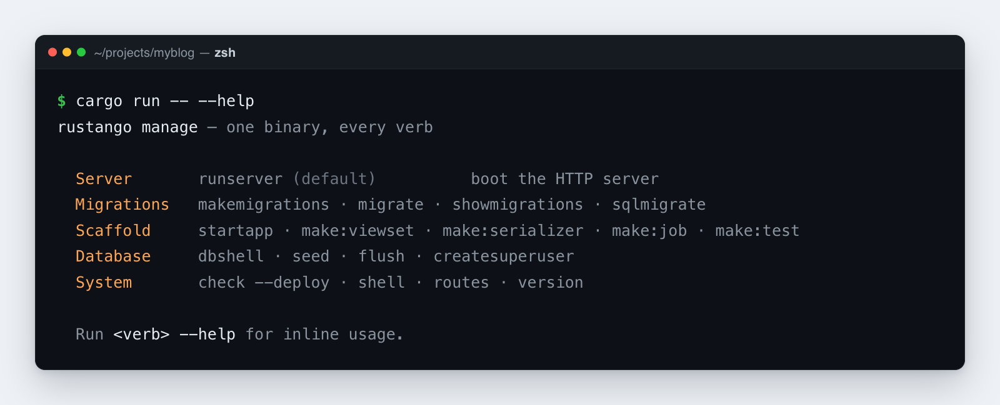

# Référence CLI `manage`

Ceci est l'outil en ligne de commande de **Rustango**. Dans un projet
généré via `cargo rustango new`, un seul binaire exécute chaque commande
(« verbe ») :

```bash
cargo run                          # runserver (no args = boot the HTTP server)
cargo run -- migrate               # any other verb
cargo run -- --help                # full subcommand list
```

[](../img/manage.png)

> **Source :** `rustango::manage` (`Cli`, le répartiteur de verbes) — derrière
> la fonctionnalité `manage` (activée par défaut).
>
> **Version exécutable :** chaque verbe présenté ici s'exécute dans un projet
> généré ; l'exemple
> [`getting_started_blog`](https://github.com/ujeenet/rustango/tree/main/crates/rustango/examples/getting_started_blog)
> est piloté par `cargo run -- migrate` et consorts.

> **Nouveau terme rencontré ici ?** *scaffold* (générateur de squelette),
> *migration*, *tenant* (locataire) — voir le [glossaire](glossary.md).

Le routeur de commandes se trouve dans [`rustango::manage::Cli`](https://docs.rs/rustango/latest/rustango/manage/struct.Cli.html) ;
votre `src/main.rs` le branche ainsi :

```rust
#[rustango::main]
async fn main() -> Result<(), Box<dyn std::error::Error>> {
    let _ = dotenvy::dotenv();
    rustango::manage::Cli::new().api(urls::api()).run().await
}
```

Les projets multi-tenant ajoutent `.tenancy()` à la chaîne. Cela fait basculer
le routeur vers [`rustango::tenancy::manage`](https://docs.rs/rustango/latest/rustango/tenancy/manage/index.html)
et débloque les commandes multi-tenant.

> **Forme plus ancienne** — les projets générés par
> `manage startapp --with-manage-bin` (ou datant d'avant la v0.16) livrent
> encore un `src/bin/manage.rs`. Ceux-ci utilisent
> `cargo run --bin manage -- <verb>`. Les deux formes acceptent les mêmes
> verbes.

Chaque commande affiche sa sortie sur stdout et se termine avec un code de
retour non nul en cas d'erreur de validation ou d'E/S. Exécutez
`cargo run -- --help` (ou `<verb> --help`) pour l'aide intégrée.

---

## Table des matières

- [Migrations](#migrations)
- [Migrations de données](#migrations-de-données)
- [Générateurs de projet / d'app](#générateurs-de-projet--dapp)
- [Générateurs de fichiers (`make:*`)](#générateurs-de-fichiers-make)
- [Utilitaires de base de données](#utilitaires-de-base-de-données)
- [Commandes système](#commandes-système)
- [Commandes de tenancy](#commandes-de-tenancy)
- [Sous-commandes personnalisées](#sous-commandes-personnalisées)
- [Flux de travail courants](#flux-de-travail-courants)
- [Tous les verbes](#tous-les-verbes)

---

## Tous les verbes

Les sections ci-dessous détaillent les verbes courants. Ce tableau est la liste
**complète**, tirée des deux dispatchers (`migrate/manage.rs` et
`tenancy/manage/mod.rs`) plutôt que de la prose — un verbe absent du guide
reste donc trouvable ici. Lancez `<verb> --help` pour ses drapeaux ; le texte
d'aide fait foi, pas cette page.

Les verbes marqués **T** exigent la fonctionnalité `tenancy` et passent par
`Cli::tenancy()`.

### Migrations et schéma

| Verbe | Ce qu'il fait |
|---|---|
| `makemigrations [name]` / `--empty <name>` | Génère une migration à partir du diff des modèles |
| `migrate [target]` / `--dry-run` / `--squash` | Applique les migrations en attente |
| `downgrade [N]` | Annule les N dernières migrations |
| `showmigrations` / `status` | Liste les migrations et leur état d'application |
| `sqlmigrate <name>` | Affiche le SQL qu'une migration exécuterait, sans l'exécuter |
| `forget-pending <name>` | Supprime un JSON de migration non appliquée dont aucune migration suivante ne dépend |
| `add-data-op --sql <SQL> [--reverse-sql <SQL>]` | Ajoute une opération de données écrite à la main |
| `inspectdb [--schema <s>] [--table <t>]` | Lit un schéma existant et produit du source `#[derive(Model)]` |

### Données

| Verbe | Ce qu'il fait |
|---|---|
| `dumpdata` | Exporte des lignes en fixtures JSON. Les flottants gardent chaque bit ; une colonne JSON contenant le `null` JSON est écrite `{"$json": null}`, distincte du NULL SQL (`null`) |
| `loaddata <fixture.json> [--fail-fast]` | Recharge des fixtures JSON. Un chargement échoué ou partiel n'est pas annulé |
| `flush [--yes] [--app <label>] [--model <name>]` | Vide chaque table de modèle ; les drapeaux restreignent l'ensemble. Les modèles non gérés et les vues sont ignorés. Postgres utilise `TRUNCATE … RESTART IDENTITY` et échoue si une table hors du filtre référence une cible (un lien `ON DELETE CASCADE` depuis celle-ci la vide quand même sur MySQL / SQLite) ; MySQL / SQLite suppriment les lignes dans une transaction, enfants d'abord, et gardent les compteurs d'id. Un projet multi-tenant exige `--tenant <slug>` et ne vide que ce tenant |
| `prune [--model <name>] [--except <name>] [--pretend]` | Suppression en masse en flux ; `--pretend` signale sans supprimer |
| `db:dump` / `db:restore` / `db:info` | Dump / restauration / inspection natifs |
| `dbshell` | Exécute le client natif (`psql` / `mysql` / `sqlite3`). N'a besoin que de `DATABASE_URL`, pas d'un pool fonctionnel — traité avant la construction du pool, il marche donc quand sqlx n'arrive pas à se connecter |

### Scaffolders et générateurs

| Verbe | Ce qu'il fait |
|---|---|
| `startapp <name>` | Génère un module d'application |
| `make:viewset` / `make:serializer` / `make:form` | Génère un ViewSet, un Serializer ou un Form |
| `make:job` / `make:scheduled` / `make:worker` / `make:middleware` / `make:notification` / `make:test` | Génère un job de file, une tâche à intervalle, un binaire de worker, un middleware, une notification ou un test |
| `make:api_routes <app> [--tenant]` | Génère le module de routes API d'une application |

### Cache, sessions et courriel

| Verbe | Ce qu'il fait |
|---|---|
| `createcachetable` / `create-cache-table` `[--table <name>]` | Crée la table de cache (et la table de sessions quand les sessions vont en base) |
| `clear-cache [--table <name>]` / `clearsessions` | La vide ; renvoie le nombre de lignes supprimées. Sans table, indique qu'il n'y a rien à vider |
| `sendtestemail --to <addr>` | Envoie un courriel de test fixe via le backend configuré |

### Introspection

| Verbe | Ce qu'il fait |
|---|---|
| `showmodels [--format plain\|json] [--app <label>]` | Chaque modèle enregistré, trié pour une sortie déterministe |
| `showurls [--format plain\|json]` | Chaque route nommée, triée |
| `check [--deploy]` | Contrôles de santé, changements de modèles sans migration et migrations non appliquées ; `--deploy` ajoute les audits de production |
| `create-admin` | Crée une ligne `AdminUser` pour les projets utilisant `admin::Builder::with_session_auth`. **Pas** conditionné à `tenancy` — prend un simple `&Pool` et écrit dans `rustango_admin_users`, en créant la table si besoin. Le seul moyen d'obtenir un premier login admin sur un projet non-tenancy |
| `reset-password <username>` / `change-password <username>` | Définit le mot de passe d'un utilisateur admin (base unique) ; `change-password` vérifie d'abord l'actuel. Mêmes options de mot de passe que `create-admin` |
| `set-admin-active <username> --on\|--off` | Désactive un utilisateur admin (ses sessions prennent fin) ou le réactive |
| `reset-admin-totp <username>` | Supprime l'appareil à deux facteurs d'un utilisateur admin après la perte du téléphone. Audité avec la source `cli` |
| `about` / `version` / `--version` | Informations de build et de version |
| `docs` | Ouvre la documentation |

### Utilisateurs et accès **T**

| Verbe | Ce qu'il fait |
|---|---|
| `create-superuser` / `set-superuser` | Crée un superutilisateur, ou promeut un utilisateur existant |
| `create-user` / `create-operator` | Crée un utilisateur de tenant ou un opérateur |
| `reset-password` / `change-password` | Récupération du mot de passe d'un utilisateur de tenant. Hors terminal, `change-password` lit le mot de passe actuel depuis `--current-stdin` ou `RUSTANGO_CURRENT_PASSWORD` ; `--current` dans argv émet un avertissement |
| `set-password-link <slug> <username>` | Affiche un lien à usage unique pour que l'utilisateur définisse son propre mot de passe |
| `reset-operator-password` / `change-operator-password` | Récupération du mot de passe d'un opérateur ; `change-operator-password` lit le mot de passe actuel comme `change-password` |
| `set-operator-active` | Active ou désactive un opérateur |
| `reset-operator-totp <username>` | Supprime l'appareil à deux facteurs d'un opérateur après la perte du téléphone. Audité dans le registry avec la source `cli` |
| `create-role` / `assign-role` / `revoke-role` / `list-roles` | Rôles |
| `grant-perm` / `revoke-perm` | Permissions par codename |
| `seed-permissions [--slug <s>]` | Initialise les lignes de permission par défaut |
| `create-api-key` | Émet une clé d'API |
| `revoke-passkey <slug> <username> [--credential <id>]` | Supprime une passkey d'un utilisateur de tenant, ou toutes (fonctionnalité `passkey`) |

### Tenants **T**

| Verbe | Ce qu'il fait |
|---|---|
| `create-tenant` / `edit-tenant` / `list-tenants` | Provisionner, éditer, lister |
| `drop-tenant` / `purge-tenant` | Désactiver (réversible) / détruire (non) |
| `rotate-tenant-password <slug>` | Nouveau mot de passe pour un login que rustango a créé sur un serveur enregistré |
| `migrate-tenants` / `migrate-registry` | Applique les migrations à tous les tenants, ou au registre |
| `migrate-tenant-storage <slug> --to schema\|database` | Déplace un tenant d'un mode de stockage à l'autre |
| `add-host` / `remove-host` / `list-hosts` / `set-host-enabled` | Routage par hôte |
| `add-db-server` / `edit-db-server` / `list-db-servers` / `test-db-server` / `remove-db-server` | Serveurs de bases de données enregistrés |
| `test-tenant-connection` | Vérifie que la base d'un tenant est joignable |
| `reseal-tenant-secrets [--apply]` | Rescelle les URL de tenant, les mots de passe de serveur, les secrets TOTP des opérateurs et les secrets SSO stockés avec la `RUSTANGO_SECRET_KEY` actuelle ; sans `--apply`, une simulation |
| `prewarm-pools` | Ouvre les pools de tenants avant la première requête |
| `run-server` / `runserver` | Lance le serveur multi-tenant |
| `init` / `init-tenancy` / `wizard` / `menu` / `actions` | Points d'entrée de configuration et interactifs |

**Premier administrateur.** `create-tenant <slug> … --admin-email <e> [--admin-username <u>]`
crée un superutilisateur après les migrations, avant la mise en service du
tenant ; si cela échoue, l'exécution revient en arrière. L'administrateur n'a
pas de mot de passe. Le verbe affiche une fois un lien de définition de mot de
passe : il ne sert qu'une fois, expire au bout de 72 heures, et uniquement sur
ce tenant. Donnez-le à l'administrateur. Il est signé avec la clé de session de
tenant du serveur (`RUSTANGO_SESSION_SECRET`, ou le fichier de clé de dev) :
lancez donc la CLI avec la même clé que le serveur.
`set-password-link <slug> <username>` en affiche un nouveau.

### Audit **T**

| Verbe | Ce qu'il fait |
|---|---|
| `audit-log` | Lit la piste d'audit |
| `audit-cleanup` | L'élague |

### MCP **T**

Documenté intégralement dans [le guide MCP](mcp.md).

| Verbe | Ce qu'il fait |
|---|---|
| `create-agent` / `list-agents` / `rotate-agent-secret` | Agents |
| `create-skill` / `list-skills` / `grant-skill` / `revoke-skill` | Skills |
| `map-skill-permission` / `unmap-skill-permission` | Lie un skill à une permission |
| `create-user-key` / `list-user-keys` / `revoke-user-key` | Identifiants MCP par utilisateur |
| `list-runs` / `show-run` | Historique des exécutions |

---

## Migrations

### `makemigrations [name]`

Génère un fichier de migration à partir des changements de vos modèles.
Elle compare vos modèles enregistrés au
dernier instantané de schéma sauvegardé dans `migrations/` et écrit un
nouveau fichier JSON avec ce qui a changé.

```bash
cargo run -- makemigrations                          # auto-name (e.g. 0004_add_slug_to_posts)
cargo run -- makemigrations rename_status_to_state   # custom suffix
```

**Changements détectés automatiquement :**
- `CreateTable` / `DropTable`
- `AddColumn` / `DropColumn`
- `AlterColumnType` / `AlterColumnNullable` / `AlterColumnDefault` / `AlterColumnMaxLength`
- `AlterColumnUnique`
- `CreateIndex` / `DropIndex`
- `AddCheckConstraint` / `DropCheckConstraint`
- `CreateM2MTable` / `DropM2MTable`

**NON détectés automatiquement** (renommage vs suppression+ajout est ambigu) :
- `RenameTable`, `RenameColumn` — utilisez `--empty` et modifiez le JSON. Une
  exception : un `src_col` / `dst_col` M2M modifié avec le même `through` est
  écrit comme `RenameColumn`, pour que la table de jonction garde ses lignes.

Une colonne supprimée à côté d'une nouvelle colonne du même type dans une table
ressemble à un champ renommé, et suppression+ajout effacerait ses données.
`makemigrations` le refuse et nomme les colonnes ; écrivez le `RenameColumn`
comme ci-dessous, ou passez `--drop-and-add` pour supprimer et ajouter
volontairement. Tout autre `DropColumn` avertit que ses données disparaissent.

### `makemigrations --app <app>`

Limite la migration à une seule app. Elle écrit dans le répertoire
`migrations/` propre à cette app, sous
`<project_root>/<app>/migrations/`, et ne regarde que les modèles
appartenant à cette app.

```bash
cargo run -- makemigrations --app blog
cargo run -- makemigrations --app blog backfill_slugs
```

### `makemigrations --scope <registry|tenant>`

Réservé au multi-tenant. Écrit une seule migration pour uniquement les
modèles d'un scope donné — ceux dont l'attribut
`#[rustango(scope = "...")]` correspond. (Les tables « registry » sont
partagées entre tous les tenants ; les tables « tenant » vivent par
tenant.) Sans ce drapeau, un simple `makemigrations` dans un projet de
tenancy scinde automatiquement les changements en DEUX fichiers — un pour
les modèles registry, un pour les modèles tenant — afin que les tables
partagées du framework (`Org`, `Operator`) ne se retrouvent pas dans les
migrations par tenant exécutées par `migrate-tenants`.

```bash
cargo run -- makemigrations                       # tenancy: writes 0NN_<auto>.json (registry) + 0MM_<auto>.json (tenant) as needed
cargo run -- makemigrations --scope tenant        # explicit single-scope diff
cargo run -- makemigrations --scope registry      # explicit single-scope diff
```

Pourquoi cette scission compte : avant la v0.24.2, un simple
`makemigrations` sur un projet de tenancy regroupait les opérations sur
`rustango_operators` (une table registry) dans une migration tenant.
Lorsque `migrate-tenants` exécutait ce fichier, `rustango_operators` se
résolvait via `search_path` vers la copie registry et entrait en conflit
avec la contrainte déjà présente là-bas.

### `makemigrations --empty <name>`

Crée une migration vide (sans opérations `forward`) que vous remplissez
vous-même à la main. Utilisez-la
lorsque vous devez écrire des opérations de données ou de renommage que le
détecteur automatique ne peut pas générer. Modifiez le JSON résultant
vous-même.

```bash
cargo run -- makemigrations --empty rename_status_to_state
# Then edit migrations/0005_rename_status_to_state.json:
#   "forward": [
#     {"schema": {"RenameColumn": {"table": "posts", "old_column": "status", "new_column": "state"}}}
#   ]
```

### `makemigrations --merge`

Corrige un historique de migrations qui s'est scindé en deux branches.
Cela
se produit quand deux personnes exécutent chacune `makemigrations` sur leur
propre branche de fonctionnalité, de sorte que les deux nouveaux fichiers
pointent vers le même parent. Une fois les deux branches fusionnées,
l'historique compte deux « feuilles » (points de fin), et
`makemigrations` refuse de s'exécuter tant qu'elles ne sont pas fusionnées.

`--merge` détecte cette situation et écrit un `NNNN_merge.json` vide dont
le parent pointe vers la dernière feuille par ordre alphabétique et dont
`merges` nomme les autres, réunissant l'historique en une seule chaîne. Son
instantané de schéma joint ceux des branches, donc les modifications de
modèles pas encore migrées apparaissent au prochain `makemigrations`.

```bash
cargo run -- makemigrations --merge
# wrote migrations/0004_merge.json
#     merge node — empty `forward`, anchors the chain after divergent leaves
```

- **Déjà une seule chaîne** → affiche `no merge needed` et se termine
  proprement. Sûr à exécuter sur un historique sain.
- **Historiques vraiment séparés** (pas une collision de branches) →
  échoue au lieu d'inventer un parent.
- **Ne peut pas être combiné** avec `--empty`, `--app`, `--scope`, ou un
  nom positionnel.

### `migrate`

Applique toutes les migrations en attente à la base de données, dans
l'ordre. C'est la commande à exécuter après `makemigrations` pour changer
réellement votre schéma.

```bash
cargo run -- migrate
cargo run -- migrate --dry-run                       # print SQL without writing
```

Chaque fichier s'exécute dans une transaction par défaut, donc un échec
annule tout le fichier. Réglez `"atomic": false` dans le JSON pour
désactiver ce comportement — nécessaire pour des instructions comme
`CREATE INDEX CONCURRENTLY` qui ne peuvent pas s'exécuter dans une
transaction.

En **mode tenancy** (`Cli::tenancy()`), `migrate` connaît le scope : elle
applique d'abord les migrations registry à la base de données registry
partagée, puis applique les migrations tenant à travers chaque tenant
actif. Pour un contrôle plus fin, utilisez
[`migrate-registry`](#migrate-registry) /
[`migrate-tenants`](#migrate-tenants).

### `migrate <target>`

Migre vers un point précis de l'historique, en avant ou en arrière.
Nommez une migration pour y
accéder ; la cible spéciale `zero` défait tout.

```bash
cargo run -- migrate 0003_add_slug      # forward to 0003
cargo run -- migrate 0001_initial       # roll back to 0001 (unapply 0002+)
cargo run -- migrate zero               # unapply EVERY migration
```

### `migrate --squash`

Regroupe chaque migration **en attente** (non appliquée) en un seul diff
nouvellement généré — l'échappatoire pour l'itération de développement,
utile quand une pile de migrations à moitié terminées est plus simple à
régénérer qu'à corriger. Elle refuse de toucher à tout ce qui est déjà
appliqué.

```bash
cargo run -- migrate --squash
```

Le fichier régénéré enregistre les noms qu'il a regroupés dans sa liste
`replaces`. Cela compte dès qu'une autre base de données entre en jeu :
le checkout de votre collègue, le staging, ou la CI ont peut-être déjà
appliqué certains des fichiers que vous venez de supprimer. Sans
`replaces`, le `CREATE TABLE` du nouveau fichier entrerait en conflit
là-bas ; avec, le runner **réconcilie** au lieu de cela (voir ci-dessous).

### Réconciliation du squash

Un squash recrée l'état final des migrations qu'il remplace, donc ce que
le runner doit faire dépend entièrement de ce que contient déjà la base
de données cible. La décision est automatique :

| état de la base de données | ce qui se passe |
|---|---|
| fraîche — aucun historique, aucune table | le squash s'exécute réellement |
| chaque migration remplacée est dans le journal | enregistrée, prédécesseurs mis en sommeil, **aucun DDL** |
| des tables existent mais le journal n'a aucun historique | enregistrée, **aucun DDL** — le journal est aligné après coup sur les tables existantes |
| seulement *certaines* des lignes/tables remplacées sont présentes | **refusé**, en précisant ce qui manque |

Le cas partiel est délibérément une erreur bloquante : aucun choix
automatique n'y est sûr, donc le runner s'arrête et vous indique ce qu'il
a trouvé plutôt que de deviner. Résolvez-le avec `migrate --fake`
(ci-dessous).

Les migrations remplacées par un squash appliqué sont considérées comme
appliquées, donc vous pouvez laisser les anciens fichiers sur le disque
pour une ou deux versions — les déploiements qui ne les ont jamais
exécutés migrent tout de même correctement vers l'avant.

Les migrations ordinaires (non-squash) ne sont pas affectées : une
migration classique dont la table existe déjà échoue toujours
bruyamment, car il s'agit d'un vrai conflit et non d'un historique
équivalent connu.

### `migrate --fake <name>`

Marque une migration comme appliquée **sans exécuter son SQL** —
l'échappatoire opérateur pour quand la base de données est déjà dans
l'état cible mais que le journal ne le sait pas (une base de données
configurée hors bande, une table de journal supprimée, une migration
partiellement réussie, un squash partiel refusé). Répétez le drapeau
pour réparer plusieurs lignes à la fois.

```bash
cargo run -- migrate --fake 0004_add_indexes
cargo run -- migrate --fake 0004_add_indexes --system        # framework's own chain
cargo run -- migrate --fake 0004_add_indexes --all-tenants   # every active tenant
```

Le nom est d'abord validé par rapport au répertoire de migrations, donc
une faute de frappe ne peut pas créer une fausse ligne. Le marquage est
idempotent.

`--system` cible la propre chaîne de migrations du framework
(`system/migrations/`, enregistrée dans
`__rustango_system_migrations__`) plutôt que celle de votre projet.
`--all-tenants` diffuse le marquage à travers chaque tenant actif, en
rapportant chacun et en continuant malgré les échecs — les tables du
framework vivent par tenant, donc les réparer est une tâche par tenant.

### `downgrade [N]`

Annule les N dernières migrations appliquées (par défaut 1). Chaque migration doit être réversible :
les changements de schéma s'annulent automatiquement, mais les
opérations de données nécessitent un `reverse_sql` défini, sinon
l'annulation échoue.

```bash
cargo run -- downgrade                  # one step
cargo run -- downgrade 3                # three steps
```

Dans un projet multi-tenant, `downgrade` annule les migrations du registre.
Les migrations de tenant sont dans le registre de chaque tenant :

```bash
cargo run -- downgrade --tenant acme    # un tenant
cargo run -- downgrade 2 --all-tenants  # chaque tenant actif, deux étapes chacun
```

Les tenants peuvent être à des versions différentes. `--all-tenants`
affiche le plan de chaque tenant sans rien changer ; ajoutez `--yes`
pour l'exécuter. Nommez une migration au lieu de N pour annuler tout
ce qui a été appliqué après elle :

```bash
cargo run -- downgrade 0001_initial --all-tenants        # le plan
cargo run -- downgrade 0001_initial --all-tenants --yes  # l'exécuter
```

### `showmigrations` / `status`

Liste chaque migration et indique si elle a été appliquée.
`[X]` signifie appliquée, `[ ]` signifie encore en attente.

```bash
cargo run -- showmigrations
cargo run -- status                     # alias
```

Sortie :

```
Migrations in ./migrations:
  [X] 0001_initial
  [X] 0002_add_status
  [ ] 0003_add_slug
System migrations in ./system/migrations:
  [X] 0001_create_rustango_audit_log_and_rustango_content_types
```

Une ligne remplacée par un squash appliqué affiche `[X] <name> (replaced by a squash)`.

---

## Migrations de données

### `add-data-op`

Ajoute une étape de données en SQL brut à une migration sans modifier de
JSON à la main. Utilisez-la quand vous devez transformer des lignes
existantes — remplir rétroactivement une colonne, nettoyer des données —
dans le cadre d'une migration. Le résultat est une migration de
données qui exécute du SQL brut, générée pour vous depuis la ligne de
commande.

```bash
# New migration with up + down
cargo run -- add-data-op \
    --sql "UPDATE posts SET slug = lower(title)" \
    --reverse-sql "UPDATE posts SET slug = NULL" \
    --name backfill_post_slugs

# Append to an existing migration
cargo run -- add-data-op \
    --to 0003_add_slug \
    --sql "UPDATE posts SET slug = id::text"

# Irreversible (no rollback)
cargo run -- add-data-op \
    --sql "DELETE FROM legacy_data" \
    --name purge_legacy
```

| Flag | Requis | Description |
|---|:-:|---|
| `--sql <SQL>` | oui | SQL avant exécuté lors de `migrate` |
| `--reverse-sql <SQL>` | non | SQL de retour en arrière lors de `unapply` ; omettez-le pour une opération irréversible |
| `--name <name>` | non | Suffixe de nom pour la nouvelle migration ; par défaut `data_op` |
| `--to <migration>` | non | Ajoute à une migration existante au lieu d'en créer une |

Omettez `--reverse-sql` et l'étape est marquée `reversible: false` —
toute tentative de l'annuler échoue immédiatement.

---

## Générateurs de projet / d'app

### `cargo rustango new <name>` *(binaire séparé)*

Crée un nouveau projet **Rustango**.
C'est un outil séparé, donc installez-le d'abord avec
`cargo install cargo-rustango`. Choisissez parmi trois modèles :

```bash
cargo rustango new myblog                          # default = fullstack (ORM + admin)
cargo rustango new myapi --template api            # JSON-only, no admin
cargo rustango new shop --template tenant          # multi-tenancy
```

Écrit :

```
<name>/
  Cargo.toml
  .env.example
  .gitignore
  rust-toolchain.toml
  docker-compose.yml
  Dockerfile                                (deploy image — multi-stage, release, non-root)
  Dockerfile.dev                            (cargo-watch image docker-compose.yml builds)
  .dockerignore
  README.md
  config/default.toml                       (shared knobs)
  config/{dev,staging,prod}_settings.toml   (per-tier overrides)
  migrations/                               (your app's migrations)
  system/migrations/                        (framework tables, generated — commit them)
  src/{lib,main,models,views,urls}.rs
```

Le niveau `config/` est la source des réglages : `default.toml` contient ce que
tous les environnements partagent et un `<env>_settings.toml` le surcharge,
sélectionné à l'exécution par **`RUSTANGO_ENV`** (`dev` par défaut) — un
`cargo run` tout neuf fonctionne donc sans aucune retouche TOML. Ensemble, ils
portent le réglage du pool `[database]`, `[admin]`, `[mcp]` et la politique
`secure_cookies` — et ce sont eux que lit l'audit de réglages de
[`check --deploy`](#check---deploy). Le contenu par niveau est détaillé dans
[Scaffolding](scaffolding.md).

Chaque template fournit un dossier `system/migrations/` **vide**. Les
propres tables du framework (`rustango_orgs`, `rustango_users`,
rôles/permissions, …) sont générées dans ce dossier à partir des modèles
compilés lors du premier `cargo run -- migrate` — il n'y a pas de JSON
d'amorçage livré à la main. Voir [`migrate`](#migrate) /
[`migrate-registry`](#migrate-registry).

### `startapp <name> [flags]`

Crée une nouvelle app (un module de fonctionnalité) sous `src/<name>/`.
Utilisez-la pour regrouper les
modèles, vues et URLs d'une partie de votre projet.

```bash
cargo run -- startapp blog
cargo run -- startapp shop --with-manage-bin             # also writes src/bin/manage.rs
cargo run -- startapp shop --into apps                   # write under src/apps/shop/ instead
```

Crée :

```
src/<name>/
  mod.rs
  models.rs      (a starter model named after the app)
  views.rs
  urls.rs
  tests.rs
```

Sûr à réexécuter — les fichiers existants sont laissés intacts. La commande
enregistre aussi le module : `pub mod <name>;` dans `src/lib.rs` (ou
`mod <name>;` dans `src/main.rs` s'il n'y a pas de `lib.rs`), plus une ligne
`.merge(crate::<name>::urls::api())` dans l'agrégateur `api()` de
`src/urls.rs`. Si elle ne peut pas modifier un fichier, elle affiche la ligne
à ajouter.

---

## Générateurs de fichiers (`make:*`)

Ceux-ci créent des fichiers de démarrage pour des briques courantes. Chaque générateur écrit dans `src/<snake_name>.rs`
(ou `tests/<snake_name>.rs` pour `make:test`) et :

- Vérifie que le nom est valide (PascalCase, lettres/chiffres/underscore) —
  ces générateurs émettent un **type**, le nom est donc un nom de type.
  `make:test` fait exception : il émet un fichier de fonctions de test, il
  accepte donc n'importe quel identifiant Rust et `make:test post_smoke`
  fonctionne comme montré plus bas.
- Le convertit en snake_case pour le nom de fichier (`PostViewSet` →
  `post_view_set.rs`).
- Ne remplace pas un fichier existant.
- Vous rappelle d'ajouter `pub mod X;` à votre `lib.rs`.

### `make:viewset <Name> [--model <Model>] [--tenant | --no-tenant] [--crate <path>]`

Génère une ressource REST CRUD complète pour un modèle.

**Deux modèles, choisis pour vous.** Le `#[derive(ViewSet)]` à pool unique
capture un seul pool au moment du montage, ce qui est faux pour un projet
tenancy — le générateur choisit donc entre deux formes. Ordre de résolution :
`--no-tenant` l'emporte, puis `--tenant`, puis la **détection automatique** —
`tenancy` dans la liste de features de la dépendance `rustango` du `Cargo.toml` —
et sinon le modèle à pool. Quand la détection automatique retient le mode
tenant, elle l'annonce sur stdout et nomme `--no-tenant` comme override.

```bash
cargo run -- make:viewset PostViewSet --model Post
cargo run -- make:viewset PostViewSet --model Post --no-tenant   # forcer la forme à pool
```

Modèle à pool — `src/post_view_set.rs` généré :

```rust
#[derive(ViewSet)]
#[viewset(model = Post, fields = "id, ", filter_fields = "", search_fields = "", page_size = 20, read_only)]
pub struct PostViewSet;
```

Il démarre en `read_only` : ajoutez `permissions(create = "...", ...)` derrière
une couche d'auth, puis retirez `read_only`, pour servir les écritures.
`--model Post` importe `crate::models::Post` ; modifiez la ligne `use` si le
modèle vit dans une app.

Montez-le dans `src/main.rs` avec le pool du serveur :
`.nest_with("/api", |pool| myapp::post_view_set::PostViewSet::router("/post_view_set", pool))`.

Modèle tenant — **pas un derive**. Il émet un `pub fn router() -> Router<()>`
construit à partir de
`ViewSet::for_model(Post::SCHEMA, &["id"])`, avec
`.permissions_for_model::<Post>()` actif et le reste de la chaîne du builder
(`filter_fields` / `search_fields` / `ordering` / `ordering_fields` /
`page_size` / `read_only`) ébauché en lignes commentées, et se termine par
`.tenant_router("/api/post_view_set")`. La connexion est résolue par requête via l'extracteur `Tenant` au
lieu d'être capturée une fois au montage, donc un seul `router()` sert tous les
tenants.

Montez-le avec : `.merge(crate::post_view_set::router())` — et **non** avec la
ligne `PostViewSet::router(path, pool)` ci-dessus.

`--crate <path>` renomme la crate du framework dans les lignes `use` générées,
pour les projets qui importent `rustango` sous un autre nom.

### `make:serializer <Name> [--model <Model>]`

Génère une structure `#[derive(Serializer)]` — contrôle la façon dont un
modèle est converti vers et depuis JSON.

```bash
cargo run -- make:serializer PostSerializer --model Post
```

### `make:form <Name>`

Génère une structure `#[derive(Form)]` pour valider et traiter une saisie
de formulaire.

```bash
cargo run -- make:form ContactForm
```

### `make:job <Name>`

Génère un `jobs::Job` — une struct de payload plus l'implémentation du trait,
avec `NAME`, `MAX_ATTEMPTS` et `async fn run(&self)`. C'est du travail que vous
mettez en file depuis un handler et qu'un worker exécute ensuite.

`run` ne reçoit **que la payload** : pas de pool, pas de tenant, pas de contexte
de requête. Portez dans ses champs tout ce dont la tâche a besoin.

```bash
cargo run -- make:job SendReceipt
```

Pour un travail qui tourne sur une minuterie plutôt que depuis une file, voir
`make:scheduled`.

### `make:scheduled <Name>`

Génère une tâche à intervalle fixe pour `scheduler::Scheduler` — la forme que
`make:job` émettait avant de générer un véritable job.

```bash
cargo run -- make:scheduled NightlySweep
```

Démarrez-la depuis un binaire worker (`make:worker`) : `main.rs` n'a pas de
pool, et du code avant `Cli::run()` tournerait pour chaque verbe de la CLI.

### `make:worker <Name>`

Génère un binaire de worker autonome pour `src/bin/` — un processus qui vide la
file de tâches et ne sert aucun HTTP. Lancez-le à côté du processus web, ou comme
son propre conteneur.

La forme est courte et facile à écrire de travers d'une manière qui ne se voit
qu'en production : un worker qui attend `tokio::signal::ctrl_c()` traite SIGINT
mais **pas** SIGTERM, qui est précisément ce qu'envoient `docker stop`,
Kubernetes et systemd. La vidange ne s'exécute alors jamais, le conteneur est tué
à l'expiration de son délai de grâce, et les tâches en vol sont perdues sans que
rien ne soit journalisé. Le worker généré attend `shutdown::shutdown_signal()`,
qui traite les deux signaux.

```bash
cargo run -- make:worker JobsWorker
```

### `make:notification <Name>`

Génère une structure de notification qui construit un email.

```bash
cargo run -- make:notification WelcomeEmail
```

### `make:middleware <Name>`

Génère une fonction middleware — du code qui s'exécute avant et après
chaque requête (vérifications d'authentification, journalisation, etc.).
« axum » est le framework web sur lequel **Rustango** est construit, donc
l'ébauche correspond à la forme du middleware d'axum.

```bash
cargo run -- make:middleware AuditLog
```

### `make:test <Name>`

Génère un test d'intégration dans `tests/` qui utilise `TestClient` pour
effectuer des requêtes contre votre app.

```bash
cargo run -- make:test post_smoke
```

---

## Utilitaires de base de données

### `db:info`

Affiche à quelle base de données cette build est configurée pour parler,
sans se connecter. Elle imprime la version du framework, les pilotes de
base de données compilés (fonctionnalités Cargo `postgres`/`mysql`),
l'URL de connexion avec le mot de passe masqué, et le backend détecté.
Comme elle n'ouvre jamais de connexion, elle est pratique en CI ou dans
des conteneurs où la base de données n'est pas encore prête mais où vous
voulez confirmer que les réglages sont corrects.

```bash
cargo run -- db:info
```

### `db:dump [--out <path>] [--data-only|--schema-only] [--no-owner]`

Sauvegarde votre base de données en exécutant `pg_dump` contre
`DATABASE_URL`. Par défaut, le SQL part
sur stdout (pour pouvoir le rediriger dans un pipe) ; passez
`--out <path>` (`-o`) pour écrire un fichier à la place. `--data-only`
et `--schema-only` correspondent directement aux drapeaux de `pg_dump`,
et `--no-owner` supprime les lignes OWNER. Vous devez avoir `pg_dump`
installé et dans votre `PATH`.

```bash
cargo run -- db:dump > backups/before-migrate.sql    # stdout → file
cargo run -- db:dump --out backups/before-migrate.sql
```

La ligne d'état `running: pg_dump …` part sur **stderr** : elle reste donc
hors de la redirection et hors d'un tube. Dans les anciennes versions,
elle partait sur stdout et se retrouvait en première ligne du fichier `.sql`.

### `db:restore <path> [--clean --yes]`

Recharge un fichier de sauvegarde dans votre base de données — l'inverse
de `db:dump`. Elle exécute le fichier via `psql` contre `DATABASE_URL`
avec `ON_ERROR_STOP=1` dans une seule transaction, donc elle s'arrête à la
première erreur et ne charge rien. Ajoutez `--clean --yes` pour effacer le
schéma existant au préalable (elle préfixe
`DROP SCHEMA IF EXISTS public CASCADE; CREATE SCHEMA public;`) afin que
la restauration se fasse sur une base de données vide ; un chargement en échec
annule l'effacement. Avec `--clean`, le dump doit être un fichier régulier non
vide, vérifié avant toute exécution ; sans `--clean`, elle lit aussi un tube.
Un projet multi-tenant refuse `--clean`, car `public` contient le registre.
Vous devez avoir `psql` dans votre `PATH`.

```bash
cargo run -- db:restore backups/before-migrate.sql
cargo run -- db:restore backups/before-migrate.sql --clean --yes
```

---

## Commandes système

### `version` / `--version`

Affiche la version du framework **Rustango**.

```bash
$ cargo run -- version
rustango 0.61.10
```

### `about`

Affiche un instantané de votre environnement : version du framework,
modèles et apps enregistrés, si la base de données est accessible, et
les variables d'environnement clés. Utile à joindre aux tickets de
support en cas de problème.

```bash
$ cargo run -- about
rustango
  version:        0.61.10
  models:         3 registered
  apps:           1 (blog)
  RUSTANGO_ENV:   local
  DATABASE_URL:   postgres://***@localhost:5433/myblog
  db_connect:     ok
```

### `check [--deploy]`

Exécute des vérifications de santé sur votre projet.
Ajoutez `--deploy` pour les vérifications plus strictes de
préparation à la production.

**Vérifications toujours actives :**
- ≥ 1 modèle enregistré via `inventory`
- Base de données accessible (`SELECT 1`)
- Des modèles enregistrés mais **aucune** migration sur le disque (il ne compare pas les nombres — un répertoire `migrations/` existant est signalé en info, quel que soit son contenu)

**Avec `--deploy` :**
- `RUSTANGO_ENV` vaut `prod` ou `production`
- `RUSTANGO_SESSION_SECRET` défini et décodé en une clé de ≥ 32 octets, la même vérification qu'à l'exécution (la clé HMAC pour les
  cookies + JWT ; `SECRET_KEY` n'est jamais lu par le framework)
- `DATABASE_URL` défini
- `RUSTANGO_APEX_DOMAIN` défini — l'avertissement se déclenche pour **tout** projet lorsqu'il est absent ou `localhost`, et le dit ; les projets mono-tenant peuvent l'ignorer
- `DATABASE_URL` pointant vers `localhost` / `127.0.0.1` (avertissement — en production, généralement un hôte managé)
- `RUSTANGO_BIND` commençant par `127.0.0.1` (avertissement — en loopback seul, aucun trafic externe n'est accepté)
- Un audit du palier de configuration sur votre TOML, signalant les valeurs de dev laissées dans un palier prod (nécessite la fonctionnalité `config`)
- `Meta.required_db_vendor` / `required_db_features` de chaque modèle enregistré, vérifiés contre le dialecte réellement connecté

```bash
$ cargo run -- check --deploy
running rustango system check (deploy mode)...
  [info]    3 models registered via inventory
  [info]    database reachable
  [info]    4 migration(s) on disk
  [info]    RUSTANGO_ENV is set to a production value
  [info]    RUSTANGO_SESSION_SECRET decodes to a valid ≥32-byte key
  [info]    DATABASE_URL set
  [info]    RUSTANGO_APEX_DOMAIN set to a non-localhost value
all checks passed
```

Se termine avec un code non nul si une vérification de niveau erreur
échoue. Les avertissements seuls ne provoquent pas d'échec.

### `docs`

Ouvre la documentation de **Rustango** (<https://docs.rs/rustango>) dans
votre navigateur. Elle affiche toujours aussi l'URL, afin de rester
utile sur un serveur sans interface graphique.

```bash
cargo run -- docs
```

### `--help` / `help`

Liste chaque commande avec une description d'une ligne. En mode
tenancy, les commandes multi-tenant listées ci-dessous sont ajoutées
également.

---

## Commandes de tenancy

Ces commandes n'existent que dans les projets multi-tenant (une
application servant de nombreux clients/organisations isolés). Elles
n'apparaissent que lorsque le projet est compilé avec
`features = ["tenancy"]` ET que `Cli::new()` est chaîné avec
`.tenancy()`.

Tout ce que la console opérateur sait faire, ces commandes le savent aussi
— pour qu'une action puisse tourner dans un hook de déploiement, dans un
cron, ou sur une machine où personne ne peut ouvrir de navigateur.

### `menu` / `actions`

Il y a plus de quarante verbes de tenancy. `--help` vous dit qu'ils
existent ; le menu vous aide à en exécuter un que vous n'avez jamais
lancé.

```bash
cargo run -- menu
```

```text
  rustango manage — pick an action

  TENANTS
     1) list-tenants             every tenant in the registry
     2) create-tenant            provision a new tenant
     3) edit-tenant              change routing and display config
     …
  HOSTNAMES
     7) list-hosts               every hostname a tenant answers on
     …
     q  quit
     ?  every other verb: cargo run -- --help
```

Choisissez un numéro (ou tapez le verbe) : il ne demande que ce que le
verbe ne demandera pas lui-même, affiche la ligne de commande qu'il
s'apprête à exécuter, l'exécute, puis revient pour l'action suivante. Il
repasse par le même dispatcher que les flags, il ne peut donc pas s'en
écarter.

Voisin mais différent : [`wizard`](#wizard--init) est une mise en place
unique ; `menu` est la liste permanente de ce que vous pouvez faire
ensuite.

### `wizard` / `init`

Mène un projet neuf de « je viens de l'échafauder » à un tenant
fonctionnel, un opérateur et un superutilisateur de tenant. Chaque étape
est optionnelle — tapez `n` pour en sauter une.

```bash
cargo run -- wizard
```

### `init-tenancy`

**Ne fait rien — conservée pour compatibilité.** Le framework ne fournit
plus de migrations d'amorçage écrites à la main. Ses propres tables
(`rustango_orgs`, `rustango_operators`, `rustango_users`,
rôles/permissions, …) sont générées dans `system/migrations/` à partir
des modèles compilés — le flux habituel (modèles →
`makemigrations` → `migrate`) — et appliquées par [`migrate`](#migrate) /
[`migrate-registry`](#migrate-registry), qui les génèrent à la demande
si les fichiers sont absents.

```bash
cargo run -- init-tenancy   # does nothing now; kept so old scripts don't break
```

Les anciennes versions écrivaient ici `0001_rustango_*_initial.json` ;
ce flux figé a disparu. **Pour provisionner, exécutez simplement
`cargo run -- migrate`.** Un modèle utilisateur personnalisé
(déclaré sur `rustango_users`) passe par le même `system/migrations/`
généré — voir
[Modèle utilisateur personnalisé](#modèle-utilisateur-personnalisé-colonnes-supplémentaires-sur-rustango_users).

### `migrate-registry`

Applique uniquement les migrations registry — les tables partagées,
inter-tenant. Le registry contient `rustango_orgs` et
`rustango_operators` plus toute table de scope registry que vous
définissez. Les tables tenant ne sont pas touchées.

```bash
cargo run -- migrate-registry
```

### `migrate-tenants`

Applique les migrations tenant à chaque tenant actif, l'un après
l'autre. Chaque tenant utilise sa propre connexion (son propre schéma ou
sa propre base de données), et si un tenant échoue, les autres
continuent tout de même — la commande rapporte le résultat par tenant à
la fin.

```bash
cargo run -- migrate-tenants
```

Pour le cas courant, un simple `migrate` fait déjà registry en premier,
puis tenants — n'utilisez `migrate-tenants` que lorsque vous avez besoin
de cette étape seule.

### `runserver` / `run-server`

Démarre le serveur web multi-tenant. Dans un
projet de tenancy, c'est équivalent au simple `cargo run` ; la forme
nommée existe pour que des binaires personnalisés qui analysent leurs
propres arguments puissent tout de même la déclencher.

```bash
cargo run                        # implicit
cargo run -- runserver           # explicit
```

`--bind <addr>` l'emporte sur `RUSTANGO_BIND` et `[server] bind` ; dans un projet tenancy, `--apex <domain>` l'emporte sur `RUSTANGO_APEX_DOMAIN` et `[tenancy] apex_domain`. Tout autre flag est refusé. Le serveur journalise en INFO l'adresse où il écoute.

Sur SIGTERM, il n'accepte plus de connexions et laisse aux connexions ouvertes
`[server] shutdown_timeout_secs` (20 par défaut) pour finir, puis ferme le reste.
SSE et long-poll ne finissent jamais seuls. Les exécutions de provisionnement et
de migration laissées en `running` plus d'une heure par un processus arrêté sont
marquées en échec au démarrage suivant, et une relance du webhook avec le même
`event_id` s'exécute à nouveau.

Un `runserver` à base unique applique les migrations en attente avant d'écouter et
déclenche `pre_migrate` / `post_migrate` comme `migrate`. Il attend au plus
`[server] migrate_lock_timeout_secs` (300 par défaut) le verrou d'une autre
exécution, puis s'arrête. Désactivez-le avec `[server] migrate_on_boot = false`
(`RUSTANGO__SERVER__MIGRATE_ON_BOOT=false`) ou `Cli::migrate_on_boot(false)`.
Pour un déploiement progressif à plusieurs réplicas, désactivez-le et lancez
`migrate` une fois dans un job avant le déploiement : aucun pod ne migre pendant
que les anciens servent encore. Le serveur tenancy ne migre jamais au démarrage ;
lancez `migrate` vous-même.

### `create-tenant <slug> [options]`

Met en place un nouveau tenant (client/organisation) et applique les
migrations tenant à celui-ci. Le `<slug>` est son identifiant court.
**Pas** sûr à réexécuter : l'appeler à nouveau sur un slug existant est refusé
d'emblée avec ``tenant slug `<slug>` already exists``
(`tenancy::provision::provision_tenant`), avant toute autre opération.

```bash
cargo run -- create-tenant acme --display-name "ACME Corp"
cargo run -- create-tenant beta --mode database --database-url postgres://...
cargo run -- create-tenant gamma --mode database --server main
```

| Flag | Description |
|---|---|
| `--display-name <name>` | Libellé lisible affiché dans les barres latérales d'administration |
| `--mode schema \| database` | Mode de stockage (par défaut : schema, ou database quand `--database-url` ou `--server` est donné) |
| `--database-url <url>` | Une base existante pour le tenant |
| `--server <name>` | Crée plutôt la base sur ce [serveur enregistré](#serveurs-de-bases-de-données) |
| `--host-pattern <pattern>` | Remplace le motif d'hôte utilisé par `SubdomainResolver` |
| `--no-migrate` | Ignore l'application des migrations à scope tenant après le provisionnement |
| `--backend postgres \| mysql \| sqlite` | Doit être le backend du registre, qui est la valeur par défaut |
| `--schema-name <s>` | Remplace le nom de schéma généré en mode schéma |
| `--port <n>` | Port sur lequel le tenant est joignable, pour le routage |
| `--path-prefix <s>` | Préfixe de chemin sous lequel le tenant est joignable, pour le routage |
| `--admin-email <e>` / `--admin-username <u>` | Crée le premier superutilisateur du tenant (voir **Premier administrateur** plus haut) |
| `--resume` | Termine un tenant qu'un run précédent a laissé inactif après l'échec de ses migrations ; redonnez les mêmes options |

Si les migrations du tenant échouent, `create-tenant` sort avec un code
non nul et le tenant reste inactif. Corrigez la migration, puis relancez
la même commande avec `--resume` : elle migre et active ce tenant.

Chaque mode vérifie ses droits avant de créer quoi que ce soit et, quand l'un
manque, le nomme et affiche les instructions qui le corrigent : le mode schéma
demande le `CREATE` du login du registre sur la base du registre, `--server`
demande les droits d'administration ci-dessous, `--database-url` n'en demande
aucun. Voir [Droits](tenant-databases.md#droits).

Avec `--server`, les droits d'administration du serveur sont vérifiés d'abord,
puis une base portant exactement le nom du slug est créée avec son propre login
(mot de passe aléatoire, autorisé sur cette base seulement) ; SQLite crée
`<dir>/<slug>.db`. Une base existante de ce nom est refusée, jamais réutilisée.
Le nouveau login doit ensuite se connecter (une règle pg_hba ou un compte MySQL
qui le masque échoue ici). Sur MySQL, la base copie la collation utf8mb4 du
registre. L'URL du tenant est stockée scellée et la base est enregistrée dans
`rustango_tenant_databases`. Si l'enregistrement, la migration ou l'activation
échoue, la nouvelle base, le login et la ligne du tenant sont à nouveau
supprimés : la même commande peut donc simplement être relancée. Si cette
suppression échoue, le tenant inactif et son enregistrement restent : une
nouvelle tentative qui reprend (webhook, `create_tenant_if_missing`) le migre
sur place. L'enregistrement est écrit avant le `CREATE`, donc une exécution
tuée en cours de route laisse une base que rustango peut retrouver : une
nouvelle tentative après dix minutes la supprime et recommence, et refuse une
base dont elle ne peut pas prouver qu'elle l'a créée.

### `edit-tenant <slug> [options]`

Modifie la configuration de routage et d'affichage d'un tenant — les
mêmes champs que la page d'édition de la console opérateur.

```bash
cargo run -- edit-tenant acme --host-pattern shop.example.com
cargo run -- edit-tenant acme --display-name "ACME Inc" --deactivate
cargo run -- edit-tenant acme --clear host-pattern
```

| Flag | Description |
|---|---|
| `--display-name <name>` | Libellé lisible par un humain |
| `--host-pattern <host>` | Nom d'hôte nu auquel le tenant répond |
| `--path-prefix <path>` | Un segment avec slash initial, p. ex. `/acme` |
| `--port <n>` | Port sur lequel le tenant est apparié |
| `--database-url <url>` | Fait tourner l'URL de connexion du tenant |
| `--activate` / `--deactivate` | Met le tenant en service ou hors service |
| `--clear <field>` | Vide `host-pattern`, `path-prefix` ou `port` |

**Seuls les champs que vous nommez sont touchés.** « Laisser tel quel »
et « vider » sont deux instructions différentes — c'est à cela que sert
`--clear`, qui évite de dépendre de `--host-pattern ""`, que certains
shells et runners CI avalent.

Les valeurs sont validées comme `create-tenant` les valide : un motif
d'hôte portant un port, ou un préfixe de chemin que le résolveur ne
pourrait jamais produire, est refusé plutôt que stocké pour n'apparier
silencieusement jamais rien.

Faire tourner `--database-url` change l'URL stockée. Chaque serveur bascule
en 30 s, quand son cache de tenants se rafraîchit ; les autres modifications
laissent les connexions chaudes tranquilles. Un secret tourné derrière la
**même** référence (vault, variable d'environnement) ne change rien de
stocké : redémarrez les serveurs, ou invalidez le pool du tenant sur chacun.

### `test-tenant-connection <url> [flags]`

Sonde une URL de base de données avant que vous ne vous y engagiez — elle
se connecte et, par défaut, écrit puis annule, si bien qu'un identifiant
en lecture seule est détecté ici plutôt qu'à la première requête du
tenant.

```bash
cargo run -- test-tenant-connection postgres://user:pw@host/db
cargo run -- test-tenant-connection "$URL" --no-write-probe --timeout 5
```

### `drop-tenant <slug> [--confirm <slug>]`

Désactive un tenant en réglant `active = false`. C'est l'option souple
et réversible — les données du tenant restent sur le disque, et
réactivez-le avec `edit-tenant <slug> --activate`.
Réexécuter `create-tenant` ne marche **pas** : la ligne `Org` existe toujours,
donc le slug est refusé comme doublon. Quand vous n'êtes pas en
mode interactif (aucun terminal attaché), vous devez passer
`--confirm <slug>` avec le slug retapé pour confirmer.

```bash
cargo run -- drop-tenant acme --confirm acme
```

### `purge-tenant <slug> [--confirm <slug>] [--purge-database]`

**Supprime définitivement un tenant.** Elle supprime le schéma du
tenant et retire sa ligne de `rustango_orgs`, sans possibilité
d'annulation. Quand vous n'êtes pas en mode interactif (aucun terminal
attaché), vous devez passer `--confirm <slug>` avec le slug retapé.
Pour les tenants en mode database, la commande **refuse purement et
simplement** sauf si vous passez aussi `--purge-database` — elle
ne supprime pas la ligne `Org` en laissant la base, elle ne fait rien du tout.

```bash
cargo run -- purge-tenant acme --confirm acme
cargo run -- purge-tenant beta --confirm beta --purge-database   # database-mode: also DROP DATABASE
```

Chaque étape s'affiche quand elle se termine et la purge est enregistrée comme
une exécution de type `purge` (`list-runs --kind purge`). Une base que rustango a
créée sur un serveur enregistré est supprimée par l'administrateur de ce
serveur, avec son login et son enregistrement ; chaque refus s'exécute avant
que quoi que ce soit ne change. Voir
[Bases de tenants sur un serveur enregistré](tenant-databases.md).

Avec plusieurs serveurs, désactivez d'abord (`drop-tenant`) et attendez 30 s.
Un serveur dont le cache contient encore un tenant en mode schema garde
`search_path = <schema>, public` ; une fois le schema supprimé, ses requêtes
retombent sur `public` jusqu'au rafraîchissement du cache.

### `rotate-tenant-password <slug>`

Donne un nouveau mot de passe aléatoire au login que rustango a créé pour le
tenant sur un serveur enregistré : modifié sur le serveur, puis scellé et
stocké à la place de l'ancienne URL, puis les pools du tenant se rouvrent. Les
étapes s'affichent quand elles se terminent ; l'exécution est enregistrée comme
`rotate_password`. Les autres pods récupèrent la nouvelle URL en un sondage
d'empreinte ; voir [Bases de tenants sur un serveur enregistré](tenant-databases.md)
pour cette fenêtre.

```bash
cargo run -- rotate-tenant-password acme
```

### `list-tenants`

Liste chaque tenant avec son mode de stockage et son statut
actif/inactif.

```bash
cargo run -- list-tenants
```

### Noms d'hôte

Un tenant est joignable à son sous-domaine et, en option, aux noms
d'hôte supplémentaires que vous lui attachez. Un nom d'hôte mène à
exactement un tenant.

```bash
cargo run -- list-hosts acme
cargo run -- add-host acme shop.example.com
cargo run -- set-host-enabled acme shop.example.com --off   # le mettre en attente
cargo run -- remove-host acme shop.example.com
```

| Verbe | Ce qu'il fait |
|---|---|
| `list-hosts <slug>` | Tous les noms d'hôte du tenant, l'hôte de base en premier |
| `add-host <slug> <hostname>` | En attache un. Refusé si un autre tenant le revendique déjà |
| `remove-host <slug> <hostname>` | Le détache |
| `set-host-enabled <slug> <hostname> --on\|--off` | Servir ou mettre en attente |

La mise en attente (`--off`) conserve la ligne tout en retirant l'hôte du
service — utile pendant la propagation DNS, ou pour retirer un domaine
que vous voudrez peut-être récupérer.

Les noms d'hôte sont normalisés à l'entrée (minuscules, sans schéma, sans
port, sans chemin), car la valeur stockée est comparée octet par octet à
l'en-tête `Host`. Les verbes affichent ce qui a été **stocké**, pas ce
que vous avez tapé.

L'**hôte de base** provient du `host_pattern` du tenant et n'a pas de
ligne propre : il ne peut donc pas être retiré ici — changez-le avec
[`edit-tenant --host-pattern`](#edit-tenant-slug-options). Il n'y a
délibérément pas de `rename-host` : retirez puis rajoutez, pour que le
changement atteigne aussi les autres pods en cours d'exécution.

### Serveurs de bases de données

Enregistrez une fois le login d'administration d'un serveur, pour y créer les
bases des tenants sans SQL. Le backend est celui du registre.

```bash
cargo run -- add-db-server main --host db.internal --user admin --tls require
cargo run -- test-db-server main
cargo run -- list-db-servers
cargo run -- edit-db-server main --port 6432
cargo run -- remove-db-server main
```

| Verbe | Ce qu'il fait |
|---|---|
| `add-db-server <name> --host <h> [--port <n>] --user <u> [--tls <mode>] [--maintenance-db <db>]` | Enregistre un serveur. SQLite : `--sqlite-dir <dir>` à la place |
| `list-db-servers` | Tous les serveurs enregistrés, sans secrets |
| `test-db-server <name>` | Se connecte et liste la version et les droits du login d'administration, une ligne chacun ; échoue en nommant ce qui manque et le `GRANT` à exécuter |
| `edit-db-server <name> [same flags] [--prompt-password \| --clear-password] [--on\|--off]` | Modifie un serveur ; `none` vide `--tls` ou `--maintenance-db` |
| `remove-db-server <name>` | Le supprime ; refusé tant que la base d'un tenant s'y trouve |

Le mot de passe est demandé sans écho, ou lu dans la variable nommée par
`--password-env <VAR>` ; `--no-password` n'en enregistre aucun. Il ne vient
jamais d'argv et n'est jamais affiché. Il est stocké scellé, donc
`RUSTANGO_SECRET_KEY` doit être défini. `--tls` accepte `disable`, `prefer`,
`require`, `verify-ca` ou `verify-full` ; un nouveau serveur reçoit `require`
sauf si vous en passez un autre. `edit-db-server --prompt-password` garde le mot
de passe enregistré sur une réponse vide. La suppression est refusée tant que
l'URL d'un tenant pointe vers le serveur, ou ne peut pas être résolue ou
analysée. Les hôtes sont comparés sans tenir compte de la casse, des crochets
IPv6 ni d'un point final ; `localhost` et `127.0.0.1` comptent comme des hôtes
différents. `reseal-tenant-secrets` rescelle aussi les mots de passe des serveurs.

### `create-operator <username> --password <pwd>`

Crée un opérateur — un administrateur global qui peut gérer chaque
tenant depuis une console inter-tenant. Les opérateurs vivent dans le
registry partagé, pas dans un tenant en particulier.

```bash
cargo run -- create-operator admin --password correct-horse-42
cargo run -- create-operator admin --generate     # en afficher un aléatoire à la place
```

Omettez `--password` sur un terminal et il le demande sans écho.

### `list-operators`

Chaque opérateur, avec son statut actif et sa date de création, plus un
décompte de ceux encore actifs.

```bash
cargo run -- list-operators
```

### `set-operator-active <username> --on|--off`

Coupe ou rétablit l'accès d'un opérateur. La ligne reste dans les deux
cas, de sorte que « qui a fait ça ? » se résout encore plus tard — et la
console la relit à **chaque** requête, si bien qu'une désactivation prend
effet au clic suivant plutôt qu'à l'expiration du cookie.

```bash
cargo run -- set-operator-active grace --off   # départ d'un collègue
cargo run -- set-operator-active grace --on
```

Deux choses qu'il refuse, pour la même raison que la console :

- **Désactiver le dernier opérateur actif.** Cela enferme tout le monde
  dehors, et seul un shell sur le registry pourrait le défaire.
- **Se désactiver soi-même**, quand la requête vient de la console. La
  CLI n'a pas de session dont s'exclure, seule la première règle s'y
  applique.

La direction est obligatoire — deviner reviendrait soit à retirer un
accès, soit à en accorder un, et les deux sont fautifs s'ils se font en
silence. Régler l'état déjà en place est signalé et réussit, pour qu'un
script de provisioning relancé ne passe pas au rouge.

### `create-user <tenant> <username> --password <pwd> [--superuser]`

Crée un utilisateur au sein d'un tenant — avec `--superuser`, un
administrateur, mais toujours limité à un seul tenant. Au lieu de
`--password`, vous pouvez passer `--password-stdin` ou `--generate` (affiche un
mot de passe aléatoire) ; omettez les trois dans un terminal et la commande le
demande. Le mot de passe doit suivre les mêmes règles que les formulaires
web : au moins 12 caractères, un chiffre ou un symbole, pas un mot de passe
faible connu. `--skip-validation` les ignore. Il n'y a pas de flag `--staff`.

```bash
cargo run -- create-user acme alice --password Hunter2-alice-pw --superuser
```

`--superuser` règle `is_superuser = true` pour cet utilisateur au sein
du tenant. Cela en fait un administrateur du tenant (accès en écriture
complet dans l'admin du tenant), mais cela ne lui donne jamais accès à
la console opérateur inter-tenant.

### `create-role <tenant> <name>`

Crée un rôle (un ensemble nommé de permissions) au sein d'un tenant.

```bash
cargo run -- create-role acme editor
```

### `list-roles <tenant>`

Liste les rôles définis dans un tenant donné.

```bash
cargo run -- list-roles acme
```

### `assign-role <tenant> <username> <role>`

Donne à un utilisateur l'un des rôles du tenant.

```bash
cargo run -- assign-role acme alice editor
```

### `revoke-role <tenant> <username> <role>`

Retire un rôle à un utilisateur — l'inverse d'`assign-role`.

```bash
cargo run -- revoke-role acme alice editor
```

### `grant-perm <tenant> <role-name|username> <codename> [--role]`

Accorde une seule permission. Par défaut, le deuxième argument est un
**nom d'utilisateur**, donc la permission va directement à cet
utilisateur ; ajoutez `--role` pour l'accorder à un rôle à la place.
Les noms de code de modèle suivent le format `<table>.<action>`
(`posts.add`, `posts.change`, `posts.delete`, `posts.view`). `migrate` crée
ces quatre pour chaque modèle ; excluez un modèle avec
`#[rustango(permissions = false)]`.

```bash
cargo run -- grant-perm acme alice posts.change           # grant to user alice
cargo run -- grant-perm acme editor posts.change --role   # grant to role editor
```

### `revoke-perm <tenant> <role-name|username> <codename> [--role]`

Retire une permission — l'inverse de `grant-perm`. Cible un utilisateur
par défaut ; ajoutez `--role` pour la retirer à un rôle à la place.

```bash
cargo run -- revoke-perm acme alice posts.change
cargo run -- revoke-perm acme editor posts.change --role
```

### `create-api-key <tenant> <username> [--label <s>]`

Émet une clé API pour un utilisateur du tenant. Le jeton complet est
affiché **une seule fois** et jamais plus — copiez-le maintenant, car
seuls son préfixe et un hachage sont stockés.

```bash
cargo run -- create-api-key acme alice --label "ci-bot"
```

### `audit-cleanup`

Élague les anciennes entrées du journal d'audit (`rustango_audit_log`)
pour l'empêcher de grossir indéfiniment. Réduisez par âge (`--days`) ou
par nombre (`--keep-last`), et limitez éventuellement à un seul tenant.

```bash
cargo run -- audit-cleanup --days 90                       # delete > 90 days old
cargo run -- audit-cleanup --keep-last 50                  # keep most recent 50 per row
cargo run -- audit-cleanup --keep-last 50 --tenant acme    # scoped
cargo run -- audit-cleanup --registry --days 90            # le journal du registry seul
```

Par défaut, il balaie le journal propre au registry **et** celui de chaque
tenant actif. C'est dans le journal du registry que la console opérateur
consigne ce qu'ont fait les opérateurs : il grossit donc avec l'usage de
la console. Nommer un tenant (`--tenant`) demande ce tenant-là et laisse
le registry tranquille. Un tenant cassé est signalé et compté plutôt que
de mettre fin au balayage.

Un projet à base unique a le même verbe avec `--days`, `--keep-last` et `--yes` ;
il réduit l'unique journal d'audit.

### Voir ce qui s'est passé

Trois verbes en lecture seule qui affichent ce que la console rend — les
réponses qu'il vous faut pendant un incident, sans navigateur ni client
SQL.

```bash
cargo run -- list-runs                        # exécutions récentes de provisioning et de migration
cargo run -- list-runs --kind migrate --limit 50
cargo run -- show-run 42                      # les étapes d'une exécution
cargo run -- audit-log                        # qui a changé quoi, et quand
cargo run -- audit-log --pk acme --limit 100
```

| Verbe | Flags |
|---|---|
| `list-runs` | `--limit <n>`, `--kind provision\|migrate\|purge\|rotate_password`, `--state pending\|running\|succeeded\|failed` |
| `show-run <id>` | — |
| `audit-log` | `--limit <n>`, `--table <t>`, `--pk <v>`, `--operation <o>`, `--source <s>` |

`list-runs` affiche les plus récentes en premier, et ses filtres tournent
dans la requête : chercher une exécution `migrate` en trouve donc une même
si les plus récentes sont toutes des provisionings. `show-run` affiche
l'en-tête de l'exécution et chaque étape enregistrée, ce qui vous dit *où*
une panne s'est produite.

Les tenants créés depuis la CLI sont enregistrés aussi, marqués
`requested_by = cli`, si bien que l'historique couvre les deux surfaces.

### `prewarm-pools`

Ouvre à l'avance une connexion pour chaque tenant actif en mode
`database`. Cela vaut le coup après un déploiement, un redémarrage du
registry ou une rotation d'identifiants : cela transforme « la première
requête vers chaque tenant paie la connexion » en une seule attente
délibérée, et fait apparaître un tenant injoignable avant qu'un
utilisateur ne le trouve.

```bash
cargo run -- prewarm-pools
```

La console opérateur a également un bouton pour cela, sur la liste des
tenants.

---

## Modèle utilisateur personnalisé (colonnes supplémentaires sur `rustango_users`)

Voici comment ajouter vos propres champs à la table utilisateur. Le
`User` de tenant intégré possède neuf colonnes fixes : `id`, `username`,
`password_hash`, `is_superuser`, `active`, `created_at`,
`password_changed_at`, `sessions_revoked_at`, plus une colonne JSONB `data`
(un blob JSON flexible) pour toute métadonnée supplémentaire par utilisateur.
Avec la fonctionnalité `sso`, il a aussi un `email` unique. **Pour la plupart des apps, cette
colonne JSONB est tout ce dont vous avez besoin** — pas de migration,
pas de surcharge, pas de surprise.

Quand vous voulez des colonnes **typées, indexables** sur
`rustango_users` à la place, il existe deux approches. Elles ne sont pas
interchangeables ; choisissez celle qui correspond à l'étape de vie de
votre projet.

### Option 1 — Modèle de profil compagnon avec clé étrangère *(fonctionne sur tout projet)*

Idéale quand le projet existe déjà, ou quand vous préférez laisser la
table `User` du framework comme source unique de vérité.

```rust
#[derive(rustango::Model)]
pub struct UserProfile {
    #[rustango(primary_key)] pub id: rustango::sql::Auto<i64>,
    #[rustango(fk = "rustango_users")] pub user_id: i64,
    #[rustango(max_length = 128, default = "''")] pub display_name: String,
    #[rustango(max_length = 64, default = "'UTC'")] pub timezone: String,
}
```

Exécutez `cargo run -- makemigrations` puis `cargo run -- migrate`, et
vous avez une table d'extras typée liée à l'utilisateur par clé
étrangère. Lisez-la avec l'ORM :

```rust
let profile = UserProfile::objects()
    .where_(UserProfile::user_id.eq(user.id.get().copied().unwrap()))
    .first(&pool).await?;            // Option<UserProfile>
```

Compromis : une ligne supplémentaire et une jointure à chaque accès.
Avantage : zéro risque de casser l'authentification du framework.

### Option 2 — `Cli::user_model::<AppUser>()` *(uniquement pour un projet neuf)*

N'utilisez ceci que sur un projet neuf où vous voulez les champs
supplémentaires directement sur la table `rustango_users` elle-même.
Comme `AppUser` *est* le modèle `rustango_users`, ses colonnes passent
par le moteur ordinaire `makemigrations` → `migrate` : les tables du
framework sont générées dans `system/migrations/`, donc les colonnes
d'`AppUser` se retrouvent dans le `CREATE TABLE rustango_users` généré.

**Étape 1.** Définissez votre modèle. Il doit déclarer exactement chaque
colonne requise par le framework (`id`, `username`, `password_hash`,
`is_superuser`, `active`, `created_at`, `data`,
`password_changed_at`, `sessions_revoked_at`), plus vos extras. Chaque
colonne supplémentaire doit soit autoriser `NULL`, soit avoir un
`default = "…"`.

```rust
use rustango::sql::Auto;

#[derive(rustango::Model, Debug, Clone)]
#[rustango(table = "rustango_users")]
pub struct AppUser {
    #[rustango(primary_key)] pub id: Auto<i64>,
    #[rustango(max_length = 64, unique)] pub username: String,
    #[rustango(max_length = 255)] pub password_hash: String,
    pub is_superuser: bool,
    pub active: bool,
    pub created_at: chrono::DateTime<chrono::Utc>,
    #[rustango(default = "'{}'")] pub data: serde_json::Value,
    pub password_changed_at: Option<chrono::DateTime<chrono::Utc>>,
    pub sessions_revoked_at: Option<chrono::DateTime<chrono::Utc>>,
    // extras —
    #[rustango(max_length = 128, default = "''")] pub display_name: String,
    #[rustango(max_length = 64, default = "'UTC'")] pub timezone: String,
}
impl rustango::tenancy::TenantUserModel for AppUser {}
```

**Étape 2.** Branchez la surcharge dans `main.rs` :

```rust
#[rustango::main]
async fn main() -> Result<(), Box<dyn std::error::Error>> {
    rustango::manage::Cli::new()
        .api(my_app::urls::router())
        .tenancy()
        .user_model::<AppUser>()
        .run().await
}
```

`user_model` vérifie le modèle au démarrage et panique s'il manque une colonne
requise ; c'est la déclaration du modèle sur `rustango_users` qui le sélectionne.

**Étape 3.** Enregistrez `AppUser` **au lieu du** `User` du framework —
un seul modèle peut revendiquer `table = "rustango_users"`. Le
générateur de squelette ne livre aucun JSON d'amorçage statique
(seulement un `system/migrations/` vide), donc il n'y a rien à
supprimer ; il faut juste ne pas enregistrer aussi le `User` du
framework.

**Étape 4.** Générez + appliquez :

```bash
cargo run -- makemigrations       # generates system/migrations/ with AppUser's columns
cargo run -- migrate              # creates rustango_users with your extras
```

**Mises en garde :**

- Modifier `AppUser` plus tard est un changement de schéma ordinaire :
  réexécutez `makemigrations` pour émettre la migration `AddColumn`,
  puis `migrate`.
- Un seul modèle peut correspondre à `rustango_users`. Enregistrer **à
  la fois** le `User` du framework et votre `AppUser` rend
  `makemigrations` ambigu — enregistrez `AppUser` seul. C'est la
  raison principale pour laquelle l'option 2 est réservée aux projets
  neufs ; sur un projet existant, l'option 1 évite le problème.
- Le code d'authentification et d'administration du framework lit les
  neuf colonnes essentielles par leur nom ; vos colonnes
  supplémentaires ne sont accessibles que via
  `AppUser::objects().fetch(...)`.

`Builder::user_model::<AppUser>()` fait la même chose pour le code qui
construit directement le `Builder` du serveur, sans passer par `Cli`.

---

## Sous-commandes personnalisées

Une crate peut ajouter ses propres verbes, l'application aussi. Ils
apparaissent dans `--help` sous la crate qui les a enregistrés et
s'exécutent comme les verbes intégrés.

**Depuis une crate** — `register_command!` enregistre le verbe à l'édition
de liens ; l'application hôte ne modifie pas `main` :

```rust
use std::io::Write as _;
use rustango::manage::CommandContext;

// In any crate the binary links, e.g. a CMS library.
rustango::register_command!(
    "reset-link",
    "Print a password-reset link for a user",
    |mut ctx: CommandContext, args: Vec<String>| async move {
        let user = args.first().ok_or("usage: reset-link --tenant <slug> <user>")?;
        let pool = ctx.tenant_pool().ok_or("pass --tenant <slug>")?.clone();
        // ... look the user up on `pool` with the ORM ...
        writeln!(ctx.stdout(), "link for {user}")?;
        Ok(())
    },
);
```

**Depuis l'application** — la méthode de builder `Cli::command` :

```rust
rustango::manage::Cli::new()
    .tenancy()
    .command("import-csv", "Import a CSV file", |ctx, args| async move {
        my_csv_importer::run(ctx.pool(), &args).await?;
        Ok(())
    })
    .run()
    .await
```

Le handler reçoit un `CommandContext` et les arguments après le verbe :

- `ctx.pool()` — la base de l'application ; dans un projet multi-tenant, le registre.
- `ctx.tenant_pool()` / `ctx.tenant()` — avec `Cli::tenancy()`,
  `--tenant <slug>` est retiré des arguments et ouvre le pool de ce tenant
  (mode schéma ou base, tout backend). `ctx.tenant_by_slug(slug)` en ouvre
  un autre.
- `ctx.settings()` — les réglages passés à `Cli::with_settings*`.
- `ctx.stdout()` — la sortie.

```bash
cargo run -- reset-link --tenant acme alice
```

Un nom qui entre en conflit avec un verbe intégré, ou enregistré deux
fois, fait échouer `Cli::run` au démarrage avec les deux noms dans l'erreur.

`Cli::run_with_args(args)` exécute la CLI sur les arguments que vous lui
donnez (sans nom de programme) au lieu de ceux du processus, par exemple
depuis un test.

**Connexion à la base.** Tous les verbes, le serveur et les commandes
personnalisées lisent la base depuis `DATABASE_URL`, ou depuis `DB_DRIVER`,
`DB_HOST`, `DB_PORT`, `DB_USER`, `DB_PASSWORD` (ou `DB_PASSWORD_FILE`, un
fichier qui le contient), `DB_NAME` et `DB_PARAMS`. Pour SQLite, mettez
`DB_DRIVER=sqlite` et le chemin du fichier dans `DB_NAME`. Définir à la fois
`DB_PASSWORD` et `DB_PASSWORD_FILE` est une erreur. Si les deux styles sont
définis, `DATABASE_URL` l'emporte, un seul avertissement (mot de passe masqué)
le signale, et `check --deploy` le liste ; à partir de 0.62.0, les variables
`DB_*` l'emporteront, donc gardez un seul style.

---

## Flux de travail courants

### Mise en place d'un projet pour la première fois (mono-tenant)

```bash
cargo rustango new myapp
cd myapp
cp .env.example .env             # edit DATABASE_URL
docker compose up -d
cargo run -- migrate
cargo run                        # serve at :8080
```

### Mise en place d'un projet pour la première fois (tenancy)

```bash
cargo rustango new myapp --template tenant
cd myapp
cp .env.example .env             # edit DATABASE_URL + RUSTANGO_APEX_DOMAIN
docker compose up -d
cargo run -- makemigrations                               # files for your models
cargo run -- migrate                                      # registry + tenants
cargo run -- create-operator admin --password correct-horse-42
cargo run -- create-tenant acme --display-name "ACME Inc" \
                  --host-pattern acme.localhost
cargo run -- create-user acme alice --password Tenant-pw-2026 --superuser
cargo run                        # serve at :8080
```

### Ajout de tenants une fois l'app déjà en fonctionnement

Une véritable application de tenancy accumule généralement des modèles
et des migrations bien avant l'arrivée de son premier tenant. Ce flux
fonctionne à n'importe quel moment de la vie du projet :

```bash
# 1. (any time) develop user models — define structs with #[derive(Model)],
#    add `pub mod ...;` to src/lib.rs.
# 2. Generate scope-aware migrations. In a tenancy project this writes
#    up to TWO files: one tagged registry-scope (touches Org/Operator),
#    one tagged tenant-scope (touches User + your models). Pre-v0.24.2
#    this used to dump everything into one tenant-scoped file and
#    crash on `create-tenant` — see the changelog.
cargo run -- makemigrations

# 3. Apply migrations. `migrate` is scope-aware: it runs registry-
#    scoped files once against the registry pool first, then fans
#    tenant-scoped files across every active tenant.
cargo run -- migrate

# 4. Provision a NEW tenant whenever (could be days, weeks, many
#    migrations later). The tenancy code applies every accumulated
#    tenant-scoped migration to the new tenant's schema in one pass —
#    the new tenant arrives at the same schema state as existing ones.
cargo run -- create-tenant acme --display-name "ACME Inc" \
                  --host-pattern acme.localhost
cargo run -- create-user acme alice --password Tenant-pw-2026 --superuser
```

Pourquoi c'est sûr :
- `#[rustango(scope = "registry")]` sur `Org`/`Operator` maintient les
  changements aux tables partagées hors des migrations par tenant.
- `migrate-tenants` visite chaque tenant actif et applique uniquement
  les migrations tenant — les fichiers registry sont ignorés.
- `create-tenant` exécute ce même passage `migrate-tenants` contre le
  schéma du nouveau tenant, qui démarre donc entièrement à jour sans
  correctif manuel.

### Ajouter un modèle

```bash
cargo run -- startapp blog        # if not done yet
# Edit src/blog/models.rs — add #[derive(Model)]
# (startapp already added `pub mod blog;` to src/lib.rs)
cargo run -- makemigrations
cargo run -- migrate
```

### Ajouter une API JSON pour ce modèle

```bash
cargo run -- make:viewset PostViewSet --model Post
# Edit src/post_view_set.rs — fill in field lists
# Add `pub mod post_view_set;` to src/lib.rs
# Mount it in src/main.rs: .nest_with("/api", |pool| PostViewSet::router("/posts", pool))
cargo run                        # GET /api/posts now works
```

### Ajouter un remplissage rétroactif de données

```bash
cargo run -- add-data-op \
    --sql "UPDATE posts SET slug = lower(title) WHERE slug IS NULL" \
    --reverse-sql "UPDATE posts SET slug = NULL" \
    --name backfill_post_slugs
cargo run -- migrate
```

### Audit avant déploiement

```bash
cargo run --release -- check --deploy
```

### Annuler la dernière migration

```bash
cargo run -- downgrade 1
```

### Appliquer une migration de tenancy à un scope spécifique

```bash
cargo run -- migrate-registry            # registry-scoped only
cargo run -- migrate-tenants             # tenant-scoped, fan-out across orgs
```

### Décommissionner un tenant

```bash
cargo run -- drop-tenant acme            # soft (reversible)
cargo run -- purge-tenant acme           # hard (drops schema/db)
```

---

## Réglage du pool par tenant (v0.27.7+)

Les tenants en mode database obtiennent leur propre pool de connexions
(un `PgPool` — un ensemble de connexions de base de données réutilisées),
mis en cache par slug dans
[`TenantPools`](https://github.com/ujeenet/rustango/blob/main/crates/rustango/src/tenancy/pools.rs). Par défaut, un
pool est construit **de façon paresseuse, à la première requête du
tenant**, sauf si vous activez le préchauffage. Les réglages se trouvent
sur `TenantPoolsConfig` :

| Champ | Défaut | Objet |
|---|---|---|
| `max_cached_database_pools` | 64 | Plafond du cache de pools. Une fois plein, le prochain tenant non mis en cache échoue (pas d'éviction silencieuse). |
| `database_pool_max_connections` | 16 | `max_connections` par pool. À garder petit pour qu'un éparpillement de tenants n'épuise pas le `max_connections` de PG. |
| `database_pool_min_connections` | 0 | Garde N connexions chaudes en permanence. `≥1` réduit la latence de la première requête en payant l'aller-retour TCP/TLS/auth au démarrage. |
| `database_pool_acquire_timeout` | 30s | Durée d'attente de `pool.acquire()` avant l'erreur `PoolTimedOut`. |
| `database_pool_idle_timeout` | 10 min | Ferme les connexions inactives après cette durée. Protège contre les coupures dues à l'équilibreur de charge / à `idle_in_transaction_session_timeout`. |
| `database_pool_max_lifetime` | 30 min | Force la rotation des connexions pour que les identifiants louvés via vault soient renouvelés. |
| `prewarm_active_tenants` | false | Si vrai, `Server::Builder::serve` appelle `prewarm_database_tenants()` au démarrage. |
| `max_cached_scoped_pools` | 64 | Plafond des pools par tenant mis en cache pour les tenants en mode schéma. |
| `scoped_pool_max_connections` | 8 | `max_connections` de chaque pool de tenant en mode schéma. |

Avec `Cli`, passez la configuration via `Cli::with_tenant_pools(config)`.

### Préchauffage au démarrage

Deux façons de le déclencher :

1. **Automatique** — réglez `prewarm_active_tenants = true` sur le
   `TenantPoolsConfig` que vous passez à
   `TenantPools::new(...).config(...)`. `Server::Builder::serve`
   exécute le préchauffage avant de se lier au port.

2. **Verbe CLI** — `cargo run -- prewarm-pools` construit les pools
   pour chaque tenant actif en mode database et se termine. Utile
   comme hook post-déploiement (par exemple après une rotation
   d'identifiants), ou pour vérifier que chaque tenant est accessible
   avant de basculer un équilibreur de charge.

Le préchauffage parcourt `Org::objects().where(active = true,
storage_mode = "database")` et s'arrête court quand le plafond du
cache est atteint (rapporté comme `skipped_cap` dans le
[`PrewarmReport`]). Les échecs de construction par tenant journalisent
un `tracing::warn!` mais n'interrompent pas la boucle.

### Traçage

`tenant_pool_init` est un `tracing::info_span!` qui enveloppe la
construction du pool sur le chemin froid, et les événements qu'il
contient portent le target `rustango::tenancy::pools`. Abonnez-vous-y
pour voir la latence de construction par tenant :

```text
INFO rustango::tenancy::pools: tenant pool connected (database mode)
     slug=acme elapsed_ms=42 min_conn=1 max_conn=4
```

Activez-le avec `RUST_LOG=rustango::tenancy::pools=info`. Un filtre sur
`crate::tenancy::pools` ne correspond à rien — un target est une chaîne,
pas un chemin ; voir
[Journalisation](logging.md#targets--nommer-le-sous-système).

### Piège de configuration — TLD `.local` sur macOS

Si vous accédez à l'admin du tenant via
`http://acme.local:8080/admin/` sur macOS et constatez une pause de 5
secondes à chaque requête : c'est **Bonjour / mDNS**, pas
**Rustango**. Le résolveur de macOS traite `.local` de façon spéciale
et attend le délai complet de mDNS avant de retomber sur
`/etc/hosts`. Deux corrections :

1. **Utiliser un TLD différent** : `127.0.0.1 acme.localhost`
   fonctionne sans délai. `localhost` est réservé (RFC 6761) et évite
   mDNS.
2. **Exécuter dnsmasq** avec une zone `.local` pointant vers 127.0.0.1
   pour que l'OS obtienne une réponse immédiate.

Confirmez avec `curl -w "%{time_connect}\n"` : si `time_connect`
affiche environ 5s mais tombe à quelques millisecondes avec
`--resolve acme.local:8080:127.0.0.1`, vous êtes bien confronté à mDNS.


---

## Voir aussi

- [Recueil ORM](orm.md)
- [Générateurs de squelette](scaffolding.md)
- [ViewSets](viewsets.md)
- [Serializers](serializers.md)
- [Guide de sécurité](security.md)
