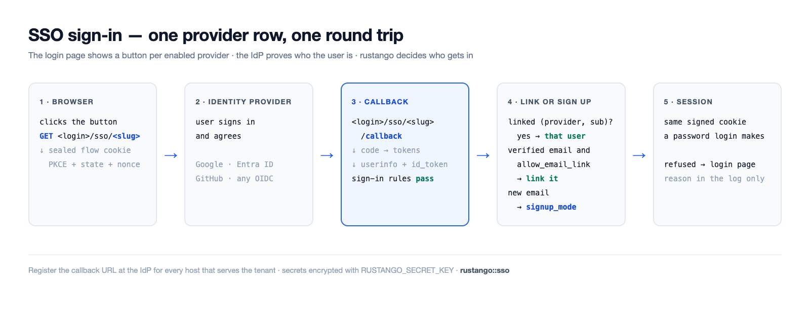
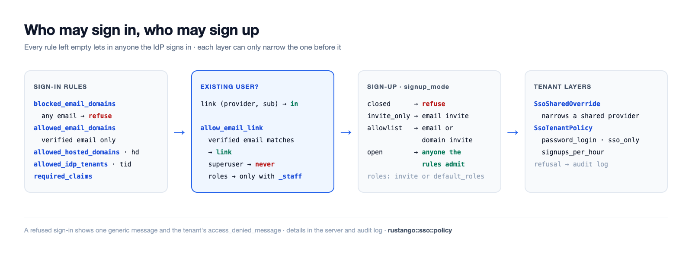

# SSO (OpenID Connect / connexion sociale)

Connectez-vous avec un fournisseur d'identité externe (IdP) au lieu d'un
mot de passe local : Google, Microsoft Entra ID, GitHub, GitLab, Discord
ou **tout provider OpenID Connect** (Okta, Auth0, Keycloak, …). Chaque
provider est une ligne que vous ajoutez dans l'admin : pas de fichier de
configuration, pas de recompilation.

[](../img/sso-flow.png)

## Configurer le SSO en quatre étapes

1. **Créez une app chez l'IdP.** Enregistrez une application web (un
   « client OAuth » ou un « enregistrement d'app »). Copiez son **client
   ID** et son **client secret**. Les [guides par provider](#guides-par-provider)
   ci-dessous disent où.
2. **Enregistrez l'URL de callback** chez l'IdP, pour chaque hôte qui sert
   la page de connexion. C'est `<login>/sso/<slug>/callback` sur cet hôte ;
   voir [URL de callback](#url-de-callback). Choisissez le `slug`
   maintenant, p. ex. `google`.
3. **Ajoutez la ligne du provider.** Dans l'admin du tenant, ajoutez une
   ligne au modèle `rustango_sso_providers` : `slug`, `label`, `kind`,
   `client_id`, `client_secret`, et `issuer_url` quand `kind` vaut `oidc`.
   Seul un superutilisateur peut ajouter ou modifier des lignes de
   provider. Chaque champ a un texte d'aide sous sa saisie ; la
   [référence des champs](#référence-des-champs) reprend les mêmes textes.
   `RUSTANGO_SECRET_KEY` doit être définie, sinon le secret ne peut pas
   être enregistré.
4. **Testez la connexion.** Ouvrez la page de connexion dans une fenêtre
   privée et utilisez le nouveau bouton. Une connexion refusée affiche un
   message générique ; la raison est dans le journal du serveur
   (`sso refused`) et dans le journal d'audit. `manage check --deploy`
   repère un provider qui refuserait tous les utilisateurs existants.

Le SSO connecte l'utilisateur **lié** à l'identité de l'IdP : une ligne
`rustango_sso_links` par `(provider, sub)`. L'email envoyé par l'IdP ne
suffit jamais à lui seul. Un utilisateur qui se connecte pour la première
fois n'est lié par son email vérifié que si le provider a
**`allow_email_link`** activé (désactivé par défaut), et jamais si le
compte est un superutilisateur ou, sans `allow_email_link_staff`, du staff
(tenant : détient un rôle ou une permission directe quelconque ; bare admin : tout compte). Ces comptes sont liés
par un admin, qui ajoute la ligne `SsoLink` dans l'admin ; la ligne de
journal du refus indique le subject. (Le flux membre, ci-dessous,
peut aussi créer un compte pour un email inconnu ; c'est désactivé par défaut.)

> **Source :** le cœur `rustango::sso`, indépendant de l'admin
> (`SsoProvider`, `build_provider`, `verified_email`, `ResolvedSso`,
> `SsoError`), la table de liens `rustango::sso::link` (`SsoLink`,
> `ProviderKey`, `sign_in`), le câblage bare-admin `rustango::admin::sso`, le SSO
> par tenant / console `rustango::tenancy::sso`
> (`SharedSsoProvider`), et le SSO membre
> `rustango::tenancy::member_auth`.

## URL de callback

Le callback est construit à chaque requête à partir de l'hôte et du
`slug` : `https://<host><login>/sso/<slug>/callback`. Sur les surfaces
d'admin, le schéma est `https`, sauf si un proxy de confiance envoie
`X-Forwarded-Proto` ; le flux membre utilise aussi `http` sur un hôte
loopback (voir [SSO membre](#sso-membre-utilisateur-final)). Enregistrez
une URL par hôte où le provider est utilisé.

| Surface de connexion | Tenant sur son propre hôte | Tenant sous un préfixe de chemin |
|---|---|---|
| Admin du tenant (`<login>` vaut `/login`) | `https://acme.example.com/login/sso/<slug>/callback` | `https://app.example.com/acme/login/sso/<slug>/callback` |
| Connexion des membres (`member_sso_router`, `login_base` par défaut `/auth`) | `https://acme.example.com/auth/sso/<slug>/callback` | `https://app.example.com/acme/auth/sso/<slug>/callback` |
| Admin nu (sans tenancy), monté sur `/admin` | `https://admin.example.com/admin/login/sso/<slug>/callback` | — |

Avec `RouteConfig::legacy()`, le `<login>` de l'admin du tenant vaut
`/__login`. Un tenant joignable sur son propre hôte et sous un préfixe a
besoin des deux URL. Pour un provider partagé, la console opérateur
affiche l'URL de callback à enregistrer à côté de chaque ligne.

## Guides par provider

### Google

1. Dans la console Google Cloud, ouvrez *APIs & Services → Credentials* et
   créez un *OAuth client ID* de type *Web application*.
2. Ajoutez l'URL de callback sous *Authorized redirect URIs*.
3. Ligne du provider : `kind = google`, le client ID et le secret. Laissez
   `issuer_url` vide. Scopes par défaut : `openid email profile`.
4. Pour n'autoriser que votre Google Workspace, renseignez
   `allowed_hosted_domains` (le claim `hd`), p. ex. `client.org`.

### Microsoft Entra ID

1. Dans le centre d'administration Entra, ouvrez *App registrations → New
   registration*. Ajoutez l'URL de callback comme redirect URI *Web*.
2. Copiez l'*Application (client) ID*. Sous *Certificates & secrets*,
   créez un client secret et copiez sa valeur.
3. Ligne du provider : `kind = microsoft`. Il utilise l'endpoint `common` ;
   avec `allowed_idp_tenants` vide, tout annuaire Entra peut se connecter.
   Mettez-y votre *Directory (tenant) ID* pour n'autoriser que votre
   annuaire ; ses emails comptent alors comme vérifiés, et `role_map` et
   `required_claims` s'appliquent. `check --deploy` avertit quand
   `role_map` ou `required_claims` est renseigné et `allowed_idp_tenants`
   vide.
4. N'utilisez pas `kind = oidc` avec un émetteur Entra à annuaire unique
   (`…/<tenant-id>/v2.0`) : cette ligne n'est pas traitée comme Microsoft,
   Entra n'envoie pas `email_verified`, donc la liaison par email,
   l'inscription et `allowed_email_domains` refusent tout le monde.

### GitHub

1. Dans GitHub, ouvrez *Settings → Developer settings → OAuth Apps → New
   OAuth App*. Mettez l'URL de callback dans *Authorization callback URL*.
2. Copiez le client ID et générez un client secret.
3. Ligne du provider : `kind = github`. Scopes par défaut :
   `read:user user:email`. L'email vérifié vient de `/user/emails`. GitHub
   n'envoie pas d'id_token, donc une règle qui en a besoin, comme
   `allowed_idp_tenants`, refuse.

### OpenID Connect générique

1. Créez un client web (confidential) chez votre IdP et ajoutez l'URL de
   callback.
2. Ligne du provider : `kind = oidc`, le client ID et le secret, et
   `issuer_url`, par exemple `https://<org>.okta.com`,
   `https://<host>/realms/<realm>` (Keycloak) ou
   `https://<tenant>.auth0.com/`.
3. rustango lit `<issuer>/.well-known/openid-configuration` pour trouver
   les endpoints, une fois par émetteur et par heure. Scopes par défaut :
   `openid email profile`.

`check --deploy` avertit pour la liaison par email sur un provider `oidc`
et pour un émetteur `http://` qui n'est pas loopback.

## Référence des champs

Ce sont les textes d'aide que l'admin affiche sous chaque saisie (en
anglais là-bas).

### `SsoProvider` et `SharedSsoProvider`

Les providers propres d'un tenant sont des lignes `SsoProvider`. Les
providers partagés de la console opérateur (`SharedSsoProvider`) ont les
mêmes champs et affichent les mêmes textes.

| Champ | Quoi saisir |
|---|---|
| `slug` | Id court dans les URL du provider, p. ex. `google` : l'IdP renvoie les utilisateurs vers `<login>/sso/<slug>/callback`. Unique ; un nouveau slug implique une nouvelle URL de callback chez l'IdP. |
| `label` | Texte du bouton de connexion, p. ex. `Sign in with Google`. |
| `kind` | `google`, `microsoft`, `github`, `gitlab` ou `discord` pour un provider intégré, ou `oidc` pour tout autre provider OpenID Connect (remplissez alors l'URL de l'émetteur). |
| `issuer_url` | Seulement pour `oidc` : l'URL de l'émetteur, p. ex. `https://<org>.okta.com` ou `https://<host>/realms/<realm>`. Les endpoints sont lus dans `<issuer>/.well-known/openid-configuration` ; pour Microsoft Entra ID, utilisez le type `microsoft`. |
| `client_id` | Client ID (ID d'application) de l'enregistrement de l'app chez votre fournisseur d'identité. |
| `client_secret` | Client secret du même enregistrement d'app. Stocké chiffré avec `RUSTANGO_SECRET_KEY`. |
| `enabled` | Afficher le bouton de ce provider sur la page de connexion. |
| `sort_order` | Ordre des boutons sur la page de connexion ; les plus petits nombres d'abord. |
| `scopes` | Scopes OAuth séparés par des espaces, p. ex. `openid email profile`. Vide : les scopes par défaut du type. |
| `allow_email_link` | Sécurité : lier une première connexion au compte existant ayant le même email vérifié ; le mot de passe de ce compte ne fonctionne plus, ses sessions prennent fin, ses clés API sont supprimées et ses clés d'agent désactivées. Jamais un superutilisateur, et un utilisateur avec un rôle ou une permission quelconque seulement avec la liaison par email pour le staff ; l'admin nu l'ignore. |
| `allowed_email_domains` | Sécurité : seuls les utilisateurs dont l'email vérifié est dans ces domaines peuvent se connecter. Liste séparée par des virgules ou des retours à la ligne : `client.org` est ce domaine seul, `*.client.org` ses sous-domaines seuls. Vide : tout domaine. |
| `blocked_email_domains` | Les utilisateurs avec un email dans ces domaines ne se connectent jamais, même si la liste autorisée les contient. Même format que la liste autorisée. |
| `allowed_idp_tenants` | IDs d'annuaire (tenant) Microsoft Entra autorisés, séparés par des virgules, lus dans un id_token vérifié. Vide : tout annuaire Entra peut se connecter par un provider `microsoft`. |
| `allowed_hosted_domains` | Domaines Google Workspace (le claim `hd`) autorisés, séparés par des virgules, p. ex. `client.org`. |
| `required_claims` | Objet JSON des claims qu'une connexion doit porter, chacun avec une de ses valeurs : `{"roles": ["App.User"]}`. `{}` : aucun claim exigé. |
| `signup_mode` | Sécurité : qui obtient un nouveau compte à la première connexion : `closed` (personne), `invite_only` (une invitation pour l'email), `allowlist` (une invitation pour l'email ou son domaine) ou `open` (quiconque les règles de connexion admettent). Vide : le défaut de la page de connexion. |
| `default_roles` | Rôles du tenant qu'obtient un nouvel utilisateur, séparés par des virgules, p. ex. `Viewer`. Une invitation avec des rôles les remplace. |
| `role_map` | Objet JSON d'un groupe ou rôle d'app de l'IdP vers des rôles du tenant : `{"Admins": "Editor"}` ou `{"Admins": ["Editor", "Viewer"]}`. |
| `role_claims` | Claims que lit la table des rôles, séparés par des virgules. Vide : `groups,roles`. |
| `sync_roles_on_login` | Appliquer la table des rôles à chaque connexion, pas seulement à la première. Seuls les rôles de la table sont ajoutés ou retirés. |
| `username_from` | D'où vient le nom d'utilisateur d'un nouvel utilisateur : la partie locale de l'email, l'email entier, ou le `preferred_username` de l'IdP (à défaut, la partie locale). |
| `username_clash` | Que faire si ce nom d'utilisateur est pris : ajouter un court suffixe, ou refuser l'inscription. |
| `sync_profile` | Mettre à jour le nom et l'email depuis l'IdP à chaque connexion. Jamais pour un superutilisateur. |
| `allow_email_link_staff` | Sécurité : avec la liaison par email active, lier aussi les utilisateurs qui ont un rôle ou une permission quelconque. Un superutilisateur n'est jamais lié par email. |
| `sso_only` | Les utilisateurs liés par ce provider ne peuvent pas se connecter avec un mot de passe, même quand le provider est désactivé. |
| `auto_deactivate_after_days` | Après autant de jours sans usage, `sso-deactivate-idle` désactive les utilisateurs inscrits par ce provider qui ne peuvent pas utiliser de mot de passe : SSO seul ici, ou connexion par mot de passe désactivée pour le tenant. Vide : jamais. |
| `session_ttl_secs` | Session la plus longue, en secondes, après une connexion par ce provider. Vide : la durée de session normale. |
| `superuser_session_ttl_secs` | Session la plus longue, en secondes, pour un superutilisateur connecté par ce provider. Vide : la durée de session normale. |

### `SsoTenantPolicy`

Les réglages de tout le tenant, une ligne.

| Champ | Quoi saisir |
|---|---|
| `name` | Toujours `default` : le tenant utilise cette seule ligne. |
| `access_denied_message` | Message affiché sur la page de connexion après une connexion SSO refusée, p. ex. qui contacter. Affiché en texte brut. |
| `password_login` | Le formulaire de mot de passe : `on`, `off` (aussi pour les superutilisateurs) ou `superusers_only` (seulement à `?local=1`, pour les superutilisateurs). |
| `sso_only` | Personne sauf un superutilisateur ne se connecte avec un mot de passe. |
| `default_provider` | Slug du provider que la page de connexion ouvre directement, sauf à `?local=1` ou après une erreur. |
| `signups_per_hour` | Nombre maximal d'inscriptions SSO par heure. Vide : 100 ; `0` : pas de limite. |

### `SsoLandingRule`

Où mène une connexion sans `?next=`. Les règles passent dans l'ordre de
`position` et la première qui correspond gagne. Elles valent pour les connexions
SSO et par mot de passe sur l'admin du tenant et l'admin nu ; la connexion des
membres les ignore. Une règle dont le chemin échoue au contrôle de `next` (par
exemple la page de connexion) est sautée. Sans la table, il n'y a pas de règle.

| Champ | Quoi saisir |
|---|---|
| `position` | Les règles sont essayées du plus petit nombre au plus grand et la première qui correspond gagne. À nombre égal, l'id décide. |
| `match_kind` | `role` : l'utilisateur a le rôle de `match_value` (jamais sur l'admin nu, qui n'a pas de rôles). `claim` : la connexion SSO porte le claim `match_name` avec `match_value`, lu comme un claim du mappage de rôles. `any` : toute connexion ; à mettre en dernier comme valeur par défaut. |
| `match_name` | Le nom du claim, pour les règles `claim` seulement. Vide pour les autres. |
| `match_value` | Le nom du rôle (`role`) ou la valeur du claim (`claim`), comparé exactement. Vide pour `any`. |
| `landing_url` | Un chemin de ce site qui commence par `/`, tel que sur l'hôte propre du tenant, p. ex. `/admin/reports`. Le préfixe de chemin est ajouté pour vous. Pas un contrôle d'accès : la page doit vérifier les droits elle-même. |

### `SsoSharedOverride`

La restriction d'un provider partagé par un tenant. Les champs vides
gardent la valeur partagée.

| Champ | Quoi saisir |
|---|---|
| `shared_slug` | Slug du provider partagé que cette ligne restreint pour ce tenant. |
| `shared_provider_id` | La ligne du provider partagé à laquelle cet ajustement est lié, fixée à son premier usage. |
| `shared_issuer` | L'émetteur de cette ligne au moment du lien. Si la ligne partagée change d'émetteur, la connexion est refusée jusqu'à ce que l'ajustement soit recréé. |
| `allowed_email_domains` | Sécurité : seuls ces domaines d'email se connectent ici, en plus des règles partagées. Même format à virgules ou retours à la ligne que sur le provider. |
| `blocked_email_domains` | Domaines d'email supplémentaires qui ne se connectent jamais ici. |
| `allowed_idp_tenants` | IDs d'annuaire Microsoft autorisés ici, séparés par des virgules. Restreint la liste partagée. |
| `allowed_hosted_domains` | Domaines Google Workspace autorisés ici, séparés par des virgules. Restreint la liste partagée. |
| `required_claims` | Claims supplémentaires qu'une connexion doit porter ici, en JSON : `{"roles": ["App.User"]}`. |
| `signup_mode` | Sécurité : l'inscription ici. Seulement plus stricte que celle du provider partagé. Vide : la valeur partagée. |
| `allow_email_link` | Désactivé : pas de liaison par email ici. Vide ou activé : le réglage partagé. |
| `allow_email_link_staff` | Désactivé : la liaison par email ne lie jamais ici un utilisateur avec un rôle ou une permission quelconque. Vide ou activé : le réglage partagé. |
| `sso_only` | Activé : les utilisateurs de ce provider ne se connectent pas ici avec un mot de passe. |
| `session_ttl_secs` | Une limite de session plus courte ici, en secondes. Vide : la valeur partagée. |
| `superuser_session_ttl_secs` | Une limite de session superutilisateur plus courte ici, en secondes. Vide : la valeur partagée. |
| `allowed_roles` | Rôles que le provider partagé peut attribuer ici, séparés par des virgules. Vide : aucun. |

### `SsoInvite`

Une invitation à s'inscrire par SSO.

| Champ | Quoi saisir |
|---|---|
| `provider_slug` | Slug du provider pour lequel l'invitation vaut. Vide : tout provider. |
| `target` | Qui peut s'inscrire : un email (`ann@client.org`) ou un domaine (`@client.org`, ou `*.client.org` pour ses sous-domaines). Une invitation de domaine exige un nombre maximal d'usages ou une expiration. |
| `roles` | Rôles qu'obtient le nouvel utilisateur, séparés par des virgules. Ils remplacent les rôles par défaut du provider. |
| `expires_at` | Après ce moment l'invitation ne vaut plus. Vide : elle n'expire pas. |
| `max_uses` | Combien d'inscriptions peuvent utiliser cette invitation. Vide : sans limite. |
| `link_user_id` | Re-liaison seulement : l'utilisateur existant que lie la prochaine connexion, au lieu d'un nouveau compte. Fixé par l'action Re-link. |
| `link_key` | Re-liaison seulement : le provider par lequel la prochaine connexion doit passer. Fixé par l'action Re-link ; laissez vide. |

## Fonctionnalités et qui les utilise

Depuis la **0.49**, le cœur SSO est sa propre fonctionnalité, indépendante
de l'auto-admin, si bien qu'une connexion d'utilisateur final (membre)
peut se compiler sans tirer `crate::admin` :

| Fonctionnalité | Tire | Vous donne |
|---|---|---|
| `sso` | `oauth2`, `casts` | Le cœur indépendant de l'admin : `rustango::sso` — la poignée de main OIDC / OAuth social, le modèle `SsoProvider` adossé à la base (secret chiffré au repos via `casts`), et le flux membre (`tenancy::member_auth`, avec `tenancy`). |
| `admin-sso` | `admin`, `sso` | Ce qui précède **plus** le câblage de connexion bare-admin (`rustango::admin::sso`) — les boutons SSO sur la page de connexion de l'admin, qui émettent la session admin. |

```toml
[dependencies]
# Connexion admin avec SSO :
rustango = { version = "0.63", features = ["admin-sso"] }
# SSO membre (utilisateur final) sans l'auto-admin :
rustango = { version = "0.63", features = ["tenancy", "sso"] }
```

`admin::sso_provider` et les anciens chemins du cœur `admin::sso::*` sont
désormais des **shims de ré-export** au-dessus de `sso::provider` /
`sso::*`, donc les imports existants
`crate::admin::sso::{build_provider, ResolvedSso, …}` et
`crate::admin::sso_provider::SsoProvider` continuent de résoudre
inchangés. Depuis la 0.58, `rustango_sso_providers` a une colonne
`allow_email_link` et il existe une table `rustango_sso_links` ;
`makemigrations` émet les deux.

L'email que compare la liaison optionnelle par email est la colonne `email`. Sur le
modèle `User` du tenant, elle est conditionnée à la fonctionnalité
**`sso`** (déplacée hors de `admin-sso` en 0.49, pour que les builds
membre-SSO-seul obtiennent quand même la colonne) ; le `AdminUser.email`
nu reste derrière `admin-sso`. Activer ou désactiver la fonctionnalité
émet une migration `AddColumn` / `DropColumn` pour cette colonne.

## Comment ça fonctionne

1. La page de connexion affiche un bouton **« Sign in with &lt;provider&gt; »**
   par provider activé.
2. Cliquer sur l'un d'eux (`GET <login>/sso/<slug>`) redirige vers l'IdP
   avec un cookie de flux signé et à courte durée de vie (PKCE + `state`
   CSRF).
3. L'IdP renvoie l'utilisateur vers `<login>/sso/<slug>/callback`.
4. rustango vérifie le flux, échange le code et lit `/userinfo`.
5. Il cherche le lien pour ce provider et le `sub` de l'IdP. Sans lien, et
   si `allow_email_link` est activé, un email **vérifié** correspondant à
   un utilisateur non privilégié crée le lien.
6. Si l'utilisateur lié est actif, rustango émet la **même session à
   cookie signé** qu'une connexion par mot de passe — ainsi chaque
   garde-fou existant (superutilisateur / permissions, invalidation en
   direct au changement de mot de passe) s'applique toujours.
7. Sinon, l'utilisateur est renvoyé vers la page de connexion avec une
   erreur générique (les détails vont dans le journal serveur, jamais dans
   le navigateur).

Sur l'admin du tenant, `GET <login>/sso/<slug>?next=/chemin` mène à `/chemin`
après la connexion. Le chemin voyage dans le cookie de flux signé et passe le
même contrôle que la connexion par mot de passe : même origine uniquement, et
dans le préfixe de chemin du tenant. Sans `next` valable, les
[règles d'arrivée](#ssolandingrule) du tenant décident, et sans correspondance la
connexion mène à `admin_url`. La page de connexion transmet son propre `?next`
aux boutons SSO et n'en invente jamais : ouvrir la racine de l'admin n'envoie pas
de `next`. L'admin nu fait de même sans la règle du préfixe, garde le chemin
pendant l'étape TOTP et revient à son préfixe.

La table de liens est un modèle migré normal : dans le stockage du tenant
pour les connexions tenant, et dans la base de l'admin pour le bare admin.
Un lien est comparé exactement (issuer et subject clés par un SHA-256 ;
l'email n'ignore que la casse ASCII), quelle que soit la collation de la base.

Le secret client est **chiffré au repos** — la colonne `client_secret`
est un cast [`EncryptedString`](#stockage-des-secrets), déchiffré en
mémoire uniquement au moment de la connexion.

## Les providers sont des lignes, gérées dans l'admin

Chaque provider est une ligne `SsoProvider`, un modèle d'admin ordinaire :
ajout, modification et activation depuis l'UI de l'admin, sans
redéploiement. Les champs sont dans la
[référence des champs](#référence-des-champs). Seul un superutilisateur
peut ajouter, modifier ou supprimer des lignes `SsoProvider` et `SsoLink` ;
les autres membres du staff les listent avec les permissions habituelles.
Les endpoints sont découverts à la connexion, sans câblage par provider.

## Où chaque surface gère les providers

- **Admin autonome / mono-tenant** (`crate::admin`) : les lignes
  `SsoProvider` forment une table globale simple, gérée depuis l'admin
  nu. Nécessite `Builder::with_session_auth` (le SSO émet la même
  session).
- **Admin tenant** (multi-tenancy) : chaque tenant gère ses **propres**
  lignes `SsoProvider` depuis son admin — granulaire, en libre-service,
  isolé par tenant.
- **Console opérateur** (multi-tenancy) : un opérateur définit un
  **`SharedSsoProvider`** une seule fois, et il est proposé à **tous**
  les tenants (un Google à l'échelle de l'entreprise, par exemple). Géré
  depuis le panneau *Shared SSO* de la console (`/sso-shared`, fonctionnalité
  `admin-sso` ; tout opérateur voit la liste, les changements exigent une
  console modifiable), où *Allow email linking*
  bascule `allow_email_link` sur place (l'id et ses liens restent). Le
  drapeau s'applique à **tous** les tenants. *Edit*
  (`/sso-shared/{id}/edit`) modifie un provider sur place (même id et slug ;
  un secret vide garde celui enregistré), et chaque ligne affiche l'URL de
  callback à enregistrer auprès de l'IdP. Le champ d'URL de l'issuer
  n'apparaît que pour `oidc`. Un ajout ou une modification refusé réaffiche le
  formulaire (statut 400) avec les valeurs saisies et l'erreur, jamais le
  secret.

Sur la page de connexion d'un tenant, les deux ensembles fusionnent, et
en cas de collision de slug, c'est le **propre provider du tenant qui
l'emporte** sur le provider partagé — un tenant peut ainsi remplacer un
provider partagé pour lui-même.

Enregistrez l'[URL de callback](#url-de-callback) auprès de l'IdP. Un utilisateur est lié par la liaison
optionnelle par email (utilisateurs tenant non privilégiés), ou par un
superutilisateur qui ajoute une ligne `SsoLink` : `provider_source`
(`tenant`, `shared`, `admin`, ou `app` pour une connexion native), `provider_id` (l'id de la ligne du
provider), `issuer` (`kind`, ou `kind|issuer_url` sans barre oblique
finale), `subject` et `user_id`. L'admin calcule `key_sha256`. La ligne de journal du refus (`sso refused`) porte
`provider_id`, `issuer` et `subject`. Ajouter une ligne exige
l'authentification par session de l'admin (`Builder::with_session_auth`,
ou `with_session` de l'admin tenant) ; sans elle, personne ne peut ajouter
de liens.

Un lien créé plus d'une heure avant le compte vers lequel il pointe (un id
réutilisé après une restauration, par exemple) est supprimé, et la connexion
continue comme sans lien. Un lien dont l'utilisateur n'existe plus est supprimé
à la connexion suivante, et supprimer un utilisateur dans l'admin supprime ses
liens. Si les valeurs `created_at` des comptes sont importées ou remplies après
leurs liens, `rustango::sso::link::set_stale_links(StaleLinks::Warn)` se
contente de journaliser un avertissement et connecte quand même.

Avec la fonctionnalité `totp`, un utilisateur du bare admin qui a un appareil
TOTP confirmé doit encore saisir un code après le SSO. L'admin affiche le
formulaire de code et garde la connexion en attente 5 minutes dans un cookie
signé ; le formulaire poste vers `<login>/sso-totp`. L'admin tenant n'a pas
d'étape TOTP.

`manage check --deploy` avertit pour un provider activé qui refuserait tout
utilisateur existant : aucune ligne `SsoLink`, et liaison par email désactivée
ou seulement des utilisateurs privilégiés. Dans le bare admin, c'est tout
provider sans lien. Il avertit aussi pour la liaison par email sur un provider
`kind = "oidc"`, un issuer `http://` hors loopback, et un provider partagé qui
inscrit des utilisateurs.

## SSO membre (utilisateur final)

Les surfaces ci-dessus connectent des personnes à un **admin**.
`tenancy::member_auth` en est l'équivalent côté membre : il connecte un
utilisateur final au pool d'utilisateurs propre au tenant
(`rustango_users`) et émet une **session membre**, pour qu'un adhérent de
salle de sport / client SaaS puisse « Se connecter avec Google » sans
toucher à l'admin. Il réutilise exactement le même cœur `rustango::sso`
et les lignes `SsoProvider` du tenant — seule la session émise diffère,
d'où le fait qu'il vive derrière la fonctionnalité `sso` (et non
`admin-sso`) et n'ait besoin d'aucun auto-admin.

Montez `member_sso_router` dans une pile `rustango::server::Builder` (il
lit l'`Arc<TenantContext>` résolu que le builder injecte) :

```rust
use rustango::tenancy::member_auth::{member_sso_router, MemberAuthConfig};

let members = member_sso_router(MemberAuthConfig {
    login_base:     "/auth".into(),   // buttons link to /auth/sso/<slug>
    landing_url:    "/".into(),       // post-login destination (a same-origin ?next on the begin URL wins)
    auto_provision: true,             // create a user from a verified email on first sign-in
    session_ttl:    7 * 24 * 60 * 60, // 7 days
    ..Default::default()
});
```

Avec plusieurs backends compilés, `member_sso_router` sert le type de tenant
par défaut (Postgres) ; utilisez `member_sso_router_for::<sqlx::Sqlite>` (ou
`MySql`).

Il monte deux routes par slug sous `login_base` :

- `GET {login_base}/sso/{slug}` — démarrer la poignée de main, rediriger
  vers l'IdP.
- `GET {login_base}/sso/{slug}/callback` — la terminer, trouver ou
  provisionner le membre, émettre le cookie de session.

Un tenant à préfixe de chemin reçoit les deux mêmes routes sous son préfixe.

Différences avec le flux admin :

- **Schéma du callback.** Le `redirect_uri` membre prend son schéma dans le
  `X-Forwarded-Proto` d'un proxy de confiance (et son hôte dans
  `X-Forwarded-Host`), sinon `http` sur un hôte de
  loopback (`localhost`, `*.localhost`, une IP de loopback) et `https` partout
  ailleurs, donc `localhost.example.com` obtient `https`.
- **Provisionnement automatique.** Le `signup_mode` d'un provider ([Qui peut s'inscrire](#qui-peut-sinscrire)) l'emporte ; sans lui, `auto_provision = true` agit comme `open`. Avec `auto_provision = true` (optionnel ; le
  défaut est `false`), un email IdP vérifié sans ligne `rustango_users`
  correspondante en **crée** une — nom d'utilisateur issu de la partie
  locale de l'email (dédupliqué en cas de collision), avec un hash de mot
  de passe aléatoire réel mais inutilisable (les utilisateurs SSO ne
  peuvent pas se connecter par mot de passe) — et la lie. Un email qui
  correspond à un compte existant suit la règle `allow_email_link`
  ci-dessus. Mettez-le à `false` pour refuser les emails inconnus. Une
  connexion native (une app qui a vérifié elle-même son ID token) appelle
  directement `find_or_provision_member`, avec `ProviderKey::app(issuer)`
  comme clé. Son résultat `MemberSignIn` vaut `Member(id)`, `NotLinked` (un
  compte a cet email mais ne peut pas être lié par lui), `NoAccount`,
  `Inactive`, `Unverified` ou `Refused`.
- **Son propre cookie de session.** Le cookie membre
  (`rustango_member_session`) est **séparé par domaine** des cookies de
  session tenant / admin : le message signé porte une étiquette
  par domaine et une revendication d'audience, si bien qu'un cookie
  membre ne peut jamais valider comme cookie tenant/admin (ni
  l'inverse), même si les deux sont signés avec
  `RUSTANGO_SESSION_SECRET`. Il est lié au slug (un cookie émis pour
  `acme` n'authentifie jamais sur `globex`) et invalidé par une rotation
  de mot de passe (parité avec la session admin).
- **Déconnexion.** `member_auth::logout(&pool, &user)` termine les sessions
  du membre sur tous les appareils et renvoie la valeur `Set-Cookie` qui
  efface le cookie. Pour un tenant à préfixe de chemin, utilisez
  `logout_at`, qui efface le cookie sur le chemin du préfixe.

Lisez le membre courant dans un handler avec l'extracteur
**`CurrentMember`** — l'équivalent membre de `SessionUser`. Il est
infaillible (`None` pour les sessions anonymes / expirées / invalidées
par rotation / inter-tenants), donc il se compose avec les routes
publiques :

```rust
use rustango::tenancy::member_auth::CurrentMember;

async fn dashboard(CurrentMember(member): CurrentMember) -> impl axum::response::IntoResponse {
    match member {
        Some(user) => format!("Hi, {}", user.username),
        None => "Please sign in".to_owned(),
    }
}
```

> **Périmètre v1.** Le SSO membre résout les providers uniquement depuis
> les lignes `SsoProvider` du tenant — la fusion avec le
> `SharedSsoProvider` à l'échelle du registry et un hook `provision`
> personnalisé sont des suites.

## Qui peut se connecter

Chaque provider (et chaque provider partagé de la console opérateur) a des
règles de connexion. Des règles vides admettent toute personne que l'IdP
authentifie.

[](../img/sso-policy.png)

Les champs de règles sont `allowed_email_domains`, `blocked_email_domains`,
`allowed_idp_tenants`, `allowed_hosted_domains` et `required_claims` ;
leur format est dans la [référence des champs](#référence-des-champs). La
liste bloquée s'applique à tout email de l'IdP, vérifié ou non ; la liste
autorisée seulement à un email vérifié. Un claim de `required_claims` peut
être une chaîne ou une liste, et un claim absent refuse.

L'admin et la console opérateur enregistrent les listes sous une forme
canonique et refusent une valeur illisible. Une valeur invalide écrite par
un autre chemin refuse toute connexion via ce provider.

Une connexion refusée va dans le log serveur et dans le journal d'audit
(`source = sso:<surface>`, `changes.rule`, p. ex. `domain_not_allowed`).
Le navigateur voit un message générique ; la page de connexion du tenant
affiche aussi le `access_denied_message` du tenant (de `SsoTenantPolicy`), échappé.

La route membre (`member_sso_router`) ne résout que les providers propres
au tenant ; les providers partagés, et leur restriction par le tenant, ne
s'y appliquent pas encore.

### Confiance dans l'id_token

Les données de profil viennent de `/userinfo` via TLS. Les claims que seul
l'id_token porte (`tid`, `iss`, `xms_edov`) ne servent que si l'id_token
passe : signature contre le JWKS de l'émetteur (RS256 ou ES256 ; mis en
cache selon son `max-age`, rechargé au plus une fois par minute pour une clé
inconnue), `aud` contient le client id, `exp`/`nbf` avec une minute de
tolérance, l'émetteur (Microsoft : `https://login.microsoftonline.com/{tid}/v2.0`)
et le même `sub` que userinfo. Sinon ces claims sont absents, et une règle
qui en a besoin refuse. Un email Microsoft compte comme vérifié si
`xms_edov` est vrai, ou si le provider fixe `allowed_idp_tenants` et que le
`tid` du token y figure.

## Qui peut s'inscrire

Un provider peut aussi créer le compte à la première connexion. Cela
n'arrive que si aucun lien ni aucun compte ne correspond à l'e-mail vérifié,
et seulement après les règles de connexion ci-dessus.

Les champs d'inscription sont `signup_mode`, `default_roles`, `role_map`,
`role_claims`, `sync_roles_on_login`, `username_from`, `username_clash`,
`sync_profile` et `allow_email_link_staff` (voir la
[référence des champs](#référence-des-champs)). Avec `signup_mode` vide,
la connexion du tenant est fermée et le flux membre suit
`MemberAuthConfig::auto_provision` ; l'admin nu n'inscrit jamais personne.
Un nouvel utilisateur reçoit les rôles de l'invitation ou `default_roles`,
plus les rôles que donne `role_map`. Un provider avec JWKS (découverte OIDC, Microsoft, Google) prend les
claims de rôles seulement dans un id_token vérifié ; un provider sans
id_token, dans userinfo. `sync_roles_on_login` n'ajoute ou ne retire que
les rôles nommés dans `role_map` ; les rôles donnés à la main restent, et
une connexion sans claims de rôles ne change rien.

Un nouvel utilisateur n'est jamais superuser. Les rôles passent par le
moteur de permissions (`UserRole`) ; un nom de rôle sans ligne `Role` est
ignoré et noté dans le journal d'audit (`sso_role_unknown`). L'utilisateur,
son lien (`provisioned = true`), ses rôles et l'usage de l'invitation sont
écrits dans une seule transaction.

**Invitations** (`SsoInvite`, réservées aux superusers dans l'admin du
tenant) : un e-mail (`ann@client.org`) ou un domaine (`@client.org`, ou
`*.client.org` pour ses sous-domaines). Elles peuvent viser un provider,
porter des rôles, expirer (`expires_at`) et limiter les usages (`max_uses`).
Un usage est compté de façon atomique : deux inscriptions qui se disputent
le dernier usage créent un seul compte. `.../rustango_sso_invites/bulk`
en ajoute plusieurs d'un coup, depuis une liste collée ou une colonne CSV.

**Délier et relier.** Sur les lignes `SsoLink`, les actions *Unlink* et
*Re-link on next sign-in* (superusers seulement). Re-link supprime le lien
et laisse une invitation à usage unique, valable 7 jours, qui relie le même
utilisateur à sa prochaine connexion par le même provider avec son e-mail
vérifié, même avec un nouveau subject. Un superuser n'est jamais relié ; un
détenteur de rôles seulement avec `allow_email_link_staff`.

Les collisions de nom d'utilisateur et d'email ignorent la casse comme le
backend : PostgreSQL replie l'Unicode, SQLite seulement les lettres ASCII, et
MySQL suit la collation de la colonne (par défaut aussi les accents, `ané` et
`ane` entrent en collision). Des noms d'utilisateur ASCII donnent la même
réponse partout.

`check --deploy` ne signale pas comme bloquant un provider dont
l'inscription n'est pas fermée, et avertit pour `signup_mode = open` sans
`allowed_email_domains`, `allowed_hosted_domains` ni `allowed_idp_tenants`.

## Mots de passe, sessions et cycle de vie

Les champs du provider `sso_only`, `session_ttl_secs`,
`superuser_session_ttl_secs` et `auto_deactivate_after_days`, et la ligne
`SsoTenantPolicy`, sont dans la [référence des champs](#référence-des-champs).
`sso_only` couvre la connexion par mot de passe, la connexion JSON,
HTTP Basic et les liens de réinitialisation. Une session dure le plus
court entre la limite du provider et la durée de la route.
`sso-deactivate-idle` ne désactive jamais un superutilisateur ni un
utilisateur lié par un admin.

Un superutilisateur ne suit que `password_login` ; `sso_only` ne le bloque jamais.
Un mot de passe refusé ressemble à un mauvais. Une règle illisible refuse ; des réglages illisibles ne laissent entrer que les superutilisateurs. Un provider désactivé garde ses utilisateurs `sso_only`, un lien vers un provider supprimé compte comme `sso_only` jusqu'à ce qu'un admin le retire. `sso_only` couvre les connexions par mot de passe (tenant et bare admin) et les réinitialisations, pas les clés API ni les secrets d'agents MCP. `sso-deactivate-idle` ne désactive que les utilisateurs qui ne peuvent pas utiliser de mot de passe. La déconnexion mène à `?local=1`, et la redirection automatique a lieu au plus une fois par minute, pour qu'une session perdue ne boucle pas.

**Providers partagés.** Le `SsoSharedOverride` d'un tenant resserre un provider partagé, sans jamais l'assouplir, et nomme dans `allowed_roles` les rôles qu'il peut donner (sans override : aucun). L'override peut aussi couper la liaison par e-mail (`allow_email_link`, `allow_email_link_staff`). Il se lie à la ligne du provider partagé à la première connexion : une ligne renommée le garde, une nouvelle ligne avec l'ancien slug non, et une ligne passée à un autre issuer refuse la connexion jusqu'à ce que l'override soit recréé.

**Microsoft multi-annuaires.** Un provider `microsoft` (ou `oidc` sur `/common` ou `/organizations`) accepte les utilisateurs de tout annuaire Entra. Son `role_map` et ses `required_claims` ne comptent que si `allowed_idp_tenants` fixe le `tid` du jeton ; sinon aucun rôle n'est donné et les claims requis refusent. `check --deploy` avertit pour une ligne qui renseigne `role_map` ou `required_claims` sans `allowed_idp_tenants`.

**Limitation et audit.** Les callbacks SSO ont leur propre limite par IP (429), séparée de celle des mots de passe. Liaisons, inscriptions, re-liaisons et changements de rôles vont au journal d'audit (`sso_linked`, `sso_signup`, `sso_relinked`, `sso_roles_synced`) ; les refus au plus cinq fois par sujet en dix minutes.

**Verrouillage.** Le verrouillage après des mots de passe faux n'arrête pas le SSO. Pour arrêter un utilisateur, mettez `active = false`.

## Stockage des secrets

`client_secret` est stocké **chiffré au repos** avec XChaCha20-Poly1305
(AEAD), la clé étant dérivée de la variable d'environnement
**`RUSTANGO_SECRET_KEY`**. Il n'est déchiffré en mémoire qu'au moment de
la connexion, pour s'authentifier auprès du point de terminaison de
jetons de l'IdP. Ainsi, un dump de base de données divulgué n'expose
jamais le secret, et chaque tenant conserve son propre secret sans
variable d'environnement par provider.

> Définissez `RUSTANGO_SECRET_KEY` dans le déploiement. Elle est hachée en
> SHA-256 vers une clé de 32 octets ; utilisez au moins 32 caractères
> aléatoires (avec le provisionnement des tenants monté, `check --deploy`
> avertit pour une clé plus courte). Sans elle, enregistrer ou utiliser un provider échoue
> immédiatement — la même posture qu'une URL de base de données manquante.

Pour faire tourner la clé, mettez la nouvelle valeur dans
`RUSTANGO_SECRET_KEY` et l'ancienne dans `RUSTANGO_SECRET_KEY_PREVIOUS`. La
lecture retombe sur l'ancienne clé. Dans un déploiement multi-tenant,
`manage reseal-tenant-secrets --apply` rescelle ensuite les secrets SSO
partagés et des tenants avec la nouvelle clé.

## Providers (préréglages)

Préréglages intégrés : `google`, `microsoft` (Azure AD), `github`,
`gitlab`, `discord`. Pour tout le reste, utilisez `kind = "oidc"` avec
une `issuer_url` — rustango exécute la découverte OpenID Connect pour
trouver les points de terminaison (une fois par émetteur et par heure). (Sign in with Apple n'est pas un
préréglage ; il nécessite une vérification id_token/JWKS.)

## Notes de sécurité

- **Le lien d'abord** — le lien `(provider, sub)` décide ; l'email ne sert
  qu'à la liaison optionnelle par email, et seulement s'il est vérifié.
- **Pas de liens privilégiés par email** — un superutilisateur n'est jamais
  lié par email, un détenteur de rôle seulement avec `allow_email_link_staff`. Un lien créé par email continue de
  fonctionner après la promotion de l'utilisateur ; supprimez-le si ce
  n'est pas voulu.
- **Pas de provisionnement automatique** pour les admins — un email inconnu
  ne peut pas entrer.
- **Secrets chiffrés au repos** (`RUSTANGO_SECRET_KEY`), déchiffrés
  uniquement en mémoire au moment de la connexion ; les formulaires
  d'édition masquent le secret stocké.
- Le cookie de flux a une courte durée de vie (10 min), `HttpOnly`,
  `SameSite=Lax`, et `Secure` en HTTPS ; la poignée de main transporte
  PKCE + un `state` signé.
- Les sessions SSO sont la session admin ordinaire — faire tourner ou
  désactiver l'utilisateur lié les invalide via le garde-fou en direct
  existant.
- Le modèle de confiance repose sur `/userinfo` via TLS ; les claims de
  l'id_token ne comptent qu'après la vérification JWKS (voir
  [confiance dans l'id_token](#confiance-dans-lid_token)). Placez l'admin derrière HTTPS.

## Durcissement

- **La liaison par email verrouille le mot de passe.** Quand le SSO lie un
  compte tenant existant par email (ou par une invitation de re-liaison), son
  mot de passe devient inutilisable, ses sessions prennent fin, ses clés API
  sont supprimées et ses clés d'agent désactivées, dans la même transaction. Celui qui a enregistré l'email avant son propriétaire perd le
  compte ; le propriétaire réinitialise le mot de passe pour en utiliser un.
  Tout rôle, même sans permission, compte comme privilégié pour la liaison par email.
- **Un flow, un usage.** Un callback termine un flow une seule fois (par
  processus ; le code à usage unique de l'IdP couvre les autres réplicas). Les
  connexions OIDC envoient un `nonce` ; un id_token vérifié sans lui, ou avec un
  autre, est refusé (`id_token_replayed`). La destination du flux membre est le
  `?next` donné à l'URL de début, scellé dans le flow ; un `?next` sur le
  callback est ignoré.
- **Cookies de flow `__Host-`** en HTTPS avec `Path=/` (admin nu, tenant sur
  son propre hôte) ; seul ce nom y est lu. Un tenant à préfixe de chemin garde
  le nom simple, et le `?next` membre doit rester sous le préfixe.
- **Invitations.** Une invitation de domaine pour un suffixe public ou un
  webmail gratuit (`@gmail.com`, `*.co.uk`) est refusée, et une invitation de
  domaine exige `max_uses` ou `expires_at`. Les noms affichés de l'IdP sont
  limités à 150 caractères.
- **Hôte de l'admin nu.** Avec `security.allowed_hosts` (ou
  `Builder::allowed_hosts`), l'URI de redirection SSO n'est construite que pour
  un hôte listé. Sans liste elle accepte tout hôte, et l'admin l'avertit au démarrage.

### Tenants sur leur propre hôte et sous un préfixe

Un tenant est joignable sur son propre hôte (cookies en `Path=/`) et sur
l'hôte apex sous son préfixe (`app.example.com/acme`, cookies en
`Path=/acme`). Les tenants à préfixe partagent une origine avec la console
opérateur et entre eux : le `Path` d'un cookie n'y est pas une frontière de
sécurité. Sessions et flows sont liés au slug du tenant par leur MAC : le
cookie d'un tenant n'ouvre jamais celui d'un autre. Pour un tenant joignable
des deux façons, enregistrez les deux URL de callback chez l'IdP :
`https://acme.example.com/login/sso/<slug>/callback` et
`https://app.example.com/acme/login/sso/<slug>/callback` (`/__login` avec `RouteConfig::legacy()`).

## Voir aussi

- [Guide de sécurité](security.md) · [Authentification](auth-flows.md)
