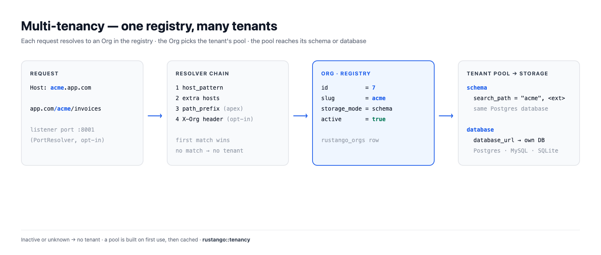
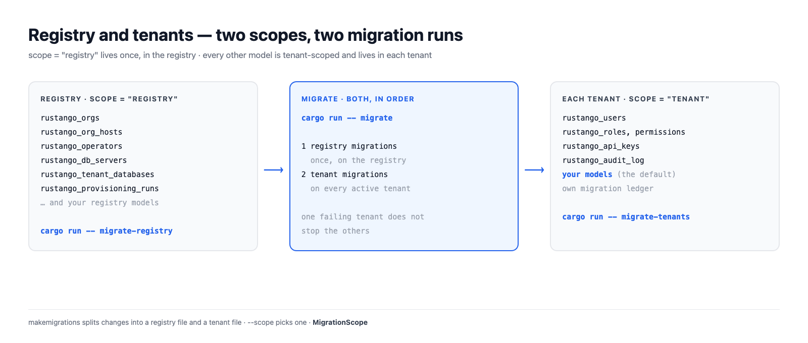

# Multi-tenancy

Une app rustango peut servir de nombreux clients. Chaque client est un
**tenant** : une ligne `Org` dans la base **registry**. Chaque requête est
reliée à son tenant, et les données du tenant vivent dans son propre schéma
ou sa propre base.

Cette page explique comment les pièces s'assemblent. Pour les étapes, voir
[la console opérateur](operator-console.md), [la CLI `manage`](manage.md#commandes-de-tenancy)
et [les bases de tenant sur un serveur enregistré](tenant-databases.md).

[](../img/tenancy.png)

## Table des matières

- [Registry et tenant](#registry-et-tenant)
- [Comment une requête trouve son tenant](#comment-une-requête-trouve-son-tenant)
- [Deux façons d'atteindre un tenant](#deux-façons-datteindre-un-tenant)
- [Modes de stockage](#modes-de-stockage)
- [Pools](#pools)
- [Migrations](#migrations)
- [Identifiants et caches liés à l'id de l'org](#identifiants-et-caches-liés-à-lid-de-lorg)
- [Cycle de vie](#cycle-de-vie)

## Registry et tenant

Le **registry** est la seule base que l'app connaît au démarrage
(`DATABASE_URL`). Il contient ce que tout le déploiement partage :

- `rustango_orgs` : une ligne par tenant, avec son slug, son mode de
  stockage, son URL de base, son hôte, son préfixe de chemin, son port et
  son état actif ;
- `rustango_org_hosts` : les noms d'hôte supplémentaires d'un tenant ;
- `rustango_operators` : les personnes qui font tourner le déploiement ;
- `rustango_db_servers` et `rustango_tenant_databases` : les serveurs
  enregistrés et les bases que rustango y a créées ;
- `rustango_provisioning_runs` et leurs événements, les fournisseurs SSO
  partagés, les appareils TOTP des opérateurs.

Tout le reste vit **par tenant** : `rustango_users`, rôles et permissions,
`rustango_api_keys`, le journal d'audit et vos propres modèles.

Un modèle indique où il vit avec `scope`. `tenant` est la valeur par défaut,
donc vous n'écrivez `scope = "registry"` que pour les tables partagées :

```rust
use rustango::sql::Auto;
use rustango::Model;

// Une table partagée, dans le registry.
#[derive(Model)]
#[rustango(table = "billing_plans", scope = "registry")]
pub struct BillingPlan {
    #[rustango(primary_key)]
    pub id: Auto<i64>,
    #[rustango(max_length = 64)]
    pub name: String,
}

// Pas de scope : `tenant` est la valeur par défaut. Chaque tenant a sa table.
#[derive(Model)]
#[rustango(table = "invoices")]
pub struct Invoice {
    #[rustango(primary_key)]
    pub id: Auto<i64>,
    pub total_cents: i64,
}
```

Opérateurs et utilisateurs de tenant ne se mélangent jamais. Les opérateurs
vivent dans le registry et se connectent sur le domaine apex. Les
utilisateurs de tenant vivent dans leur tenant et ne voient jamais la
console.

[](../img/tenancy-registry.png)

## Comment une requête trouve son tenant

Un **resolver** transforme une requête en `Org`. Le serveur essaie une chaîne
de resolvers dans l'ordre, et le premier qui trouve gagne :

1. **Hôte.** L'en-tête `Host` est égal au `host_pattern` du tenant, par
   exemple `acme.app.com`. La comparaison est exacte. `create-tenant` met
   `<slug>.<apex>` si vous n'en donnez pas.
2. **Hôtes supplémentaires.** Un nom d'hôte lié au tenant dans
   `rustango_org_hosts`. Il ne passe jamais devant l'hôte propre d'un autre
   tenant.
3. **Préfixe de chemin, sur l'apex seulement.** `app.com/acme/...` trouve le
   tenant dont le `path_prefix` est `/acme`. Sur tout autre hôte, le chemin
   ne choisit aucun tenant.
4. **En-tête (optionnel).** `Builder::header_resolver` ajoute un en-tête du
   type `X-Org` après les autres. Associez-le à
   `HeaderResolver::allow_only` : c'est le client qui choisit la valeur.

Seuls les tenants **actifs** sont trouvés. L'apex lui-même
(`RUSTANGO_APEX_DOMAIN`) ne mène jamais à un tenant : il sert la console
opérateur. Une requête sans tenant reçoit un 404 des routes de tenant, ou va
à [`unresolved_tenant`](operator-console.md#hôtes-inconnus) si vous en avez
défini un.

**Port.** `Org.port` est comparé par `PortResolver`, qui lit le port du
listener qui a accepté la requête, jamais l'URI du client. Il n'est pas dans
la chaîne du serveur : ajoutez-le à une chaîne que vous construisez vous-même.

Un tenant sans hôte, sans préfixe de chemin et sans port est **injoignable**,
et il est refusé : par `create-tenant`, par la console et par une
modification qui touche au routage.

Les résultats sont mis en cache 30 secondes. Un autre serveur voit un
changement de `rustango_orgs` en une lecture d'empreinte
(`RUSTANGO_HOST_GEN_CHECK_SECS`, 5 secondes par défaut).

Dans un handler, prenez `TenantScope` (ne garde aucune connexion) ou
`Tenant` (garde une connexion pour la requête) :

```rust
use axum::http::StatusCode;
use rustango::extractors::TenantScope;
use rustango::sql::CounterPool as _;

async fn invoice_count(t: TenantScope) -> Result<String, StatusCode> {
    // `t.org` est l'Org trouvée. `t.pool()` est son pool.
    let n = Invoice::objects()
        .count(t.pool())
        .await
        .map_err(|_| StatusCode::INTERNAL_SERVER_ERROR)?;
    Ok(format!("{}: {n} invoices", t.org.slug))
}
```

## Deux façons d'atteindre un tenant

| Accès | Exemple | `Path` du cookie |
|---|---|---|
| L'hôte propre du tenant | `acme.app.com/admin` | `/` |
| L'apex plus son préfixe de chemin | `app.com/acme/admin` | `/acme` |

Sur son propre hôte, le tenant a l'hôte pour lui seul, donc les cookies
utilisent `Path=/`. Les navigateurs séparent les cookies par hôte.

Sous un préfixe de chemin, de nombreux tenants partagent l'hôte apex. Les
cookies du tenant utilisent donc `Path=/<prefix>`, et les cookies de `/acme`
ne sont pas envoyés à `/acmecorp`. Les liens et redirections de l'admin du
tenant portent aussi le préfixe.

Le routage par hôte est le meilleur choix en production. Les préfixes de
chemin sont pratiques en développement, quand vous n'avez qu'un hôte.

## Modes de stockage

Chaque tenant a un `storage_mode` : `schema` ou `database`.

[](../img/tenancy-storage-modes.png)

### Mode schéma (Postgres seulement)

Tous les tenants partagent la base Postgres du registry. Chaque tenant a son
schéma, nommé d'après le slug sauf si vous fixez `schema_name`. Le
`search_path` d'une connexion de tenant est :

1. le schéma du tenant ;
2. puis chaque schéma qui ne contient que des extensions, pour que les types
   et fonctions des extensions marchent toujours.

`public` n'est dans le chemin que si une extension y vit. Tout autre schéma
n'y entre que s'il ne contient que des objets d'extension et qu'aucune org
ne le nomme : les schémas des autres tenants n'apparaissent donc jamais dans
le chemin.

Un pool de tenant **refuse de s'ouvrir** quand :

- le schéma manque (lancez `migrate-tenants` pour lui) ;
- le schéma porte le nom d'un rôle de la base, dont les sessions le
  verraient en premier ;
- un schéma d'extensions du chemin, comme `public`, contient une table de
  tenant absente du schéma du tenant. Les requêtes liraient cette table à la
  place.

Une extension placée dans le schéma du tenant, ou dans un schéma qui a ses
propres objets, reste hors du chemin, avec un avertissement. Déplacez-la
avec `ALTER EXTENSION <name> SET SCHEMA public`.

Sur MySQL et SQLite, le mode schéma est refusé avec un message qui renvoie
au mode base.

### Mode base (Postgres, MySQL, SQLite)

Chaque tenant a sa propre base. `database_url` contient la connexion : une
URL littérale, une référence `env://VAR` ou une valeur scellée `enc:v1:`. Il
y a deux façons de l'obtenir :

- apporter l'URL d'une base existante ;
- laisser rustango créer la base et un login dédié sur un serveur
  enregistré. Voir
  [les bases de tenant sur un serveur enregistré](tenant-databases.md).

Un tenant utilise le backend du registry.

### Lequel choisir

| | Mode schéma | Mode base |
|---|---|---|
| Backends | Postgres | Postgres, MySQL, SQLite |
| Isolation | des schémas dans une base, un login | une base chacun, et son propre login sur un serveur enregistré |
| Connexions | vers le serveur du registry | par base de tenant |
| Sauvegarde et restauration | toute la base | par tenant |
| Bon pour | beaucoup de petits tenants | moins de tenants, plus gros ou réglementés |

Vous choisissez par tenant, donc un déploiement peut avoir les deux.

```bash
cargo run -- create-tenant acme                                  # mode schéma, sur un registry Postgres
cargo run -- create-tenant globex --server main                  # mode base, créée sur un serveur enregistré
cargo run -- create-tenant initech --mode database --database-url "postgres://..."
```

## Pools

`TenantPools` donne un pool par tenant. Ce qu'il fait :

- **Construit au premier usage.** La première requête pour un tenant résout
  son URL et se connecte. Plusieurs requêtes pour un tenant froid partagent
  une seule construction.
- **En cache et plafonné.** Jusqu'à 64 pools en mode base et 64 en mode
  schéma, comptés à part. Au-delà, le tenant utilisé il y a le plus
  longtemps est évincé et se reconnecte à sa prochaine requête.
- **Deux par tenant sur Postgres.** Un pour les requêtes (`t.pool()`), un
  pour la connexion que garde un extracteur `Tenant` : une connexion gardée
  n'attend jamais les requêtes.
- **Reconstruit en cas de changement.** Un pool retient l'URL ou le schéma
  dont il est issu. Quand l'`Org` en nomme un autre, la requête suivante
  construit un nouveau pool.
- **Marqué.** Une connexion de tenant Postgres porte
  `application_name=rustango-tenant:<org id>`, pour qu'une purge puisse
  terminer ses sessions.

Par défaut : 16 connexions par pool en mode base, 8 par pool en mode schéma,
aucune connexion inactive gardée au chaud, délai d'inactivité 10 minutes,
durée de vie maximale 30 minutes, délai d'acquisition 30 secondes.

Les connexions se multiplient par tenant et par processus. Réglez-les avec
`Builder::tenant_pools` :

```rust
use rustango::sql::sqlx::Database;
use rustango::tenancy::TenantPoolsConfig;

fn sized<DB: Database>(b: rustango::server::Builder<DB>) -> rustango::server::Builder<DB> {
    b.tenant_pools(TenantPoolsConfig {
        max_cached_database_pools: 200,
        database_pool_max_connections: 4,
        ..Default::default()
    })
}
```

Pour ouvrir d'avance le pool de chaque tenant actif en mode base, lancez
[`prewarm-pools`](manage.md#prewarm-pools), utilisez le bouton de la console
ou mettez `prewarm_active_tenants: true`.

## Migrations

Chaque fichier de migration a un scope, `registry` ou `tenant`.
`makemigrations` dans un projet tenancy écrit les deux sortes dans des
fichiers séparés ; `--scope` en choisit un. Voir [migrations](migrations.md).

| Commande | Ce qu'elle lance |
|---|---|
| `migrate` | les migrations du registry, puis celles des tenants sur chaque tenant actif |
| [`migrate-registry`](manage.md#migrate-registry) | les migrations du registry, sur le registry seulement |
| [`migrate-tenants`](manage.md#migrate-tenants) | les migrations de tenant, sur chaque tenant actif |

```bash
cargo run -- makemigrations
cargo run -- migrate
```

Chaque tenant a son propre registre de migrations, dans son schéma ou sa
base. Un tenant en échec n'arrête pas les autres ; la commande rend compte
de chaque tenant à la fin. En mode schéma, `public` est ajouté à la fin du
chemin pendant la migration du tenant, et les vérifications strictes du
chemin passent ensuite.

Le serveur tenancy ne migre jamais au démarrage. Lancez `migrate` comme
étape de déploiement. La console peut migrer un seul tenant ;
`migrate-tenants` ne prend pas de slug.

## Identifiants et caches liés à l'id de l'org

Un slug peut revenir. Purgez `acme`, puis créez un nouvel `acme` : il a une
nouvelle ligne, donc un nouvel `id`. rustango lie l'état d'un tenant à un
`TenantSlug`, c'est-à-dire l'id de l'org **plus** le slug. Le nouvel `acme`
ne reçoit donc rien de l'état de l'ancien.

[](../img/tenancy-identity.png)

Ce qui le porte :

- le cookie de session du tenant et le jeton de passage d'impersonation ;
- les JWT : les claims `tenant` et `org_id` doivent tous deux correspondre ;
- les clés de signature HMAC et les clés d'agents MCP liées à un tenant ;
- `ScopedCache::for_tenant`, le cache de page, les clés d'idempotence et
  `DistributedLock::for_tenant`, tous avec la clé `#org:<id>:<slug>` ;
- les liens de réinitialisation de mot de passe et de vérification.

Les clés d'API et les utilisateurs du tenant vivent dans son propre
stockage, qu'une purge supprime. Une `Org` sans id (non lue depuis le
registry) n'a pas de `TenantSlug`, et l'authentification la refuse.

```rust
use rustango::cache::{BoxedCache, ScopedCache};
use rustango::extractors::TenantScope;
use rustango::tenancy::TenantSlug;

fn tenant_cache(cache: BoxedCache, t: &TenantScope) -> Option<ScopedCache> {
    // `None` seulement pour une Org qui n'a pas été lue depuis le registry.
    let tenant = TenantSlug::of(&t.org)?;
    Some(ScopedCache::for_tenant(cache, &tenant))
}
```

Plus de détails dans [la mise en cache en multi-tenancy](caching.md#la-mise-en-cache-en-multi-tenancy).

## Cycle de vie

| Étape | Console | CLI |
|---|---|---|
| Créer | **Organizations → New tenant** | `create-tenant <slug>` |
| Modifier routage, URL, image de marque | **Organizations → Edit** | `edit-tenant <slug>` |
| Suspendre (garde les données) | **Deactivate** sur la page du tenant | `drop-tenant <slug>` ou `edit-tenant <slug> --deactivate` |
| Réactiver | la page d'édition du tenant | `edit-tenant <slug> --activate` |
| Purger (sans retour) | **Purge** | `purge-tenant <slug>`, plus `--purge-database` en mode base |

Un tenant suspendu n'est pas résolu, donc ses hôtes n'ont pas de tenant. Son
slug reste pris jusqu'à une purge. Une purge supprime le schéma ou la base,
puis la ligne `Org`. Sur un serveur enregistré, elle supprime aussi le login
du tenant ; voir [purger un tenant](tenant-databases.md#6-purger-un-tenant).

Détails : [la console opérateur](operator-console.md) et
[les commandes de tenancy](manage.md#commandes-de-tenancy).
