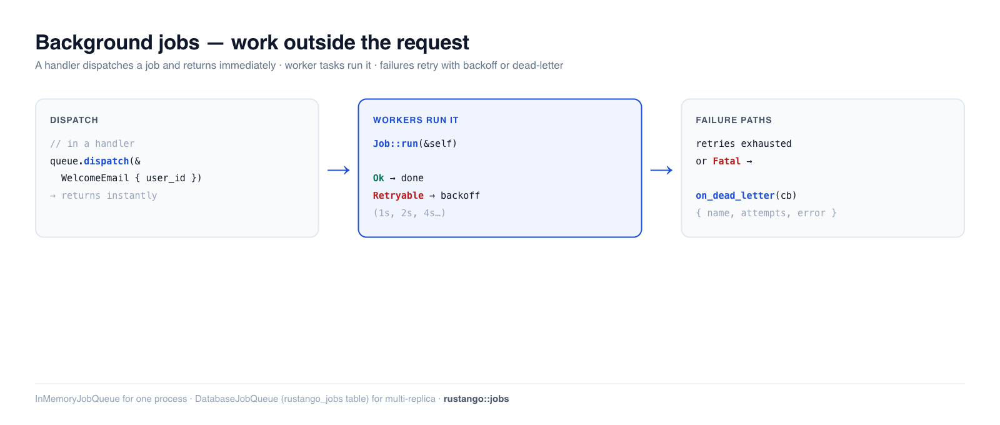

# Background jobs

Some work shouldn't happen during a request — sending a welcome email, resizing
an upload, syncing a third-party API. Doing it inline makes the user wait and
couples the response to a flaky external call. A **background job** moves that
work onto a queue: the handler returns immediately, and a pool of workers runs
the job moments later, with **automatic retries** and a **dead-letter** path for
failures.

[](img/jobs.png)

> **New to a term here?** *queue*, *worker*, *retry/backoff*, *dead-letter* — see
> the [glossary](glossary.md).

> **Source:** `rustango::jobs` (`Job`, `JobQueue`, `InMemoryJobQueue`,
> `JobError`, `JobDeadLetter`) and `rustango::jobs::DatabaseJobQueue` (the
> table-backed queue, alias of `pg::PgJobQueue`) — behind the `jobs` feature;
> `DatabaseJobQueue` and `make:worker` also need `jobs-postgres` (both on by default).
>
> **Runnable version:** the in-memory, retry, and dead-letter snippets are
> copied from [`jobs_doc.rs`](https://github.com/ujeenet/rustango/blob/main/crates/rustango/tests/jobs_doc.rs)
> (`cargo test -p rustango --test jobs_doc`); the persistent queue is dogfooded
> on SQLite by
> [`jobs_sqlite_live.rs`](https://github.com/ujeenet/rustango/blob/main/crates/rustango/tests/jobs_sqlite_live.rs)
> (`cargo test -p rustango --features sqlite,jobs-postgres --test jobs_sqlite_live`).

## Table of contents

- [Step 1 — Define a job](#step-1--define-a-job)
- [Step 2 — Start a queue](#step-2--start-a-queue)
- [Step 3 — Dispatch from a handler](#step-3--dispatch-from-a-handler)
- [Step 4 — Wire it into your app](#step-4--wire-it-into-your-app) — the full example
- [Delayed, cancellable and unique jobs](#delayed-cancellable-and-unique-jobs)
- [Running the workers (CLI + production)](#running-the-workers-cli--production)
- [Retries and backoff](#retries-and-backoff)
- [The job context: id, attempt, stop](#the-job-context-id-attempt-stop)
- [The dead-letter handler](#the-dead-letter-handler)
- [The persistent queue (production)](#the-persistent-queue-production)
- [Jobs under multi-tenancy](#jobs-under-multi-tenancy)
- [Scheduled sweeps under multi-tenancy](#scheduled-sweeps-under-multi-tenancy)
- [Reference](#reference)
- [See also](#see-also)

---

## Step 1 — Define a job

A job is a serializable struct that implements `Job`. The payload is what gets
queued (serialized to JSON); `run()` is the work. `NAME` routes a queued payload
back to its handler, so it must be unique.

Scaffold a skeleton with the CLI — `cargo run -- make:job WelcomeEmail` writes
`src/welcome_email.rs`; add `pub mod welcome_email;` to `src/lib.rs` — or write it
by hand:

```rust
// src/welcome_email.rs
use rustango::jobs::{Job, JobError};
use serde::{Deserialize, Serialize};

#[derive(Serialize, Deserialize)]
pub struct WelcomeEmail {
    pub to: String,
}

#[async_trait::async_trait]   // the scaffolded Cargo.toml has `async-trait`
impl Job for WelcomeEmail {
    const NAME: &'static str = "welcome_email";

    async fn run(&self) -> Result<(), JobError> {
        tracing::info!(to = %self.to, "welcome email job ran");
        Ok(())
    }
}
```

`run()` gets only the payload: no database pool, no mailer. So put in the payload
what the job needs, such as the address. [Step 4](#step-4--wire-it-into-your-app)
gives the job a mailer, so it can really send.

`run()` returns:

- `Ok(())` — done.
- `Err(JobError::Retryable(msg))` — transient; the worker retries with backoff.
- `Err(JobError::Fatal(msg))` — permanent; skip retries, dead-letter it now.

Override `const MAX_ATTEMPTS: u32 = 3;` on the impl to change the ceiling on
**total attempts** — not retries. The default of 5 is one initial run plus four
retries; `MAX_ATTEMPTS = 3` gives two retries. `0` counts as `1`: the job runs
once.

A handler that needs state the payload cannot carry, such as a mailer, can be
registered with `queue.register_with(move |job: WelcomeEmail| async move { … })`.
That closure runs in place of `Job::run`, and it can hold values you move into
it. Both built-in queues support it. Step 4 shows a full one.

---

## Step 2 — Start a queue

For a single process (and for dev and tests), `InMemoryJobQueue` runs jobs on
tokio worker tasks — no database. **Register every job type, then `start()` the
workers** (jobs aren't picked up until you do):

```rust
use rustango::jobs::{InMemoryJobQueue, JobQueue};
use std::sync::Arc;

let queue = Arc::new(InMemoryJobQueue::with_workers(4));   // 4 worker tasks
queue.register::<WelcomeEmail>().await;                    // before start/dispatch
queue.start().await;

// ... app runs ...

queue.shutdown().await;   // on shutdown: drain in-flight jobs, then stop
```

`shutdown()` gives running jobs a grace period (`shutdown_grace`, default 5s),
then aborts and re-queues them. Queued jobs and parked retries stay queued, and
`start()` again picks them up.

Jobs are **at-least-once**. A running job sees the stop through
[`JobCtx::stopping`](#the-job-context-id-attempt-stop), and an aborted
job runs again from the start (the DB queue releases its row even if the job had
just finished). The abort spends an attempt. Make every job idempotent.

Keep the `Arc<InMemoryJobQueue>` in your app state so handlers can reach it.

> **In-memory means in-memory.** Jobs queued or in-flight are **lost on
> restart**. For anything you can't afford to drop, use the
> [persistent queue](#the-persistent-queue-production).

---

## Step 3 — Dispatch from a handler

Once the queue is running, dispatch is one call — it enqueues and returns
immediately, so the request doesn't wait for the work:

```rust
queue.dispatch(&WelcomeEmail { to: "ada@example.com".into() }).await?;
```

A worker picks it up and runs `run()` moments later. Verified end to end: three
dispatched jobs all run on the workers.

```rust
for to in ["a@example.com", "b@example.com", "c@example.com"] {
    queue.dispatch(&WelcomeEmail { to: to.into() }).await.unwrap();
}
// → all three WelcomeEmail::run() calls execute on the worker pool
```

---

## Delayed, cancellable and unique jobs

`dispatch_at` queues a job to run later and returns its `JobId`. Store the id
(`id.to_string()`), and `cancel` drops the job until a worker starts it:

```rust
use rustango::jobs::{Dispatch, JobId, JobQueue, UniqueKey};

let when = chrono::Utc::now() + chrono::Duration::days(7);
let id = queue.dispatch_at(&DeleteAccount { user_id: 42 }, when).await?;
account.deletion_job = Some(id.to_string());

// Later, maybe from another process:
let id: JobId = stored.parse()?;
let dropped = queue.cancel(&id).await?;   // false once the job runs or ran
```

`enqueue` takes every option. A `UniqueKey` keeps one job of a type with that
key queued or running; a second dispatch returns `Enqueued::Duplicate` with the
first job's id and queues nothing:

```rust
let key = UniqueKey::new(format!("delete-account:{}", user.id))?;
let queued = queue
    .enqueue(&DeleteAccount { user_id: user.id }, Dispatch::at(when).unique(key))
    .await?;
let id = queued.id();   // the new job, or the one already queued
```

- `cancel` also drops a job waiting on a retry. It never stops a running job.
- A key is 1 to 200 characters and compared exactly (case counts) on every
  backend. It is free again once its job finishes, dead-letters or is
  cancelled.
- On the database queue a key needs the `unique_key` column, which
  `ensure_table_pool` adds; until then a unique dispatch is refused. A
  job dispatched in an `atomic` block holds its key once the block commits.

---

## Step 4 — Wire it into your app

Putting Steps 1–3 together for the app from [Getting started](getting-started.md):
give the job a mailer, register it **once at boot**, start the workers, hand the
queue to a route, and drain on shutdown.

First the job file. It keeps the `WelcomeEmail` job from Step 1 and adds two
things: a `register` function and a `/signup` route.

```rust
// src/welcome_email.rs
use std::sync::Arc;

use axum::{http::StatusCode, routing::post, Extension, Json, Router};
use rustango::email::{BoxedMailer, Email};
use rustango::jobs::{InMemoryJobQueue, Job, JobError, JobQueue};
use serde::{Deserialize, Serialize};

#[derive(Serialize, Deserialize)]
pub struct WelcomeEmail {
    pub to: String,
}

#[async_trait::async_trait]
impl Job for WelcomeEmail {
    const NAME: &'static str = "welcome_email";

    // Not called here: `register` below gives the queue a handler instead.
    async fn run(&self) -> Result<(), JobError> {
        tracing::info!(to = %self.to, "welcome email job ran");
        Ok(())
    }
}

/// Register the job with a handler that holds the mailer. Call it once at
/// boot, before `start()`.
pub async fn register<Q: JobQueue>(queue: &Q, mailer: BoxedMailer) {
    queue
        .register_with(move |job: WelcomeEmail| {
            // The closure runs once per job, so each run takes its own copy.
            let mailer = mailer.clone();
            async move {
                Email::new()
                    .to(job.to)
                    .subject("Welcome")
                    .body("Thanks for signing up.")
                    .send(&*mailer)
                    .await
                    .map_err(|e| {
                        if e.is_retryable() {
                            JobError::Retryable(e.to_string()) // mail server down
                        } else {
                            JobError::Fatal(e.to_string()) // bad address: no retry
                        }
                    })
            }
        })
        .await;
}

#[derive(Deserialize)]
pub struct Signup {
    pub email: String,
}

async fn signup(
    Extension(queue): Extension<Arc<InMemoryJobQueue>>,
    Json(form): Json<Signup>,
) -> StatusCode {
    // ... create the user here ...
    // `dispatch` returns at once; a worker sends the email.
    match queue.dispatch(&WelcomeEmail { to: form.email }).await {
        Ok(()) => StatusCode::CREATED,
        Err(e) => {
            tracing::error!(error = %e, "could not queue the welcome email");
            StatusCode::INTERNAL_SERVER_ERROR
        }
    }
}

pub fn router(queue: Arc<InMemoryJobQueue>) -> Router {
    Router::new()
        .route("/signup", post(signup))
        .layer(Extension(queue))
}
```

`mailer` is an `Arc`, so `&*mailer` passes the mailer inside it.

Then `src/main.rs`. This is the scaffolded file from Getting started, with the
queue added. The scaffolder puts the body in `run()`; the lines go there. The
lines marked `NEW` are the additions — keep the admin and settings lines:

```rust
// src/main.rs: keep the scaffolded main(), which calls run()
use std::sync::Arc;

use myblog::urls;
use rustango::jobs::{InMemoryJobQueue, JobQueue}; // NEW

async fn run() -> Result<(), Box<dyn std::error::Error>> {
    let _ = dotenvy::dotenv();
    let loaded = rustango::config::Settings::load_from_env();
    let settings = loaded.as_ref().cloned().unwrap_or_default();
    let admin_settings = settings.clone();

    // NEW 1. The mailer, from the [mail] settings (see the email guide).
    let mailer = rustango::email::from_settings(&settings.mail)?;

    // NEW 2. Build the queue and register every job type BEFORE start().
    let queue = Arc::new(InMemoryJobQueue::with_workers(4));
    myblog::welcome_email::register(&*queue, mailer).await;
    queue
        .on_dead_letter(|dl| async move {
            tracing::error!(job = dl.name, attempts = dl.attempts, error = %dl.error,
                            "job dead-lettered");
        })
        .await;

    // NEW 3. Start the workers — tokio tasks that run inside THIS process.
    queue.start().await;
    let draining = Arc::clone(&queue);

    rustango::manage::Cli::new()
        // NEW 4. Mount the /signup route, which holds the queue.
        .api(urls::api().merge(myblog::welcome_email::router(queue)))
        .try_nest_with(urls::admin_prefix(&settings), move |pool| {
            urls::admin_router(pool, &admin_settings)
        })
        .with_health()
        .with_loaded_settings(loaded)
        // NEW 5. Drain the queue after the server stops (SIGINT and SIGTERM).
        .on_shutdown(move || async move { draining.shutdown().await })
        .run()
        .await
}
```

Try it with `cargo run`, and in another terminal:

```bash
curl -X POST http://localhost:8080/signup \
     -H "content-type: application/json" \
     -d '{"email":"ada@example.com"}'
```

The request returns `201` at once. With the default console mail backend, the
email prints in the server's terminal a moment later.

To send an `Email` you build in the handler, you do not need your own job type:
`rustango::email_jobs::register_email_job` and `dispatch_email` do it in two
calls. See [Send it off the request](email.md#send-it-off-the-request).

> **Put the drain in `on_shutdown`, not after `run()`.** Earlier
> versions of this example
> called `queue.shutdown()` on the line *after* `run()`, and that line could
> never execute: nothing handled SIGTERM, so an orchestrator's stop killed
> the process outright. `run()` now returns on signal, so code after it does
> run — but `on_shutdown` is still the right place, because it also runs on
> the tenancy path and orders correctly against the server's own drain.

> **Store the concrete queue type.** The `JobQueue` trait is **not object-safe**
> (its `register`/`dispatch` are generic), so you can't hold `Arc<dyn JobQueue>`
> in state — keep the concrete `Arc<InMemoryJobQueue>` (or `Arc<DatabaseJobQueue>`).

### A job that reads the database

In `main.rs` a job cannot hold the server's database pool. `Cli` opens that pool
when the server starts, and that is after your queue is built. You have two
options:

- Put the data in the payload, as `WelcomeEmail` does with the address. The
  handler can read the database: a route mounted with `nest_with` gets the pool,
  as in [Getting started, Step 12b](getting-started.md#12b-mount-the-routes).
- Run the job in a [worker process](#a-dedicated-worker-process-production). It
  opens its own pool, and `register_with` can hold the pool next to the mailer.

---

## Running the workers (CLI + production)

`start()` spawns the workers as **tokio tasks inside the current process**. So
when you launch your app with the CLI — `cargo run` (which runs the server) —
the workers run right alongside it. For most apps that's all you need: **one
process serves requests *and* drains the queue**; there's no separate worker
command.

```bash
cargo run                 # starts the server AND the in-process workers
cargo run -- make:job WelcomeEmail   # scaffold a new job type
```

### A dedicated worker process (production)

At scale you often want workers **separate** from the web tier — so a traffic
spike can't starve jobs, and you scale each independently. With the
[persistent queue](#the-persistent-queue-production) every process pulls from the
same `rustango_jobs` table, so just run a second, server-less binary that builds
the queue, starts it, and blocks until a signal. `cargo run -- make:worker Worker`
writes a skeleton. Here the worker opens its own pool, so its `register_with`
closure can hold the pool and the mailer. The job reads the `Post` model from
Getting started:

```rust
// src/bin/worker.rs — run with `cargo run --bin worker`
use std::sync::Arc;

use myblog::blog::models::Post;
use myblog::welcome_email::WelcomeEmail;
use rustango::email::Email;
use rustango::jobs::{DatabaseJobQueue, JobError, JobQueue};
use rustango::sql::{FetcherPool, Pool};

#[rustango::main]
async fn main() -> Result<(), Box<dyn std::error::Error>> {
    // A worker never runs main.rs, so it loads `.env` and the settings itself.
    let _ = dotenvy::dotenv();
    let settings = rustango::config::Settings::load_from_env()?;
    let mailer = rustango::email::from_settings(&settings.mail)?;
    let pool = Pool::connect_from_env().await?; // DATABASE_URL
    DatabaseJobQueue::ensure_table_pool(&pool).await?;

    let queue = Arc::new(DatabaseJobQueue::with_workers_pool(pool.clone(), 8));
    // Register the SAME job types the web process dispatches.
    queue
        .register_with(move |job: WelcomeEmail| {
            let pool = pool.clone();
            let mailer = mailer.clone();
            async move {
                let posts = Post::objects()
                    .fetch(&pool)
                    .await
                    .map_err(|e| JobError::Retryable(e.to_string()))?;
                Email::new()
                    .to(job.to)
                    .subject("Welcome")
                    .body(format!("There are {} posts waiting for you.", posts.len()))
                    .send(&*mailer)
                    .await
                    .map_err(|e| JobError::Retryable(e.to_string()))
            }
        })
        .await;
    queue.start().await;

    // Blocks until Ctrl-C (SIGINT) *or* SIGTERM. `tokio::signal::ctrl_c()`
    // alone is SIGINT-only on Unix, so a worker waiting on it is killed
    // outright by `docker stop` / a pod eviction and drains nothing.
    rustango::shutdown::shutdown_signal().await;
    queue.shutdown().await;                     // drain in-flight, then exit
    Ok(())
}
```

Deploy it as its own container/service and scale to **N replicas** — they all
pull from the shared table safely. The web process only dispatches: it must
still `register` every job type it dispatches (no `start()` needed), or build
its queue with `.allow_unregistered_dispatch()`; an unregistered dispatch is
refused. Pair the worker with a
periodic [`reclaim_stuck_jobs_pool`](#the-persistent-queue-production) sweep to
recover jobs from a crashed worker.

Two different queues on one table (say, a mailer and a report runner with their
own handlers) pick each other's jobs. Give each its own name with
`.queue_name("mailer")` on the dispatching and the working side: a named queue
runs only its jobs, an unnamed one only unnamed jobs.
Workers from before `queue_name` existed ignore it and run named jobs too:
stop them before you dispatch on a named queue.

---

## Retries and backoff

A job that returns `Retryable` is re-queued with **exponential backoff** (1s, 2s,
4s, 8s, …, capped at 1024s) until `MAX_ATTEMPTS` total attempts are spent. Use it
for transient failures — a timeout, a rate-limited API, a deadlock:

```rust
#[async_trait::async_trait]
impl Job for FlakyImport {
    const NAME: &'static str = "flaky_import";
    async fn run(&self) -> Result<(), JobError> {
        match call_external_api().await {
            Ok(_)  => Ok(()),
            Err(e) => Err(JobError::Retryable(e.to_string())),   // try again later
        }
    }
}
```

The backing test dispatches a job that fails once then succeeds, and asserts it
**ran more than once and eventually succeeded** — the retry actually happens.

To change the wait for every job of a type, override
`fn retry_backoff(failed_attempt: u32) -> Duration` on the impl
(`failed_attempt` is 0 after the first run). To set the cap or the wait from
the payload, override `fn max_attempts(&self) -> u32` or
`fn retry_delay(&self, failed_attempt: u32) -> Duration`; by default they
return `MAX_ATTEMPTS` and `retry_backoff`. The cap is read at dispatch.
`jobs::exponential_backoff(base, failed_attempt)` is the default curve with your
own base: `base`, doubled per failure, capped at `base · 1024`.

---

## The job context: id, attempt, stop

Both queues call `Job::run_with(&self, ctx: &JobCtx)`. By default it calls
`run()`, so jobs that implement only `run` work unchanged. Override it to read:

- `ctx.id()` — the job's id, the same on every retry. Unique on its queue only.
- `ctx.idempotency_key(scope)` — the id under your scope, for an outside system.
- `ctx.attempt()` — 1 for the first run, 2 for the first retry.
- `ctx.stopping()` / `ctx.is_stopping()` — the queue is shutting down; finish
  within `shutdown_grace` or the run is aborted and re-queued.

Use `idempotency_key` as the key an outside system sees, so a retried charge is
not charged twice. The database queue's id is the row id plus its enqueue time,
so a recreated table does not repeat it. Tenants with their own job tables still
start at row 1, so pass a scope that tells the tables apart, such as the tenant
slug:

```rust
use rustango::jobs::{Job, JobCtx, JobError};

#[async_trait::async_trait]
impl Job for ChargeCard {
    const NAME: &'static str = "charge_card";

    async fn run(&self) -> Result<(), JobError> {
        Err(JobError::Fatal("ChargeCard runs through run_with".into()))
    }

    async fn run_with(&self, ctx: &JobCtx) -> Result<(), JobError> {
        let key = ctx.idempotency_key(&self.tenant);   // same key on every retry
        stripe_charge(self.order_id, self.cents, &key)
            .await
            .map_err(|e| JobError::Retryable(e.to_string()))
    }
}
```

A handler passed to `register_with` gets the payload only, not the context.

---

## The dead-letter handler

When a job exhausts its retries — or returns `Fatal` immediately — it's handed
to the **dead-letter** callback instead of vanishing. Register one (before
`start`) to log, alert, or persist the failure:

```rust
queue
    .on_dead_letter(|dl| async move {
        // dl: JobDeadLetter { name, payload, attempts, error }
        tracing::error!(job = dl.name, attempts = dl.attempts, error = %dl.error,
                        "job dead-lettered");
    })
    .await;
```

A `Fatal` error skips retries and lands here on the first attempt:

```rust
async fn run(&self) -> Result<(), JobError> {
    Err(JobError::Fatal("unprocessable payload".into()))   // → dead-letter now
}
```

The test confirms the callback fires exactly once for a `Fatal` job, with the
job's `name` and `error` intact.

---

## The persistent queue (production)

`InMemoryJobQueue` is single-process and forgets on restart. For real
deployments — multiple workers, multiple replicas, jobs that must survive a
crash — use **`DatabaseJobQueue`** (the same type as `PgJobQueue`). Jobs live in
a `rustango_jobs` table; workers claim a row inside a transaction
(`FOR UPDATE SKIP LOCKED` on PostgreSQL and MySQL, a single
`UPDATE … RETURNING` on SQLite), so it's safe across processes. It's **tri-dialect**
(PostgreSQL, MySQL, SQLite). The `Job` definitions from Step 1 are unchanged.

```rust
use rustango::jobs::DatabaseJobQueue;   // = rustango::jobs::pg::PgJobQueue
use rustango::jobs::JobQueue;
use std::sync::Arc;
use std::time::Duration;

// 1. Create the jobs table once at boot (idempotent, tri-dialect).
DatabaseJobQueue::ensure_table_pool(&pool).await?;

// 2. Build the queue over your pool + N workers, and start it.
let queue = Arc::new(
    DatabaseJobQueue::with_workers_pool(pool.clone(), 4)
        .poll_interval(Duration::from_millis(50)),
);
queue.register::<WelcomeEmail>().await;
queue.start().await;

// 3. Dispatch exactly as before — now it's durable.
queue.dispatch(&WelcomeEmail { to: "ada@example.com".into() }).await?;
```

**Dispatch inside a transaction.** Inside an `atomic` block on the queue's own
pool, `dispatch` joins the block: the job is rolled back with it, and no worker
wakes before the commit. Don't hold the block's `TxGuard` across the call.

**Recovering crashed workers.** If a worker dies mid-job, the row stays locked.
Run a periodic sweep to release locks older than a threshold so another worker
picks the job back up:

```rust
// e.g. from a scheduled task every few minutes:
let reclaimed = DatabaseJobQueue::reclaim_stuck_jobs_pool(&pool, Duration::from_secs(300)).await?;
```

Or let the queue do it: `.reclaim_stuck_after(Duration::from_secs(300))` on the
builder sweeps the queue's own pool at `start` and then every
`min(threshold, 60s)`. It is off by default, and the threshold is raised to at
least three heartbeats.

A running job refreshes its lock every `heartbeat_interval` (10 s by default), so
keep the threshold well above it. Each pickup spends an attempt, so a job that
crashes its worker is dead-lettered once `MAX_ATTEMPTS` runs are used. A job that
panics is a `Retryable` failure; the worker keeps running.

Both the dispatch-and-run flow and `reclaim_stuck_jobs_pool` are dogfooded
against SQLite in `jobs_sqlite_live.rs`.

---

## Jobs under multi-tenancy

A worker is not a request. Nothing resolved a tenant for it — no host, no
header, no middleware ran — so **a job carries no tenant context**:
`run(&self)` receives only the deserialized payload. Isolation comes from
**the pool the queue was built on**, and the rule follows from that:

> One queue per tenant pool. A tenant id in the payload is routing, not
> isolation.

That single decision is what makes each mode safe:

| Mode | Where `rustango_jobs` lives | Why a worker stays scoped |
|---|---|---|
| `database` | inside the tenant's own database / SQLite file | a different tenant's rows are not in the table the worker queries — cross-tenant reads aren't expressible |
| `schema` (PG) | the tenant's schema | `scoped_pool_dyn` returns a pool with `search_path` baked into its **connect options**, not a per-request `SET` — so every checkout for the pool's whole lifetime is scoped, including a worker that lives for days |

Build the queues at boot, one per active tenant:

```rust
use rustango::core::Column as _;
use rustango::jobs::{DatabaseJobQueue, JobQueue};
use rustango::sql::FetcherPool as _;
use rustango::tenancy::{Org, TenantPools};
use std::sync::Arc;
use std::time::Duration;

let pools = Arc::new(TenantPools::new(registry));
let registry_pool = pools.registry_pool();

// The registry holds the tenant list; each `Org` names its own
// database (or PG schema).
let orgs: Vec<Org> = Org::objects()
    .where_(Org::active.eq(true))
    .fetch(&registry_pool)
    .await?;

let mut queues = Vec::new();
for org in orgs {
    // DDL as the registry login: a schema tenant's own role cannot create tables.
    DatabaseJobQueue::ensure_table_pool(&pools.ddl_pool(&org).await?).await?;
    let pool = pools.scoped_pool_dyn(&org).await?;   // scoped for its lifetime

    let queue = Arc::new(
        DatabaseJobQueue::with_workers_pool(pool, 2)
            .poll_interval(Duration::from_secs(1)),
    );
    queue.register::<WelcomeEmail>().await;
    queue.start().await;
    queues.push((org.slug, queue));
}
```

Dispatch then goes to *that tenant's* queue — in a request handler, the one
keyed by the `Org` the resolver already produced.

**What not to do.** One queue on the registry pool with an `org_id` field in
the payload puts every tenant's jobs in one shared table, and leaves each
`run()` to remember to re-scope. One forgotten re-scope is a cross-tenant
write. If you need a shared queue for operational reasons, resolve the tenant
pool as the *first* thing `run()` does and never touch the registry pool
afterwards.

**Known limits.** The framework does not do the fan-out for you: there is no
per-tenant worker supervisor, no `Job::run(&ctx)` with the tenant attached,
and no tenant-aware `reclaim_stuck_jobs_pool` sweep — you loop over tenants
yourself, as above (`.reclaim_stuck_after(..)` on each tenant's queue sweeps that
tenant's pool). New tenants provisioned after boot get no workers until
the process restarts. This is a known gap.

**Ambient context: audit source and timezone only.** `InMemoryJobQueue`
captures them at `dispatch` and the scheduler at `every()`, and each reinstalls
them around the run. `PgJobQueue` stores them in `rustango_jobs.context`,
which `ensure_table_pool` adds to an older table; a table without the column
runs jobs as `AuditSource::System`. No queue carries a session or a tenant.

A source set by the tenant admin names a user of that tenant, so it is
recorded only on writes through the pool `tenancy::with_tenant` (or
`for_each_tenant`) hands over for that tenant. Other writes, including ones
through another pool inside it, record `system`:

```rust
rustango::tenancy::with_tenant(&pools, &org, |pool| async move {
    note.insert(&pool).await
})
.await??;
```

---

## Scheduled sweeps under multi-tenancy

The same "a worker is not a request" problem hits *time-based* work, and the
framework's own sweep helpers are where it bites: `MediaManager::purge_orphans`,
`audit::cleanup_older_than_pool` and `prunable::prune_all` each take **one
pool**, and every table they touch is per-tenant. One pool means one tenant —
and a registry pool in schema mode means only `public`, while every tenant's
rows accumulate and the sweep still reports success.

Fan out with **`for_each_tenant`**, which resolves each active tenant's own
pool and keeps going when one tenant fails:

```rust
use rustango::tenancy::for_each_tenant;

let opts = &opts;
let sweep = for_each_tenant(&pools, move |_org, pool| async move {
    rustango::prunable::prune_all(&pool, opts).await
})
.await?;

tracing::info!(ok = sweep.succeeded(), failed = sweep.failed(), "nightly prune");
for (slug, err) in sweep.errors() {
    tracing::warn!(%slug, %err, "tenant prune failed");
}
```

A broken tenant — rotated credential, unreachable database — is recorded in the
report rather than aborting the run, so it cannot starve the tenants after it.
Inactive orgs are skipped. `purge_orphans` is the one sweep that reaches outside
the database (it deletes storage objects), so it has a
`purge_orphans_dry_run` that runs the same query and deletes nothing — worth a
look before you wire the real thing.

If you guard the sweep so only one replica runs it, **scope the lock per
tenant**:

```rust
use rustango::cache::CacheScope;

let tenant = TenantSlug::of(&org).expect("a registry org");
let lock = CacheScope::for_tenant(cache.clone(), &tenant).locks();
// Tick every minute; this runs once per UTC day across replicas.
lock.once_per_period("nightly_prune", day, || prune(&org)).await;
```

Unscoped, every tenant contends for one `lock:nightly_prune`: the first tenant
wins and the rest are skipped for the whole TTL, silently — a refused acquire is
the expected outcome, so nothing is logged. This is a known gap.

---

## Reference

**Backends**

| Backend | Use for | Survives restart? |
|---|---|---|
| `InMemoryJobQueue` | single process, dev, tests | no |
| `DatabaseJobQueue` (`PgJobQueue`) | production; multi-worker / multi-replica | yes (`rustango_jobs` table) |

**`JobError`**

| Variant | Effect |
|---|---|
| `Retryable(String)` | re-queue with exponential backoff, up to `MAX_ATTEMPTS` |
| `Fatal(String)` | skip retries → dead-letter immediately |
| `Queue(String)` | internal queue error (serialization/registration) |

**`JobQueue` methods:** `register::<T>()` · `dispatch(&payload)` ·
`dispatch_at(&payload, when)` · `enqueue(&payload, Dispatch)` · `cancel(&id)` · `start()` ·
`register_with::<T, _, _>(handler)` · `shutdown()` · `pending_count()` (jobs
waiting to be picked up). `Job::run_with` gets a `JobCtx` (`id`, `attempt`,
`stopping`). Both queues have `on_dead_letter` and
`shutdown_grace`. The `DatabaseJobQueue` adds `ensure_table_pool`,
`with_workers_pool`, `new_pool`, `poll_interval`, `heartbeat_interval`,
`queue_name`, `reclaim_stuck_after` and `reclaim_stuck_jobs_pool`.
`jobs::inmemory_from_settings(&settings.jobs)` builds an `InMemoryJobQueue` with
`[jobs] concurrency` workers (default 4).

---

## See also

- [Scheduler](manage.md) — for *time-based* recurring work at a fixed interval
  (`Scheduler::every` + a `Duration`; there are no cron expressions), as opposed to
  on-demand jobs.
- [Email](email.md) — the canonical "do it in a job" workload.
- [Caching](caching.md) — the other way to keep request handlers fast.
- [Signals](orm.md) — fire-and-forget hooks that often *dispatch* a job.
- [Tenancy commands](manage.md#tenancy-commands) — provisioning the tenants a
  per-tenant queue fans out over.
