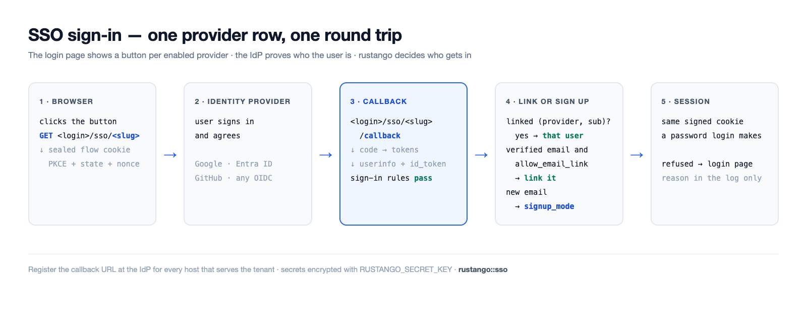
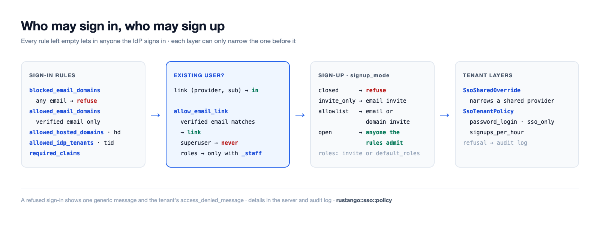

# SSO (OpenID Connect / social login)

Sign in with an external identity provider (IdP) instead of a local
password: Google, Microsoft Entra ID, GitHub, GitLab, Discord, or **any
OpenID Connect provider** (Okta, Auth0, Keycloak, …). Each provider is a
row you add in the admin: no config file, no rebuild.

[](img/sso-flow.png)

## Set up SSO in four steps

1. **Create an app at the IdP.** Register a web application (an "OAuth
   client" or "app registration"). Copy its **client ID** and **client
   secret**. The [provider guides](#provider-guides) below say where.
2. **Register the callback URL** at the IdP, for every host that serves
   the sign-in page. It is `<login>/sso/<slug>/callback` on that host; see
   [Callback URLs](#callback-urls). Pick the `slug` now, e.g. `google`.
3. **Add the provider row.** In the tenant admin, add a row to the
   `rustango_sso_providers` model: `slug`, `label`, `kind`,
   `client_id`, `client_secret`, and `issuer_url` when `kind` is `oidc`.
   Only a superuser can add or change provider rows. Every field has help
   text under its input; the [field reference](#field-reference) lists the
   same texts. `RUSTANGO_SECRET_KEY` must be set, or the secret cannot be
   saved.
4. **Test the sign-in.** Open the sign-in page in a private window and use
   the new button. A refused sign-in shows one generic message; the reason
   is in the server log (`sso refused`) and the audit log. Run
   `manage check --deploy` to catch a provider that would refuse every
   existing user.

SSO signs in the user **linked** to the IdP identity: one
`rustango_sso_links` row per `(provider, sub)`. The email the IdP sends is
never enough on its own. A first-time user is linked by verified email
only when the provider has **`allow_email_link`** on (default off), and
never when the account is a superuser or, without `allow_email_link_staff`,
staff (tenant: holds any role or any direct permission; bare admin: every account). Those accounts are linked by an
admin, who adds the `SsoLink` row in the admin; the refusal log line names
the subject. (The member flow, below, can also create an account for an
unknown email; that is off by default.)

> **Source:** the admin-independent core `rustango::sso` (`SsoProvider`,
> `build_provider`, `verified_email`, `ResolvedSso`, `SsoError`), the link
> table `rustango::sso::link` (`SsoLink`, `ProviderKey`, `sign_in`), the
> bare-admin wiring `rustango::admin::sso`, per-tenant/console SSO
> `rustango::tenancy::sso` (`SharedSsoProvider`), and member SSO
> `rustango::tenancy::member_auth`.

## Callback URLs

The callback is built per request from the host and the `slug`:
`https://<host><login>/sso/<slug>/callback`. On the admin surfaces the
scheme is `https` unless a trusted proxy sends `X-Forwarded-Proto`; the
member flow also uses `http` on a loopback host (see
[Member SSO](#member-end-user-sso)). Register one URL per host the provider
is used on.

| Sign-in surface | Tenant on its own host | Tenant under a path prefix |
|---|---|---|
| Tenant admin (`<login>` is `/login`) | `https://acme.example.com/login/sso/<slug>/callback` | `https://app.example.com/acme/login/sso/<slug>/callback` |
| Member sign-in (`member_sso_router`, `login_base` default `/auth`) | `https://acme.example.com/auth/sso/<slug>/callback` | `https://app.example.com/acme/auth/sso/<slug>/callback` |
| Bare admin (no tenancy), mounted at `/admin` | `https://admin.example.com/admin/login/sso/<slug>/callback` | — |

With `RouteConfig::legacy()` the tenant admin's `<login>` is `/__login`. A
tenant reachable both on its own host and under a prefix needs both URLs.
For a shared provider, the operator console shows the callback URL to
register next to each row.

## Provider guides

### Google

1. In the Google Cloud console, open *APIs & Services → Credentials* and
   create an *OAuth client ID* of type *Web application*.
2. Add the callback URL under *Authorized redirect URIs*.
3. Provider row: `kind = google`, the client ID and secret. Leave
   `issuer_url` empty. Default scopes: `openid email profile`.
4. To allow only your Google Workspace, set `allowed_hosted_domains`
   (the `hd` claim), e.g. `client.org`.

### Microsoft Entra ID

1. In the Entra admin center, open *App registrations → New registration*.
   Add the callback URL as a *Web* redirect URI.
2. Copy the *Application (client) ID*. Under *Certificates & secrets*,
   create a client secret and copy its value.
3. Provider row: `kind = microsoft`. It uses the `common` endpoint, so
   with `allowed_idp_tenants` empty any Entra directory can sign in. Set
   it to your *Directory (tenant) ID* to allow only your directory; then
   its emails count as verified and `role_map` and `required_claims`
   apply. `check --deploy` warns when `role_map` or `required_claims` is
   set and `allowed_idp_tenants` is empty.
4. Do not use `kind = oidc` with a single-directory Entra issuer
   (`…/<tenant-id>/v2.0`): that row is not treated as Microsoft, Entra
   sends no `email_verified`, so email linking, sign-up and
   `allowed_email_domains` refuse everyone.

### GitHub

1. In GitHub, open *Settings → Developer settings → OAuth Apps → New OAuth
   App*. Set the *Authorization callback URL* to the callback URL.
2. Copy the client ID and generate a client secret.
3. Provider row: `kind = github`. Default scopes: `read:user user:email`.
   The verified email comes from `/user/emails`. GitHub sends no id_token,
   so a rule that needs one, such as `allowed_idp_tenants`, refuses.

### Generic OpenID Connect

1. Create a web (confidential) client at your IdP and add the callback URL.
2. Provider row: `kind = oidc`, the client ID and secret, and `issuer_url`,
   for example `https://<org>.okta.com`, `https://<host>/realms/<realm>`
   (Keycloak) or `https://<tenant>.auth0.com/`.
3. rustango reads `<issuer>/.well-known/openid-configuration` to find the
   endpoints, once per issuer per hour. Default scopes:
   `openid email profile`.

`check --deploy` warns about email linking on an `oidc` provider and about
an `http://` issuer that is not loopback.

## Field reference

These are the help texts the admin shows under each input.

### `SsoProvider` and `SharedSsoProvider`

A tenant's own providers are `SsoProvider` rows. The operator console's
shared providers (`SharedSsoProvider`) have the same fields and show the
same texts.

| Field | What to enter |
|---|---|
| `slug` | Short id in this provider's URLs, e.g. `google`: the IdP sends users back to `<login>/sso/<slug>/callback`. Unique; a new slug means a new callback URL at the IdP. |
| `label` | Text on the sign-in button, e.g. `Sign in with Google`. |
| `kind` | `google`, `microsoft`, `github`, `gitlab` or `discord` for a built-in provider, or `oidc` for any other OpenID Connect provider (then fill in the issuer URL). |
| `issuer_url` | Only for `oidc`: the issuer URL, e.g. `https://<org>.okta.com` or `https://<host>/realms/<realm>`. The endpoints are read from `<issuer>/.well-known/openid-configuration`; for Microsoft Entra ID use the `microsoft` kind. |
| `client_id` | Client ID (application ID) from your identity provider's app registration. |
| `client_secret` | Client secret from the same app registration. Stored encrypted with `RUSTANGO_SECRET_KEY`. |
| `enabled` | Show this provider's button on the sign-in page. |
| `sort_order` | Button order on the sign-in page; lower numbers come first. |
| `scopes` | OAuth scopes, space separated, e.g. `openid email profile`. Empty: the kind's default scopes. |
| `allow_email_link` | Security: link a first-time sign-in to the existing account with the same verified email; that account's password stops working, its sessions end, its API keys are deleted and its agent keys are turned off. Never a superuser, and a user with any role or permission only with email linking for staff; the bare admin ignores it. |
| `allowed_email_domains` | Security: only users whose verified email is in these domains may sign in. Comma or newline list: `client.org` is that domain only, `*.client.org` its subdomains only. Empty: any domain. |
| `blocked_email_domains` | Users with an email in these domains never sign in, even if the allowed list has them. Same format as the allowed list. |
| `allowed_idp_tenants` | Microsoft Entra directory (tenant) IDs allowed to sign in, comma separated, read from a verified id_token. Empty: any Entra directory can sign in through a `microsoft` provider. |
| `allowed_hosted_domains` | Google Workspace domains (the `hd` claim) allowed to sign in, comma separated, e.g. `client.org`. |
| `required_claims` | JSON object of claims a sign-in must carry, each holding one of its values: `{"roles": ["App.User"]}`. `{}`: no claim is required. |
| `signup_mode` | Security: who gets a new account at first sign-in: `closed` (no one), `invite_only` (an invite for the email), `allowlist` (an invite for the email or its domain) or `open` (anyone the sign-in rules let in). Empty: the sign-in page's default. |
| `default_roles` | Tenant roles a new user gets, comma separated, e.g. `Viewer`. An invite with roles replaces them. |
| `role_map` | JSON object from an IdP group or app role to tenant roles: `{"Admins": "Editor"}` or `{"Admins": ["Editor", "Viewer"]}`. |
| `role_claims` | Claims the role map reads, comma separated. Empty: `groups,roles`. |
| `sync_roles_on_login` | Apply the role map at every sign-in, not only the first. Only roles named in the role map are added or removed. |
| `username_from` | Where a new user's username comes from: the email's local part, the whole email, or the IdP's `preferred_username` (falls back to the local part). |
| `username_clash` | What happens when that username is taken: add a short suffix, or refuse the sign-up. |
| `sync_profile` | Update the user's name and email from the IdP at every sign-in. Never for a superuser. |
| `allow_email_link_staff` | Security: with email linking on, also link users who hold any role or permission. A superuser is never linked by email. |
| `sso_only` | Users linked through this provider may not sign in with a password, even while the provider is off. |
| `auto_deactivate_after_days` | After this many days without use, `sso-deactivate-idle` turns off the users this provider signed up who cannot use a password: SSO only here, or password login off for the tenant. Empty: never. |
| `session_ttl_secs` | Longest session, in seconds, after a sign-in through this provider. Empty: the normal session length. |
| `superuser_session_ttl_secs` | Longest session, in seconds, for a superuser who signs in through this provider. Empty: the normal session length. |

### `SsoTenantPolicy`

The tenant-wide settings, one row.

| Field | What to enter |
|---|---|
| `name` | Always `default`: the tenant uses this one row. |
| `access_denied_message` | Message shown on the sign-in page after a refused SSO sign-in, e.g. who to contact. Shown as plain text. |
| `password_login` | The password form: `on`, `off` (also for superusers), or `superusers_only` (shown only at `?local=1`, for superusers). |
| `sso_only` | No one except a superuser may sign in with a password. |
| `default_provider` | Slug of the provider the sign-in page opens straight away, except at `?local=1` or after an error. |
| `signups_per_hour` | Most SSO sign-ups per hour. Empty: 100; `0`: no limit. |

### `SsoSharedOverride`

A tenant's narrowing of one shared provider. Empty fields keep the shared
value.

| Field | What to enter |
|---|---|
| `shared_slug` | Slug of the shared provider this row narrows for this tenant. |
| `shared_provider_id` | The shared provider row this override is bound to, set at its first use. |
| `shared_issuer` | That row's issuer when bound. If the shared row moves to another issuer, sign-in is refused until the override is added again. |
| `allowed_email_domains` | Security: only these email domains may sign in here, on top of the shared rules. Same comma or newline format as on the provider. |
| `blocked_email_domains` | More email domains that never sign in here. |
| `allowed_idp_tenants` | Microsoft directory IDs allowed here, comma separated. Narrows the shared list. |
| `allowed_hosted_domains` | Google Workspace domains allowed here, comma separated. Narrows the shared list. |
| `required_claims` | More claims a sign-in must carry here, as JSON: `{"roles": ["App.User"]}`. |
| `signup_mode` | Security: sign-up here. It can only be stricter than the shared provider's. Empty: the shared value. |
| `allow_email_link` | Off: no email linking here. Empty or on: the shared setting. |
| `allow_email_link_staff` | Off: email linking never links a user with any role or permission here. Empty or on: the shared setting. |
| `sso_only` | On: users of this provider may not sign in with a password here. |
| `session_ttl_secs` | A shorter longest session here, in seconds. Empty: the shared value. |
| `superuser_session_ttl_secs` | A shorter longest superuser session here, in seconds. Empty: the shared value. |
| `allowed_roles` | Roles the shared provider may grant here, comma separated. Empty: none. |

### `SsoInvite`

An invitation to sign up through SSO.

| Field | What to enter |
|---|---|
| `provider_slug` | Slug of the provider this invite is for. Empty: any provider. |
| `target` | Who may sign up: one email (`ann@client.org`) or a domain (`@client.org`, or `*.client.org` for its subdomains). A domain invite needs max uses or an expiry. |
| `roles` | Roles the new user gets, comma separated. They replace the provider's default roles. |
| `expires_at` | After this time the invite no longer works. Empty: it does not expire. |
| `max_uses` | How many sign-ups may use this invite. Empty: no limit. |
| `link_user_id` | Re-link only: the existing user the next sign-in links, instead of a new account. Set by the Re-link action. |
| `link_key` | Re-link only: the provider the next sign-in must come through. Set by the Re-link action; leave empty. |

## Features & who uses them

Since **0.49** the SSO core is its own feature, independent of the
auto-admin, so an end-user (member) login can build without pulling in
`crate::admin`:

| Feature | Pulls in | Gives you |
|---|---|---|
| `sso` | `oauth2`, `casts` | The admin-independent core: `rustango::sso` — the OIDC / social OAuth handshake, the DB-backed `SsoProvider` model (secret encrypted at rest via `casts`), and the member flow (`tenancy::member_auth`, with `tenancy`). |
| `admin-sso` | `admin`, `sso` | The above **plus** the bare-admin login wiring (`rustango::admin::sso`) — SSO buttons on the admin login page that mint the admin session. |

```toml
[dependencies]
# Admin login with SSO:
rustango = { version = "0.63", features = ["admin-sso"] }
# Member (end-user) SSO without the auto-admin:
rustango = { version = "0.63", features = ["tenancy", "sso"] }
```

`admin::sso_provider` and the historical `admin::sso::*` core paths are
now **re-export shims** over `sso::provider` / `sso::*`, so existing
`crate::admin::sso::{build_provider, ResolvedSso, …}` and
`crate::admin::sso_provider::SsoProvider` imports keep resolving
unchanged. Since 0.58 `rustango_sso_providers` has an `allow_email_link`
column and there is a `rustango_sso_links` table; `makemigrations`
emits both.

The email opt-in email linking matches is the `email` column. On the tenant
`User` model it is gated on the **`sso`** feature (moved off `admin-sso`
in 0.49, so member-SSO-only builds still get the column); the bare
`AdminUser.email` remains behind `admin-sso`. Enabling or disabling the
feature emits an `AddColumn` / `DropColumn` migration for that column.

## How it works

1. The login page shows one **"Sign in with &lt;provider&gt;"** button per
   enabled provider.
2. Clicking one (`GET <login>/sso/<slug>`) redirects to the IdP with a
   signed, short-lived flow cookie (PKCE + CSRF `state`).
3. The IdP sends the user back to `<login>/sso/<slug>/callback`.
4. rustango verifies the flow, exchanges the code and reads `/userinfo`.
5. It looks up the link for this provider and the IdP `sub`. With no
   link, and `allow_email_link` on, a **verified** email that matches a
   non-privileged user creates the link.
6. If the linked user is active, it mints the **same signed-cookie
   session** a password login produces — so every existing gate
   (superuser / permissions, live password-change invalidation) still
   applies.
7. Otherwise the user is bounced back to the login page with a generic
   error (details go to the server log, never the browser).

The link table is a normal migrated model: in the tenant's storage for
tenant logins, and in the admin database for the bare admin. A link is
matched exactly (issuer and subject keyed by a SHA-256; the email ignores
ASCII case only),
whatever the database collation.

The client **secret is encrypted at rest** — the `client_secret` column
is an [`EncryptedString`](#secret-storage) cast, decrypted in-memory only
at login time.

## Providers are rows, managed in the admin

Each provider is a `SsoProvider` row, an ordinary admin model: add, edit
and enable it from the admin UI, no redeploy. The fields are in the
[field reference](#field-reference). Only a superuser can add, change or
delete `SsoProvider` and `SsoLink` rows; other staff can list them with
the usual permissions. The endpoints are discovered at sign-in, so there
is no per-provider endpoint wiring.

## Where each surface manages providers

- **Single-tenant / standalone admin** (`crate::admin`): `SsoProvider`
  rows are a plain global table, managed from the bare admin. Requires
  `Builder::with_session_auth` (SSO mints the same session).
- **Tenant admin** (multi-tenancy): each tenant manages its **own**
  `SsoProvider` rows from its admin — granular, self-service, isolated
  per tenant.
- **Operator console** (multi-tenancy): an operator defines a
  **`SharedSsoProvider`** once and it's offered to **every** tenant
  (a company-wide Google, say). Managed from the console's *Shared SSO*
  panel (`/sso-shared`, `admin-sso` feature; every operator can list,
  changes need an editable console), where *Allow email linking* toggles `allow_email_link` in place
  (the id and its links stay). The flag applies to **every** tenant.
  *Edit* (`/sso-shared/{id}/edit`) changes a provider in place (same id
  and slug; a blank secret keeps the saved one), and each row shows the
  callback URL to register. The issuer URL field shows only for `oidc`. A
  refused add or edit shows the form again (status 400) with the typed
  values and the error, never the secret.

On a tenant's login page the two sets merge, and on a slug clash the
**tenant's own provider wins** over the shared one — so a tenant can
override a shared provider for itself.

Register the [callback URL](#callback-urls) with the IdP. A user is linked by opt-in email linking (non-privileged tenant
users), or by a superuser adding an `SsoLink` row: `provider_source`
(`tenant`, `shared`, `admin`, or `app` for a native sign-in), `provider_id` (the provider row id),
`issuer` (`kind`, or `kind|issuer_url` without a trailing slash),
`subject` and `user_id`. The admin computes
`key_sha256`. The refusal log line (`sso refused`) carries `provider_id`,
`issuer` and `subject`. Adding a row needs the admin's session auth
(`Builder::with_session_auth`, or the tenant admin's `with_session`);
without it nobody can add links.

A link created more than an hour before the account it points at (an id
reused after a restore, say) is deleted, and sign-in goes on as if unlinked.
A link whose user no longer exists is deleted at the next sign-in, and
deleting a user in the admin deletes its links.
When account `created_at` values are imported or backfilled after their
links, `rustango::sso::link::set_stale_links(StaleLinks::Warn)` only logs a
warning and still signs in.

With the `totp` feature, a bare-admin user with a confirmed TOTP device
must still enter a code after SSO. The admin shows the code form and
keeps the pending sign-in in a signed cookie for 5 minutes; the form
posts to `<login>/sso-totp`. The tenant admin has no TOTP step.

`manage check --deploy` warns about an enabled provider that would refuse
every existing user: no `SsoLink` rows, and email linking off or only
privileged users. In the bare admin that means any provider with no links.
It also warns about email linking on a `kind = "oidc"` provider, an `http://`
issuer that is not loopback, and a shared provider that signs users up.

## Member (end-user) SSO

The surfaces above sign people in to an **admin**. `tenancy::member_auth`
is the member-facing analogue: it logs an end-user into a tenant's own
user pool (`rustango_users`) and mints a **member session**, so a gym
member / SaaS customer can "Sign in with Google" without touching the
admin. It reuses the exact same `rustango::sso` core and the tenant's own
`SsoProvider` rows — only the session it mints differs, which is why it
lives behind the `sso` feature (not `admin-sso`) and needs no auto-admin.

Mount `member_sso_router` into a `rustango::server::Builder` stack (it
reads the resolved `Arc<TenantContext>` the builder injects):

```rust
use rustango::tenancy::member_auth::{member_sso_router, MemberAuthConfig};

let members = member_sso_router(MemberAuthConfig {
    login_base:     "/auth".into(),   // buttons link to /auth/sso/<slug>
    landing_url:    "/".into(),       // post-login destination (a same-origin ?next on the begin URL wins)
    auto_provision: true,             // create a user from a verified email on first sign-in
    session_ttl:    7 * 24 * 60 * 60, // 7 days
    ..Default::default()
});
```

With several backends compiled in, `member_sso_router` is for the default
(Postgres) tenant type; use `member_sso_router_for::<sqlx::Sqlite>` (or `MySql`).

It mounts two per-slug routes off `login_base`:

- `GET {login_base}/sso/{slug}` — begin the handshake, redirect to the IdP.
- `GET {login_base}/sso/{slug}/callback` — complete it, find-or-provision
  the member, mint the session cookie.

A path-prefix tenant gets the same two routes under its prefix.

Differences from the admin flow:

- **Callback scheme.** The member `redirect_uri` takes its scheme from a
  trusted proxy's `X-Forwarded-Proto` (and its host from
  `X-Forwarded-Host`), else `http` on a loopback host
  (`localhost`, `*.localhost`, a loopback IP) and `https` everywhere else,
  so `localhost.example.com` gets `https`.
- **Auto-provisioning.** A provider's `signup_mode` ([Who may sign up](#who-may-sign-up)) wins; with none set, `auto_provision = true` (opt-in; the default is `false`) works as `open`: a
  verified IdP email with no matching `rustango_users` row **creates**
  one — username from the email local-part (deduped on a clash), a real
  but unusable random password hash (SSO users can't password-login) —
  and links it. An email that matches an existing account follows the
  `allow_email_link` rule above. Set it to `false` to refuse unknown
  emails. A native sign-in (an app that verified its own ID token) calls
  `find_or_provision_member` directly, with `ProviderKey::app(issuer)` as
  the key. Its `MemberSignIn` result is `Member(id)`, `NotLinked` (an
  account has the email but may not be linked by it), `NoAccount`,
  `Inactive`, `Unverified` or `Refused`.
- **Its own session cookie.** The member cookie
  (`rustango_member_session`) is **domain-separated** from the tenant /
  admin session cookies: the signed message carries a per-domain tag and
  an audience claim, so a member cookie can never validate as a
  tenant/admin cookie (or vice-versa) even though both are signed with
  `RUSTANGO_SESSION_SECRET`. It is slug-bound (a cookie minted for `acme`
  never authenticates on `globex`) and invalidated by a password rotation
  (parity with the admin session).
- **Logout.** `member_auth::logout(&pool, &user)` ends the member's
  sessions on every device and returns the `Set-Cookie` value that clears
  the cookie. On a path-prefix tenant use `logout_at`, which clears the
  cookie on the prefix path.

Read the current member in a handler with the **`CurrentMember`**
extractor — the member analogue of `SessionUser`. It's infallible
(`None` for anonymous / expired / rotated-out / cross-tenant sessions),
so it composes with public routes:

```rust
use rustango::tenancy::member_auth::CurrentMember;

async fn dashboard(CurrentMember(member): CurrentMember) -> impl axum::response::IntoResponse {
    match member {
        Some(user) => format!("Hi, {}", user.username),
        None => "Please sign in".to_owned(),
    }
}
```

> **v1 scope.** Member SSO resolves providers from the tenant's own
> `SsoProvider` rows only — the registry-wide `SharedSsoProvider` merge
> and a custom `provision` hook are follow-ups.

## Who may sign in

Each provider (and each shared provider in the operator console) has
sign-in rules. Every rule left empty admits anyone the IdP signs in.

[](img/sso-policy.png)

The rule fields are `allowed_email_domains`, `blocked_email_domains`,
`allowed_idp_tenants`, `allowed_hosted_domains` and `required_claims`; see
the [field reference](#field-reference) for their format. The blocked list
is checked against any email the IdP sends, verified or not; the allowed
list only against a verified one. A claim in `required_claims` may be a
string or a list, and a missing claim refuses.

The admin and the operator console store lists in one canonical form and
refuse a value that does not parse. A value that still does not parse
(written past them) refuses every sign-in through the provider.

A refused sign-in goes to the server log and to the audit log
(`source = sso:<surface>`, `changes.rule` such as `domain_not_allowed`).
The browser gets one generic message; on the tenant login page it also
shows the tenant's `access_denied_message` (from `SsoTenantPolicy`),
escaped.

The member route (`member_sso_router`) resolves only the tenant's own
providers, so shared providers, and any tenant tightening of them, do not
apply there yet.

### id_token trust

Profile data comes from `/userinfo` over TLS. Claims only an id_token
carries (`tid`, `iss`, `xms_edov`) are used only after the id_token
passes: its signature against the issuer's JWKS (RS256 or ES256; the key
set is cached per its `max-age` and refetched at most once a minute for an
unknown key), `aud` holds the client id, `exp`/`nbf` with one minute of
leeway, the issuer (Microsoft: `https://login.microsoftonline.com/{tid}/v2.0`),
and the same `sub` as userinfo. Otherwise those claims are absent, and a
rule that needs them refuses. A Microsoft email counts as verified when
`xms_edov` is true, or when the provider pins `allowed_idp_tenants` and
the token's `tid` is one of them.

## Who may sign up

A provider can also create the account the first time someone signs in.
Sign-up runs only when no link and no account match the IdP's verified
email, and only after the sign-in rules above pass.

The sign-up fields are `signup_mode`, `default_roles`, `role_map`,
`role_claims`, `sync_roles_on_login`, `username_from`, `username_clash`,
`sync_profile` and `allow_email_link_staff` (see the
[field reference](#field-reference)). With `signup_mode` empty, the tenant
login is closed and the member flow follows
`MemberAuthConfig::auto_provision`; the bare admin never signs anyone up.
A new user gets the invite's roles or `default_roles`, plus the roles
`role_map` gives. A provider with a JWKS (OIDC discovery, Microsoft, Google) takes role
claims only from a verified id_token; a userinfo-only provider takes them
from userinfo. `sync_roles_on_login` adds or removes only roles named in
`role_map`; roles granted by hand stay, and a sign-in without any of the
role claims changes nothing.

A new user is never a superuser. Roles go through the permission engine
(`UserRole`); a role name with no `Role` row is skipped and written to the
audit log (`sso_role_unknown`). The user, its link (`provisioned = true`),
its roles and the invite's use commit in one transaction.

**Invites** (`SsoInvite`, superuser-only in the tenant admin) target one
email (`ann@client.org`) or a domain (`@client.org`, or `*.client.org` for
its subdomains). They can name one provider, carry roles, expire
(`expires_at`) and limit uses (`max_uses`). A use is counted atomically:
two sign-ups racing for the last use make one account. `.../rustango_sso_invites/bulk`
adds many at once from a pasted list or a CSV column.

**Unlink and re-link.** On `SsoLink` rows, the admin actions *Unlink* and
*Re-link on next sign-in* (superuser-only). Re-link deletes the link and
leaves a one-use invite, good for 7 days, that links the same user again
the next time they sign in through the same provider with their verified
email, even if the IdP gives them a new subject. The user must still have
that email. It never re-links a superuser, and a role holder only with
`allow_email_link_staff`.

Username and email collision checks ignore case as the backend does:
PostgreSQL folds Unicode case, SQLite only ASCII letters, and MySQL follows
the column collation (by default also accents, so `ané` and `ane` collide).
Keep usernames ASCII for the same answer everywhere.

`check --deploy` does not report a provider whose sign-up is not closed
as refusing everyone, and warns about `signup_mode = open` with no
`allowed_email_domains`, `allowed_hosted_domains` or `allowed_idp_tenants`.

## Passwords, sessions and lifecycle

The provider fields `sso_only`, `session_ttl_secs`,
`superuser_session_ttl_secs` and `auto_deactivate_after_days`, and the
`SsoTenantPolicy` row, are in the [field reference](#field-reference).
`sso_only` covers password login, JSON login, HTTP Basic and reset links.
A session lasts the shortest of the provider's limit and the route's
lifetime. `sso-deactivate-idle` never switches off a superuser or a user
with a link an admin made.

A superuser follows only `password_login`; `sso_only` never locks one out.
A refused password looks like a wrong one. An unreadable rule refuses;
unreadable tenant settings still let a superuser in. A provider binds its
users while disabled too; a link to a deleted provider counts as
`sso_only` until an admin removes it. `sso_only` covers password logins
(tenant and bare admin) and resets, not API keys or MCP agent secrets.
`sso-deactivate-idle` only switches off users who cannot use a password.
Logout lands on `?local=1`, and the automatic redirect happens at most
once a minute, so a dropped session cannot loop.

**Shared providers.** A tenant's `SsoSharedOverride` (one row, bound to
the shared provider) adds its own rules on top: it can block more
domains, narrow sign-up, set `sso_only` or shorter sessions, never loosen. A shared provider grants only the roles its `allowed_roles` names;
with no override, none. The override can also switch email linking off
(`allow_email_link`, `allow_email_link_staff`). It binds to the shared
provider row on its first sign-in: a renamed row keeps it, a new row with
the old slug does not, and a row moved to another issuer refuses sign-in
until the override is re-added.

**Multi-tenant Microsoft.** A `microsoft` provider (or `oidc` on
`/common` or `/organizations`) accepts users from any Entra directory.
Its `role_map` and `required_claims` count only when `allowed_idp_tenants`
pins the token's `tid`; otherwise roles are not granted and required
claims refuse. `check --deploy` warns about a row that sets `role_map` or
`required_claims` without `allowed_idp_tenants`.

**Throttle and audit.** SSO callbacks have their own per-IP limit (a 429
past it), apart from the password one. Email links, sign-ups, re-links and
role changes are audited (`sso_linked`, `sso_signup`, `sso_relinked`,
`sso_roles_synced`); refusals at most five times per subject in ten minutes.

**Account lock.** The lock after failed passwords does not stop SSO, so a
guessed username cannot lock its owner out of SSO. To stop a user, set
`active = false`: SSO refuses inactive users.

## Secret storage

`client_secret` is stored **encrypted at rest** with XChaCha20-Poly1305
(AEAD), the key derived from the **`RUSTANGO_SECRET_KEY`** environment
variable. It's decrypted in memory only at login, to authenticate to the
IdP's token endpoint. So a leaked DB dump never exposes the secret, and
each tenant keeps its own secret with no per-provider env var.

> Set `RUSTANGO_SECRET_KEY` in the deployment. It is SHA-256'd to a
> 32-byte key; use at least 32 random characters (with tenant
> provisioning mounted, `check --deploy` warns about a shorter key). Without it, saving or using a provider fails
> fast — the same posture as a missing database URL.

To rotate the key, set the new value in `RUSTANGO_SECRET_KEY` and the old
one in `RUSTANGO_SECRET_KEY_PREVIOUS`. Reads fall back to the old key. In
a multi-tenant deployment, `manage reseal-tenant-secrets --apply` then
re-seals the shared and tenant SSO secrets with the new key.

## Providers (presets)

Built-in presets: `google`, `microsoft` (Azure AD), `github`, `gitlab`,
`discord`. For anything else, use `kind = "oidc"` with an `issuer_url` —
rustango runs OpenID Connect discovery to find the endpoints, once per issuer
per hour. (Sign in
with Apple isn't a preset; it needs id_token/JWKS verification.)

## Security notes

- **Link first** — the `(provider, sub)` link decides; the email is used
  only by opt-in email linking, and only when verified.
- **No privileged email links** — a superuser is never linked by email;
  a role holder only with `allow_email_link_staff`. A link made by email
  keeps working after the user is promoted; delete it if that is not wanted.
- **No auto-provisioning** for the admins — an unknown email can't get in.
- **Secrets encrypted at rest** (`RUSTANGO_SECRET_KEY`), decrypted only
  in memory at login; edit forms mask the stored secret.
- The flow cookie is short-lived (10 min), `HttpOnly`, `SameSite=Lax`,
  and `Secure` per configuration — **not** per request scheme. Precedence
  is `security.secure_cookies` (default `true` on the `manage` path, so
  it fails closed), falling back to "secure on the prod tier" from
  `RUSTANGO_ENV` when nothing is set. Nothing inspects whether the
  request actually arrived over HTTPS. The handshake carries PKCE + a
  signed `state`.
- SSO sessions are the ordinary admin session — rotating or deactivating
  the linked user invalidates them through the existing live gate.
- Trust model is `/userinfo` over TLS; id_token claims count only after
  JWKS verification (see [id_token trust](#id_token-trust)). Front the
  admin with HTTPS.

## Hardening

- **Email links lock the password.** When SSO links an existing tenant
  account by email (or a re-link invite links it), its password is made
  unusable, its sessions end, its API keys are deleted and its own agent
  keys switched off, in the link's transaction. Whoever
  registered the email before its owner loses the account; the owner
  resets the password to use one again. Any role, even one without
  permissions, counts as privileged for email linking.
- **One use per flow.** A callback completes a flow once (per process; the
  IdP's one-time code covers other replicas). OIDC sign-ins send a `nonce`;
  a verified id_token without it, or with another, is refused
  (`id_token_replayed`). The member landing is the `?next` given to the
  begin URL, sealed into the flow; a `?next` on the callback is ignored.
- **`__Host-` flow cookies** on HTTPS at `Path=/` (the bare admin, a
  tenant on its own host); only that name is read there. A path-prefix
  tenant keeps the plain name. Under a prefix the member `?next` must stay
  under it.
- **Invites.** A domain invite for a public suffix or free mail domain
  (`@gmail.com`, `*.co.uk`) is refused, and a domain invite needs
  `max_uses` or `expires_at`. Stored IdP display names are capped at 150
  characters.
- **Bare admin host.** With `security.allowed_hosts` (or
  `Builder::allowed_hosts`), the SSO redirect URI is built only for a
  listed Host. Without a list it uses any Host, and the admin logs a
  warning at startup.

### Tenants on their own host and under a prefix

A tenant can be reached on its own host (cookies at `Path=/`) and on the
apex host under its prefix (`app.example.com/acme`, cookies at
`Path=/acme`). Prefix tenants share one origin with the operator console
and with each other: a cookie `Path` is not a security boundary there.
Sessions and flows are bound to the tenant slug by their MAC, so one
tenant's cookie never opens another's. Register both callback URLs at the
IdP for a tenant reachable both ways:
`https://acme.example.com/login/sso/<slug>/callback` and
`https://app.example.com/acme/login/sso/<slug>/callback` (`/__login` with
`RouteConfig::legacy()`).

## See also

- [Security guide](security.md) · [Authentication](auth-flows.md)
