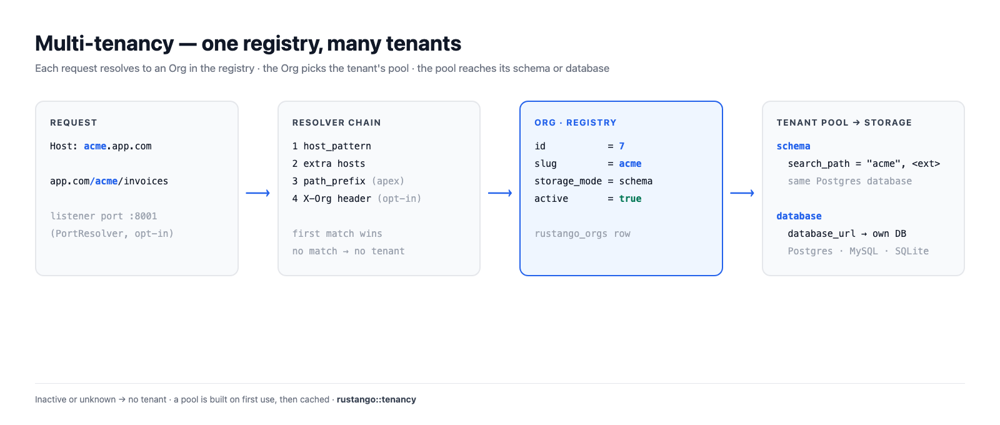
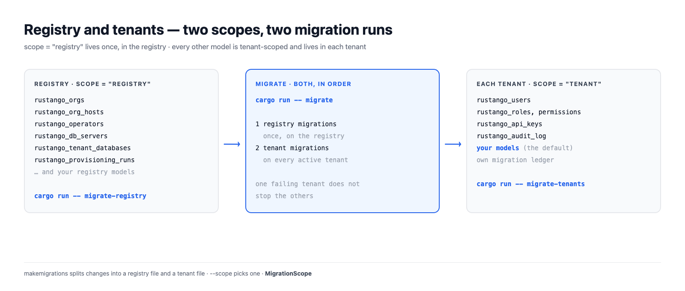

# Multi-tenancy

One rustango app can serve many customers. Each customer is a **tenant**: an
`Org` row in the **registry** database. A request is matched to its tenant,
and the tenant's data lives in its own schema or its own database.

This page explains how the parts fit together. For the steps, see
[the operator console](operator-console.md), [the `manage` CLI](manage.md#tenancy-commands)
and [tenant databases on a saved server](tenant-databases.md).

[](img/tenancy.png)

## Table of contents

- [Registry and tenant](#registry-and-tenant)
- [How a request finds its tenant](#how-a-request-finds-its-tenant)
- [Two ways to reach a tenant](#two-ways-to-reach-a-tenant)
- [Storage modes](#storage-modes)
- [Pools](#pools)
- [Migrations](#migrations)
- [Credentials and caches bind to the org id](#credentials-and-caches-bind-to-the-org-id)
- [Lifecycle](#lifecycle)

## Registry and tenant

The **registry** is the one database the app knows at boot (`DATABASE_URL`).
It holds what is shared by the whole deployment:

- `rustango_orgs`: one row per tenant, with its slug, storage mode,
  database URL, host, path prefix, port and active flag;
- `rustango_org_hosts`: extra hostnames bound to a tenant;
- `rustango_operators`: the people who run the deployment;
- `rustango_db_servers` and `rustango_tenant_databases`: saved servers and
  the databases rustango made on them;
- `rustango_provisioning_runs` and their events, shared SSO providers,
  operator TOTP devices.

Everything else lives **per tenant**: `rustango_users`, roles and
permissions, `rustango_api_keys`, the audit log, and your own models.

A model says where it lives with `scope`. `tenant` is the default, so you
only write `scope = "registry"` for shared tables:

```rust
use rustango::sql::Auto;
use rustango::Model;

// One shared table, in the registry.
#[derive(Model)]
#[rustango(table = "billing_plans", scope = "registry")]
pub struct BillingPlan {
    #[rustango(primary_key)]
    pub id: Auto<i64>,
    #[rustango(max_length = 64)]
    pub name: String,
}

// No scope: `tenant` is the default. Each tenant has its own table.
#[derive(Model)]
#[rustango(table = "invoices")]
pub struct Invoice {
    #[rustango(primary_key)]
    pub id: Auto<i64>,
    pub total_cents: i64,
}
```

Operators and tenant users never mix. Operators live in the registry and
sign in on the apex domain. Tenant users live in their tenant and never see
the console.

[](img/tenancy-registry.png)

## How a request finds its tenant

A **resolver** turns a request into an `Org`. The server tries a chain of
resolvers in order, and the first match wins:

1. **Host.** The `Host` header equals the tenant's `host_pattern`, for
   example `acme.app.com`. The match is exact. When you give no host,
   `create-tenant` sets `<slug>.<apex>`, but only when there is no
   `--path-prefix` and the apex is set.
2. **Extra hosts.** A hostname bound to the tenant in
   `rustango_org_hosts`. It never beats another tenant's own host.
3. **Path prefix, on the apex only.** `app.com/acme/...` matches the tenant
   whose `path_prefix` is `/acme`. On any other host the path picks no
   tenant.
4. **Header (opt-in).** `Builder::header_resolver` adds an `X-Org` style
   header after the others. Pair it with `HeaderResolver::allow_only`: the
   client chooses the header value.

Only **active** tenants match. The bare apex (`RUSTANGO_APEX_DOMAIN`)
resolves to no tenant: it serves the operator console. The apex plus a path
prefix does resolve, and so does an apex request with the `X-Org` header when
`HeaderResolver` is on. A request that
matches no tenant gets a 404 from the tenant routes, or goes to
[`unresolved_tenant`](operator-console.md#unknown-hosts) if you set one.

**Port.** The built-in server (`Builder::serve`, `run-server`) has no port
routing, and no way to add `PortResolver` to its chain. A tenant reachable
only by its port is not reached there. `PortResolver` (it reads the
listener's port, never the client's URI) works only in a chain you build and
serve yourself.

A tenant with no host, no path prefix and no port is **unroutable**, and it
is refused: by `create-tenant`, by the console, and by an edit that changes
routing.

Resolutions are cached for 30 seconds. Another server sees a change to
`rustango_orgs` within two fingerprint polls (`RUSTANGO_HOST_GEN_CHECK_SECS`,
default 5 seconds), and never later than the 30-second cache.

In a handler, take `TenantScope` (holds no connection) or `Tenant` (holds
one connection for the request):

```rust
use axum::http::StatusCode;
use rustango::extractors::TenantScope;
use rustango::sql::CounterPool as _;

async fn invoice_count(t: TenantScope) -> Result<String, StatusCode> {
    // `t.org` is the Org the resolver found. `t.pool()` is its pool.
    let n = Invoice::objects()
        .count(t.pool())
        .await
        .map_err(|_| StatusCode::INTERNAL_SERVER_ERROR)?;
    Ok(format!("{}: {n} invoices", t.org.slug))
}
```

## Two ways to reach a tenant

| Reach | Example | Cookie `Path` |
|---|---|---|
| The tenant's own host | `acme.app.com/admin` | `/` |
| The apex plus its path prefix | `app.com/acme/admin` | `/acme` |

On its own host a tenant has the host to itself, so cookies use `Path=/`.
Browsers keep cookies apart by host.

Under a path prefix many tenants share the apex host. So the tenant's
cookies use `Path=/<prefix>`, and `/acme`'s cookies are not sent to
`/acmecorp`. Links and redirects in the tenant admin carry the prefix too.

Host routing is the stronger choice for production. Path prefixes are handy
in development, where you have one host.

Path-prefix tenants also share the apex origin with the operator console. A
script on a tenant page then runs on the console's origin and can act there as
a signed-in operator, or in another prefix tenant's admin. The server warns at
boot when it serves both. In production, give tenants their own hosts, or keep
operators off tenant pages in the browser they use for the console.

## Storage modes

Each tenant has a `storage_mode`: `schema` or `database`.

[](img/tenancy-storage-modes.png)

### Schema mode (Postgres only)

All tenants share the registry's Postgres database. Each tenant has its own
schema, named after the slug unless you set `schema_name`. A tenant
connection's `search_path` is:

1. the tenant's schema;
2. then each schema that holds only extensions, so extension types and
   functions still work.

`public` is on the path only when an extension lives there. Any other schema
joins only when it holds nothing but extension objects and no org names it,
so other tenants' schemas never appear on the path.

A tenant pool **refuses to open** when:

- the schema is missing (run `migrate-tenants` for it);
- the schema has the name of a database role, whose sessions would see it
  first;
- an extension schema on the path, such as `public`, holds a tenant table
  the tenant's schema lacks. Queries would read that table instead.

An extension in the tenant's own schema is fine: that schema is first on
the path. An extension in another tenant's schema, or in a schema with
objects of its own, stays off the path, with a warning. Move it with
`ALTER EXTENSION <name> SET SCHEMA public`.

On MySQL and SQLite, schema mode is refused with a message that points to
database mode.

### Database mode (Postgres, MySQL, SQLite)

Each tenant has its own database. `database_url` holds the connection: a
literal URL, an `env://VAR` reference, or a sealed `enc:v1:` value. There
are two ways to get one:

- bring an existing database URL;
- let rustango create the database and a login of its own on a saved
  server. See [tenant databases on a saved server](tenant-databases.md).

A tenant uses the registry's backend.

### Which one to choose

| | Schema mode | Database mode |
|---|---|---|
| Backends | Postgres | Postgres, MySQL, SQLite |
| Isolation | schemas in one database, one login | a database each, and its own login on a saved server |
| Connections | to the registry server | per tenant database |
| Backup and restore | the whole database | per tenant |
| Good for | many small tenants | fewer, larger or regulated tenants |

You choose per tenant, so one deployment can have both.

```bash
cargo run -- create-tenant acme                                  # schema mode, on a Postgres registry
cargo run -- create-tenant globex --server main                  # database mode, created on a saved server
cargo run -- create-tenant initech --mode database --database-url "postgres://..."
```

## Pools

`TenantPools` hands out a pool per tenant. What it does:

- **Built on first use.** The first request for a tenant resolves its URL
  and connects. Many requests for a cold tenant share one build.
- **Cached and capped.** Up to 64 database-mode pools and 64 schema-mode
  pools, counted apart. Past the cap the least recently used tenant is
  evicted and reconnects on its next request.
- **Two per tenant on Postgres.** One for queries (`t.pool()`), one for the
  connection a `Tenant` extractor holds, so a held connection never waits on
  the queries.
- **Rebuilt on change.** A pool remembers the URL or schema it was built
  from. When the `Org` names another one, the next request builds a new pool.
- **Tagged.** A database-mode Postgres connection carries
  `application_name=rustango-tenant:<org id>`, so a purge can end its
  sessions. Schema-mode pools are not tagged.

Defaults: 16 connections per database-mode pool, 8 per schema-mode pool,
no idle connections kept warm, idle timeout 10 minutes, max lifetime
30 minutes, acquire timeout 30 seconds.

Connections multiply by tenant and by process. Size them with
`Builder::tenant_pools`:

```rust
use rustango::sql::sqlx::Database;
use rustango::tenancy::TenantPoolsConfig;

fn sized<DB: Database>(b: rustango::server::Builder<DB>) -> rustango::server::Builder<DB> {
    b.tenant_pools(TenantPoolsConfig {
        max_cached_database_pools: 200,
        database_pool_max_connections: 4,
        ..Default::default()
    })
}
```

To open every active database-mode tenant's pool up front, run
[`prewarm-pools`](manage.md#prewarm-pools), use the console button, or set
`prewarm_active_tenants: true`.

Cold pool builds are bounded: at most 16 at once (`max_concurrent_pool_builds`)
and 600 a minute (`max_pool_builds_per_minute`); past either a request gets a
503 with `Retry-After`. `0` lifts a limit.

## Migrations

Each migration file has a scope, `registry` or `tenant`. `makemigrations` in
a tenancy project writes the two kinds into separate files; `--scope` picks
one. See [migrations](migrations.md).

| Command | What it runs |
|---|---|
| `migrate` | registry migrations, then tenant migrations on every active tenant |
| [`migrate-registry`](manage.md#migrate-registry) | registry migrations, on the registry only |
| [`migrate-tenants`](manage.md#migrate-tenants) | tenant migrations, on every active tenant |

```bash
cargo run -- makemigrations
cargo run -- migrate
```

Each tenant has its own migration ledger, in its schema or database. A
tenant that fails does not stop the others; the command reports each
tenant at the end. In schema mode `public` is added at the end of the path
while the tenant migrates, and the strict path checks run after.

The tenancy server never migrates on boot. Run `migrate` as a deploy step.
The console can migrate one tenant; `migrate-tenants` takes no slug.

## Credentials and caches bind to the org id

A slug can come back. Purge `acme`, then create a new `acme`: it gets a new
row, so a new `id`. rustango binds tenant state to a `TenantSlug`, which is
the org id **plus** the slug. So the new `acme` gets none of the old one's
state.

[](img/tenancy-identity.png)

What carries it:

- the tenant session cookie and the impersonation handoff token;
- JWTs: the `tenant` and `org_id` claims must both match;
- HMAC signing keys and MCP agent keys bound to a tenant;
- `CacheScope::for_tenant`, the page cache, idempotency keys and
  `CacheScope::locks`, all keyed `#org:<id>:<slug>`;
- password-reset and verify links.

Tenant API keys and users live in the tenant's own storage, which a purge
drops. An `Org` with no id (one not read from the registry) has no
`TenantSlug`, and authentication refuses it.

```rust
use rustango::cache::{BoxedCache, CacheScope};
use rustango::extractors::TenantScope;
use rustango::tenancy::TenantSlug;

fn tenant_cache(cache: BoxedCache, t: &TenantScope) -> Option<BoxedCache> {
    // `None` only for an Org that was not read from the registry.
    let tenant = TenantSlug::of(&t.org)?;
    Some(CacheScope::for_tenant(cache, &tenant).app())
}
```

More in [caching under multi-tenancy](caching.md#caching-under-multi-tenancy).

## Lifecycle

| Step | Console | CLI |
|---|---|---|
| Create | **Organizations → New tenant** | `create-tenant <slug>` |
| Edit routing, URL, branding | **Organizations → Edit** | `edit-tenant <slug>` |
| Suspend (keeps the data) | **Deactivate** on the tenant's page | `drop-tenant <slug>` or `edit-tenant <slug> --deactivate` |
| Bring back | the tenant's edit page | `edit-tenant <slug> --activate` |
| Purge (no undo) | **Purge** | `purge-tenant <slug>`, plus `--purge-database` in database mode |

A suspended tenant does not resolve, so its hosts get no tenant. Its slug
stays taken until a purge. A purge drops the schema or database, then the
`Org` row. On a saved server it also drops the tenant's login; see
[purge a tenant](tenant-databases.md#6-purge-a-tenant).

Details: [the operator console](operator-console.md) and
[tenancy commands](manage.md#tenancy-commands).
